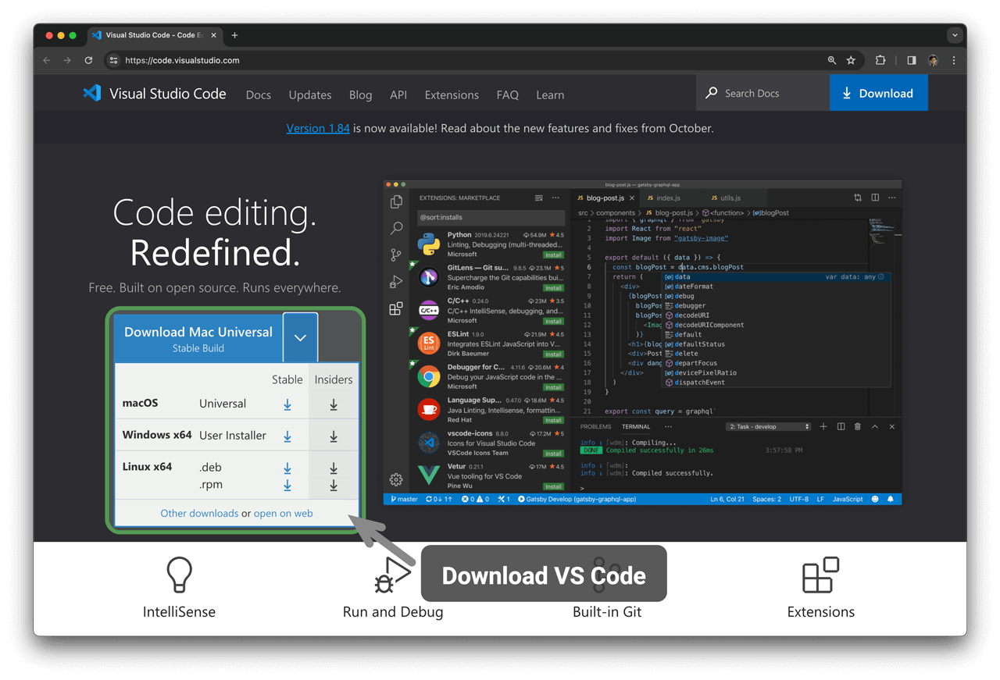

# Cài đặt môi trường lập trình

## Cài đặt IDE

Chúng tôi khuyến nghị sử dụng VS Code mã nguồn mở và nhẹ làm môi trường phát triển tích hợp (IDE) cục bộ. Truy cập [trang web chính thức của VS Code](https://code.visualstudio.com/), sau đó tải xuống và cài đặt phiên bản VS Code phù hợp với hệ điều hành của bạn.

VS Code có một hệ sinh thái extension mạnh mẽ, hỗ trợ chạy và debug hầu hết các ngôn ngữ lập trình. Ví dụ: sau khi cài đặt extension "Python Extension Pack", bạn có thể debug mã Python. Các bước cài đặt được minh họa trong hình sau.

## Cài đặt môi trường ngôn ngữ

### Môi trường Python

1. Tải xuống và cài đặt [Miniconda3](https://docs.conda.io/en/latest/miniconda.html) với Python 3.10 trở lên.
2. Tìm kiếm `python` trong marketplace extension của VS Code và cài đặt Python Extension Pack.
3. (Tùy chọn) Nhập `pip install black` trên dòng lệnh để cài đặt code formatter.

### Môi trường C/C++

1. Hệ thống Windows cần cài đặt [MinGW](https://sourceforge.net/projects/mingw-w64/files/) ([hướng dẫn cấu hình](https://blog.csdn.net/qq_33698226/article/details/129031241)); macOS được tích hợp sẵn Clang nên không cần cài đặt.
2. Tìm kiếm `c++` trong marketplace extension của VS Code và cài đặt C/C++ Extension Pack.
3. (Tùy chọn) Mở trang Settings, tìm tùy chọn định dạng mã `Clang_format_fallback Style` và đặt thành `{ BasedOnStyle: Microsoft, BreakBeforeBraces: Attach }`.

### Môi trường Java

1. Tải xuống và cài đặt [OpenJDK](https://jdk.java.net/18/) (phiên bản 10 trở lên).
2. Tìm kiếm `java` trong marketplace extension của VS Code và cài đặt Extension Pack for Java.

### Môi trường C#

1. Tải xuống và cài đặt [.NET 8.0](https://dotnet.microsoft.com/en-us/download).
2. Tìm kiếm `C# Dev Kit` trong marketplace extension của VS Code và cài đặt C# Dev Kit ([hướng dẫn cấu hình](https://code.visualstudio.com/docs/csharp/get-started)).
3. Bạn cũng có thể sử dụng Visual Studio ([hướng dẫn cài đặt](https://learn.microsoft.com/zh-cn/visualstudio/install/install-visual-studio?view=vs-2022)).

### Môi trường Go

1. Tải xuống và cài đặt [Go](https://go.dev/dl/).
2. Tìm kiếm `go` trong marketplace extension của VS Code và cài đặt Go.
3. Nhấn `Ctrl + Shift + P` để mở command palette, nhập `go`, chọn `Go: Install/Update Tools`, đánh dấu tất cả các tùy chọn và cài đặt.

### Môi trường Swift

1. Tải xuống và cài đặt [Swift](https://www.swift.org/download/).
2. Tìm kiếm `swift` trong marketplace extension của VS Code và cài đặt [Swift for Visual Studio Code](https://marketplace.visualstudio.com/items?itemName=sswg.swift-lang).

### Môi trường JavaScript

1. Tải xuống và cài đặt [Node.js](https://nodejs.org/en/).
2. (Tùy chọn) Tìm kiếm `Prettier` trong marketplace extension của VS Code và cài đặt code formatter.

### Môi trường TypeScript

1. Thực hiện các bước cài đặt giống như đối với môi trường JavaScript.
2. Cài đặt [TypeScript Execute (tsx)](https://github.com/privatenumber/tsx?tab=readme-ov-file#global-installation).
3. Tìm kiếm `typescript` trong marketplace extension của VS Code và cài đặt [Pretty TypeScript Errors](https://marketplace.visualstudio.com/items?itemName=yoavbls.pretty-ts-errors).

### Môi trường Dart

1. Tải xuống và cài đặt [Dart](https://dart.dev/get-dart).
2. Tìm kiếm `dart` trong marketplace extension của VS Code và cài đặt [Dart](https://marketplace.visualstudio.com/items?itemName=Dart-Code.dart-code).

### Môi trường Rust

1. Tải xuống và cài đặt [Rust](https://www.rust-lang.org/tools/install).
2. Tìm kiếm `rust` trong marketplace extension của VS Code và cài đặt [rust-analyzer](https://marketplace.visualstudio.com/items?itemName=rust-lang.rust-analyzer).