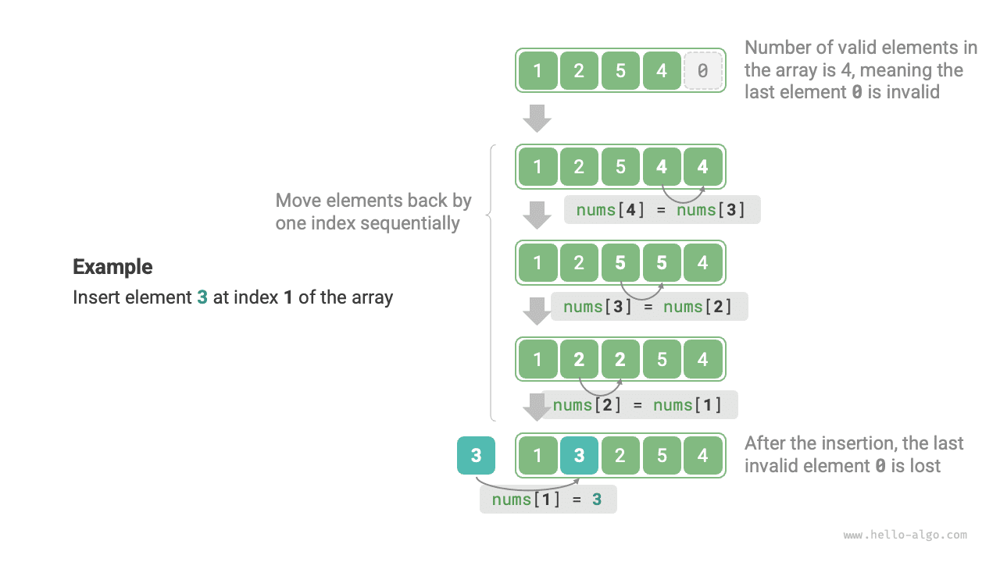

# Mảng

Một <u>array</u> là một cấu trúc dữ liệu tuyến tính lưu trữ các phần tử cùng kiểu trong vùng nhớ liên tiếp. Vị trí của một phần tử trong mảng được gọi là <u>index</u> của phần tử đó. Hình dưới đây minh họa các khái niệm chính và phương thức lưu trữ của mảng.


## Các thao tác mảng phổ biến

### Khởi tạo mảng

Tùy theo nhu cầu, chúng ta có thể chọn một trong hai phương thức khởi tạo mảng: có hoặc không có giá trị ban đầu. Khi không chỉ định giá trị ban đầu, hầu hết các ngôn ngữ lập trình sẽ khởi tạo các phần tử mảng bằng $0$:

=== "Python"

    ```python title="array.py"
    # Khởi tạo mảng
    arr: list[int] = [0] * 5  # [ 0, 0, 0, 0, 0 ]
    nums: list[int] = [1, 3, 2, 5, 4]
    ```

=== "C++"

    ```cpp title="array.cpp"
    /* Khởi tạo mảng */
    // Lưu trên stack
    int arr[5] = {};
    int nums[5] = { 1, 3, 2, 5, 4 };
    // Lưu trên heap (yêu cầu giải phóng bộ nhớ thủ công)
    int* arr1 = new int[5] {};
    int* nums1 = new int[5] { 1, 3, 2, 5, 4 };
    ```

=== "Java"

    ```java title="array.java"
    /* Khởi tạo mảng */
    int[] arr = new int[5]; // { 0, 0, 0, 0, 0 }
    int[] nums = { 1, 3, 2, 5, 4 };
    ```

=== "C#"

    ```csharp title="array.cs"
    /* Khởi tạo mảng */
    int[] arr = new int[5]; // [ 0, 0, 0, 0, 0 ]
    int[] nums = [1, 3, 2, 5, 4];
    ```

=== "Go"

    ```go title="array.go"
    /* Khởi tạo mảng */
    var arr [5]int
    // Trong Go, chỉ định độ dài ([5]int) sẽ tạo một mảng; không chỉ định độ dài ([]int) sẽ tạo một slice
    // Vì mảng của Go được thiết kế để có độ dài được xác định tại thời điểm biên dịch, chỉ các hằng số mới có thể được dùng để chỉ định độ dài
    // Để thuận tiện cho việc triển khai phương thức extend(), các slice bên dưới được xử lý như mảng
    nums := []int{1, 3, 2, 5, 4}
    ```

=== "Swift"

    ```swift title="array.swift"
    /* Khởi tạo mảng */
    let arr = Array(repeating: 0, count: 5) // [0, 0, 0, 0, 0]
    let nums = [1, 3, 2, 5, 4]
    ```

=== "JS"

    ```javascript title="array.js"
    /* Khởi tạo mảng */
    var arr = new Array(5).fill(0);
    var nums = [1, 3, 2, 5, 4];
    ```

=== "TS"

    ```typescript title="array.ts"
    /* Khởi tạo mảng */
    let arr: number[] = new Array(5).fill(0);
    let nums: number[] = [1, 3, 2, 5, 4];
    ```

=== "Dart"

    ```dart title="array.dart"
    /* Khởi tạo mảng */
    List<int> arr = List.filled(5, 0); // [0, 0, 0, 0, 0]
    List<int> nums = [1, 3, 2, 5, 4];
    ```

=== "Rust"

    ```rust title="array.rs"
    /* Khởi tạo mảng */
    let arr: [i32; 5] = [0; 5]; // [0, 0, 0, 0, 0]
    let slice: &[i32] = &[0; 5];
    // Trong Rust, chỉ định độ dài ([i32; 5]) sẽ tạo một mảng; không chỉ định độ dài (&[i32]) sẽ tạo một slice
    // Vì mảng của Rust được thiết kế để có độ dài được xác định tại thời điểm biên dịch, chỉ các hằng số mới có thể được dùng để chỉ định độ dài
    // Vector là kiểu thường được dùng làm mảng động trong Rust
    // Để thuận tiện cho việc triển khai phương thức extend(), các vector bên dưới được xử lý như mảng
    let nums: Vec<i32> = vec![1, 3, 2, 5, 4];
    ```

=== "C"

    ```c title="array.c"
    /* Khởi tạo mảng */
    int arr[5] = { 0 }; // { 0, 0, 0, 0, 0 }
    int nums[5] = { 1, 3, 2, 5, 4 };
    ```

=== "Kotlin"

    ```kotlin title="array.kt"
    /* Khởi tạo mảng */
    var arr = IntArray(5) // { 0, 0, 0, 0, 0 }
    var nums = intArrayOf(1, 3, 2, 5, 4)
    ```

=== "Ruby"

    ```ruby title="array.rb"
    # Khởi tạo mảng
    arr = Array.new(5, 0)
    nums = [1, 3, 2, 5, 4]
    ```

??? pythontutor "Trực quan hóa mã"

    https://pythontutor.com/render.html#code=%23%20%E5%88%9D%E5%A7%8B%E5%8C%96%E6%95%B0%E7%BB%84%0Aarr%20%3D%20%5B0%5D%20*%205%20%20%23%20%5B%200,%200,%200,%200,%200%20%5D%0Anums%20%3D%20%5B1,%203,%202,%205,%204%5D&cumulative=false&curInstr=0&heapPrimitives=nevernest&mode=display&origin=opt-frontend.js&py=311&rawInputLstJSON=%5B%5D&textReferences=false

### Truy cập các phần tử

Các phần tử mảng được lưu trữ trong vùng nhớ liên tiếp, nên việc tính địa chỉ bộ nhớ của các phần tử mảng rất đơn giản. Khi biết địa chỉ bộ nhớ của mảng (địa chỉ bộ nhớ của phần tử đầu tiên) và chỉ mục của một phần tử, chúng ta có thể sử dụng công thức trong hình dưới đây để tính địa chỉ bộ nhớ của phần tử đó và truy cập trực tiếp vào phần tử.


Quan sát hình trên, chúng ta thấy phần tử đầu tiên của mảng có chỉ mục là $0$, điều này có thể có vẻ ngược với trực giác vì việc bắt đầu đếm từ $1$ sẽ tự nhiên hơn. Tuy nhiên, xét từ góc độ công thức tính địa chỉ, **chỉ mục về bản chất là một độ lệch so với địa chỉ bộ nhớ**. Độ lệch địa chỉ của phần tử đầu tiên là $0$, vì vậy chỉ mục của nó bằng $0$ là hợp lý.

Việc truy cập các phần tử trong mảng rất hiệu quả; chúng ta có thể truy cập ngẫu nhiên bất kỳ phần tử nào trong mảng trong thời gian $O(1)$.

```src
[file]{array}-[class]{}-[func]{random_access}
```

### Chèn phần tử

Các phần tử mảng được xếp sát nhau trong bộ nhớ, không có khoảng trống thừa giữa chúng để chứa dữ liệu bổ sung. Như trong hình dưới đây, nếu muốn chèn một phần tử vào giữa mảng, chúng ta cần dịch chuyển tất cả các phần tử phía sau sang phải một vị trí, sau đó gán giá trị tại chỉ mục đó.



Cần lưu ý rằng vì độ dài của mảng là cố định, việc chèn một phần tử chắc chắn sẽ đẩy phần tử cuối cùng ra khỏi mảng. Chúng ta sẽ để lại cách giải quyết vấn đề này để thảo luận trong chương "List".

```src
[file]{array}-[class]{}-[func]{insert}
```

### Xóa phần tử

Tương tự, như trong hình dưới đây, để xóa phần tử tại chỉ mục $i$, chúng ta cần dịch chuyển tất cả các phần tử sau chỉ mục $i$ về phía trước một vị trí.


Lưu ý rằng sau khi hoàn tất việc xóa, phần tử cuối cùng ban đầu không còn ý nghĩa, nên chúng ta không cần sửa đổi rõ ràng phần tử đó.

```src
[file]{array}-[class]{}-[func]{remove}
```

Nhìn chung, các thao tác chèn và xóa trong mảng có những nhược điểm sau:

- **Độ phức tạp thời gian cao**: Độ phức tạp thời gian trung bình của cả thao tác chèn và xóa trong mảng là $O(n)$, trong đó $n$ là độ dài của mảng.
- **Mất phần tử**: Vì độ dài của mảng là bất biến, sau khi chèn một phần tử, các phần tử vượt quá độ dài của mảng sẽ bị mất.
- **Lãng phí bộ nhớ**: Chúng ta có thể khởi tạo một mảng tương đối dài và chỉ sử dụng phần đầu, khiến các phần tử ở phần đuôi bị ghi đè chỉ đóng vai trò là các vị trí giữ chỗ không được sử dụng, nhưng điều này gây lãng phí một phần bộ nhớ.

### Duyệt mảng

Trong hầu hết các ngôn ngữ lập trình, chúng ta có thể duyệt mảng bằng chỉ mục hoặc lặp trực tiếp qua từng phần tử trong mảng:

```src
[file]{array}-[class]{}-[func]{traverse}
```

### Tìm kiếm phần tử

Để tìm một phần tử được chỉ định trong mảng, cần duyệt qua mảng và kiểm tra xem giá trị phần tử có khớp trong mỗi lần lặp hay không; nếu khớp, xuất chỉ mục tương ứng.

Vì mảng là một cấu trúc dữ liệu tuyến tính, thao tác tìm kiếm nêu trên được gọi là "tìm kiếm tuyến tính".

```src
[file]{array}-[class]{}-[func]{find}
```

### Mở rộng mảng

Trong các môi trường hệ thống phức tạp, chương trình không thể đảm bảo vùng nhớ sau mảng còn trống, khiến việc mở rộng dung lượng mảng trở nên không an toàn. Do đó, trong hầu hết các ngôn ngữ lập trình, **độ dài của mảng là bất biến**.

Nếu muốn mở rộng mảng, chúng ta cần tạo một mảng mới lớn hơn, sau đó sao chép lần lượt các phần tử của mảng ban đầu sang mảng mới. Đây là một thao tác $O(n)$, rất tốn thời gian khi mảng lớn. Mã được trình bày dưới đây:

```src
[file]{array}-[class]{}-[func]{extend}
```

## Ưu điểm và hạn chế của mảng

Mảng được lưu trữ trong vùng nhớ liên tiếp, với các phần tử cùng kiểu. Cách tiếp cận này chứa nhiều thông tin có sẵn mà hệ thống có thể sử dụng để tối ưu hiệu suất của các thao tác trên cấu trúc dữ liệu.

- **Hiệu quả sử dụng không gian cao**: Mảng cấp phát các khối bộ nhớ liên tiếp cho dữ liệu mà không có chi phí bổ sung cho cấu trúc.
- **Hỗ trợ truy cập ngẫu nhiên**: Mảng cho phép truy cập bất kỳ phần tử nào trong thời gian $O(1)$.
- **Tính cục bộ của cache**: Khi truy cập các phần tử mảng, máy tính không chỉ tải phần tử đó mà còn lưu vào cache dữ liệu xung quanh, qua đó tận dụng cache để cải thiện tốc độ thực thi của các thao tác tiếp theo.

Việc lưu trữ trong vùng nhớ liên tiếp cũng có những hạn chế sau:

- **Hiệu quả chèn và xóa thấp**: Khi mảng có nhiều phần tử, các thao tác chèn và xóa yêu cầu dịch chuyển một số lượng lớn phần tử.
- **Độ dài bất biến**: Sau khi được khởi tạo, độ dài của mảng là cố định. Việc mở rộng mảng yêu cầu sao chép toàn bộ dữ liệu sang một mảng mới, gây tốn kém đáng kể.
- **Lãng phí không gian**: Nếu kích thước được cấp phát cho mảng lớn hơn nhu cầu thực tế, phần không gian dư thừa sẽ bị lãng phí.

## Các ứng dụng điển hình của mảng

Mảng là một cấu trúc dữ liệu nền tảng và phổ biến, thường xuyên được sử dụng trong nhiều thuật toán cũng như để triển khai nhiều cấu trúc dữ liệu phức tạp.

- **Truy cập ngẫu nhiên**: Nếu muốn lấy mẫu ngẫu nhiên một số phần tử, chúng ta có thể sử dụng một mảng để lưu trữ chúng và tạo một chuỗi ngẫu nhiên nhằm thực hiện việc lấy mẫu ngẫu nhiên dựa trên các chỉ số.
- **Sắp xếp và tìm kiếm**: Mảng là cấu trúc dữ liệu được sử dụng phổ biến nhất cho các thuật toán sắp xếp và tìm kiếm. Quick sort, merge sort, binary search và các thuật toán khác chủ yếu được thực hiện trên mảng.
- **Bảng tra cứu**: Khi cần nhanh chóng tìm một phần tử hoặc mối quan hệ tương ứng của nó, chúng ta có thể sử dụng mảng làm bảng tra cứu. Ví dụ, nếu muốn triển khai ánh xạ từ ký tự sang mã ASCII, chúng ta có thể sử dụng giá trị mã ASCII của một ký tự làm chỉ số, đồng thời lưu phần tử tương ứng tại vị trí đó trong mảng.
- **Machine learning**: Mạng neural sử dụng rộng rãi các phép toán đại số tuyến tính giữa vector, ma trận và tensor; tất cả đều được xây dựng dưới dạng mảng. Mảng là cấu trúc dữ liệu được sử dụng phổ biến nhất trong lập trình mạng neural.
- **Triển khai cấu trúc dữ liệu**: Mảng có thể được sử dụng để triển khai stack, queue, bảng băm, heap, đồ thị và các cấu trúc dữ liệu khác. Ví dụ, biểu diễn ma trận kề của một đồ thị về bản chất là một mảng hai chiều.