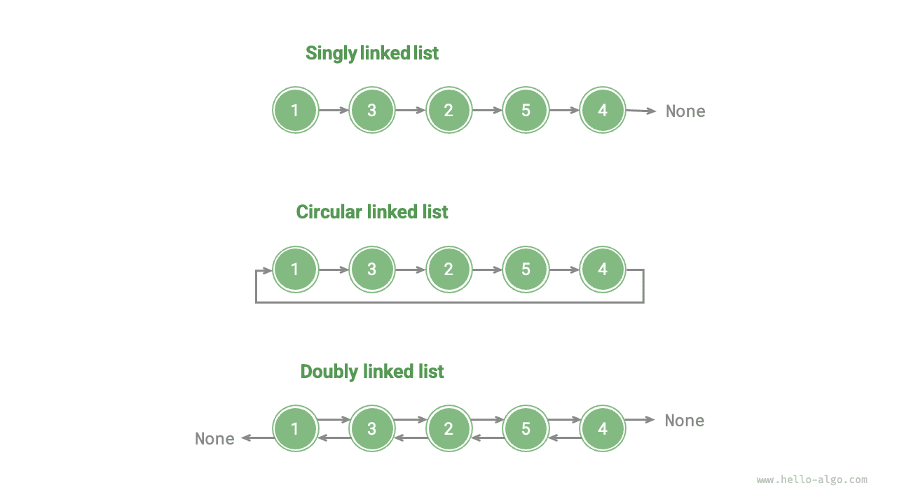

# Danh sách liên kết

Bộ nhớ là tài nguyên dùng chung cho tất cả chương trình. Trong một môi trường runtime phức tạp, bộ nhớ trống có thể bị phân tán trong toàn bộ không gian địa chỉ. Ta biết rằng mảng yêu cầu vùng nhớ liên tục, và khi mảng có kích thước rất lớn, hệ thống có thể không cung cấp được một khối vùng nhớ liên tục lớn như vậy. Đây là lúc tính linh hoạt của danh sách liên kết phát huy tác dụng.

<u>danh sách liên kết</u> là một cấu trúc dữ liệu tuyến tính, trong đó mỗi phần tử là một đối tượng node và các node được kết nối với nhau thông qua các "reference". Một reference lưu địa chỉ bộ nhớ của node tiếp theo, nhờ đó có thể truy cập node tiếp theo từ node hiện tại.

Thiết kế này cho phép các node của danh sách liên kết được lưu tại những vị trí khác nhau trong bộ nhớ, và địa chỉ của chúng không cần liên tục.


Quan sát hình trên, đơn vị cơ bản của danh sách liên kết là một đối tượng <u>node</u>. Mỗi node chứa hai phần dữ liệu: "value" của node và một "reference" trỏ đến node tiếp theo.

- Node đầu tiên của danh sách liên kết được gọi là "head node", còn node cuối cùng được gọi là "tail node".
- Tail node trỏ đến "null", lần lượt được biểu diễn là `null`, `nullptr` và `None` trong Java, C++ và Python.
- Trong các ngôn ngữ hỗ trợ pointer, chẳng hạn như C, C++, Go và Rust, "reference" nói trên nên được thay thế bằng "pointer".

Như thể hiện trong đoạn mã sau, một node của danh sách liên kết `ListNode` không chỉ chứa một value mà còn chứa thêm một reference (pointer). Do đó, **danh sách liên kết chiếm nhiều vùng nhớ hơn mảng khi lưu trữ cùng một lượng dữ liệu**.

=== "Python"

    ```python title=""
    class ListNode:
        """Lớp node của danh sách liên kết"""
        def __init__(self, val: int):
            self.val: int = val               # Giá trị của node
            self.next: ListNode | None = None # Reference đến node tiếp theo
    ```

=== "C++"

    ```cpp title=""
    /* Cấu trúc node của danh sách liên kết */
    struct ListNode {
        int val;         // Giá trị của node
        ListNode *next;  // Pointer đến node tiếp theo
        ListNode(int x) : val(x), next(nullptr) {}  // Hàm khởi tạo
    };
    ```

=== "Java"

    ```java title=""
    /* Lớp node của danh sách liên kết */
    class ListNode {
        int val;        // Giá trị của node
        ListNode next;  // Reference đến node tiếp theo
        ListNode(int x) { val = x; }  // Hàm khởi tạo
    }
    ```

=== "C#"

    ```csharp title=""
    /* Lớp node của danh sách liên kết */
    class ListNode(int x) {  // Hàm khởi tạo
        int val = x;         // Giá trị của node
        ListNode? next;      // Reference đến node tiếp theo
    }
    ```

=== "Go"

    ```go title=""
    /* Cấu trúc node của danh sách liên kết */
    type ListNode struct {
        Val  int       // Giá trị của node
        Next *ListNode // Pointer đến node tiếp theo
    }

    // Hàm khởi tạo NewListNode, tạo một danh sách liên kết mới
    func NewListNode(val int) *ListNode {
        return &ListNode{
            Val:  val,
            Next: nil,
        }
    }
    ```

=== "Swift"

    ```swift title=""
    /* Lớp node của danh sách liên kết */
    class ListNode {
        var val: Int // Giá trị của node
        var next: ListNode? // Reference đến node tiếp theo

        init(x: Int) { // Hàm khởi tạo
            val = x
        }
    }
    ```

=== "JS"

    ```javascript title=""
    /* Lớp node của danh sách liên kết */
    class ListNode {
        constructor(val, next) {
            this.val = (val === undefined ? 0 : val);       // Giá trị của node
            this.next = (next === undefined ? null : next); // Reference đến node tiếp theo
        }
    }
    ```

=== "TS"

    ```typescript title=""
    /* Lớp node của danh sách liên kết */
    class ListNode {
        val: number;
        next: ListNode | null;
        constructor(val?: number, next?: ListNode | null) {
            this.val = val === undefined ? 0 : val;        // Giá trị của node
            this.next = next === undefined ? null : next;  // Reference đến node tiếp theo
        }
    }
    ```

=== "Dart"

    ```dart title=""
    /* Lớp node của danh sách liên kết */
    class ListNode {
      int val; // Giá trị của node
      ListNode? next; // Reference đến node tiếp theo
      ListNode(this.val, [this.next]); // Hàm khởi tạo
    }
    ```

=== "Rust"

    ```rust title=""
    use std::rc::Rc;
    use std::cell::RefCell;
    /* Lớp node của danh sách liên kết */
    #[derive(Debug)]
    struct ListNode {
        val: i32, // Giá trị của node
        next: Option<Rc<RefCell<ListNode>>>, // Pointer đến node tiếp theo
    }
    ```

=== "C"

    ```c title=""
    /* Cấu trúc node của danh sách liên kết */
    typedef struct ListNode {
        int val;               // Giá trị của node
        struct ListNode *next; // Pointer đến node tiếp theo
    } ListNode;

    /* Hàm khởi tạo */
    ListNode *newListNode(int val) {
        ListNode *node;
        node = (ListNode *) malloc(sizeof(ListNode));
        node->val = val;
        node->next = NULL;
        return node;
    }
    ```

=== "Kotlin"

    ```kotlin title=""
    /* Lớp node của danh sách liên kết */
    // Hàm khởi tạo
    class ListNode(x: Int) {
        val _val: Int = x          // Giá trị của node
        var next: ListNode? = null // Reference đến node tiếp theo
    }
    ```

=== "Ruby"

    ```ruby title=""
    # Lớp node của danh sách liên kết
    class ListNode
      attr_accessor :val  # Giá trị của node
      attr_accessor :next # Reference đến node tiếp theo

      def initialize(val=0, next_node=nil)
        @val = val
        @next = next_node
      end
    end
    ```

## Các thao tác phổ biến với danh sách liên kết

### Khởi tạo danh sách liên kết

Việc xây dựng một danh sách liên kết gồm hai bước: trước tiên, khởi tạo từng đối tượng node; sau đó, thiết lập các mối quan hệ reference giữa các node. Sau khi hoàn tất khởi tạo, ta có thể duyệt qua tất cả node, bắt đầu từ head node của danh sách liên kết, thông qua reference `next`.

=== "Python"

    ```python title="linked_list.py"
    # Khởi tạo danh sách liên kết 1 -> 3 -> 2 -> 5 -> 4
    # Khởi tạo từng node
    n0 = ListNode(1)
    n1 = ListNode(3)
    n2 = ListNode(2)
    n3 = ListNode(5)
    n4 = ListNode(4)
    # Thiết lập reference giữa các node
    n0.next = n1
    n1.next = n2
    n2.next = n3
    n3.next = n4
    ```

=== "C++"

    ```cpp title="linked_list.cpp"
    /* Khởi tạo danh sách liên kết 1 -> 3 -> 2 -> 5 -> 4 */
    // Khởi tạo từng node
    ListNode* n0 = new ListNode(1);
    ListNode* n1 = new ListNode(3);
    ListNode* n2 = new ListNode(2);
    ListNode* n3 = new ListNode(5);
    ListNode* n4 = new ListNode(4);
    // Thiết lập reference giữa các node
    n0->next = n1;
    n1->next = n2;
    n2->next = n3;
    n3->next = n4;
    ```

=== "Java"

    ```java title="linked_list.java"
    /* Khởi tạo danh sách liên kết 1 -> 3 -> 2 -> 5 -> 4 */
    // Khởi tạo từng node
    ListNode n0 = new ListNode(1);
    ListNode n1 = new ListNode(3);
    ListNode n2 = new ListNode(2);
    ListNode n3 = new ListNode(5);
    ListNode n4 = new ListNode(4);
    // Thiết lập reference giữa các node
    n0.next = n1;
    n1.next = n2;
    n2.next = n3;
    n3.next = n4;
    ```

=== "C#"

    ```csharp title="linked_list.cs"
    /* Khởi tạo danh sách liên kết 1 -> 3 -> 2 -> 5 -> 4 */
    // Khởi tạo từng node
    ListNode n0 = new(1);
    ListNode n1 = new(3);
    ListNode n2 = new(2);
    ListNode n3 = new(5);
    ListNode n4 = new(4);
    // Thiết lập reference giữa các node
    n0.next = n1;
    n1.next = n2;
    n2.next = n3;
    n3.next = n4;
    ```

=== "Go"

    ```go title="linked_list.go"
    /* Khởi tạo danh sách liên kết 1 -> 3 -> 2 -> 5 -> 4 */
    // Khởi tạo từng node
    n0 := NewListNode(1)
    n1 := NewListNode(3)
    n2 := NewListNode(2)
    n3 := NewListNode(5)
    n4 := NewListNode(4)
    // Thiết lập reference giữa các node
    n0.Next = n1
    n1.Next = n2
    n2.Next = n3
    n3.Next = n4
    ```

=== "Swift"

    ```swift title="linked_list.swift"
    /* Khởi tạo danh sách liên kết 1 -> 3 -> 2 -> 5 -> 4 */
    // Khởi tạo từng node
    let n0 = ListNode(x: 1)
    let n1 = ListNode(x: 3)
    let n2 = ListNode(x: 2)
    let n3 = ListNode(x: 5)
    let n4 = ListNode(x: 4)
    // Thiết lập reference giữa các node
    n0.next = n1
    n1.next = n2
    n2.next = n3
    n3.next = n4
    ```

=== "JS"

    ```javascript title="linked_list.js"
    /* Khởi tạo danh sách liên kết 1 -> 3 -> 2 -> 5 -> 4 */
    // Khởi tạo từng node
    const n0 = new ListNode(1);
    const n1 = new ListNode(3);
    const n2 = new ListNode(2);
    const n3 = new ListNode(5);
    const n4 = new ListNode(4);
    // Thiết lập reference giữa các node
    n0.next = n1;
    n1.next = n2;
    n2.next = n3;
    n3.next = n4;
    ```

=== "TS"

    ```typescript title="linked_list.ts"
    /* Khởi tạo danh sách liên kết 1 -> 3 -> 2 -> 5 -> 4 */
    // Khởi tạo từng node
    const n0 = new ListNode(1);
    const n1 = new ListNode(3);
    const n2 = new ListNode(2);
    const n3 = new ListNode(5);
    const n4 = new ListNode(4);
    // Thiết lập reference giữa các node
    n0.next = n1;
    n1.next = n2;
    n2.next = n3;
    n3.next = n4;
    ```

=== "Dart"

    ```dart title="linked_list.dart"
    /* Khởi tạo danh sách liên kết 1 -> 3 -> 2 -> 5 -> 4 */\
    // Khởi tạo từng node
    ListNode n0 = ListNode(1);
    ListNode n1 = ListNode(3);
    ListNode n2 = ListNode(2);
    ListNode n3 = ListNode(5);
    ListNode n4 = ListNode(4);
    // Thiết lập reference giữa các node
    n0.next = n1;
    n1.next = n2;
    n2.next = n3;
    n3.next = n4;
    ```

=== "Rust"

    ```rust title="linked_list.rs"
    /* Khởi tạo danh sách liên kết 1 -> 3 -> 2 -> 5 -> 4 */
    // Khởi tạo từng nút
    let n0 = Rc::new(RefCell::new(ListNode { val: 1, next: None }));
    let n1 = Rc::new(RefCell::new(ListNode { val: 3, next: None }));
    let n2 = Rc::new(RefCell::new(ListNode { val: 2, next: None }));
    let n3 = Rc::new(RefCell::new(ListNode { val: 5, next: None }));
    let n4 = Rc::new(RefCell::new(ListNode { val: 4, next: None }));

    // Xây dựng các tham chiếu giữa các nút
    n0.borrow_mut().next = Some(n1.clone());
    n1.borrow_mut().next = Some(n2.clone());
    n2.borrow_mut().next = Some(n3.clone());
    n3.borrow_mut().next = Some(n4.clone());
    ```

=== "C"

    ```c title="linked_list.c"
    /* Khởi tạo danh sách liên kết 1 -> 3 -> 2 -> 5 -> 4 */
    // Khởi tạo từng nút
    ListNode* n0 = newListNode(1);
    ListNode* n1 = newListNode(3);
    ListNode* n2 = newListNode(2);
    ListNode* n3 = newListNode(5);
    ListNode* n4 = newListNode(4);
    // Xây dựng các tham chiếu giữa các nút
    n0->next = n1;
    n1->next = n2;
    n2->next = n3;
    n3->next = n4;
    ```

=== "Kotlin"

    ```kotlin title="linked_list.kt"
    /* Khởi tạo danh sách liên kết 1 -> 3 -> 2 -> 5 -> 4 */
    // Khởi tạo từng nút
    val n0 = ListNode(1)
    val n1 = ListNode(3)
    val n2 = ListNode(2)
    val n3 = ListNode(5)
    val n4 = ListNode(4)
    // Xây dựng các tham chiếu giữa các nút
    n0.next = n1;
    n1.next = n2;
    n2.next = n3;
    n3.next = n4;
    ```

=== "Ruby"

    ```ruby title="linked_list.rb"
    # Khởi tạo danh sách liên kết 1 -> 3 -> 2 -> 5 -> 4
    # Khởi tạo từng nút
    n0 = ListNode.new(1)
    n1 = ListNode.new(3)
    n2 = ListNode.new(2)
    n3 = ListNode.new(5)
    n4 = ListNode.new(4)
    # Xây dựng các tham chiếu giữa các nút
    n0.next = n1
    n1.next = n2
    n2.next = n3
    n3.next = n4
    ```

??? pythontutor "Trực quan hóa mã"

    https://pythontutor.com/render.html#code=class%20ListNode%3A%0A%20%20%20%20%22%22%22%E9%93%BE%E8%A1%A8%E8%8A%82%E7%82%B9%E7%B1%BB%22%22%22%0A%20%20%20%20def%20__init__%28self,%20val%3A%20int%29%3A%0A%20%20%20%20%20%20%20%20self.val%3A%20int%20%3D%20val%20%20%23%20%E8%8A%82%E7%82%B9%E5%80%BC%0A%20%20%20%20%20%20%20%20self.next%3A%20ListNode%20%7C%20None%20%3D%20None%20%20%23%20%E5%90%8E%E7%BB%A7%E8%8A%82%E7%82%B9%E5%BC%95%E7%94%A8%0A%0A%22%22%22Driver%20Code%22%22%22%0Aif%20__name__%20%3D%3D%20%22__main__%22%3A%0A%20%20%20%20%23%20%E5%88%9D%E5%A7%8B%E5%8C%96%E9%93%BE%E8%A1%A8%201%20-%3E%203%20-%3E%202%20-%3E%205%20-%3E%204%0A%20%20%20%20%23%20%E5%88%9D%E5%A7%8B%E5%8C%96%E5%90%84%E4%B8%AA%E8%8A%82%E7%82%B9%0A%20%20%20%20n0%20%3D%20ListNode%281%29%0A%20%20%20%20n1%20%3D%20ListNode%283%29%0A%20%20%20%20n2%20%3D%20ListNode%282%29%0A%20%20%20%20n3%20%3D%20ListNode%285%29%0A%20%20%20%20n4%20%3D%20ListNode%284%29%0A%20%20%20%20%23%20%E6%9E%84%E5%BB%BA%E8%8A%82%E7%82%B9%E4%B9%8B%E9%97%B4%E7%9A%84%E5%BC%95%E7%94%A8%0A%20%20%20%20n0.next%20%3D%20n1%0A%20%20%20%20n1.next%20%3D%20n2%0A%20%20%20%20n2.next%20%3D%20n3%0A%20%20%20%20n3.next%20%3D%20n4&cumulative=false&curInstr=3&heapPrimitives=nevernest&mode=display&origin=opt-frontend.js&py=311&rawInputLstJSON=%5B%5D&textReferences=false

Một mảng là một biến duy nhất; ví dụ, một mảng `nums` chứa các phần tử `nums[0]`, `nums[1]`, v.v. Ngược lại, danh sách liên kết được cấu thành từ nhiều đối tượng nút độc lập. **Chúng ta thường dùng nút đầu làm đại diện cho toàn bộ danh sách liên kết**; ví dụ, danh sách liên kết trong đoạn mã trên có thể được gọi là danh sách liên kết `n0`.

### Chèn một nút

Việc chèn một nút vào danh sách liên kết rất đơn giản. Như minh họa trong hình bên dưới, giả sử chúng ta muốn chèn một nút mới `P` giữa hai nút liền kề `n0` và `n1`. **Chúng ta chỉ cần thay đổi hai tham chiếu nút (con trỏ)**, với độ phức tạp thời gian là $O(1)$.

Ngược lại, độ phức tạp thời gian của việc chèn một phần tử vào mảng là $O(n)$, không hiệu quả khi xử lý lượng dữ liệu lớn.


```src
[file]{linked_list}-[class]{}-[func]{insert}
```

### Xóa một nút

Như minh họa trong hình bên dưới, việc xóa một nút khỏi danh sách liên kết cũng rất thuận tiện. **Chúng ta chỉ cần thay đổi một tham chiếu nút (con trỏ)**.

Lưu ý rằng mặc dù nút `P` vẫn trỏ đến `n1` sau khi thao tác xóa hoàn tất, danh sách liên kết không còn có thể truy cập `P` khi duyệt nữa, điều đó có nghĩa là `P` không còn thuộc danh sách liên kết này.


```src
[file]{linked_list}-[class]{}-[func]{remove}
```

### Truy cập một nút

**Việc truy cập các nút trong danh sách liên kết kém hiệu quả hơn**. Như đã đề cập trong phần trước, chúng ta có thể truy cập bất kỳ phần tử nào trong mảng trong thời gian $O(1)$. Điều này không đúng với danh sách liên kết. Chương trình cần bắt đầu từ nút đầu và lần lượt duyệt qua các nút cho đến khi tìm thấy nút đích. Nói cách khác, việc truy cập nút thứ $i$ trong danh sách liên kết cần $i - 1$ lần lặp, với độ phức tạp thời gian là $O(n)$.

```src
[file]{linked_list}-[class]{}-[func]{access}
```

### Tìm một nút

Duyệt danh sách liên kết để tìm nút có giá trị `target`, rồi xuất chỉ mục của nút đó trong danh sách liên kết. Quá trình này cũng là một phép tìm kiếm tuyến tính. Mã được minh họa bên dưới:

```src
[file]{linked_list}-[class]{}-[func]{find}
```

## Mảng và danh sách liên kết

Bảng dưới đây tóm tắt các đặc điểm của mảng và danh sách liên kết, đồng thời so sánh hiệu quả hoạt động của chúng. Vì sử dụng hai chiến lược lưu trữ đối lập, các thuộc tính và hiệu quả hoạt động của chúng cũng thể hiện những đặc điểm tương phản.

<p align="center"> Bảng <id> &nbsp; So sánh hiệu quả của mảng và danh sách liên kết </p>

|                        | Mảng                                          | Danh sách liên kết       |
| ---------------------- | --------------------------------------------- | ------------------------ |
| Phương thức lưu trữ    | Vùng nhớ liên tục                             | Vùng nhớ rải rác         |
| Mở rộng dung lượng     | Độ dài không thể thay đổi                     | Mở rộng linh hoạt        |
| Hiệu quả bộ nhớ        | Các phần tử chiếm ít bộ nhớ hơn, nhưng không gian có thể bị lãng phí | Các phần tử chiếm nhiều bộ nhớ hơn |
| Truy cập một phần tử   | $O(1)$                                        | $O(n)$                   |
| Thêm một phần tử       | $O(n)$                                        | $O(1)$                   |
| Xóa một phần tử        | $O(n)$                                        | $O(1)$                   |

## Các loại danh sách liên kết phổ biến

Như minh họa trong hình bên dưới, có ba loại danh sách liên kết phổ biến:

- **Danh sách liên kết đơn**: Đây là danh sách liên kết thông thường đã được giới thiệu trước đó. Các nút của danh sách liên kết đơn chứa một giá trị và một tham chiếu đến nút tiếp theo. Chúng ta gọi nút đầu tiên là nút đầu và nút cuối cùng là nút đuôi; nút đuôi trỏ đến `None`.
- **Danh sách liên kết vòng**: Nếu cho nút đuôi của danh sách liên kết đơn trỏ đến nút đầu (nối đuôi với đầu), chúng ta sẽ có một danh sách liên kết vòng. Trong danh sách liên kết vòng, bất kỳ nút nào cũng có thể được xem là nút đầu.
- **Danh sách liên kết đôi**: So với danh sách liên kết đơn, danh sách liên kết đôi lưu các tham chiếu theo cả hai hướng. Định nghĩa nút của danh sách liên kết đôi bao gồm các tham chiếu đến cả nút kế tiếp (nút tiếp theo) và nút tiền nhiệm (nút trước đó). So với danh sách liên kết đơn, danh sách liên kết đôi linh hoạt hơn và có thể duyệt danh sách liên kết theo cả hai hướng, nhưng cũng cần nhiều không gian bộ nhớ hơn.

=== "Python"

    ```python title=""
    class ListNode:
        """Lớp nút danh sách liên kết đôi"""
        def __init__(self, val: int):
            self.val: int = val                # Giá trị nút
            self.next: ListNode | None = None  # Tham chiếu đến nút kế tiếp
            self.prev: ListNode | None = None  # Tham chiếu đến nút tiền nhiệm
    ```

=== "C++"

    ```cpp title=""
    /* Cấu trúc nút danh sách liên kết đôi */
    struct ListNode {
        int val;         // Giá trị nút
        ListNode *next;  // Con trỏ đến nút kế tiếp
        ListNode *prev;  // Con trỏ đến nút tiền nhiệm
        ListNode(int x) : val(x), next(nullptr), prev(nullptr) {}  // Hàm khởi tạo
    };
    ```

=== "Java"

    ```java title=""
    /* Lớp nút danh sách liên kết đôi */
    class ListNode {
        int val;        // Giá trị nút
        ListNode next;  // Tham chiếu đến nút kế tiếp
        ListNode prev;  // Tham chiếu đến nút tiền nhiệm
        ListNode(int x) { val = x; }  // Hàm khởi tạo
    }
    ```

=== "C#"

    ```csharp title=""
    class ListNode(int x) {  // Hàm khởi tạo
        int val = x;    // Giá trị nút
        ListNode next;  // Tham chiếu đến nút kế tiếp
        ListNode prev;  // Tham chiếu đến nút tiền nhiệm
    }
    ```

=== "Go"

    ```go title=""
    /* Cấu trúc nút danh sách liên kết đôi */
    type DoublyListNode struct {
        Val  int             // Giá trị nút
        Next *DoublyListNode // Con trỏ đến nút kế tiếp
        Prev *DoublyListNode // Con trỏ đến nút tiền nhiệm
    }

    // Khởi tạo NewDoublyListNode
    func NewDoublyListNode(val int) *DoublyListNode {
        return &DoublyListNode{
            Val:  val,
            Next: nil,
            Prev: nil,
        }
    }
    ```

=== "Swift"

    ```swift title=""
    /* Lớp nút danh sách liên kết đôi */
    class ListNode {
        var val: Int // Giá trị nút
        var next: ListNode? // Tham chiếu đến nút kế tiếp
        var prev: ListNode? // Tham chiếu đến nút tiền nhiệm

        init(x: Int) { // Hàm khởi tạo
            val = x
        }
    }
    ```

=== "JS"

    ```javascript title=""
    /* Lớp nút danh sách liên kết đôi */
    class ListNode {
        constructor(val, next, prev) {
            this.val = val  ===  undefined ? 0 : val;        // Giá trị nút
            this.next = next  ===  undefined ? null : next;  // Tham chiếu đến nút kế tiếp
            this.prev = prev  ===  undefined ? null : prev;  // Tham chiếu đến nút tiền nhiệm
        }
    }
    ```

=== "TS"

    ```typescript title=""
    /* Lớp nút danh sách liên kết đôi */
    class ListNode {
        val: number;
        next: ListNode | null;
        prev: ListNode | null;
        constructor(val?: number, next?: ListNode | null, prev?: ListNode | null) {
            this.val = val  ===  undefined ? 0 : val;        // Giá trị nút
            this.next = next  ===  undefined ? null : next;  // Tham chiếu đến nút kế tiếp
            this.prev = prev  ===  undefined ? null : prev;  // Tham chiếu đến nút trước đó
        }
    }
    ```

=== "Dart"

    ```dart title=""
    /* Lớp nút danh sách liên kết đôi */
    class ListNode {
        int val;        // Giá trị nút
        ListNode? next;  // Tham chiếu đến nút kế tiếp
        ListNode? prev;  // Tham chiếu đến nút trước đó
        ListNode(this.val, [this.next, this.prev]);  // Hàm khởi tạo
    }
    ```

=== "Rust"

    ```rust title=""
    use std::rc::Rc;
    use std::cell::RefCell;

    /* Kiểu nút danh sách liên kết đôi */
    #[derive(Debug)]
    struct ListNode {
        val: i32, // Giá trị nút
        next: Option<Rc<RefCell<ListNode>>>, // Con trỏ đến nút kế tiếp
        prev: Option<Rc<RefCell<ListNode>>>, // Con trỏ đến nút trước đó
    }

    /* Hàm khởi tạo */
    impl ListNode {
        fn new(val: i32) -> Self {
            ListNode {
                val,
                next: None,
                prev: None,
            }
        }
    }
    ```

=== "C"

    ```c title=""
    /* Cấu trúc nút danh sách liên kết đôi */
    typedef struct ListNode {
        int val;               // Giá trị nút
        struct ListNode *next; // Con trỏ đến nút kế tiếp
        struct ListNode *prev; // Con trỏ đến nút trước đó
    } ListNode;

    /* Hàm khởi tạo */
    ListNode *newListNode(int val) {
        ListNode *node;
        node = (ListNode *) malloc(sizeof(ListNode));
        node->val = val;
        node->next = NULL;
        node->prev = NULL;
        return node;
    }
    ```

=== "Kotlin"

    ```kotlin title=""
    /* Lớp nút danh sách liên kết đôi */
    // Hàm khởi tạo
    class ListNode(x: Int) {
        val _val: Int = x           // Giá trị nút
        var next: ListNode? = null  // Tham chiếu đến nút kế tiếp
        var prev: ListNode? = null  // Tham chiếu đến nút trước đó
    }
    ```

=== "Ruby"

    ```ruby title=""
    # Lớp nút danh sách liên kết đôi
    class ListNode
      attr_accessor :val    # Giá trị nút
      attr_accessor :next   # Tham chiếu đến nút kế tiếp
      attr_accessor :prev   # Tham chiếu đến nút trước đó

      def initialize(val=0, next_node=nil, prev_node=nil)
        @val = val
        @next = next_node
        @prev = prev_node
      end
    end
    ```



## Ứng dụng điển hình của danh sách liên kết

Danh sách liên kết đơn thường được dùng để triển khai stack, queue, bảng băm và đồ thị.

- **Stack và queue**: Khi cả hai thao tác chèn và xóa đều diễn ra ở một đầu của danh sách liên kết, danh sách có đặc điểm vào sau ra trước, tương ứng với một stack. Khi thao tác chèn diễn ra ở một đầu của danh sách liên kết và thao tác xóa diễn ra ở đầu còn lại, danh sách có đặc điểm vào trước ra trước, tương ứng với một queue.
- **Bảng băm**: Chaining riêng biệt là một trong những giải pháp phổ biến để xử lý xung đột băm. Với cách tiếp cận này, tất cả các phần tử xung đột được đặt trong một danh sách liên kết.
- **Đồ thị**: Danh sách kề là một cách phổ biến để biểu diễn đồ thị, trong đó mỗi đỉnh trong đồ thị được liên kết với một danh sách liên kết, và mỗi phần tử trong danh sách liên kết biểu diễn một đỉnh khác được nối với đỉnh đó.

Danh sách liên kết đôi thường được dùng trong các tình huống cần truy cập nhanh đến phần tử trước đó và phần tử kế tiếp.

- **Cấu trúc dữ liệu nâng cao**: Ví dụ, trong cây đỏ-đen và cây B, ta cần truy cập nút cha của một nút. Điều này có thể thực hiện bằng cách lưu tham chiếu đến nút cha trong nút đó, tương tự như danh sách liên kết đôi.
- **Lịch sử trình duyệt**: Trong các trình duyệt web, khi người dùng nhấp vào nút tiến hoặc lùi, trình duyệt cần biết các trang web trước đó và kế tiếp mà người dùng đã truy cập. Đặc điểm của danh sách liên kết đôi giúp thao tác này trở nên đơn giản.
- **Thuật toán LRU**: Trong các thuật toán loại bỏ dữ liệu khỏi cache (LRU), ta cần nhanh chóng tìm dữ liệu ít được sử dụng gần đây nhất, đồng thời hỗ trợ thêm và xóa nút nhanh chóng. Danh sách liên kết đôi đặc biệt phù hợp cho việc này.

Danh sách liên kết vòng thường được dùng trong các tình huống yêu cầu thao tác định kỳ, chẳng hạn như lập lịch tài nguyên của hệ điều hành.

- **Thuật toán lập lịch round-robin**: Trong hệ điều hành, round-robin là một thuật toán lập lịch CPU phổ biến, cần lần lượt xử lý một tập hợp các tiến trình. Mỗi tiến trình được cấp một lát thời gian; khi lát thời gian hết, CPU chuyển sang tiến trình tiếp theo. Thao tác tuần hoàn này có thể được triển khai bằng danh sách liên kết vòng.
- **Bộ đệm dữ liệu**: Danh sách liên kết vòng cũng có thể được dùng trong một số cách triển khai bộ đệm dữ liệu. Ví dụ, trong các trình phát âm thanh và video, luồng dữ liệu có thể được chia thành nhiều khối bộ đệm và đặt trong một danh sách liên kết vòng để phát liên tục.