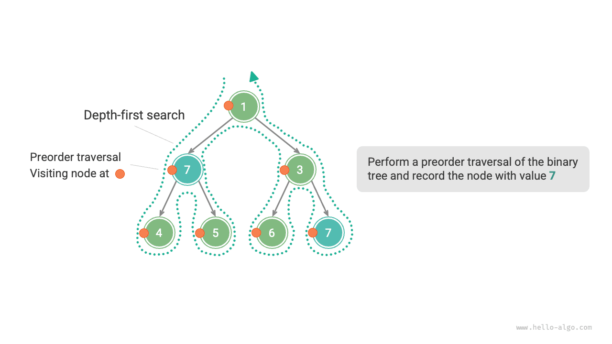
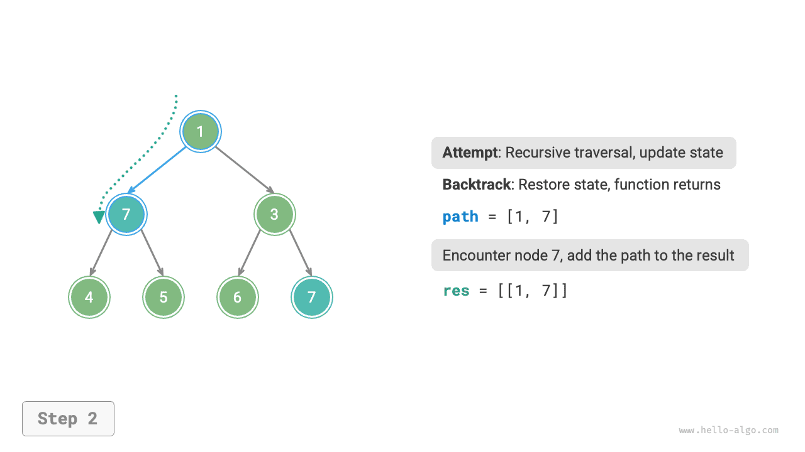
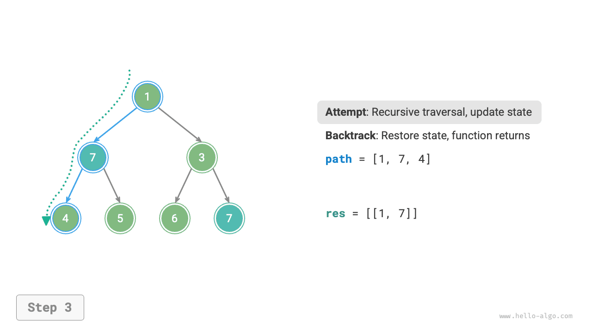
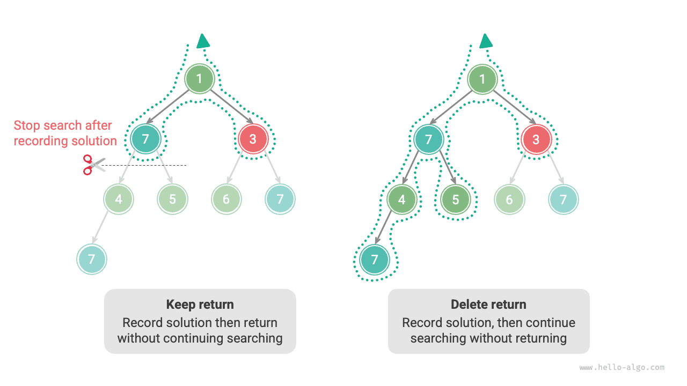

# Thuật toán quay lui

<u>Thuật toán quay lui</u> là một phương pháp giải bài toán bằng cách tìm kiếm toàn diện. Ý tưởng cốt lõi là bắt đầu từ một trạng thái ban đầu và tìm kiếm toàn diện tất cả các nghiệm có thể có. Khi tìm thấy một nghiệm đúng, nghiệm đó sẽ được ghi lại. Quá trình này tiếp tục cho đến khi tìm thấy một nghiệm hoặc tất cả các lựa chọn có thể đã được thử mà không tìm thấy nghiệm nào.

Thuật toán quay lui thường sử dụng "tìm kiếm theo chiều sâu" để duyệt không gian nghiệm. Trong chương "Cây nhị phân", chúng ta đã đề cập rằng các phép duyệt preorder, inorder và postorder đều thuộc tìm kiếm theo chiều sâu. Tiếp theo, chúng ta sẽ xây dựng một bài toán quay lui bằng phép duyệt preorder để từng bước hiểu cách hoạt động của thuật toán quay lui.

!!! question "Ví dụ 1"

    Cho một cây nhị phân, hãy tìm kiếm và ghi lại tất cả các nút có giá trị $7$, rồi trả về một danh sách các nút này.

Với bài toán này, chúng ta thực hiện phép duyệt preorder trên cây và kiểm tra xem giá trị của nút hiện tại có phải là $7$ hay không. Nếu đúng, chúng ta thêm nút đó vào danh sách kết quả `res`. Phần triển khai tương ứng được trình bày trong hình và đoạn mã sau:

```src
[file]{preorder_traversal_i_compact}-[class]{}-[func]{pre_order}
```



## Thử và quay lui

**Sở dĩ được gọi là thuật toán quay lui là vì nó sử dụng các chiến lược "thử" và "quay lui" khi tìm kiếm trong không gian nghiệm**. Khi thuật toán gặp một trạng thái mà nó không thể tiếp tục tiến lên hoặc không thể tìm thấy nghiệm thỏa mãn các ràng buộc, nó sẽ hoàn tác lựa chọn trước đó, quay về trạng thái trước, rồi thử các lựa chọn khả dĩ khác.

Trong Ví dụ 1, việc thăm từng nút đại diện cho một "lần thử", còn việc bỏ qua một nút lá hoặc `return` đưa phép duyệt quay lại nút cha đại diện cho một "lần quay lui".

Cần lưu ý rằng **quay lui không chỉ giới hạn ở việc trả về từ hàm**. Để minh họa điều này, hãy mở rộng Ví dụ 1 một chút.

!!! question "Ví dụ 2"

    Trong một cây nhị phân, hãy tìm kiếm tất cả các nút có giá trị $7$, **và trả về các đường đi từ nút gốc đến những nút này**.

Dựa trên đoạn mã của Ví dụ 1, chúng ta cần sử dụng một danh sách `path` để ghi lại đường đi qua các nút đã thăm. Khi đến một nút có giá trị $7$, chúng ta sao chép `path` và thêm nó vào danh sách kết quả `res`. Sau khi hoàn tất phép duyệt, `res` chứa tất cả các nghiệm. Đoạn mã như sau:

```src
[file]{preorder_traversal_ii_compact}-[class]{}-[func]{pre_order}
```

Trong mỗi "lần thử", chúng ta ghi lại đường đi bằng cách thêm nút hiện tại vào `path`; trước khi "quay lui", chúng ta cần xóa nút đó khỏi `path`, **để khôi phục trạng thái trước lần thử này**.

Quan sát quá trình được minh họa trong hình sau, **chúng ta có thể hiểu thử và quay lui là hai thao tác "tiến lên" và "hoàn tác"**, ngược chiều nhau.

=== "<1>"
    

=== "<2>"
    

=== "<3>"
    

=== "<4>"
    

=== "<5>"
    

=== "<6>"
    

=== "<7>"
    

=== "<8>"
    

=== "<9>"
    

=== "<10>"
    

=== "<11>"
    

## Cắt tỉa

Các bài toán quay lui phức tạp thường chứa một hoặc nhiều ràng buộc. **Các ràng buộc thường có thể được sử dụng để "cắt tỉa"**.

!!! question "Ví dụ 3"

    Trong một cây nhị phân, hãy tìm kiếm tất cả các nút có giá trị $7$ và trả về các đường đi từ nút gốc đến những nút này, **nhưng yêu cầu các đường đi không được chứa các nút có giá trị $3$**.

Để thỏa mãn các ràng buộc trên, **chúng ta cần thêm các thao tác cắt tỉa**: trong quá trình tìm kiếm, nếu gặp một nút có giá trị $3$, chúng ta sẽ trả về sớm và không tiếp tục tìm kiếm. Đoạn mã như sau:

```src
[file]{preorder_traversal_iii_compact}-[class]{}-[func]{pre_order}
```

"Cắt tỉa" là một thuật ngữ trực quan. Như minh họa trong hình sau, trong quá trình tìm kiếm, **chúng ta "cắt tỉa" các nhánh tìm kiếm không thỏa mãn ràng buộc**, tránh nhiều lần thử vô nghĩa và nhờ đó cải thiện hiệu quả tìm kiếm.


## Mã khung

Tiếp theo, chúng ta sẽ cố gắng rút ra một mã khung tổng quát, lấy "thử, quay lui và cắt tỉa" của phép quay lui làm trọng tâm, nhằm cải thiện tính tổng quát của mã.

Trong mã khung sau, `state` đại diện cho trạng thái hiện tại của bài toán, còn `choices` đại diện cho các lựa chọn có thể có trong trạng thái hiện tại:

=== "Python"

    ```python title=""
    def backtrack(state: State, choices: list[choice], res: list[state]):
        """Khung thuật toán quay lui"""
        # Kiểm tra xem có phải là nghiệm hay không
        if is_solution(state):
            # Ghi lại nghiệm
            record_solution(state, res)
            # Dừng tìm kiếm
            return
        # Duyệt qua tất cả các lựa chọn
        for choice in choices:
            # Cắt tỉa: kiểm tra xem lựa chọn có hợp lệ hay không
            if is_valid(state, choice):
                # Thử: đưa ra lựa chọn và cập nhật trạng thái
                make_choice(state, choice)
                backtrack(state, choices, res)
                # Quay lui: hoàn tác lựa chọn và khôi phục trạng thái trước đó
                undo_choice(state, choice)
    ```

=== "C++"

    ```cpp title=""
    /* Khung thuật toán quay lui */
    void backtrack(State *state, vector<Choice *> &choices, vector<State *> &res) {
        // Kiểm tra xem có phải là nghiệm hay không
        if (isSolution(state)) {
            // Ghi lại nghiệm
            recordSolution(state, res);
            // Dừng tìm kiếm
            return;
        }
        // Duyệt qua tất cả các lựa chọn
        for (Choice choice : choices) {
            // Cắt tỉa: kiểm tra xem lựa chọn có hợp lệ hay không
            if (isValid(state, choice)) {
                // Thử: đưa ra lựa chọn và cập nhật trạng thái
                makeChoice(state, choice);
                backtrack(state, choices, res);
                // Quay lui: hoàn tác lựa chọn và khôi phục trạng thái trước đó
                undoChoice(state, choice);
            }
        }
    }
    ```

=== "Java"

    ```java title=""
    /* Khung thuật toán quay lui */
    void backtrack(State state, List<Choice> choices, List<State> res) {
        // Kiểm tra xem có phải là nghiệm hay không
        if (isSolution(state)) {
            // Ghi lại nghiệm
            recordSolution(state, res);
            // Dừng tìm kiếm
            return;
        }
        // Duyệt qua tất cả các lựa chọn
        for (Choice choice : choices) {
            // Cắt tỉa: kiểm tra xem lựa chọn có hợp lệ hay không
            if (isValid(state, choice)) {
                // Thử: đưa ra lựa chọn và cập nhật trạng thái
                makeChoice(state, choice);
                backtrack(state, choices, res);
                // Quay lui: hoàn tác lựa chọn và khôi phục trạng thái trước đó
                undoChoice(state, choice);
            }
        }
    }
    ```

=== "C#"

    ```csharp title=""
    /* Khung thuật toán quay lui */
    void Backtrack(State state, List<Choice> choices, List<State> res) {
        // Kiểm tra xem có phải là nghiệm hay không
        if (IsSolution(state)) {
            // Ghi lại nghiệm
            RecordSolution(state, res);
            // Dừng tìm kiếm
            return;
        }
        // Duyệt qua tất cả các lựa chọn
        foreach (Choice choice in choices) {
            // Cắt tỉa: kiểm tra xem lựa chọn có hợp lệ hay không
            if (IsValid(state, choice)) {
                // Thử: đưa ra lựa chọn và cập nhật trạng thái
                MakeChoice(state, choice);
                Backtrack(state, choices, res);
                // Quay lui: hoàn tác lựa chọn và khôi phục trạng thái trước đó
                UndoChoice(state, choice);
            }
        }
    }
    ```

=== "Go"

    ```go title=""
    /* Khung thuật toán quay lui */
    func backtrack(state *State, choices []Choice, res *[]State) {
        // Kiểm tra xem đây có phải là một nghiệm hay không
        if isSolution(state) {
            // Ghi lại nghiệm
            recordSolution(state, res)
            // Dừng tìm kiếm
            return
        }
        // Duyệt qua tất cả lựa chọn
        for _, choice := range choices {
            // Cắt tỉa: kiểm tra xem lựa chọn có hợp lệ hay không
            if isValid(state, choice) {
                // Thử: đưa ra một lựa chọn và cập nhật trạng thái
                makeChoice(state, choice)
                backtrack(state, choices, res)
                // Quay lui: hoàn tác lựa chọn và khôi phục trạng thái trước đó
                undoChoice(state, choice)
            }
        }
    }
    ```

=== "Swift"

    ```swift title=""
    /* Khung thuật toán quay lui */
    func backtrack(state: inout State, choices: [Choice], res: inout [State]) {
        // Kiểm tra xem đây có phải là một nghiệm hay không
        if isSolution(state: state) {
            // Ghi lại nghiệm
            recordSolution(state: state, res: &res)
            // Dừng tìm kiếm
            return
        }
        // Duyệt qua tất cả lựa chọn
        for choice in choices {
            // Cắt tỉa: kiểm tra xem lựa chọn có hợp lệ hay không
            if isValid(state: state, choice: choice) {
                // Thử: đưa ra một lựa chọn và cập nhật trạng thái
                makeChoice(state: &state, choice: choice)
                backtrack(state: &state, choices: choices, res: &res)
                // Quay lui: hoàn tác lựa chọn và khôi phục trạng thái trước đó
                undoChoice(state: &state, choice: choice)
            }
        }
    }
    ```

=== "JS"

    ```javascript title=""
    /* Khung thuật toán quay lui */
    function backtrack(state, choices, res) {
        // Kiểm tra xem đây có phải là một nghiệm hay không
        if (isSolution(state)) {
            // Ghi lại nghiệm
            recordSolution(state, res);
            // Dừng tìm kiếm
            return;
        }
        // Duyệt qua tất cả lựa chọn
        for (let choice of choices) {
            // Cắt tỉa: kiểm tra xem lựa chọn có hợp lệ hay không
            if (isValid(state, choice)) {
                // Thử: đưa ra một lựa chọn và cập nhật trạng thái
                makeChoice(state, choice);
                backtrack(state, choices, res);
                // Quay lui: hoàn tác lựa chọn và khôi phục trạng thái trước đó
                undoChoice(state, choice);
            }
        }
    }
    ```

=== "TS"

    ```typescript title=""
    /* Khung thuật toán quay lui */
    function backtrack(state: State, choices: Choice[], res: State[]): void {
        // Kiểm tra xem đây có phải là một nghiệm hay không
        if (isSolution(state)) {
            // Ghi lại nghiệm
            recordSolution(state, res);
            // Dừng tìm kiếm
            return;
        }
        // Duyệt qua tất cả lựa chọn
        for (let choice of choices) {
            // Cắt tỉa: kiểm tra xem lựa chọn có hợp lệ hay không
            if (isValid(state, choice)) {
                // Thử: đưa ra một lựa chọn và cập nhật trạng thái
                makeChoice(state, choice);
                backtrack(state, choices, res);
                // Quay lui: hoàn tác lựa chọn và khôi phục trạng thái trước đó
                undoChoice(state, choice);
            }
        }
    }
    ```

=== "Dart"

    ```dart title=""
    /* Khung thuật toán quay lui */
    void backtrack(State state, List<Choice>, List<State> res) {
      // Kiểm tra xem đây có phải là một nghiệm hay không
      if (isSolution(state)) {
        // Ghi lại nghiệm
        recordSolution(state, res);
        // Dừng tìm kiếm
        return;
      }
      // Duyệt qua tất cả lựa chọn
      for (Choice choice in choices) {
        // Cắt tỉa: kiểm tra xem lựa chọn có hợp lệ hay không
        if (isValid(state, choice)) {
          // Thử: đưa ra một lựa chọn và cập nhật trạng thái
          makeChoice(state, choice);
          backtrack(state, choices, res);
          // Quay lui: hoàn tác lựa chọn và khôi phục trạng thái trước đó
          undoChoice(state, choice);
        }
      }
    }
    ```

=== "Rust"

    ```rust title=""
    /* Khung thuật toán quay lui */
    fn backtrack(state: &mut State, choices: &Vec<Choice>, res: &mut Vec<State>) {
        // Kiểm tra xem đây có phải là một nghiệm hay không
        if is_solution(state) {
            // Ghi lại nghiệm
            record_solution(state, res);
            // Dừng tìm kiếm
            return;
        }
        // Duyệt qua tất cả lựa chọn
        for choice in choices {
            // Cắt tỉa: kiểm tra xem lựa chọn có hợp lệ hay không
            if is_valid(state, choice) {
                // Thử: đưa ra một lựa chọn và cập nhật trạng thái
                make_choice(state, choice);
                backtrack(state, choices, res);
                // Quay lui: hoàn tác lựa chọn và khôi phục trạng thái trước đó
                undo_choice(state, choice);
            }
        }
    }
    ```

=== "C"

    ```c title=""
    /* Khung thuật toán quay lui */
    void backtrack(State *state, Choice *choices, int numChoices, State *res, int numRes) {
        // Kiểm tra xem đây có phải là một nghiệm hay không
        if (isSolution(state)) {
            // Ghi lại nghiệm
            recordSolution(state, res, numRes);
            // Dừng tìm kiếm
            return;
        }
        // Duyệt qua tất cả lựa chọn
        for (int i = 0; i < numChoices; i++) {
            // Cắt tỉa: kiểm tra xem lựa chọn có hợp lệ hay không
            if (isValid(state, &choices[i])) {
                // Thử: đưa ra một lựa chọn và cập nhật trạng thái
                makeChoice(state, &choices[i]);
                backtrack(state, choices, numChoices, res, numRes);
                // Quay lui: hoàn tác lựa chọn và khôi phục trạng thái trước đó
                undoChoice(state, &choices[i]);
            }
        }
    }
    ```

=== "Kotlin"

    ```kotlin title=""
    /* Khung thuật toán quay lui */
    fun backtrack(state: State?, choices: List<Choice?>, res: List<State?>?) {
        // Kiểm tra xem đây có phải là một nghiệm hay không
        if (isSolution(state)) {
            // Ghi lại nghiệm
            recordSolution(state, res)
            // Dừng tìm kiếm
            return
        }
        // Duyệt qua tất cả lựa chọn
        for (choice in choices) {
            // Cắt tỉa: kiểm tra xem lựa chọn có hợp lệ hay không
            if (isValid(state, choice)) {
                // Thử: đưa ra một lựa chọn và cập nhật trạng thái
                makeChoice(state, choice)
                backtrack(state, choices, res)
                // Quay lui: hoàn tác lựa chọn và khôi phục trạng thái trước đó
                undoChoice(state, choice)
            }
        }
    }
    ```

=== "Ruby"

    ```ruby title=""
    ### Khung thuật toán quay lui ###
    def backtrack(state, choices, res)
        # Kiểm tra xem đây có phải là một nghiệm hay không
        if is_solution?(state)
            # Ghi lại nghiệm
            record_solution(state, res)
            return
        end

        # Duyệt qua tất cả lựa chọn
        for choice in choices
            # Cắt tỉa: kiểm tra xem lựa chọn có hợp lệ hay không
            if is_valid?(state, choice)
                # Thử: đưa ra một lựa chọn và cập nhật trạng thái
                make_choice(state, choice)
                backtrack(state, choices, res)
                # Quay lui: hoàn tác lựa chọn và khôi phục trạng thái trước đó
                undo_choice(state, choice)
            end
        end
    end
    ```

Tiếp theo, chúng ta giải Example 3 dựa trên đoạn mã khung. Trạng thái `state` là đường đi duyệt các node, các lựa chọn `choices` là node con trái và node con phải của node hiện tại, còn kết quả `res` là một danh sách các đường đi:

```src
[file]{preorder_traversal_iii_template}-[class]{}-[func]{backtrack}
```

Theo đề bài, chúng ta cần tiếp tục tìm kiếm sau khi tìm thấy một node có giá trị $7$. **Do đó, chúng ta cần xóa câu lệnh `return` sau khi ghi lại nghiệm**. Hình dưới đây so sánh quá trình tìm kiếm có và không có câu lệnh `return`.



So với đoạn mã dựa trên duyệt preorder, đoạn mã dựa trên khung thuật toán quay lui có vẻ dài hơn, nhưng tổng quát hơn. Trên thực tế, **nhiều bài toán quay lui có thể được giải trong khung này**. Chúng ta chỉ cần định nghĩa `state` và `choices` cho bài toán cụ thể rồi triển khai từng phương thức trong khung.

## Thuật ngữ phổ biến

Để phân tích các bài toán thuật toán rõ ràng hơn, chúng ta tóm tắt ý nghĩa của những thuật ngữ phổ biến được sử dụng trong các thuật toán quay lui và đưa ra các ví dụ tương ứng từ Example 3, như trong bảng dưới đây.

<p align="center"> Bảng <id> &nbsp; Các thuật ngữ phổ biến trong thuật toán quay lui </p>

| Thuật ngữ                 | Định nghĩa                                                                                                                   | Ví dụ 3                                                                          |
| ------------------------- | ---------------------------------------------------------------------------------------------------------------------------- | -------------------------------------------------------------------------------- |
| Solution (solution)       | Solution là một đáp án thỏa mãn các điều kiện cụ thể của một bài toán; có thể có một hoặc nhiều solution                  | Tất cả các đường đi từ root đến các node có giá trị $7$ và thỏa mãn constraint  |
| Constraint (constraint)   | Constraint là một điều kiện trong bài toán giới hạn tính khả thi của các solution, thường được dùng để pruning           | Các đường đi không chứa node có giá trị $3$                                    |
| State (state)             | State biểu thị tình huống của một bài toán tại một thời điểm nhất định, bao gồm các lựa chọn đã thực hiện                 | Đường đi qua các node hiện đang được duyệt, tức là danh sách node `path` |
| Attempt (attempt)         | Attempt là quá trình khám phá không gian solution theo các lựa chọn hiện có, bao gồm việc đưa ra lựa chọn, cập nhật state và kiểm tra xem đó có phải là solution hay không | Đệ quy duyệt các node con bên trái (bên phải), thêm các node vào `path`, kiểm tra xem giá trị của node có phải là $7$ hay không |
| Backtrack (backtracking)  | Backtracking là việc hoàn tác các lựa chọn trước đó và quay lại state trước đó khi gặp một state không thỏa mãn các constraint | Dừng tìm kiếm khi vượt qua các node lá, kết thúc việc duyệt node hoặc gặp node có giá trị $3$; hàm trả về |
| Pruning (pruning)         | Pruning là phương pháp tránh các đường tìm kiếm vô nghĩa dựa trên đặc điểm và constraint của bài toán, giúp cải thiện hiệu quả tìm kiếm | Khi gặp node có giá trị $3$, không tiếp tục tìm kiếm                            |

!!! tip

    Các khái niệm như bài toán, solution, state, v.v. là những khái niệm phổ quát và xuất hiện trong divide-and-conquer, backtracking, dynamic programming, greedy algorithms và các lĩnh vực khác.

## Ưu điểm và hạn chế

Thuật toán backtracking về bản chất là một thuật toán tìm kiếm theo chiều sâu, thử tất cả các solution khả dĩ cho đến khi tìm được một solution thỏa mãn các điều kiện. Ưu điểm của phương pháp này là có thể tìm được tất cả solution khả dĩ và, với các thao tác pruning hợp lý, đạt hiệu quả cao.

Tuy nhiên, khi xử lý các bài toán quy mô lớn hoặc phức tạp, **hiệu suất chạy của thuật toán backtracking có thể không chấp nhận được**.

- **Thời gian**: Thuật toán backtracking thường cần duyệt qua mọi khả năng trong state space, và độ phức tạp thời gian có thể đạt cấp số mũ hoặc giai thừa.
- **Không gian**: Trong các lời gọi đệ quy, state hiện tại cần được lưu lại (chẳng hạn như các đường đi, các biến phụ trợ dùng cho pruning, v.v.); khi độ sâu lớn, yêu cầu về không gian có thể trở nên rất lớn.

Tuy vậy, **thuật toán backtracking vẫn là solution tốt nhất cho một số bài toán tìm kiếm và bài toán thỏa mãn constraint nhất định**. Với các bài toán này, vì không thể dự đoán lựa chọn nào sẽ tạo ra solution hợp lệ, chúng ta phải duyệt qua tất cả lựa chọn khả dĩ. Trong trường hợp này, **điều quan trọng là cách tối ưu hiệu quả**. Có hai phương pháp tối ưu hiệu quả phổ biến.

- **Pruning**: Tránh tìm kiếm các đường đi chắc chắn không thể tạo ra solution, từ đó tiết kiệm thời gian và không gian.
- **Heuristic search**: Đưa vào một số chiến lược hoặc giá trị ước tính trong quá trình tìm kiếm để ưu tiên các đường đi có khả năng cao nhất tạo ra solution hợp lệ.

## Các ví dụ backtracking điển hình

Thuật toán backtracking có thể được dùng để giải nhiều bài toán tìm kiếm, bài toán thỏa mãn constraint và bài toán tối ưu tổ hợp.

**Bài toán tìm kiếm**: Mục tiêu của các bài toán này là tìm các solution thỏa mãn những điều kiện cụ thể.

- Bài toán hoán vị: Cho một tập hợp, tìm tất cả các hoán vị và tổ hợp có thể.
- Bài toán tổng tập con: Cho một tập hợp và một tổng mục tiêu, tìm tất cả các tập con trong tập hợp có tổng các phần tử bằng tổng mục tiêu.
- Tháp Hà Nội: Cho ba cọc và một dãy đĩa có kích thước khác nhau, di chuyển tất cả đĩa từ một cọc này sang cọc khác, mỗi lần chỉ di chuyển một đĩa và không bao giờ đặt đĩa lớn hơn lên trên đĩa nhỏ hơn.

**Bài toán thỏa mãn constraint**: Mục tiêu của các bài toán này là tìm các solution thỏa mãn mọi constraint.

- N-Queens: Đặt $n$ quân hậu trên bàn cờ $n \times n$ sao cho chúng không thể ăn nhau.
- Sudoku: Điền các số từ $1$ đến $9$ vào một lưới $9 \times 9$ sao cho mỗi hàng, cột và vùng con $3 \times 3$ không chứa chữ số trùng lặp.
- Tô màu đồ thị: Cho một đồ thị vô hướng, tô màu mỗi đỉnh bằng số màu ít nhất có thể sao cho các đỉnh kề nhau có màu khác nhau.

**Bài toán tối ưu tổ hợp**: Mục tiêu của các bài toán này là tìm một solution tối ưu thỏa mãn một số điều kiện trong không gian tổ hợp.

- Bài toán Knapsack 0-1: Cho một tập hợp các vật phẩm và một chiếc ba lô, mỗi vật phẩm có một giá trị và trọng lượng. Dưới constraint về sức chứa của ba lô, chọn các vật phẩm để tối đa hóa tổng giá trị.
- Bài toán Người du lịch (Traveling Salesman Problem): Bắt đầu từ một điểm trong đồ thị, đi qua tất cả các điểm khác đúng một lần rồi quay lại điểm bắt đầu, tìm đường đi ngắn nhất.
- Maximum Clique: Cho một đồ thị vô hướng, tìm đồ thị con đầy đủ lớn nhất, tức là đồ thị con mà mọi cặp đỉnh đều được nối với nhau bằng một cạnh.

Lưu ý rằng đối với nhiều bài toán tối ưu tổ hợp, backtracking không phải là solution tối ưu.

- Bài toán Knapsack 0-1 thường được giải bằng dynamic programming để đạt hiệu quả thời gian cao hơn.
- Bài toán Traveling Salesman là một bài toán NP-Hard nổi tiếng; các solution phổ biến bao gồm genetic algorithms và ant colony algorithms.
- Bài toán Maximum Clique là một bài toán kinh điển trong lý thuyết đồ thị và có thể được giải bằng các thuật toán heuristic như greedy algorithms.