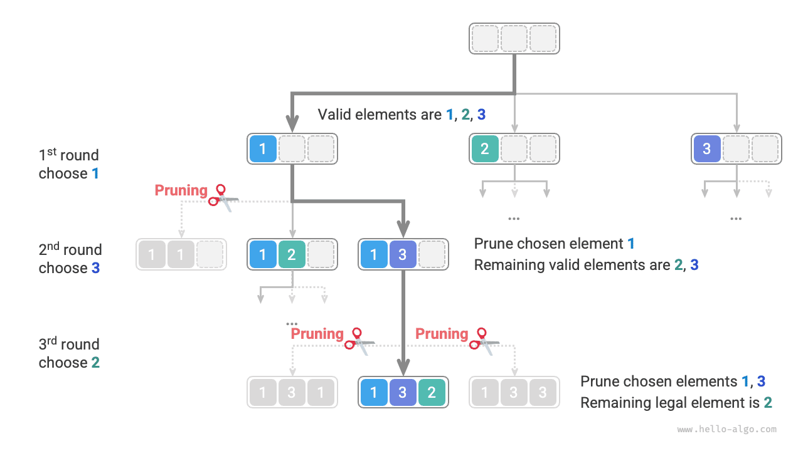

# Bài toán hoán vị

Bài toán hoán vị là một ứng dụng kinh điển của các thuật toán quay lui. Bài toán được định nghĩa là tìm tất cả các cách sắp xếp có thể có của các phần tử trong một tập hợp cho trước (chẳng hạn như một mảng hoặc chuỗi).

Bảng dưới đây trình bày một số bộ dữ liệu ví dụ, bao gồm các mảng đầu vào và các hoán vị tương ứng của chúng.

<p align="center"> Bảng <id> &nbsp; Các ví dụ về hoán vị </p>

| Mảng đầu vào | Tất cả các hoán vị                                                  |
| :----------- | :------------------------------------------------------------------ |
| $[1]$        | $[1]$                                                               |
| $[1, 2]$     | $[1, 2], [2, 1]$                                                    |
| $[1, 2, 3]$  | $[1, 2, 3], [1, 3, 2], [2, 1, 3], [2, 3, 1], [3, 1, 2], [3, 2, 1]$ |

## Trường hợp các phần tử phân biệt

!!! question

    Cho một mảng số nguyên không chứa phần tử trùng lặp, hãy trả về tất cả các hoán vị có thể có.

Từ góc nhìn của các thuật toán quay lui, **chúng ta có thể hình dung quá trình tạo hoán vị là kết quả của một chuỗi lựa chọn**. Giả sử mảng đầu vào là $[1, 2, 3]$. Nếu trước tiên chọn $1$, sau đó chọn $3$, và cuối cùng chọn $2$, ta thu được hoán vị $[1, 3, 2]$. Quay lui nghĩa là hoàn tác một lựa chọn rồi thử các lựa chọn khác.

Từ góc nhìn của mã quay lui, tập ứng viên `choices` bao gồm tất cả các phần tử trong mảng đầu vào, còn trạng thái `state` là các phần tử đã được chọn cho đến thời điểm hiện tại. Lưu ý rằng mỗi phần tử chỉ có thể được chọn một lần, **do đó tất cả các phần tử trong `state` phải là duy nhất**.

Như trong hình dưới đây, chúng ta có thể triển khai quá trình tìm kiếm thành một cây đệ quy, trong đó mỗi nút trong cây biểu diễn trạng thái hiện tại `state`. Bắt đầu từ nút gốc, sau ba lượt lựa chọn, ta đạt đến một nút lá, và mỗi nút lá tương ứng với một hoán vị.


### Cắt tỉa các lựa chọn trùng lặp

Để bảo đảm mỗi phần tử chỉ được chọn một lần, chúng ta cân nhắc sử dụng một mảng Boolean `selected`, trong đó `selected[i]` cho biết liệu `choices[i]` đã được chọn hay chưa. Dựa trên đó, chúng ta thực hiện thao tác cắt tỉa sau:

- Sau khi đưa ra một lựa chọn `choices[i]`, chúng ta đặt `selected[i]` thành $\text{True}$, cho biết phần tử đó đã được chọn.
- Khi duyệt qua danh sách ứng viên `choices`, chúng ta bỏ qua tất cả các nút đã được chọn; đây chính là thao tác cắt tỉa.

Như trong hình dưới đây, giả sử chúng ta chọn $1$ ở lượt đầu tiên, $3$ ở lượt thứ hai và $2$ ở lượt thứ ba. Khi đó, chúng ta cần cắt tỉa nhánh của phần tử $1$ ở lượt thứ hai, đồng thời cắt tỉa các nhánh của phần tử $1$ và $3$ ở lượt thứ ba.



Quan sát hình trên, chúng ta thấy thao tác cắt tỉa này làm giảm kích thước không gian tìm kiếm từ $O(n^n)$ xuống còn $O(n!)$.

### Triển khai mã

Sau khi hiểu các thông tin trên, chúng ta có thể điền vào những chỗ trống trong mã mẫu. Để rút gọn toàn bộ mã, chúng ta không triển khai riêng từng hàm trong mã mẫu mà thay vào đó triển khai trực tiếp chúng trong hàm `backtrack()`:

```src
[file]{permutations_i}-[class]{}-[func]{permutations_i}
```

## Trường hợp có phần tử trùng lặp

!!! question

    Cho một mảng số nguyên **có thể chứa các phần tử trùng lặp**, hãy trả về tất cả các hoán vị duy nhất.

Giả sử mảng đầu vào là $[1, 1, 2]$. Để phân biệt hai phần tử $1$ trùng lặp, chúng ta ký hiệu phần tử $1$ thứ hai là $\hat{1}$.

Như trong hình dưới đây, một nửa số hoán vị được tạo ra bằng phương pháp trên là các hoán vị trùng lặp.


Vậy làm thế nào để loại bỏ các hoán vị trùng lặp? Cách tiếp cận trực tiếp nhất là sử dụng một hash set để khử trùng lặp trực tiếp các kết quả hoán vị. Tuy nhiên, cách này không thật sự tối ưu vì **các nhánh tìm kiếm tạo ra những hoán vị trùng lặp là không cần thiết và nên được xác định, cắt tỉa sớm**, qua đó tiếp tục cải thiện hiệu quả của thuật toán.

### Cắt tỉa các phần tử bằng nhau

Quan sát hình dưới đây. Ở lượt đầu tiên, việc chọn $1$ hoặc chọn $\hat{1}$ là tương đương. Tất cả các hoán vị được tạo ra từ hai lựa chọn này đều trùng lặp. Vì vậy, chúng ta nên cắt tỉa $\hat{1}$.

Tương tự, sau khi chọn $2$ ở lượt đầu tiên, $1$ và $\hat{1}$ ở lượt thứ hai cũng tạo ra các nhánh trùng lặp, do đó $\hat{1}$ ở lượt thứ hai cũng nên được cắt tỉa.

Về bản chất, **mục tiêu của chúng ta là bảo đảm nhiều phần tử bằng nhau chỉ được chọn một lần trong một lượt lựa chọn nhất định**.


### Triển khai mã

Dựa trên mã của bài toán trước, chúng ta khởi tạo một hash set `duplicated` trong mỗi lượt lựa chọn để ghi lại các phần tử đã được thử trong lượt đó, đồng thời cắt tỉa các phần tử bằng nhau:

```src
[file]{permutations_ii}-[class]{}-[func]{permutations_ii}
```

Giả sử các phần tử đôi một phân biệt, có $n!$ (giai thừa) hoán vị của $n$ phần tử. Khi ghi lại kết quả, chúng ta cần sao chép một danh sách có độ dài $n$, sử dụng thời gian $O(n)$. **Do đó, độ phức tạp thời gian là $O(n! \cdot n)$**.

Độ sâu đệ quy tối đa là $n$, sử dụng không gian $O(n)$ cho các stack frame. `selected` sử dụng không gian $O(n)$. Có nhiều nhất $n$ tập `duplicated` tồn tại đồng thời, sử dụng không gian $O(n^2)$. **Do đó, độ phức tạp không gian là $O(n^2)$**.

### So sánh hai phương pháp cắt tỉa

Lưu ý rằng mặc dù cả `selected` và `duplicated` đều được sử dụng để cắt tỉa, chúng có các mục tiêu khác nhau.

- **Cắt tỉa các lựa chọn trùng lặp**: Chỉ có một `selected` trong toàn bộ quá trình tìm kiếm. Nó ghi lại những phần tử được đưa vào trạng thái hiện tại, và mục đích của nó là ngăn một phần tử xuất hiện lặp lại trong `state`.
- **Cắt tỉa các phần tử bằng nhau**: Mỗi lượt lựa chọn (mỗi lần gọi hàm `backtrack`) chứa một tập `duplicated`. Tập này ghi lại những phần tử đã được chọn trong vòng lặp của lượt đó (vòng lặp `for`), và mục đích của nó là bảo đảm các phần tử bằng nhau chỉ được chọn một lần.

Hình dưới đây cho thấy phạm vi tác động của hai điều kiện cắt tỉa. Lưu ý rằng mỗi nút trong cây biểu diễn một lựa chọn, còn các nút trên đường đi từ nút gốc đến nút lá tạo thành một hoán vị.

