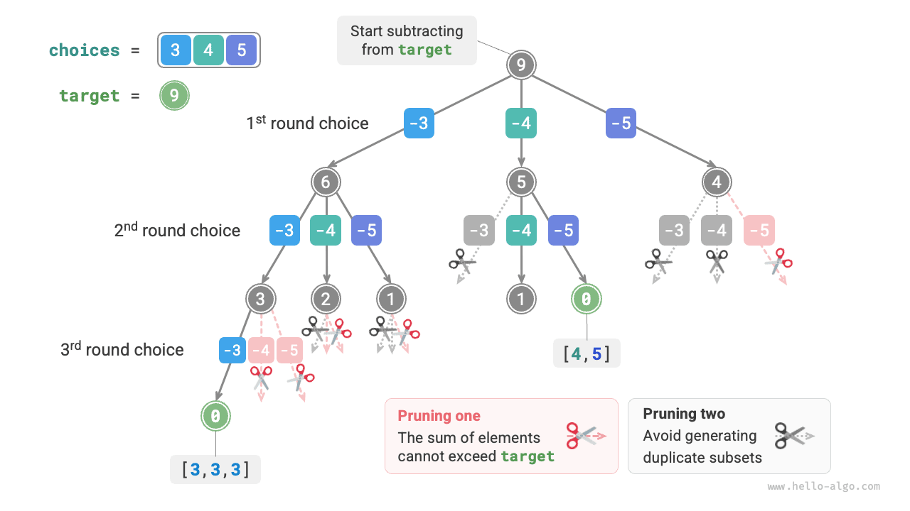

# Bài toán Subset-Sum

## Không có phần tử trùng lặp

!!! question

    Cho một mảng số nguyên dương `nums` và một số nguyên dương đích `target`, hãy tìm tất cả các tổ hợp có tổng các phần tử bằng `target`. Mảng đã cho không có phần tử trùng lặp và mỗi phần tử có thể được chọn nhiều lần. Trả về các tổ hợp này dưới dạng danh sách, trong đó danh sách không được chứa các tổ hợp trùng lặp.

Ví dụ, với tập hợp $\{3, 4, 5\}$ và số nguyên đích $9$, các nghiệm là $\{3, 3, 3\}, \{4, 5\}$. Lưu ý hai điểm sau:

- Các phần tử trong tập đầu vào có thể được chọn lặp lại không giới hạn.
- Các tập con không phân biệt thứ tự phần tử; ví dụ, $\{4, 5\}$ và $\{5, 4\}$ là cùng một tập con.

### Dùng lời giải bài toán hoán vị làm tham chiếu

Tương tự bài toán hoán vị, ta có thể xem quá trình sinh các tập con là kết quả của một chuỗi lựa chọn và cập nhật tổng hiện tại trong quá trình chọn. Khi tổng bằng `target`, ta ghi nhận tập con vào danh sách kết quả.

Khác với bài toán hoán vị, **các phần tử trong bài toán này có thể được chọn bao nhiêu lần tùy ý**, vì vậy ta không cần sử dụng danh sách boolean `selected` để theo dõi xem một phần tử đã được chọn hay chưa. Với một vài thay đổi nhỏ từ mã hoán vị, ta có được lời giải ban đầu:

```src
[file]{subset_sum_i_naive}-[class]{}-[func]{subset_sum_i_naive}
```

Chạy mã trên với mảng $[3, 4, 5]$ và giá trị đích $9$ sẽ tạo ra $[3, 3, 3], [4, 5], [5, 4]$. **Mặc dù đã tìm được tất cả các tập con có tổng bằng $9$, các tập con $[4, 5]$ và $[5, 4]$ bị trùng lặp**.

Nguyên nhân là quá trình tìm kiếm phân biệt thứ tự lựa chọn, trong khi các tập con không phân biệt thứ tự chọn. Như minh họa trong hình bên dưới, chọn 4 trước rồi chọn 5 và chọn 5 trước rồi chọn 4 là hai nhánh khác nhau, nhưng chúng tương ứng với cùng một tập con.


Để loại bỏ các tập con trùng lặp, **một ý tưởng đơn giản là loại bỏ trùng lặp trong danh sách kết quả**. Tuy nhiên, cách này rất kém hiệu quả vì hai lý do:

- Khi có nhiều phần tử trong mảng, đặc biệt khi `target` lớn, quá trình tìm kiếm sẽ sinh ra nhiều tập con trùng lặp.
- Việc so sánh các tập con (mảng) rất tốn thời gian, vì trước tiên phải sắp xếp các mảng, sau đó so sánh từng phần tử trong chúng.

### Cắt tỉa các tập con trùng lặp

**Ta thực hiện loại bỏ trùng lặp bằng cách cắt tỉa trong quá trình tìm kiếm**. Quan sát hình bên dưới, các tập con trùng lặp xuất hiện khi các phần tử trong mảng được chọn theo những thứ tự khác nhau, như trong các trường hợp sau:

1. Khi vòng thứ nhất và vòng thứ hai lần lượt chọn $3$ và $4$, tất cả các tập con chứa hai phần tử này được sinh ra, ký hiệu là $[3, 4, \dots]$.
2. Sau đó, khi vòng thứ nhất chọn $4$, **vòng thứ hai phải bỏ qua $3$**, vì tập con $[4, 3, \dots]$ được sinh ra bởi lựa chọn này hoàn toàn trùng với tập con được sinh ra ở bước `1.`

Trong quá trình tìm kiếm, các lựa chọn ở mỗi tầng được thử từ trái sang phải, vì vậy các nhánh ở bên phải sẽ được cắt tỉa nhiều hơn.

1. Hai vòng đầu tiên chọn $3$ và $5$, tạo ra tập con $[3, 5, \dots]$.
2. Hai vòng đầu tiên chọn $4$ và $5$, tạo ra tập con $[4, 5, \dots]$.
3. Nếu vòng thứ nhất chọn $5$, **vòng thứ hai phải bỏ qua $3$ và $4$**, vì các tập con $[5, 3, \dots]$ và $[5, 4, \dots]$ hoàn toàn trùng với các tập con được mô tả ở bước `1.` và `2.`


Tóm lại, với mảng đầu vào $[x_1, x_2, \dots, x_n]$, giả sử chuỗi lựa chọn trong quá trình tìm kiếm là $[x_{i_1}, x_{i_2}, \dots, x_{i_m}]$. Chuỗi lựa chọn này phải thỏa mãn $i_1 \leq i_2 \leq \dots \leq i_m$; **mọi chuỗi lựa chọn không thỏa mãn điều kiện này sẽ gây ra trùng lặp và cần được cắt tỉa**.

### Cài đặt mã

Để thực hiện việc cắt tỉa này, ta khởi tạo một biến `start` để chỉ ra vị trí bắt đầu duyệt. **Sau khi chọn $x_{i}$, đặt vòng tiếp theo bắt đầu duyệt từ chỉ số $i$**. Điều này đảm bảo chuỗi lựa chọn thỏa mãn $i_1 \leq i_2 \leq \dots \leq i_m$, từ đó đảm bảo tính duy nhất của tập con.

Ngoài ra, ta đã thực hiện hai tối ưu hóa sau đối với mã:

- Trước khi bắt đầu tìm kiếm, hãy sắp xếp mảng `nums`. Khi duyệt qua tất cả các lựa chọn, **dừng vòng lặp ngay khi tổng tập con vượt quá `target`**, vì các phần tử tiếp theo lớn hơn và tổng tập con của chúng chắc chắn phải vượt quá `target`.
- Bỏ biến tổng phần tử `total` và **dùng phép trừ trên `target` để theo dõi tổng các phần tử**. Ghi nhận nghiệm khi `target` bằng $0$.

```src
[file]{subset_sum_i}-[class]{}-[func]{subset_sum_i}
```

Hình bên dưới minh họa toàn bộ quá trình backtracking được tạo ra khi chạy mã trên với mảng $[3, 4, 5]$ và giá trị đích $9$.



## Có phần tử trùng lặp trong mảng

!!! question

    Cho một mảng số nguyên dương `nums` và một số nguyên dương đích `target`, hãy tìm tất cả các tổ hợp có tổng các phần tử bằng `target`. **Mảng đã cho có thể chứa các phần tử trùng lặp và mỗi phần tử chỉ được chọn nhiều nhất một lần**. Trả về các tổ hợp này dưới dạng danh sách, trong đó danh sách không được chứa các tổ hợp trùng lặp.

So với bài toán trước, **mảng đầu vào của bài toán này có thể chứa các phần tử trùng lặp**, điều này dẫn đến một vấn đề mới. Ví dụ, với mảng $[4, \hat{4}, 5]$ và giá trị đích $9$, kết quả của mã hiện tại là $[4, 5], [\hat{4}, 5]$, trong đó có các tập con trùng lặp.

**Nguyên nhân của sự trùng lặp này là các phần tử bằng nhau được chọn nhiều lần trong cùng một vòng**. Trong hình bên dưới, vòng thứ nhất có ba lựa chọn, trong đó hai lựa chọn là $4$, tạo ra hai nhánh tìm kiếm trùng lặp và cho ra các tập con trùng lặp. Tương tự, hai số $4$ trong vòng thứ hai cũng tạo ra các tập con trùng lặp.


### Cắt tỉa các phần tử bằng nhau

Để giải quyết bài toán này, **ta cần giới hạn việc chọn các phần tử bằng nhau, sao cho mỗi phần tử chỉ được chọn một lần trong mỗi vòng**. Cách triển khai khá tinh tế: vì mảng đã được sắp xếp nên các phần tử bằng nhau nằm liền kề nhau. Điều này có nghĩa là trong một vòng lựa chọn, nếu phần tử hiện tại bằng phần tử bên trái nó, thì cùng giá trị đó đã được chọn trong vòng này, vì vậy ta bỏ qua ngay phần tử hiện tại.

Đồng thời, **bài toán này quy định rằng mỗi phần tử trong mảng chỉ được chọn một lần**. May mắn là ta cũng có thể sử dụng biến `start` để đáp ứng ràng buộc này: sau khi chọn $x_{i}$, đặt vòng tiếp theo bắt đầu duyệt từ chỉ số $i + 1$ trở đi. Cách này vừa loại bỏ các tập con trùng lặp, vừa tránh việc chọn một phần tử nhiều lần.

### Cài đặt mã

```src
[file]{subset_sum_ii}-[class]{}-[func]{subset_sum_ii}
```

Hình bên dưới minh họa quá trình backtracking với mảng $[4, 4, 5]$ và giá trị đích $9$, trong đó có bốn loại thao tác cắt tỉa. Hãy kết hợp hình minh họa với các chú thích trong mã để hiểu toàn bộ quá trình tìm kiếm và cách mỗi thao tác cắt tỉa hoạt động.

