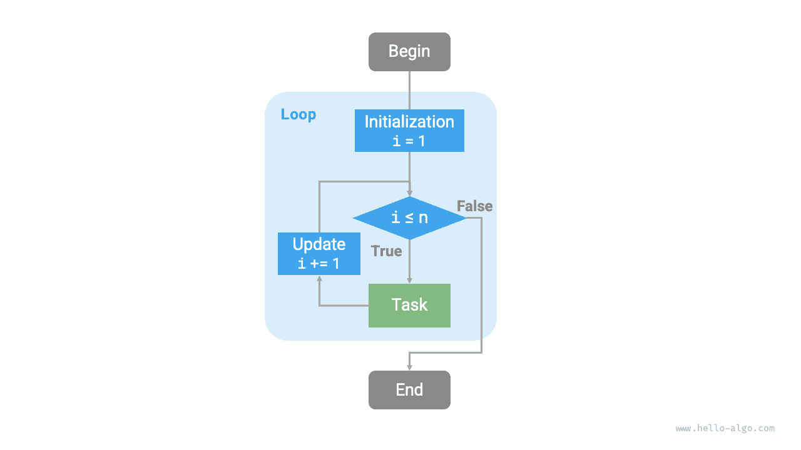
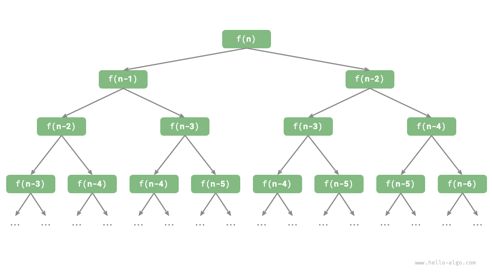

# Lặp và đệ quy

Trong các thuật toán, việc thực thi lặp đi lặp lại một tác vụ là rất phổ biến và có liên quan chặt chẽ đến việc phân tích độ phức tạp. Vì vậy, trước khi giới thiệu độ phức tạp thời gian và độ phức tạp không gian, trước tiên hãy tìm hiểu cách triển khai việc thực thi lặp lại các tác vụ trong chương trình, cụ thể là hai cấu trúc điều khiển chương trình cơ bản: lặp và đệ quy.

## Lặp

<u>Lặp</u> là một cấu trúc điều khiển dùng để thực thi lặp đi lặp lại một tác vụ. Trong phép lặp, chương trình liên tục thực thi một đoạn mã khi thỏa mãn các điều kiện nhất định, cho đến khi các điều kiện đó không còn được thỏa mãn.

### Vòng lặp For

Vòng lặp `for` là một trong những dạng lặp phổ biến nhất, **phù hợp khi đã biết trước số lần lặp**.

Hàm sau đây sử dụng vòng lặp `for` để tính tổng $1 + 2 + \dots + n$, với kết quả được lưu trong biến `res`. Lưu ý rằng trong Python, `range(a, b)` tương ứng với một khoảng "đóng trái, mở phải", trong đó phạm vi duyệt là $a, a + 1, \dots, b-1$:

```src
[file]{iteration}-[class]{}-[func]{for_loop}
```

Hình dưới đây minh họa lưu đồ của hàm tính tổng này.



Số phép toán trong hàm tính tổng này tỷ lệ với kích thước dữ liệu đầu vào $n$, hay có "mối quan hệ tuyến tính". Trên thực tế, **độ phức tạp thời gian mô tả chính xác "mối quan hệ tuyến tính" này**. Nội dung liên quan sẽ được giới thiệu chi tiết trong phần tiếp theo.

### Vòng lặp While

Tương tự vòng lặp `for`, vòng lặp `while` cũng là một phương pháp triển khai phép lặp. Trong vòng lặp `while`, chương trình kiểm tra điều kiện ở mỗi vòng; nếu điều kiện đúng, chương trình tiếp tục thực thi, nếu không thì kết thúc vòng lặp.

Dưới đây, chúng ta sử dụng vòng lặp `while` để tính tổng $1 + 2 + \dots + n$:

```src
[file]{iteration}-[class]{}-[func]{while_loop}
```

**Vòng lặp `while` linh hoạt hơn vòng lặp `for`**. Trong vòng lặp `while`, chúng ta có thể tự do thiết kế bước khởi tạo và bước cập nhật của biến điều kiện.

Ví dụ, trong đoạn mã sau, biến điều kiện $i$ được cập nhật hai lần trong mỗi vòng, điều này không thuận tiện khi triển khai bằng vòng lặp `for`:

```src
[file]{iteration}-[class]{}-[func]{while_loop_ii}
```

Nhìn chung, **vòng lặp `for` có mã ngắn gọn hơn, trong khi vòng lặp `while` linh hoạt hơn**; cả hai đều có thể triển khai cấu trúc lặp. Việc lựa chọn sử dụng loại nào nên dựa trên yêu cầu của bài toán cụ thể.

### Vòng lặp lồng nhau

Chúng ta có thể lồng một cấu trúc vòng lặp bên trong một cấu trúc vòng lặp khác. Dưới đây là một ví dụ sử dụng các vòng lặp `for`:

```src
[file]{iteration}-[class]{}-[func]{nested_for_loop}
```

Hình dưới đây minh họa lưu đồ của vòng lặp lồng nhau này.


Trong trường hợp này, số phép toán của hàm tỷ lệ với $n^2$, hay thời gian chạy của thuật toán có "mối quan hệ bậc hai" với kích thước dữ liệu đầu vào $n$.

Chúng ta có thể tiếp tục thêm các vòng lặp lồng nhau, trong đó mỗi cấp độ lồng nhau bổ sung có thể được xem là sự gia tăng số chiều, làm độ phức tạp thời gian tăng lên thành "mối quan hệ bậc ba", "mối quan hệ bậc bốn", v.v.

## Đệ quy

<u>Đệ quy</u> là một chiến lược thuật toán giải quyết bài toán bằng cách để một hàm tự gọi chính nó. Chiến lược này chủ yếu gồm hai giai đoạn.

1. **Đi xuống**: Chương trình liên tục tự gọi sâu hơn, thường truyền vào các tham số nhỏ hơn hoặc đơn giản hơn, cho đến khi đạt đến "điều kiện kết thúc".
2. **Đi lên**: Sau khi đạt đến "điều kiện kết thúc", chương trình lần lượt quay trở về từ hàm đệ quy sâu nhất, tổng hợp kết quả của từng tầng.

Xét về cách triển khai, mã đệ quy chủ yếu gồm ba thành phần.

1. **Điều kiện kết thúc**: Dùng để xác định thời điểm chuyển từ "đi xuống" sang "đi lên".
2. **Lời gọi đệ quy**: Tương ứng với "đi xuống", khi hàm tự gọi chính nó, thường với các tham số nhỏ hơn hoặc đơn giản hơn.
3. **Trả về kết quả**: Tương ứng với "đi lên", trả về kết quả của cấp đệ quy hiện tại cho tầng trước đó.

Hãy quan sát đoạn mã sau. Chúng ta chỉ cần gọi hàm `recur(n)` để hoàn tất việc tính $1 + 2 + \dots + n$:

```src
[file]{recursion}-[class]{}-[func]{recur}
```

Hình dưới đây minh họa quá trình đệ quy của hàm này.


Mặc dù xét về mặt tính toán, lặp và đệ quy có thể đạt được cùng một kết quả, **chúng đại diện cho hai paradigm hoàn toàn khác nhau trong cách tư duy và giải quyết vấn đề**.

- **Lặp**: Giải quyết bài toán theo hướng "từ dưới lên". Bắt đầu từ những bước cơ bản nhất, sau đó thực thi hoặc tích lũy các bước này lặp đi lặp lại cho đến khi hoàn thành tác vụ.
- **Đệ quy**: Giải quyết bài toán theo hướng "từ trên xuống". Bài toán ban đầu được phân tách thành các bài toán con có cùng dạng với bài toán ban đầu. Các bài toán con này tiếp tục được phân tách thành những bài toán con nhỏ hơn nữa cho đến khi đạt đến trường hợp cơ sở (khi đã biết lời giải).

Lấy hàm tính tổng ở trên làm ví dụ, giả sử bài toán là $f(n) = 1 + 2 + \dots + n$.

- **Lặp**: Mô phỏng quá trình tính tổng trong một vòng lặp, duyệt từ $1$ đến $n$, thực hiện phép cộng ở mỗi vòng để thu được $f(n)$.
- **Đệ quy**: Phân tách bài toán thành bài toán con $f(n) = n + f(n-1)$, liên tục phân tách (đệ quy) cho đến khi kết thúc tại trường hợp cơ sở $f(1) = 1$.

### Ngăn xếp lời gọi

Mỗi khi một hàm đệ quy tự gọi chính nó, hệ thống cấp phát bộ nhớ cho hàm mới được gọi để lưu trữ các biến cục bộ, địa chỉ lời gọi và các thông tin khác. Điều này dẫn đến hai hệ quả.

- Dữ liệu ngữ cảnh của hàm được lưu trong một vùng bộ nhớ gọi là "không gian khung ngăn xếp", và chỉ được giải phóng khi hàm trả về. Do đó, **đệ quy thường tiêu tốn nhiều không gian bộ nhớ hơn lặp**.
- Lời gọi hàm đệ quy phát sinh chi phí bổ sung. **Vì vậy, đệ quy thường kém hiệu quả về thời gian hơn vòng lặp**.

Như trong hình dưới đây, trước khi điều kiện kết thúc được kích hoạt, có đồng thời $n$ hàm đệ quy chưa trả về, với **độ sâu đệ quy là $n$**.


Trên thực tế, độ sâu đệ quy được các ngôn ngữ lập trình cho phép thường bị giới hạn, và đệ quy quá sâu có thể dẫn đến lỗi tràn ngăn xếp.

### Đệ quy đuôi

Điều thú vị là **nếu một hàm thực hiện lời gọi đệ quy ngay ở bước cuối cùng trước khi trả về**, compiler hoặc interpreter có thể tối ưu hóa hàm để hiệu quả sử dụng không gian tương đương với phép lặp. Trường hợp này được gọi là <u>đệ quy đuôi</u>.

- **Đệ quy thông thường**: Khi một hàm quay về cấp trước đó, nó cần tiếp tục thực thi mã, vì vậy hệ thống cần lưu ngữ cảnh của lời gọi ở tầng trước.
- **Đệ quy đuôi**: Lời gọi đệ quy là phép toán cuối cùng trước khi hàm trả về, nghĩa là sau khi quay về cấp trước đó, hàm không cần tiếp tục thực hiện phép toán nào khác, nên hệ thống không cần lưu ngữ cảnh của hàm ở tầng trước.

Lấy việc tính $1 + 2 + \dots + n$ làm ví dụ, chúng ta có thể đặt biến kết quả `res` làm tham số của hàm để triển khai đệ quy đuôi:

```src
[file]{recursion}-[class]{}-[func]{tail_recur}
```

Quá trình thực thi đệ quy đuôi được minh họa trong hình dưới đây. So sánh đệ quy thông thường với đệ quy đuôi, phép tính tổng được thực hiện ở những thời điểm khác nhau.

- **Đệ quy thông thường**: Phép tính tổng được thực hiện trong quá trình "đi lên", yêu cầu thực hiện thêm một phép cộng sau khi mỗi tầng trả về.
- **Đệ quy đuôi**: Phép tính tổng được thực hiện trong quá trình "đi xuống"; quá trình "đi lên" chỉ cần lần lượt trả về qua từng tầng.


!!! tip

    Lưu ý rằng nhiều compiler hoặc interpreter không hỗ trợ tối ưu hóa đệ quy đuôi. Ví dụ, Python mặc định không hỗ trợ tối ưu hóa đệ quy đuôi, vì vậy ngay cả khi một hàm có dạng đệ quy đuôi, hàm đó vẫn có thể gặp vấn đề tràn ngăn xếp.

### Cây đệ quy

Khi xử lý các bài toán thuật toán liên quan đến "chia để trị", đệ quy thường cung cấp cách tiếp cận trực quan hơn và mã dễ đọc hơn so với lặp. Hãy lấy "dãy Fibonacci" làm ví dụ.

!!! question

    Cho dãy Fibonacci $0, 1, 1, 2, 3, 5, 8, 13, \dots$, hãy tìm số thứ $n$ trong dãy.

Gọi số thứ $n$ của dãy Fibonacci là $f(n)$. Chúng ta có thể dễ dàng rút ra hai kết luận.

- Hai số đầu tiên của dãy là $f(1) = 0$ và $f(2) = 1$.
- Mỗi số trong dãy là tổng của hai số liền trước, tức là $f(n) = f(n - 1) + f(n - 2)$.

Dựa trên quan hệ truy hồi để thực hiện các lời gọi đệ quy, với hai số đầu tiên làm điều kiện kết thúc, chúng ta có thể viết mã đệ quy. Gọi `fib(n)` sẽ cho chúng ta số thứ $n$ của dãy Fibonacci:

```src
[file]{recursion}-[class]{}-[func]{fib}
```

Quan sát đoạn mã trên, chúng ta thực hiện hai lời gọi đệ quy bên trong hàm, **nghĩa là một lời gọi tạo ra hai nhánh lời gọi**. Như trong hình dưới đây, các lời gọi đệ quy lặp lại này cuối cùng tạo ra một <u>cây đệ quy</u> gồm $n$ cấp.



Về bản chất, đệ quy thể hiện mô hình “phân rã một bài toán thành các bài toán con nhỏ hơn”, và chiến lược chia để trị này đóng vai trò rất quan trọng.

- Xét từ góc độ thuật toán, nhiều chiến lược thuật toán quan trọng như tìm kiếm, sắp xếp, quay lui, chia để trị và quy hoạch động đều trực tiếp hoặc gián tiếp áp dụng cách tư duy này.
- Xét từ góc độ cấu trúc dữ liệu, đệ quy tự nhiên phù hợp với việc xử lý các bài toán liên quan đến danh sách liên kết, cây và đồ thị, vì những cấu trúc này rất phù hợp để phân tích bằng tư duy chia để trị.

## So sánh hai phương pháp

Tóm tắt nội dung trên, như trong bảng dưới đây, lặp và đệ quy khác nhau về cách triển khai, hiệu năng và khả năng áp dụng.

<p align="center"> Bảng <id> &nbsp; So sánh các đặc điểm của lặp và đệ quy </p>

|                | Lặp                                                      | Đệ quy                                                                                  |
| -------------- | -------------------------------------------------------- | -------------------------------------------------------------------------------------- |
| Cách triển khai | Cấu trúc vòng lặp                                       | Hàm tự gọi chính nó                                                                     |
| Hiệu quả thời gian | Nhìn chung hiệu quả hơn, không có overhead khi gọi hàm | Mỗi lần gọi hàm đều phát sinh overhead                                                  |
| Mức sử dụng bộ nhớ | Thường sử dụng một lượng bộ nhớ cố định               | Các lần gọi hàm tích lũy có thể sử dụng nhiều không gian stack frame                    |
| Bài toán phù hợp | Phù hợp với các tác vụ vòng lặp đơn giản, có code trực quan và dễ đọc | Phù hợp với việc phân rã bài toán thành các bài toán con, chẳng hạn như cây, đồ thị, chia để trị, quay lui, v.v.; cấu trúc code ngắn gọn và rõ ràng |

!!! tip

    Nếu bạn thấy nội dung dưới đây khó hiểu, bạn có thể xem lại sau khi đọc chương “Stack”.

Mối quan hệ bản chất giữa lặp và đệ quy là gì? Lấy hàm đệ quy ở trên làm ví dụ, phép tính tổng được thực hiện trong giai đoạn “đi lên” của đệ quy. Điều này có nghĩa là hàm được gọi đầu tiên thực tế lại hoàn tất phép tính tổng sau cùng, **và cơ chế hoạt động này tương tự nguyên tắc “vào sau, ra trước” của stack**.

Trên thực tế, các thuật ngữ trong đệ quy như “call stack” và “stack frame space” đã gợi ý về mối quan hệ chặt chẽ giữa đệ quy và stack.

1. **Đi xuống**: Khi một hàm được gọi, hệ thống cấp phát một stack frame mới trên “call stack” cho hàm đó để lưu các biến cục bộ, tham số, địa chỉ trả về và dữ liệu khác của hàm.
2. **Đi lên**: Khi hàm hoàn tất việc thực thi và trả về, stack frame tương ứng sẽ được xóa khỏi “call stack”, khôi phục môi trường thực thi của hàm trước đó.

Do đó, **chúng ta có thể sử dụng một stack tường minh để mô phỏng hành vi của call stack**, từ đó chuyển đệ quy thành dạng lặp:

```src
[file]{recursion}-[class]{}-[func]{for_loop_recur}
```

Quan sát code trên, khi chuyển đệ quy thành lặp, code trở nên phức tạp hơn. Mặc dù trong nhiều trường hợp lặp và đệ quy có thể chuyển đổi cho nhau, việc này có thể không đáng thực hiện vì hai lý do sau:

- Code sau khi chuyển đổi có thể khó hiểu hơn và kém dễ đọc hơn.
- Với một số bài toán phức tạp, việc mô phỏng hành vi của call stack do hệ thống quản lý có thể rất khó khăn.

Tóm lại, **việc lựa chọn giữa lặp và đệ quy phụ thuộc vào bản chất của bài toán cụ thể**. Trong thực hành lập trình, việc cân nhắc ưu và nhược điểm của cả hai phương pháp, rồi lựa chọn phương pháp phù hợp dựa trên bối cảnh, là điều rất quan trọng.