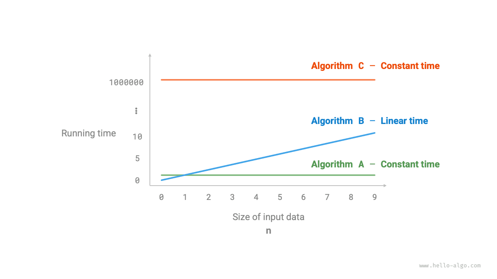
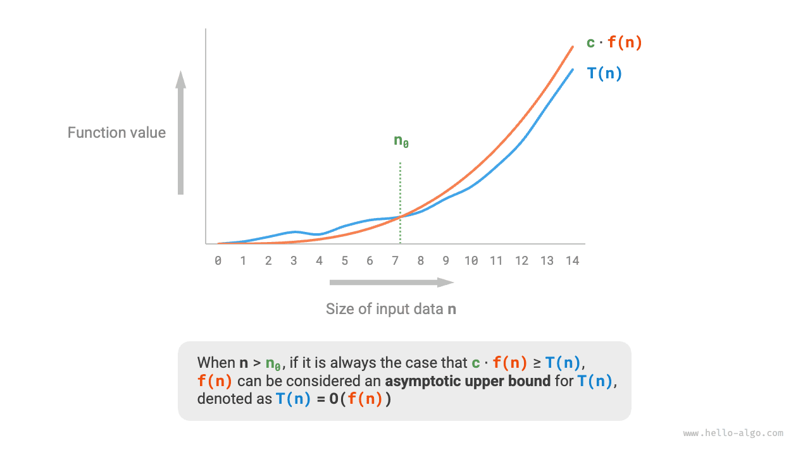
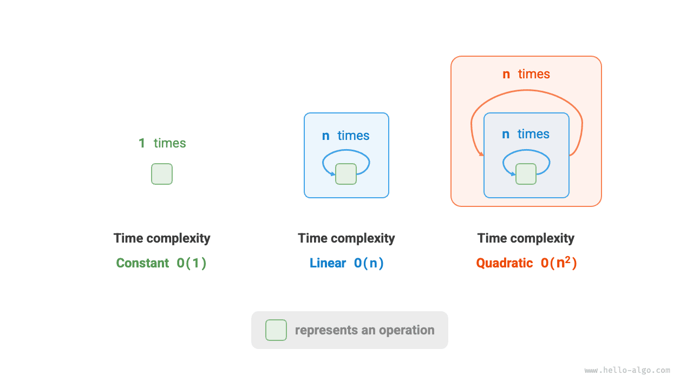

# Độ phức tạp thời gian

Thời gian chạy có thể phản ánh trực quan và chính xác hiệu quả của một thuật toán. Nếu muốn ước tính chính xác thời gian chạy của một đoạn mã, chúng ta nên thực hiện như thế nào?

1. **Xác định nền tảng chạy**, bao gồm cấu hình phần cứng, ngôn ngữ lập trình, môi trường hệ thống, v.v., vì tất cả những yếu tố này đều ảnh hưởng đến hiệu suất thực thi mã.
2. **Đánh giá thời gian chạy cần thiết cho các phép tính khác nhau**, chẳng hạn như một phép cộng `+` cần 1 ns, một phép nhân `*` cần 10 ns, một phép in `print()` cần 5 ns, v.v.
3. **Đếm tất cả các phép tính trong mã**, sau đó cộng thời gian thực thi của tất cả các phép tính để thu được thời gian chạy.

Ví dụ, trong đoạn mã sau, kích thước dữ liệu đầu vào là $n$:

=== "Python"

    ```python title=""
    # Trên một nền tảng chạy nhất định
    def algorithm(n: int):
        a = 2      # 1 ns
        a = a + 1  # 1 ns
        a = a * 2  # 10 ns
        # Lặp n lần
        for _ in range(n):  # 1 ns
            print(0)        # 5 ns
    ```

=== "C++"

    ```cpp title=""
    // Trên một nền tảng chạy nhất định
    void algorithm(int n) {
        int a = 2;  // 1 ns
        a = a + 1;  // 1 ns
        a = a * 2;  // 10 ns
        // Lặp n lần
        for (int i = 0; i < n; i++) {  // 1 ns
            cout << 0 << endl;         // 5 ns
        }
    }
    ```

=== "Java"

    ```java title=""
    // Trên một nền tảng chạy nhất định
    void algorithm(int n) {
        int a = 2;  // 1 ns
        a = a + 1;  // 1 ns
        a = a * 2;  // 10 ns
        // Lặp n lần
        for (int i = 0; i < n; i++) {  // 1 ns
            System.out.println(0);     // 5 ns
        }
    }
    ```

=== "C#"

    ```csharp title=""
    // Trên một nền tảng chạy nhất định
    void Algorithm(int n) {
        int a = 2;  // 1 ns
        a = a + 1;  // 1 ns
        a = a * 2;  // 10 ns
        // Lặp n lần
        for (int i = 0; i < n; i++) {  // 1 ns
            Console.WriteLine(0);      // 5 ns
        }
    }
    ```

=== "Go"

    ```go title=""
    // Trên một nền tảng chạy nhất định
    func algorithm(n int) {
        a := 2     // 1 ns
        a = a + 1  // 1 ns
        a = a * 2  // 10 ns
        // Lặp n lần
        for i := 0; i < n; i++ {  // 1 ns
            fmt.Println(a)        // 5 ns
        }
    }
    ```

=== "Swift"

    ```swift title=""
    // Trên một nền tảng chạy nhất định
    func algorithm(n: Int) {
        var a = 2 // 1 ns
        a = a + 1 // 1 ns
        a = a * 2 // 10 ns
        // Lặp n lần
        for _ in 0 ..< n { // 1 ns
            print(0) // 5 ns
        }
    }
    ```

=== "JS"

    ```javascript title=""
    // Trên một nền tảng chạy nhất định
    function algorithm(n) {
        var a = 2; // 1 ns
        a = a + 1; // 1 ns
        a = a * 2; // 10 ns
        // Lặp n lần
        for(let i = 0; i < n; i++) { // 1 ns
            console.log(0); // 5 ns
        }
    }
    ```

=== "TS"

    ```typescript title=""
    // Trên một nền tảng chạy nhất định
    function algorithm(n: number): void {
        var a: number = 2; // 1 ns
        a = a + 1; // 1 ns
        a = a * 2; // 10 ns
        // Lặp n lần
        for(let i = 0; i < n; i++) { // 1 ns
            console.log(0); // 5 ns
        }
    }
    ```

=== "Dart"

    ```dart title=""
    // Trên một nền tảng chạy nhất định
    void algorithm(int n) {
      int a = 2; // 1 ns
      a = a + 1; // 1 ns
      a = a * 2; // 10 ns
      // Lặp n lần
      for (int i = 0; i < n; i++) { // 1 ns
        print(0); // 5 ns
      }
    }
    ```

=== "Rust"

    ```rust title=""
    // Trên một nền tảng chạy nhất định
    fn algorithm(n: i32) {
        let mut a = 2;      // 1 ns
        a = a + 1;          // 1 ns
        a = a * 2;          // 10 ns
        // Lặp n lần
        for _ in 0..n {     // 1 ns
            println!("{}", 0);  // 5 ns
        }
    }
    ```

=== "C"

    ```c title=""
    // Trên một nền tảng chạy nhất định
    void algorithm(int n) {
        int a = 2;  // 1 ns
        a = a + 1;  // 1 ns
        a = a * 2;  // 10 ns
        // Lặp n lần
        for (int i = 0; i < n; i++) {   // 1 ns
            printf("%d", 0);            // 5 ns
        }
    }
    ```

=== "Kotlin"

    ```kotlin title=""
    // Trên một nền tảng chạy nhất định
    fun algorithm(n: Int) {
        var a = 2 // 1 ns
        a = a + 1 // 1 ns
        a = a * 2 // 10 ns
        // Lặp n lần
        for (i in 0..<n) {  // 1 ns
            println(0)      // 5 ns
        }
    }
    ```

=== "Ruby"

    ```ruby title=""
    # Trên một nền tảng chạy nhất định
    def algorithm(n)
        a = 2       # 1 ns
        a = a + 1   # 1 ns
        a = a * 2   # 10 ns
        # Lặp n lần
        (0...n).each do # 1 ns
            puts 0      # 5 ns
        end
    end
    ```

Theo phương pháp trên, thời gian chạy của thuật toán có thể được tính là $(6n + 12)$ ns:

$$
1 + 1 + 10 + (1 + 5) \times n = 6n + 12
$$

Tuy nhiên, trong thực tế, **việc cố gắng đếm chính xác thời gian chạy của một thuật toán là không thực tế và không khả thi**. Trước hết, chúng ta không muốn gắn thời gian ước tính với nền tảng chạy, vì các thuật toán cần chạy trên nhiều nền tảng khác nhau. Thứ hai, rất khó biết thời gian chạy của từng loại phép tính, khiến quá trình ước tính trở nên cực kỳ khó khăn.

## Đếm xu hướng tăng trưởng của thời gian

Phân tích độ phức tạp thời gian không đếm thời gian chạy của thuật toán, **mà đếm xu hướng tăng trưởng của thời gian chạy thuật toán khi khối lượng dữ liệu tăng lên**.

Khái niệm “xu hướng tăng trưởng của thời gian” khá trừu tượng; hãy cùng tìm hiểu qua một ví dụ. Giả sử kích thước dữ liệu đầu vào là $n$, và cho ba thuật toán `A`, `B` và `C`:

=== "Python"

    ```python title=""
    # Độ phức tạp thời gian của thuật toán A: bậc hằng số
    def algorithm_A(n: int):
        print(0)
    # Độ phức tạp thời gian của thuật toán B: bậc tuyến tính
    def algorithm_B(n: int):
        for _ in range(n):
            print(0)
    # Độ phức tạp thời gian của thuật toán C: bậc hằng số
    def algorithm_C(n: int):
        for _ in range(1000000):
            print(0)
    ```

=== "C++"

    ```cpp title=""
    // Độ phức tạp thời gian của thuật toán A: bậc hằng số
    void algorithm_A(int n) {
        cout << 0 << endl;
    }
    // Độ phức tạp thời gian của thuật toán B: bậc tuyến tính
    void algorithm_B(int n) {
        for (int i = 0; i < n; i++) {
            cout << 0 << endl;
        }
    }
    // Độ phức tạp thời gian của thuật toán C: bậc hằng số
    void algorithm_C(int n) {
        for (int i = 0; i < 1000000; i++) {
            cout << 0 << endl;
        }
    }
    ```

=== "Java"

    ```java title=""
    // Độ phức tạp thời gian của thuật toán A: bậc hằng số
    void algorithm_A(int n) {
        System.out.println(0);
    }
    // Độ phức tạp thời gian của thuật toán B: bậc tuyến tính
    void algorithm_B(int n) {
        for (int i = 0; i < n; i++) {
            System.out.println(0);
        }
    }
    // Độ phức tạp thời gian của thuật toán C: bậc hằng số
    void algorithm_C(int n) {
        for (int i = 0; i < 1000000; i++) {
            System.out.println(0);
        }
    }
    ```

=== "C#"

    ```csharp title=""
    // Độ phức tạp thời gian của thuật toán A: bậc hằng số
    void AlgorithmA(int n) {
        Console.WriteLine(0);
    }
    // Độ phức tạp thời gian của thuật toán B: bậc tuyến tính
    void AlgorithmB(int n) {
        for (int i = 0; i < n; i++) {
            Console.WriteLine(0);
        }
    }
    // Độ phức tạp thời gian của thuật toán C: bậc hằng số
    void AlgorithmC(int n) {
        for (int i = 0; i < 1000000; i++) {
            Console.WriteLine(0);
        }
    }
    ```

=== "Go"

    ```go title=""
    // Độ phức tạp thời gian của thuật toán A: bậc hằng số
    func algorithm_A(n int) {
        fmt.Println(0)
    }
    // Độ phức tạp thời gian của thuật toán B: bậc tuyến tính
    func algorithm_B(n int) {
        for i := 0; i < n; i++ {
            fmt.Println(0)
        }
    }
    // Độ phức tạp thời gian của thuật toán C: bậc hằng số
    func algorithm_C(n int) {
        for i := 0; i < 1000000; i++ {
            fmt.Println(0)
        }
    }
    ```

=== "Swift"

    ```swift title=""
    // Độ phức tạp thời gian của thuật toán A: bậc hằng số
    func algorithmA(n: Int) {
        print(0)
    }

    // Độ phức tạp thời gian của thuật toán B: bậc tuyến tính
    func algorithmB(n: Int) {
        for _ in 0 ..< n {
            print(0)
        }
    }

    // Độ phức tạp thời gian của thuật toán C: bậc hằng số
    func algorithmC(n: Int) {
        for _ in 0 ..< 1_000_000 {
            print(0)
        }
    }
    ```

=== "JS"

    ```javascript title=""
    // Độ phức tạp thời gian của thuật toán A: bậc hằng số
    function algorithm_A(n) {
        console.log(0);
    }
    // Độ phức tạp thời gian của thuật toán B: bậc tuyến tính
    function algorithm_B(n) {
        for (let i = 0; i < n; i++) {
            console.log(0);
        }
    }
    // Độ phức tạp thời gian của thuật toán C: bậc hằng số
    function algorithm_C(n) {
        for (let i = 0; i < 1000000; i++) {
            console.log(0);
        }
    }

    ```

=== "TS"

    ```typescript title=""
    // Độ phức tạp thời gian của thuật toán A: cấp hằng số
    function algorithm_A(n: number): void {
        console.log(0);
    }
    // Độ phức tạp thời gian của thuật toán B: cấp tuyến tính
    function algorithm_B(n: number): void {
        for (let i = 0; i < n; i++) {
            console.log(0);
        }
    }
    // Độ phức tạp thời gian của thuật toán C: cấp hằng số
    function algorithm_C(n: number): void {
        for (let i = 0; i < 1000000; i++) {
            console.log(0);
        }
    }
    ```

=== "Dart"

    ```dart title=""
    // Độ phức tạp thời gian của thuật toán A: cấp hằng số
    void algorithmA(int n) {
      print(0);
    }
    // Độ phức tạp thời gian của thuật toán B: cấp tuyến tính
    void algorithmB(int n) {
      for (int i = 0; i < n; i++) {
        print(0);
      }
    }
    // Độ phức tạp thời gian của thuật toán C: cấp hằng số
    void algorithmC(int n) {
      for (int i = 0; i < 1000000; i++) {
        print(0);
      }
    }
    ```

=== "Rust"

    ```rust title=""
    // Độ phức tạp thời gian của thuật toán A: cấp hằng số
    fn algorithm_A(n: i32) {
        println!("{}", 0);
    }
    // Độ phức tạp thời gian của thuật toán B: cấp tuyến tính
    fn algorithm_B(n: i32) {
        for _ in 0..n {
            println!("{}", 0);
        }
    }
    // Độ phức tạp thời gian của thuật toán C: cấp hằng số
    fn algorithm_C(n: i32) {
        for _ in 0..1000000 {
            println!("{}", 0);
        }
    }
    ```

=== "C"

    ```c title=""
    // Độ phức tạp thời gian của thuật toán A: cấp hằng số
    void algorithm_A(int n) {
        printf("%d", 0);
    }
    // Độ phức tạp thời gian của thuật toán B: cấp tuyến tính
    void algorithm_B(int n) {
        for (int i = 0; i < n; i++) {
            printf("%d", 0);
        }
    }
    // Độ phức tạp thời gian của thuật toán C: cấp hằng số
    void algorithm_C(int n) {
        for (int i = 0; i < 1000000; i++) {
            printf("%d", 0);
        }
    }
    ```

=== "Kotlin"

    ```kotlin title=""
    // Độ phức tạp thời gian của thuật toán A: cấp hằng số
    fun algoritm_A(n: Int) {
        println(0)
    }
    // Độ phức tạp thời gian của thuật toán B: cấp tuyến tính
    fun algorithm_B(n: Int) {
        for (i in 0..<n){
            println(0)
        }
    }
    // Độ phức tạp thời gian của thuật toán C: cấp hằng số
    fun algorithm_C(n: Int) {
        for (i in 0..<1000000) {
            println(0)
        }
    }
    ```

=== "Ruby"

    ```ruby title=""
    # Độ phức tạp thời gian của thuật toán A: cấp hằng số
    def algorithm_A(n)
        puts 0
    end

    # Độ phức tạp thời gian của thuật toán B: cấp tuyến tính
    def algorithm_B(n)
        (0...n).each { puts 0 }
    end

    # Độ phức tạp thời gian của thuật toán C: cấp hằng số
    def algorithm_C(n)
        (0...1_000_000).each { puts 0 }
    end
    ```

Hình dưới đây cho thấy độ phức tạp thời gian của ba hàm thuật toán trên.

- Thuật toán `A` chỉ có $1$ thao tác in, và thời gian chạy của thuật toán không tăng khi $n$ tăng. Độ phức tạp thời gian của thuật toán này được gọi là "cấp hằng số".
- Trong thuật toán `B`, thao tác in cần lặp $n$ lần, và thời gian chạy của thuật toán tăng tuyến tính khi $n$ tăng. Độ phức tạp thời gian của thuật toán này được gọi là "cấp tuyến tính".
- Trong thuật toán `C`, thao tác in cần lặp $1000000$ lần. Mặc dù thời gian chạy rất dài, nó không phụ thuộc vào kích thước dữ liệu đầu vào $n$. Do đó, độ phức tạp thời gian của `C` giống với `A`, vẫn là "cấp hằng số".



So với việc đếm trực tiếp thời gian chạy của thuật toán, phân tích độ phức tạp thời gian có những đặc điểm gì?

- **Độ phức tạp thời gian có thể đánh giá hiệu quả của thuật toán một cách hiệu quả**. Ví dụ, thời gian chạy của thuật toán `B` tăng tuyến tính; khi $n > 1$, nó chậm hơn thuật toán `A`, và khi $n > 1000000$, nó chậm hơn thuật toán `C`. Trên thực tế, chỉ cần kích thước dữ liệu đầu vào $n$ đủ lớn, thuật toán có độ phức tạp "cấp hằng số" sẽ luôn vượt trội hơn thuật toán có độ phức tạp "cấp tuyến tính", đây chính là ý nghĩa của xu hướng tăng trưởng thời gian.
- **Phương pháp suy ra độ phức tạp thời gian đơn giản hơn**. Rõ ràng, nền tảng chạy và loại thao tác tính toán đều không liên quan đến xu hướng tăng trưởng thời gian chạy của thuật toán. Vì vậy, trong phân tích độ phức tạp thời gian, ta có thể đơn giản coi thời gian thực thi của mọi thao tác tính toán là cùng một "đơn vị thời gian", chuyển việc "theo dõi thời gian chạy của từng thao tác" thành "đếm số thao tác", nhờ đó giảm đáng kể độ khó của việc ước tính.
- **Độ phức tạp thời gian cũng có những hạn chế nhất định**. Ví dụ, mặc dù các thuật toán `A` và `C` có cùng độ phức tạp thời gian, thời gian chạy thực tế của chúng lại khác nhau đáng kể. Tương tự, mặc dù thuật toán `B` có độ phức tạp thời gian cao hơn `C`, khi kích thước dữ liệu đầu vào $n$ nhỏ, thuật toán `B` rõ ràng vượt trội hơn thuật toán `C`. Trong những trường hợp này, thường khó đánh giá hiệu quả của các thuật toán chỉ dựa trên độ phức tạp thời gian. Tất nhiên, bất chấp những vấn đề trên, phân tích độ phức tạp vẫn là phương pháp hiệu quả nhất và được sử dụng phổ biến nhất để đánh giá hiệu quả của thuật toán.

## Cận trên tiệm cận của hàm số

Cho một hàm có kích thước đầu vào $n$:

=== "Python"

    ```python title=""
    def algorithm(n: int):
        a = 1      # +1
        a = a + 1  # +1
        a = a * 2  # +1
        # Lặp n lần
        for i in range(n):  # +1
            print(0)        # +1
    ```

=== "C++"

    ```cpp title=""
    void algorithm(int n) {
        int a = 1;  // +1
        a = a + 1;  // +1
        a = a * 2;  // +1
        // Lặp n lần
        for (int i = 0; i < n; i++) { // +1 (i++ được thực thi mỗi vòng)
            cout << 0 << endl;    // +1
        }
    }
    ```

=== "Java"

    ```java title=""
    void algorithm(int n) {
        int a = 1;  // +1
        a = a + 1;  // +1
        a = a * 2;  // +1
        // Lặp n lần
        for (int i = 0; i < n; i++) { // +1 (i++ được thực thi mỗi vòng)
            System.out.println(0);    // +1
        }
    }
    ```

=== "C#"

    ```csharp title=""
    void Algorithm(int n) {
        int a = 1;  // +1
        a = a + 1;  // +1
        a = a * 2;  // +1
        // Lặp n lần
        for (int i = 0; i < n; i++) {   // +1 (i++ được thực thi mỗi vòng)
            Console.WriteLine(0);   // +1
        }
    }
    ```

=== "Go"

    ```go title=""
    func algorithm(n int) {
        a := 1      // +1
        a = a + 1   // +1
        a = a * 2   // +1
        // Lặp n lần
        for i := 0; i < n; i++ {   // +1
            fmt.Println(a)         // +1
        }
    }
    ```

=== "Swift"

    ```swift title=""
    func algorithm(n: Int) {
        var a = 1 // +1
        a = a + 1 // +1
        a = a * 2 // +1
        // Lặp n lần
        for _ in 0 ..< n { // +1
            print(0) // +1
        }
    }
    ```

=== "JS"

    ```javascript title=""
    function algorithm(n) {
        var a = 1; // +1
        a += 1; // +1
        a *= 2; // +1
        // Lặp n lần
        for(let i = 0; i < n; i++){ // +1 (i++ được thực thi mỗi vòng)
            console.log(0); // +1
        }
    }
    ```

=== "TS"

    ```typescript title=""
    function algorithm(n: number): void{
        var a: number = 1; // +1
        a += 1; // +1
        a *= 2; // +1
        // Lặp n lần
        for(let i = 0; i < n; i++){ // +1 (i++ được thực thi mỗi vòng)
            console.log(0); // +1
        }
    }
    ```

=== "Dart"

    ```dart title=""
    void algorithm(int n) {
      int a = 1; // +1
      a = a + 1; // +1
      a = a * 2; // +1
      // Lặp n lần
      for (int i = 0; i < n; i++) { // +1 (i++ được thực thi mỗi vòng)
        print(0); // +1
      }
    }
    ```

=== "Rust"

    ```rust title=""
    fn algorithm(n: i32) {
        let mut a = 1;   // +1
        a = a + 1;      // +1
        a = a * 2;      // +1

        // Lặp n lần
        for _ in 0..n { // +1 (i++ được thực thi mỗi vòng)
            println!("{}", 0); // +1
        }
    }
    ```

=== "C"

    ```c title=""
    void algorithm(int n) {
        int a = 1;  // +1
        a = a + 1;  // +1
        a = a * 2;  // +1
        // Lặp n lần
        for (int i = 0; i < n; i++) {   // +1 (i++ được thực thi mỗi vòng)
            printf("%d", 0);            // +1
        }
    }
    ```

=== "Kotlin"

    ```kotlin title=""
    fun algorithm(n: Int) {
        var a = 1 // +1
        a = a + 1 // +1
        a = a * 2 // +1
        // Lặp n lần
        for (i in 0..<n) { // +1 (i++ được thực thi mỗi vòng)
            println(0) // +1
        }
    }
    ```

=== "Ruby"

    ```ruby title=""
    def algorithm(n)
        a = 1       # +1
        a = a + 1   # +1
        a = a * 2   # +1
        # Lặp n lần
        (0...n).each do # +1
            puts 0      # +1
        end
    end
    ```

Gọi số thao tác của thuật toán là một hàm của kích thước dữ liệu đầu vào $n$, ký hiệu là $T(n)$. Khi đó, số thao tác của hàm trên là:

$$
T(n) = 3 + 2n
$$

$T(n)$ là một hàm tuyến tính, cho biết xu hướng tăng trưởng thời gian chạy của nó là tuyến tính, vì vậy độ phức tạp thời gian của nó là cấp tuyến tính.

Chúng ta ký hiệu độ phức tạp thời gian tuyến tính là $O(n)$. Ký hiệu toán học này được gọi là <u>ký hiệu big-$O$</u>, biểu diễn <u>cận trên tiệm cận</u> của hàm $T(n)$.

Về bản chất, việc phân tích độ phức tạp thời gian là tính cận trên tiệm cận của “số phép toán $T(n)$”, vốn có một định nghĩa toán học rõ ràng.

!!! note "Cận trên tiệm cận của các hàm"

    Nếu tồn tại các số thực dương $c$ và $n_0$ sao cho với mọi $n > n_0$, ta có $T(n) \leq c \cdot f(n)$, thì $f(n)$ có thể được xem là cận trên tiệm cận của $T(n)$, ký hiệu là $T(n) = O(f(n))$.

Như minh họa trong hình dưới đây, việc tính cận trên tiệm cận là tìm một hàm $f(n)$ sao cho khi $n$ tiến tới vô hạn, $T(n)$ và $f(n)$ có cùng bậc tăng trưởng, chỉ khác nhau bởi một hệ số hằng số $c$.



## Phương pháp suy ra

Ý tưởng về cận trên tiệm cận có phần mang tính toán học. Nếu bạn cảm thấy mình chưa hoàn toàn hiểu, đừng lo lắng. Trước hết, chúng ta có thể nắm vững phương pháp suy ra, rồi dần dần hiểu ý nghĩa toán học của nó thông qua việc luyện tập liên tục.

Theo định nghĩa, sau khi xác định được $f(n)$, chúng ta có thể thu được độ phức tạp thời gian $O(f(n))$. Vậy làm thế nào để xác định cận trên tiệm cận $f(n)$? Nhìn chung, quá trình này được chia thành hai bước: trước tiên đếm số phép toán, sau đó xác định cận trên tiệm cận.

### Bước 1: Đếm số phép toán

Đối với code, hãy đếm từng dòng từ trên xuống dưới. Tuy nhiên, vì hệ số hằng số $c$ trong $c \cdot f(n)$ ở trên có thể có giá trị bất kỳ, **các hệ số và hạng số trong số phép toán $T(n)$ đều có thể được bỏ qua**. Dựa trên nguyên tắc này, có thể tóm tắt các kỹ thuật đơn giản hóa việc đếm như sau.

1. **Bỏ qua các hằng số trong $T(n)$**. Vì chúng không phụ thuộc vào $n$, nên không ảnh hưởng đến độ phức tạp thời gian.
2. **Bỏ qua tất cả các hệ số**. Ví dụ, vòng lặp chạy $2n$ lần, $5n + 1$ lần, v.v. đều có thể được đơn giản hóa thành $n$ lần, vì hệ số đứng trước $n$ không ảnh hưởng đến độ phức tạp thời gian.
3. **Dùng phép nhân cho các vòng lặp lồng nhau**. Tổng số phép toán bằng tích của số phép toán trong vòng lặp bên ngoài và vòng lặp bên trong; ở mỗi tầng của vòng lặp, vẫn có thể áp dụng riêng các kỹ thuật `1.` và `2.`.

Với một hàm, chúng ta có thể dùng các kỹ thuật trên để đếm số phép toán:

=== "Python"

    ```python title=""
    def algorithm(n: int):
        a = 1      # +0 (Kỹ thuật 1)
        a = a + n  # +0 (Kỹ thuật 1)
        # +n (Kỹ thuật 2)
        for i in range(5 * n + 1):
            print(0)
        # +n*n (Kỹ thuật 3)
        for i in range(2 * n):
            for j in range(n + 1):
                print(0)
    ```

=== "C++"

    ```cpp title=""
    void algorithm(int n) {
        int a = 1;  // +0 (Kỹ thuật 1)
        a = a + n;  // +0 (Kỹ thuật 1)
        // +n (Kỹ thuật 2)
        for (int i = 0; i < 5 * n + 1; i++) {
            cout << 0 << endl;
        }
        // +n*n (Kỹ thuật 3)
        for (int i = 0; i < 2 * n; i++) {
            for (int j = 0; j < n + 1; j++) {
                cout << 0 << endl;
            }
        }
    }
    ```

=== "Java"

    ```java title=""
    void algorithm(int n) {
        int a = 1;  // +0 (Kỹ thuật 1)
        a = a + n;  // +0 (Kỹ thuật 1)
        // +n (Kỹ thuật 2)
        for (int i = 0; i < 5 * n + 1; i++) {
            System.out.println(0);
        }
        // +n*n (Kỹ thuật 3)
        for (int i = 0; i < 2 * n; i++) {
            for (int j = 0; j < n + 1; j++) {
                System.out.println(0);
            }
        }
    }
    ```

=== "C#"

    ```csharp title=""
    void Algorithm(int n) {
        int a = 1;  // +0 (Kỹ thuật 1)
        a = a + n;  // +0 (Kỹ thuật 1)
        // +n (Kỹ thuật 2)
        for (int i = 0; i < 5 * n + 1; i++) {
            Console.WriteLine(0);
        }
        // +n*n (Kỹ thuật 3)
        for (int i = 0; i < 2 * n; i++) {
            for (int j = 0; j < n + 1; j++) {
                Console.WriteLine(0);
            }
        }
    }
    ```

=== "Go"

    ```go title=""
    func algorithm(n int) {
        a := 1     // +0 (Kỹ thuật 1)
        a = a + n  // +0 (Kỹ thuật 1)
        // +n (Kỹ thuật 2)
        for i := 0; i < 5 * n + 1; i++ {
            fmt.Println(0)
        }
        // +n*n (Kỹ thuật 3)
        for i := 0; i < 2 * n; i++ {
            for j := 0; j < n + 1; j++ {
                fmt.Println(0)
            }
        }
    }
    ```

=== "Swift"

    ```swift title=""
    func algorithm(n: Int) {
        var a = 1 // +0 (Kỹ thuật 1)
        a = a + n // +0 (Kỹ thuật 1)
        // +n (Kỹ thuật 2)
        for _ in 0 ..< (5 * n + 1) {
            print(0)
        }
        // +n*n (Kỹ thuật 3)
        for _ in 0 ..< (2 * n) {
            for _ in 0 ..< (n + 1) {
                print(0)
            }
        }
    }
    ```

=== "JS"

    ```javascript title=""
    function algorithm(n) {
        let a = 1;  // +0 (Kỹ thuật 1)
        a = a + n;  // +0 (Kỹ thuật 1)
        // +n (Kỹ thuật 2)
        for (let i = 0; i < 5 * n + 1; i++) {
            console.log(0);
        }
        // +n*n (Kỹ thuật 3)
        for (let i = 0; i < 2 * n; i++) {
            for (let j = 0; j < n + 1; j++) {
                console.log(0);
            }
        }
    }
    ```

=== "TS"

    ```typescript title=""
    function algorithm(n: number): void {
        let a = 1;  // +0 (Kỹ thuật 1)
        a = a + n;  // +0 (Kỹ thuật 1)
        // +n (Kỹ thuật 2)
        for (let i = 0; i < 5 * n + 1; i++) {
            console.log(0);
        }
        // +n*n (Kỹ thuật 3)
        for (let i = 0; i < 2 * n; i++) {
            for (let j = 0; j < n + 1; j++) {
                console.log(0);
            }
        }
    }
    ```

=== "Dart"

    ```dart title=""
    void algorithm(int n) {
      int a = 1; // +0 (Kỹ thuật 1)
      a = a + n; // +0 (Kỹ thuật 1)
      // +n (Kỹ thuật 2)
      for (int i = 0; i < 5 * n + 1; i++) {
        print(0);
      }
      // +n*n (Kỹ thuật 3)
      for (int i = 0; i < 2 * n; i++) {
        for (int j = 0; j < n + 1; j++) {
          print(0);
        }
      }
    }
    ```

=== "Rust"

    ```rust title=""
    fn algorithm(n: i32) {
        let mut a = 1;     // +0 (Kỹ thuật 1)
        a = a + n;        // +0 (Kỹ thuật 1)

        // +n (Kỹ thuật 2)
        for i in 0..(5 * n + 1) {
            println!("{}", 0);
        }

        // +n*n (Kỹ thuật 3)
        for i in 0..(2 * n) {
            for j in 0..(n + 1) {
                println!("{}", 0);
            }
        }
    }
    ```

=== "C"

    ```c title=""
    void algorithm(int n) {
        int a = 1;  // +0 (Kỹ thuật 1)
        a = a + n;  // +0 (Kỹ thuật 1)
        // +n (Kỹ thuật 2)
        for (int i = 0; i < 5 * n + 1; i++) {
            printf("%d", 0);
        }
        // +n*n (Kỹ thuật 3)
        for (int i = 0; i < 2 * n; i++) {
            for (int j = 0; j < n + 1; j++) {
                printf("%d", 0);
            }
        }
    }
    ```

=== "Kotlin"

    ```kotlin title=""
    fun algorithm(n: Int) {
        var a = 1   // +0 (Kỹ thuật 1)
        a = a + n   // +0 (Kỹ thuật 1)
        // +n (Kỹ thuật 2)
        for (i in 0..<5 * n + 1) {
            println(0)
        }
        // +n*n (Kỹ thuật 3)
        for (i in 0..<2 * n) {
            for (j in 0..<n + 1) {
                println(0)
            }
        }
    }
    ```

=== "Ruby"

    ```ruby title=""
    def algorithm(n)
        a = 1       # +0 (Kỹ thuật 1)
        a = a + n   # +0 (Kỹ thuật 1)
        # +n (Kỹ thuật 2)
        (0...(5 * n + 1)).each do { puts 0 }
        # +n*n (Kỹ thuật 3)
        (0...(2 * n)).each do
            (0...(n + 1)).each do { puts 0 }
        end
    end
    ```

Công thức sau đây cho thấy kết quả đếm trước và sau khi áp dụng các kỹ thuật trên; cả hai đều suy ra độ phức tạp thời gian là $O(n^2)$.

$$
\begin{aligned}
T(n) & = 2n(n + 1) + (5n + 1) + 2 & \text{Complete count (-.-|||)} \newline
& = 2n^2 + 7n + 3 \newline
T(n) & = n^2 + n & \text{Simplified count (o.O)}
\end{aligned}
$$

### Bước 2: Xác định cận trên tiệm cận

**Độ phức tạp thời gian được quyết định bởi hạng bậc cao nhất trong $T(n)$**. Điều này là do khi $n$ tiến tới vô hạn, hạng bậc cao nhất sẽ đóng vai trò chi phối, còn ảnh hưởng của các hạng khác có thể được bỏ qua.

Bảng dưới đây đưa ra một số ví dụ, trong đó một số giá trị được cố tình phóng đại để nhấn mạnh kết luận rằng “các hệ số không thể làm thay đổi bậc”. Khi $n$ tiến tới vô hạn, các hằng số này trở nên không đáng kể.

<p align="center"> Bảng <id> &nbsp; Độ phức tạp thời gian tương ứng với các số phép toán khác nhau </p>

| Số phép toán $T(n)$ | Độ phức tạp thời gian $O(f(n))$ |
| ---------------------- | -------------------- |
| $100000$               | $O(1)$               |
| $3n + 2$               | $O(n)$               |
| $2n^2 + 3n + 2$        | $O(n^2)$             |
| $n^3 + 10000n^2$       | $O(n^3)$             |
| $2^n + 10000n^{10000}$ | $O(2^n)$             |

## Các loại phổ biến

Cho kích thước dữ liệu đầu vào là $n$. Các loại độ phức tạp thời gian phổ biến được minh họa trong hình dưới đây (sắp xếp theo thứ tự từ thấp đến cao).

$$
\begin{aligned}
& O(1) < O(\log n) < O(n) < O(n \log n) < O(n^2) < O(2^n) < O(n!) \newline
& \text{Constant} < \text{Logarithmic} < \text{Linear} < \text{Linearithmic} < \text{Quadratic} < \text{Exponential} < \text{Factorial}
\end{aligned}
$$


### Độ phức tạp hằng số $O(1)$

Số phép toán trong độ phức tạp hằng số không phụ thuộc vào kích thước dữ liệu đầu vào $n$, nghĩa là không thay đổi khi $n$ thay đổi.

Trong hàm sau, mặc dù giá trị của `size` có thể lớn, nhưng nó không phụ thuộc vào kích thước dữ liệu đầu vào $n$, vì vậy độ phức tạp thời gian vẫn là $O(1)$:

```src
[file]{time_complexity}-[class]{}-[func]{constant}
```

### Độ phức tạp tuyến tính $O(n)$

Số phép toán trong độ phức tạp tuyến tính tăng tuyến tính theo kích thước dữ liệu đầu vào $n$. Độ phức tạp tuyến tính thường xuất hiện trong các vòng lặp đơn:

```src
[file]{time_complexity}-[class]{}-[func]{linear}
```

Các thao tác như duyệt mảng và duyệt danh sách liên kết có độ phức tạp thời gian là $O(n)$, trong đó $n$ là độ dài của mảng hoặc danh sách liên kết:

```src
[file]{time_complexity}-[class]{}-[func]{array_traversal}
```

Cần lưu ý rằng **kích thước dữ liệu đầu vào $n$ phải được xác định dựa trên loại dữ liệu đầu vào**. Ví dụ, trong ví dụ đầu tiên, biến $n$ là kích thước dữ liệu đầu vào; trong ví dụ thứ hai, độ dài mảng $n$ là kích thước dữ liệu.

### Độ phức tạp bậc hai $O(n^2)$

Số phép toán trong độ phức tạp bậc hai tăng theo bình phương kích thước dữ liệu đầu vào $n$. Độ phức tạp bậc hai thường xuất hiện trong các vòng lặp lồng nhau, trong đó cả vòng lặp bên ngoài và bên trong đều có độ phức tạp thời gian là $O(n)$, dẫn đến độ phức tạp thời gian tổng thể là $O(n^2)$:

```src
[file]{time_complexity}-[class]{}-[func]{quadratic}
```

Hình dưới đây so sánh độ phức tạp thời gian hằng số, tuyến tính và bậc hai.



Lấy bubble sort làm ví dụ, vòng lặp bên ngoài thực thi $n - 1$ lần, còn vòng lặp bên trong thực thi lần lượt $n-1$, $n-2$, $\dots$, $2$, $1$ lần, trung bình là $n / 2$ lần, dẫn đến độ phức tạp thời gian $O((n - 1) n / 2) = O(n^2)$:

```src
[file]{time_complexity}-[class]{}-[func]{bubble_sort}
```

### Độ phức tạp mũ $O(2^n)$

“Phân chia tế bào” trong sinh học là một ví dụ điển hình về sự tăng trưởng theo cấp số mũ: trạng thái ban đầu có $1$ tế bào, sau một lần phân chia trở thành $2$, sau hai lần trở thành $4$, và cứ tiếp tục như vậy; sau $n$ lần phân chia sẽ có $2^n$ tế bào.

Hình dưới đây và đoạn mã sau mô phỏng quá trình phân chia tế bào, với độ phức tạp thời gian là $O(2^n)$. Lưu ý rằng đầu vào $n$ biểu thị số lần phân chia, còn giá trị trả về `count` biểu thị tổng số lần phân chia.

```src
[file]{time_complexity}-[class]{}-[func]{exponential}
```


Trong các thuật toán thực tế, độ phức tạp mũ thường xuất hiện trong các hàm đệ quy. Ví dụ, đoạn mã sau liên tục chia thành hai nhánh và dừng sau $n$ lần chia:

```src
[file]{time_complexity}-[class]{}-[func]{exp_recur}
```

Tốc độ tăng của độ phức tạp mũ rất nhanh và thường gặp trong các phương pháp vét cạn (tìm kiếm brute force, quay lui, v.v.). Với các bài toán có quy mô dữ liệu lớn, độ phức tạp mũ là không thể chấp nhận được và thường cần dùng quy hoạch động hoặc thuật toán tham lam để giải quyết.

### Độ phức tạp logarit $O(\log n)$

Trái ngược với độ phức tạp mũ, độ phức tạp logarit phản ánh tình huống “giảm một nửa sau mỗi vòng”. Giả sử kích thước dữ liệu đầu vào là $n$. Vì kích thước giảm một nửa sau mỗi vòng, số vòng lặp là $\log_2 n$, là hàm ngược của $2^n$.

Hình dưới đây và đoạn mã sau mô phỏng quá trình “giảm một nửa sau mỗi vòng”, với độ phức tạp thời gian là $O(\log_2 n)$, được viết gọn là $O(\log n)$:

```src
[file]{time_complexity}-[class]{}-[func]{logarithmic}
```


Tương tự độ phức tạp mũ, độ phức tạp logarit cũng thường xuất hiện trong các hàm đệ quy. Đoạn mã sau tạo thành một cây đệ quy có chiều cao $\log_2 n$:

```src
[file]{time_complexity}-[class]{}-[func]{log_recur}
```

Độ phức tạp logarit thường xuất hiện trong các thuật toán dựa trên chiến lược chia để trị, phản ánh ý tưởng liên tục chia nhỏ và đơn giản hóa bài toán. Nó tăng chậm và là độ phức tạp thời gian lý tưởng chỉ đứng sau độ phức tạp hằng số.

!!! tip "Cơ số của $O(\log n)$ là gì?"

    Nói chính xác, “chia thành $m$ phần” tương ứng với độ phức tạp thời gian $O(\log_m n)$. Dựa trên công thức đổi cơ số logarit, ta có thể nhận được các độ phức tạp với những cơ số khác nhau nhưng tương đương:

    $$
    O(\log_m n) = O(\log_k n / \log_k m) = O(\log_k n)
    $$

    Nói cách khác, có thể chuyển đổi cơ số $m$ mà không ảnh hưởng đến độ phức tạp. Vì vậy, chúng ta thường lược bỏ cơ số $m$ và biểu diễn độ phức tạp logarit đơn giản là $O(\log n)$.

### Độ phức tạp tuyến tính-logarit $O(n \log n)$

Độ phức tạp tuyến tính-logarit thường xuất hiện trong các vòng lặp lồng nhau, trong đó độ phức tạp thời gian của hai lớp vòng lặp lần lượt là $O(\log n)$ và $O(n)$. Đoạn mã liên quan như sau:

```src
[file]{time_complexity}-[class]{}-[func]{linear_log_recur}
```

Hình dưới đây cho thấy cách tạo ra độ phức tạp tuyến tính-logarit. Mỗi cấp của cây nhị phân có tổng cộng $n$ phép toán, và cây có $\log_2 n + 1$ cấp, dẫn đến độ phức tạp thời gian là $O(n \log n)$.


Các thuật toán sắp xếp phổ biến thường có độ phức tạp thời gian $O(n \log n)$, chẳng hạn như quicksort, merge sort và heap sort.

### Độ phức tạp giai thừa $O(n!)$

Độ phức tạp giai thừa tương ứng với bài toán “hoán vị” trong toán học. Cho $n$ phần tử phân biệt, hãy tìm tất cả các cách hoán vị có thể có; số cách là:

$$
n! = n \times (n - 1) \times (n - 2) \times \dots \times 2 \times 1
$$

Giai thừa thường được triển khai bằng đệ quy. Như trong hình dưới đây và đoạn mã sau, cấp đầu tiên tách thành $n$ nhánh, cấp thứ hai tách thành $n - 1$ nhánh, và tiếp tục như vậy cho đến cấp thứ $n$, khi quá trình tách dừng lại:

```src
[file]{time_complexity}-[class]{}-[func]{factorial_recur}
```


Lưu ý rằng vì khi $n \geq 4$ ta luôn có $n! > 2^n$, nên độ phức tạp giai thừa tăng nhanh hơn độ phức tạp mũ và cũng không thể chấp nhận được khi $n$ lớn.

## Độ phức tạp thời gian trong trường hợp xấu nhất, tốt nhất và trung bình

**Hiệu quả thời gian của một thuật toán thường không cố định mà có liên quan đến sự phân bố của dữ liệu đầu vào**. Giả sử ta nhập một mảng `nums` có độ dài $n$, trong đó `nums` gồm các số từ $1$ đến $n$, mỗi số chỉ xuất hiện một lần, nhưng thứ tự các phần tử được xáo trộn ngẫu nhiên. Nhiệm vụ là trả về chỉ số của phần tử $1$. Ta có thể đưa ra các kết luận sau.

- Khi `nums = [?, ?, ..., 1]`, tức là phần tử cuối cùng là $1$, cần duyệt toàn bộ mảng, **đạt độ phức tạp thời gian trong trường hợp xấu nhất là $O(n)$**.
- Khi `nums = [1, ?, ?, ...]`, tức là phần tử đầu tiên là $1$, bất kể mảng dài bao nhiêu, không cần tiếp tục duyệt, **đạt độ phức tạp thời gian trong trường hợp tốt nhất là $\Omega(1)$**.

“Độ phức tạp thời gian trong trường hợp xấu nhất” tương ứng với cận trên tiệm cận của hàm, được biểu diễn bằng ký hiệu big-$O$. Tương ứng, “độ phức tạp thời gian trong trường hợp tốt nhất” tương ứng với cận dưới tiệm cận của hàm, được biểu diễn bằng ký hiệu $\Omega$:

```src
[file]{worst_best_time_complexity}-[class]{}-[func]{find_one}
```

Cần lưu ý rằng trên thực tế, chúng ta hiếm khi sử dụng độ phức tạp thời gian trong trường hợp tốt nhất, vì trường hợp này thường chỉ đạt được với xác suất rất nhỏ và có thể gây hiểu lầm. **Độ phức tạp thời gian trong trường hợp xấu nhất thực tế hơn vì nó cung cấp một giá trị an toàn cho hiệu suất**, giúp chúng ta yên tâm sử dụng thuật toán.

Từ ví dụ trên, ta có thể thấy rằng độ phức tạp thời gian trong trường hợp xấu nhất và tốt nhất chỉ phát sinh với những phân bố đầu vào cụ thể, có thể xảy ra với xác suất rất thấp và không nhất thiết phản ánh đúng hiệu suất chạy của thuật toán. Ngược lại, **độ phức tạp thời gian trung bình có thể phản ánh hiệu suất chạy của thuật toán khi dữ liệu đầu vào là ngẫu nhiên**, được biểu diễn bằng ký hiệu $\Theta$.

Với một số thuật toán, ta có thể đơn giản suy ra trường hợp trung bình khi dữ liệu được phân bố ngẫu nhiên. Ví dụ, trong ví dụ trên, vì mảng đầu vào đã được xáo trộn nên xác suất phần tử $1$ xuất hiện ở bất kỳ chỉ số nào là như nhau, do đó số vòng lặp trung bình của thuật toán là một nửa độ dài mảng $n / 2$, cho độ phức tạp thời gian trung bình là $\Theta(n / 2) = \Theta(n)$.

Tuy nhiên, với các thuật toán phức tạp hơn, việc tính độ phức tạp thời gian trung bình thường khá khó, vì khó phân tích kỳ vọng toán học tổng thể theo phân bố dữ liệu. Trong trường hợp này, chúng ta thường sử dụng độ phức tạp thời gian trong trường hợp xấu nhất làm tiêu chí đánh giá hiệu quả của thuật toán.

!!! question "Tại sao hiếm khi thấy ký hiệu $\Theta$?"

    Có thể là vì ký hiệu $O$ quá dễ nhớ nên chúng ta thường dùng nó để biểu diễn độ phức tạp thời gian trung bình. Tuy nhiên, nói chính xác thì cách làm này không theo chuẩn. Trong cuốn sách này và các tài liệu khác, nếu gặp những biểu thức như “độ phức tạp thời gian trung bình $O(n)$”, hãy hiểu trực tiếp là $\Theta(n)$.