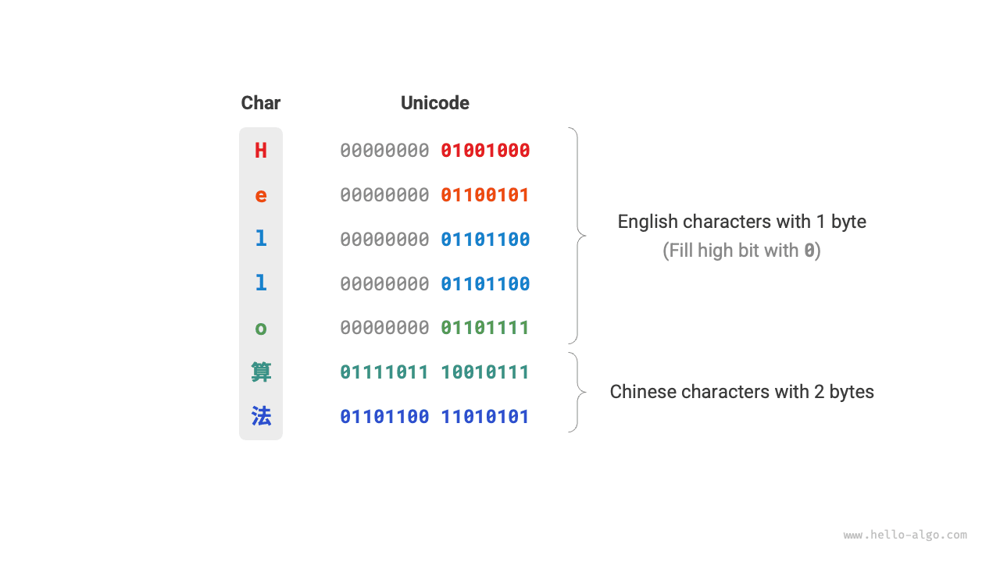

# Mã hóa ký tự *

Trong máy tính, mọi dữ liệu đều được lưu trữ dưới dạng nhị phân, và mã hóa ký tự `char` cũng không ngoại lệ. Để biểu diễn các ký tự, chúng ta cần thiết lập một "bộ ký tự" xác định sự tương ứng một-một giữa mỗi ký tự và các số nhị phân. Với một bộ ký tự, máy tính có thể chuyển đổi các số nhị phân thành ký tự bằng cách tra cứu bảng.

## Bộ ký tự ASCII

<u>Mã ASCII</u> là bộ ký tự ra đời sớm nhất, có tên đầy đủ là American Standard Code for Information Interchange. Bộ ký tự này sử dụng 7 bit nhị phân (7 bit thấp của một byte) để biểu diễn một ký tự và có thể biểu diễn tối đa 128 ký tự khác nhau. Như trong hình dưới đây, mã ASCII bao gồm các chữ cái tiếng Anh viết hoa và viết thường, các chữ số từ 0 ~ 9, một số dấu câu và một số ký tự điều khiển (chẳng hạn như ký tự xuống dòng và tab).

Tuy nhiên, **mã ASCII chỉ có thể biểu diễn tiếng Anh**. Cùng với quá trình toàn cầu hóa máy tính, một bộ ký tự có tên <u>EASCII</u> có thể biểu diễn nhiều ngôn ngữ hơn đã xuất hiện. Bộ ký tự này mở rộng từ nền tảng 7 bit của ASCII lên 8 bit và có thể biểu diễn 256 ký tự khác nhau.

Trên toàn thế giới, lần lượt xuất hiện một loạt bộ ký tự EASCII phù hợp với các khu vực khác nhau. 128 ký tự đầu tiên của các bộ ký tự này được thống nhất là mã ASCII, còn 128 ký tự cuối được định nghĩa khác nhau để đáp ứng nhu cầu của từng ngôn ngữ.

## Bộ ký tự GBK

Sau đó, người ta nhận ra rằng **EASCII vẫn không thể cung cấp đủ ký tự cho nhiều ngôn ngữ**. Ví dụ, tiếng Trung có gần một trăm nghìn chữ Hán, trong đó có vài nghìn chữ được sử dụng trong đời sống hằng ngày. Năm 1980, Cục Tiêu chuẩn hóa Quốc gia Trung Quốc đã công bố bộ ký tự <u>GB2312</u>, bao gồm 6.763 chữ Hán, về cơ bản đáp ứng nhu cầu xử lý tiếng Trung bằng máy tính.

Tuy nhiên, GB2312 không thể xử lý một số ký tự hiếm và chữ Hán phồn thể. Bộ ký tự <u>GBK</u> là phần mở rộng dựa trên GB2312, bao gồm tổng cộng 21.886 chữ Hán. Trong scheme encoding GBK, các ký tự ASCII được biểu diễn bằng một byte, còn các ký tự tiếng Trung được biểu diễn bằng hai byte.

## Bộ ký tự Unicode

Cùng với sự phát triển mạnh mẽ của công nghệ máy tính, các bộ ký tự và tiêu chuẩn encoding nở rộ, kéo theo nhiều vấn đề. Một mặt, các bộ ký tự này nhìn chung chỉ định nghĩa ký tự cho những ngôn ngữ cụ thể và không thể hoạt động bình thường trong môi trường đa ngôn ngữ. Mặt khác, có nhiều tiêu chuẩn bộ ký tự cho cùng một ngôn ngữ; nếu hai máy tính sử dụng các tiêu chuẩn encoding khác nhau, ký tự bị lỗi sẽ xuất hiện trong quá trình truyền thông tin.

Các nhà nghiên cứu thời đó đã suy nghĩ: **Nếu phát hành một bộ ký tự đủ đầy đủ để bao gồm mọi ngôn ngữ và ký hiệu trên thế giới, chẳng phải điều đó sẽ giải quyết các vấn đề trong môi trường đa ngôn ngữ và loại bỏ văn bản bị lỗi sao**? Được thúc đẩy bởi ý tưởng này, một bộ ký tự lớn và toàn diện có tên Unicode đã ra đời.

<u>Unicode</u>, hay Unified Code, về mặt lý thuyết có thể chứa hơn một triệu ký tự. Bộ ký tự này hướng tới việc đưa các ký tự trên toàn thế giới vào một bộ ký tự thống nhất, cung cấp một bộ ký tự phổ quát để xử lý và hiển thị văn bản của nhiều ngôn ngữ khác nhau, đồng thời giảm các vấn đề ký tự bị lỗi do những tiêu chuẩn encoding khác nhau gây ra. Kể từ khi được phát hành vào năm 1991, Unicode liên tục được mở rộng để bổ sung các ngôn ngữ và ký tự mới. Tính đến tháng 9 năm 2022, Unicode đã bao gồm 149.186 ký tự, trong đó có các ký tự, ký hiệu và thậm chí cả emoji của nhiều ngôn ngữ khác nhau.

Là một bộ ký tự phổ quát, về bản chất Unicode gán cho mỗi ký tự một "code point" duy nhất (mã định danh ký tự), với phạm vi từ U+0000 đến U+10FFFF, tạo thành một không gian đánh số ký tự thống nhất. Tuy nhiên, **Unicode không quy định cách lưu trữ các code point của ký tự này trong máy tính**. Chúng ta không khỏi đặt câu hỏi: khi các code point Unicode có độ dài khác nhau cùng xuất hiện trong một văn bản, hệ thống sẽ phân tích các ký tự như thế nào? Ví dụ, với một encoding có độ dài 2 byte, làm thế nào hệ thống xác định đó là một ký tự 2 byte hay hai ký tự 1 byte?

Đối với vấn đề trên, **một giải pháp đơn giản là lưu trữ tất cả ký tự bằng các encoding có cùng độ dài**. Như trong hình dưới đây, mỗi ký tự trong "Hello" chiếm 1 byte, còn mỗi ký tự trong "算法" (thuật toán) chiếm 2 byte. Chúng ta có thể mã hóa tất cả các ký tự trong "Hello 算法" với độ dài 2 byte bằng cách thêm các bit 0 vào các bit cao. Theo cách này, hệ thống có thể phân tích một ký tự sau mỗi 2 byte và khôi phục nội dung của cụm từ này.

Tuy nhiên, mã ASCII đã chứng minh rằng để mã hóa tiếng Anh chỉ cần 1 byte. Nếu áp dụng scheme encoding trên, kích thước của văn bản tiếng Anh sẽ gấp đôi so với encoding ASCII, gây lãng phí rất nhiều không gian bộ nhớ. Vì vậy, chúng ta cần một phương thức encoding Unicode hiệu quả hơn.

## Encoding UTF-8

Hiện nay, UTF-8 đã trở thành phương thức encoding Unicode được sử dụng rộng rãi nhất trên toàn thế giới. **Đây là một encoding có độ dài thay đổi**, sử dụng từ 1 đến 4 byte để biểu diễn một ký tự, tùy thuộc vào độ phức tạp của ký tự đó. Các ký tự ASCII chỉ cần 1 byte, các chữ cái Latin và Hy Lạp cần 2 byte, các chữ Hán thường dùng cần 3 byte, còn một số ký tự hiếm khác cần 4 byte.

Các quy tắc encoding UTF-8 không phức tạp và có thể được chia thành hai trường hợp sau:

- Với các ký tự 1 byte, đặt bit cao nhất thành $0$ và đặt 7 bit còn lại thành code point Unicode. Cần lưu ý rằng các ký tự ASCII chiếm 128 code point đầu tiên trong bộ ký tự Unicode. Nói cách khác, **encoding UTF-8 tương thích ngược với mã ASCII**. Điều này có nghĩa là chúng ta có thể dùng UTF-8 để phân tích văn bản mã ASCII rất cũ.
- Với các ký tự có độ dài $n$ byte (trong đó $n > 1$), đặt $n$ bit cao nhất của byte đầu tiên thành $1$ và đặt bit thứ $(n + 1)$ thành $0$; bắt đầu từ byte thứ hai, đặt 2 bit cao nhất của mỗi byte thành $10$; sử dụng tất cả các bit còn lại để điền code point Unicode của ký tự.

Hình dưới đây cho thấy encoding UTF-8 tương ứng với "Hello 算法". Có thể nhận thấy rằng vì $n$ bit cao nhất đều được đặt thành $1$, hệ thống có thể xác định độ dài ký tự là $n$ bằng cách đếm số bit $1$ liên tiếp ở đầu.

Nhưng tại sao phải đặt 2 bit cao nhất của tất cả các byte còn lại thành $10$? Trên thực tế, $10$ có thể đóng vai trò là một ký hiệu kiểm tra. Giả sử hệ thống bắt đầu phân tích văn bản từ một byte không chính xác, $10$ ở đầu byte có thể giúp hệ thống nhanh chóng xác định một bất thường.

Lý do sử dụng $10$ làm ký hiệu kiểm tra là theo các quy tắc encoding UTF-8, hai bit cao nhất của một ký tự không thể là $10$. Kết luận này có thể được chứng minh bằng phép phản chứng: giả sử hai bit cao nhất của một ký tự là $10$, điều đó có nghĩa độ dài của ký tự là $1$, tương ứng với mã ASCII. Tuy nhiên, bit cao nhất của mã ASCII phải là $0$, mâu thuẫn với giả định.

Ngoài UTF-8, các phương thức encoding phổ biến còn bao gồm hai phương thức sau:

- **Encoding UTF-16**: Sử dụng 2 hoặc 4 byte để biểu diễn một ký tự. Tất cả ký tự ASCII và các ký tự không phải tiếng Anh thường dùng đều được biểu diễn bằng 2 byte; một số ít ký tự cần 4 byte. Đối với các ký tự 2 byte, encoding UTF-16 bằng với code point Unicode.
- **Encoding UTF-32**: Mỗi ký tự sử dụng 4 byte. Điều này có nghĩa UTF-32 chiếm nhiều không gian hơn UTF-8 và UTF-16, đặc biệt đối với văn bản có tỷ lệ ký tự ASCII cao.

Xét về mức độ chiếm dụng không gian lưu trữ, sử dụng UTF-8 để biểu diễn các ký tự tiếng Anh rất hiệu quả vì chỉ cần 1 byte; sử dụng encoding UTF-16 cho một số ký tự không phải tiếng Anh (chẳng hạn như tiếng Trung) sẽ hiệu quả hơn vì chỉ cần 2 byte, trong khi UTF-8 có thể cần 3 byte.

Xét về khả năng tương thích, UTF-8 có tính phổ quát tốt nhất, và nhiều công cụ cũng như thư viện ưu tiên hỗ trợ UTF-8.

## Encoding ký tự trong ngôn ngữ lập trình

Trong nhiều ngôn ngữ lập trình trước đây, chuỗi trong quá trình thực thi chương trình sử dụng các encoding nội bộ như UTF-16 hoặc UTF-32. Với những cách biểu diễn này, chúng ta thường có thể xử lý chuỗi như các mảng, và cách tiếp cận này có những ưu điểm sau:

- **Truy cập ngẫu nhiên**: Các chuỗi được mã hóa bằng UTF-16 có thể dễ dàng được truy cập ngẫu nhiên. UTF-8 là một encoding có độ dài thay đổi. Để tìm ký tự thứ $i$, chúng ta cần duyệt từ đầu chuỗi đến ký tự thứ $i$, mất thời gian $O(n)$.
- **Đếm ký tự**: Tương tự như truy cập ngẫu nhiên, việc tính độ dài của một chuỗi được mã hóa bằng UTF-16 cũng là thao tác $O(1)$. Tuy nhiên, để tính độ dài của chuỗi được mã hóa bằng UTF-8, cần duyệt qua toàn bộ chuỗi.
- **Thao tác trên chuỗi**: Nhiều thao tác trên chuỗi (chẳng hạn như tách, nối, chèn, xóa, v.v.) đối với chuỗi được mã hóa bằng UTF-16 sẽ dễ thực hiện hơn. Khi thực hiện các thao tác này trên chuỗi được mã hóa bằng UTF-8, thường cần thêm các phép tính để đảm bảo không tạo ra encoding UTF-8 không hợp lệ.

Trên thực tế, việc thiết kế scheme encoding ký tự cho các ngôn ngữ lập trình là một chủ đề rất thú vị, liên quan đến nhiều yếu tố.

- Kiểu `String` của Java sử dụng mã hóa UTF-16, trong đó mỗi ký tự chiếm 2 byte. Điều này là do vào thời kỳ đầu thiết kế ngôn ngữ Java, người ta tin rằng 16 bit là đủ để biểu diễn mọi ký tự có thể có. Tuy nhiên, đây là một nhận định không chính xác. Về sau, đặc tả Unicode đã mở rộng vượt quá 16 bit, vì vậy các ký tự trong Java hiện có thể được biểu diễn bằng một cặp giá trị 16 bit (gọi là "surrogate pair").
- Các chuỗi của JavaScript và TypeScript sử dụng mã hóa UTF-16 vì những lý do tương tự Java. Khi Netscape lần đầu giới thiệu ngôn ngữ JavaScript vào năm 1995, Unicode vẫn đang trong giai đoạn đầu phát triển, và tại thời điểm đó, mã hóa 16 bit là đủ để biểu diễn mọi ký tự Unicode.
- C# sử dụng mã hóa UTF-16 chủ yếu vì nền tảng .NET được Microsoft thiết kế, và nhiều công nghệ của Microsoft (bao gồm hệ điều hành Windows) sử dụng rộng rãi mã hóa UTF-16.

Do các ngôn ngữ lập trình nói trên đánh giá thấp số lượng ký tự, chúng buộc phải áp dụng phương pháp "surrogate pair" để biểu diễn các ký tự Unicode có độ dài vượt quá 16 bit. Đây là một sự thỏa hiệp bất đắc dĩ. Một mặt, trong các chuỗi chứa surrogate pair, một ký tự có thể chiếm 2 byte hoặc 4 byte, do đó làm mất lợi thế của mã hóa có độ dài cố định. Mặt khác, việc xử lý surrogate pair đòi hỏi thêm mã, làm tăng độ phức tạp và gây khó khăn hơn khi gỡ lỗi trong quá trình lập trình.

Vì những lý do trên, một số ngôn ngữ lập trình đã đề xuất các cơ chế mã hóa khác.

- Kiểu `str` của Python sử dụng mã hóa Unicode và áp dụng cách biểu diễn chuỗi linh hoạt, trong đó độ dài của ký tự được lưu trữ phụ thuộc vào code point Unicode lớn nhất trong chuỗi. Nếu mọi ký tự trong chuỗi đều là ký tự ASCII, mỗi ký tự chiếm 1 byte; nếu có các ký tự vượt ngoài phạm vi ASCII nhưng tất cả đều nằm trong Basic Multilingual Plane (BMP), mỗi ký tự chiếm 2 byte; nếu có các ký tự nằm ngoài BMP, mỗi ký tự chiếm 4 byte.
- Kiểu `string` của Go sử dụng mã hóa UTF-8 ở bên trong. Go cũng cung cấp kiểu `rune`, được dùng để biểu diễn một code point Unicode đơn.
- Các kiểu `str` và `String` của Rust sử dụng mã hóa UTF-8 ở bên trong. Rust cũng cung cấp kiểu `char` để biểu diễn một code point Unicode đơn.

Cần lưu ý rằng phần thảo luận trên nói về cách các chuỗi được lưu trữ trong ngôn ngữ lập trình, **khác với cách các chuỗi được lưu trữ trong tệp hoặc truyền qua mạng**. Khi lưu trữ trong tệp hoặc truyền qua mạng, chúng ta thường mã hóa các chuỗi thành định dạng UTF-8 để đạt khả năng tương thích và hiệu quả về dung lượng tối ưu.