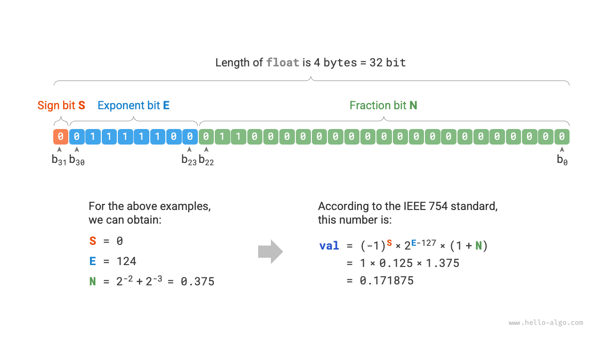

# Mã hóa số *

!!! tip

    Trong cuốn sách này, các chương được đánh dấu bằng dấu hoa thị * là phần đọc thêm tùy chọn. Nếu bạn không có nhiều thời gian hoặc thấy chúng khó, ban đầu bạn có thể tạm bỏ qua và quay lại sau khi hoàn thành các chương thiết yếu.

## Dạng dấu-trị tuyệt đối, bù 1 và bù 2

Trong bảng ở phần trước, chúng ta nhận thấy rằng tất cả các kiểu số nguyên đều có thể biểu diễn nhiều hơn một số âm so với số dương. Ví dụ, phạm vi của `byte` là $[-128, 127]$. Hiện tượng này trái với trực giác, và nguyên nhân nằm ở các cách biểu diễn dạng dấu-trị tuyệt đối, bù 1 và bù 2.

Trước hết, cần lưu ý rằng **các số được lưu trữ trong máy tính dưới dạng "bù 2"**. Trước khi phân tích lý do, hãy cùng định nghĩa ba khái niệm này.

- **Dạng dấu-trị tuyệt đối**: Ta xem bit cao nhất trong biểu diễn nhị phân của một số là bit dấu, trong đó $0$ biểu thị số dương và $1$ biểu thị số âm; các bit còn lại biểu thị trị số của số đó.
- **Bù 1**: Bù 1 của một số dương giống với dạng dấu-trị tuyệt đối của nó. Với số âm, bù 1 được tạo bằng cách đảo tất cả các bit ngoại trừ bit dấu trong biểu diễn dạng dấu-trị tuyệt đối.
- **Bù 2**: Bù 2 của một số dương giống với dạng dấu-trị tuyệt đối của nó. Với số âm, bù 2 được tạo bằng cách cộng $1$ vào bù 1 của nó.

Hình dưới đây minh họa các phương pháp chuyển đổi giữa dạng dấu-trị tuyệt đối, bù 1 và bù 2.

<u>Dạng dấu-trị tuyệt đối</u>, mặc dù trực quan nhất, vẫn có một số hạn chế. Một mặt, **dạng dấu-trị tuyệt đối của các số âm không thể được sử dụng trực tiếp trong phép tính**. Ví dụ, tính $1 + (-2)$ ở dạng dấu-trị tuyệt đối cho kết quả $-3$, rõ ràng là không đúng.

$$
\begin{aligned}
& 1 + (-2) \newline
& \rightarrow 0000 \; 0001 + 1000 \; 0010 \newline
& = 1000 \; 0011 \newline
& \rightarrow -3
\end{aligned}
$$

Để giải quyết vấn đề này, máy tính đưa vào <u>bù 1</u>. Nếu trước tiên chuyển dạng dấu-trị tuyệt đối sang bù 1 và tính $1 + (-2)$ ở dạng bù 1, sau đó chuyển kết quả trở lại dạng dấu-trị tuyệt đối, ta sẽ thu được kết quả đúng là $-1$.

$$
\begin{aligned}
& 1 + (-2) \newline
& \rightarrow 0000 \; 0001 \; \text{(Sign-magnitude)} + 1000 \; 0010 \; \text{(Sign-magnitude)} \newline
& = 0000 \; 0001 \; \text{(1's complement)} + 1111  \; 1101 \; \text{(1's complement)} \newline
& = 1111 \; 1110 \; \text{(1's complement)} \newline
& = 1000 \; 0001 \; \text{(Sign-magnitude)} \newline
& \rightarrow -1
\end{aligned}
$$

Mặt khác, **số 0 ở dạng dấu-trị tuyệt đối có hai cách biểu diễn là $+0$ và $-0$**. Điều này có nghĩa là số 0 tương ứng với hai mã nhị phân khác nhau, có thể gây ra sự mơ hồ. Ví dụ, trong các phép kiểm tra điều kiện, nếu không phân biệt số 0 dương và số 0 âm, kết quả phán đoán có thể không chính xác. Nếu muốn xử lý sự mơ hồ giữa số 0 dương và số 0 âm, ta cần thêm các phép kiểm tra, điều này có thể làm giảm hiệu năng tính toán của máy tính.

$$
\begin{aligned}
+0 & \rightarrow 0000 \; 0000 \newline
-0 & \rightarrow 1000 \; 0000
\end{aligned}
$$

Giống như dạng dấu-trị tuyệt đối, bù 1 cũng gặp vấn đề về sự mơ hồ giữa số 0 dương và số 0 âm. Vì vậy, máy tính tiếp tục đưa vào <u>bù 2</u>. Trước tiên, hãy quan sát quá trình chuyển đổi số 0 âm từ dạng dấu-trị tuyệt đối sang bù 1 rồi sang bù 2:

$$
\begin{aligned}
-0 \rightarrow \; & 1000 \; 0000 \; \text{(Sign-magnitude)} \newline
= \; & 1111 \; 1111 \; \text{(1's complement)} \newline
= 1 \; & 0000 \; 0000 \; \text{(2's complement)} \newline
\end{aligned}
$$

Khi cộng $1$ vào bù 1 của số 0 âm, phép tính tạo ra một bit nhớ, nhưng vì kiểu `byte` chỉ có độ dài 8 bit nên bit $1$ tràn sang bit thứ 9 sẽ bị loại bỏ. Nói cách khác, **bù 2 của số 0 âm là $0000 \; 0000$, giống với bù 2 của số 0 dương**. Điều này có nghĩa là trong biểu diễn bù 2, chỉ có một số 0, nhờ đó sự mơ hồ giữa số 0 dương và số 0 âm được giải quyết.

Vẫn còn một câu hỏi cuối cùng: phạm vi của kiểu `byte` là $[-128, 127]$, vậy số âm bổ sung $-128$ xuất hiện từ đâu? Ta nhận thấy rằng mọi số nguyên trong khoảng $[-127, +127]$ đều có dạng biểu diễn dấu-trị tuyệt đối, bù 1 và bù 2 tương ứng, đồng thời dạng dấu-trị tuyệt đối và bù 2 có thể chuyển đổi qua lại.

Tuy nhiên, **bù 2 $1000 \; 0000$ là một ngoại lệ và không có dạng dấu-trị tuyệt đối tương ứng**. Theo phương pháp chuyển đổi, ta thu được dạng dấu-trị tuyệt đối của bù 2 này là $0000 \; 0000$. Điều này rõ ràng mâu thuẫn, vì dạng dấu-trị tuyệt đối này biểu diễn số $0$, và bù 2 của nó phải là chính nó. Máy tính quy định rằng bù 2 đặc biệt $1000 \; 0000$ biểu diễn $-128$. Trên thực tế, kết quả của phép tính $(-1) + (-127)$ ở dạng bù 2 là $-128$.

$$
\begin{aligned}
& (-127) + (-1) \newline
& \rightarrow 1111 \; 1111 \; \text{(Sign-magnitude)} + 1000 \; 0001 \; \text{(Sign-magnitude)} \newline
& = 1000 \; 0000 \; \text{(1's complement)} + 1111  \; 1110 \; \text{(1's complement)} \newline
& = 1000 \; 0001 \; \text{(2's complement)} + 1111  \; 1111 \; \text{(2's complement)} \newline
& = 1000 \; 0000 \; \text{(2's complement)} \newline
& \rightarrow -128
\end{aligned}
$$

Bạn có thể nhận thấy rằng tất cả các phép tính trên đều là phép cộng. Điều này gợi ý một sự thật quan trọng: **các mạch phần cứng bên trong máy tính chủ yếu được thiết kế dựa trên phép cộng**. Đó là vì phép cộng dễ triển khai bằng phần cứng hơn so với các phép toán khác như nhân, chia và trừ, dễ song song hóa hơn và có tốc độ thực thi nhanh hơn.

Xin lưu ý rằng điều này không có nghĩa máy tính chỉ có thể thực hiện phép cộng. **Bằng cách kết hợp phép cộng với một số phép toán logic cơ bản, máy tính có thể thực hiện nhiều phép toán khác**. Ví dụ, phép trừ $a - b$ có thể được chuyển thành phép cộng $a + (-b)$; phép nhân và phép chia có thể được chuyển thành nhiều phép cộng hoặc phép trừ.

Đến đây, chúng ta có thể tóm tắt lý do máy tính sử dụng bù 2: với biểu diễn bù 2, máy tính có thể sử dụng cùng một mạch và phép toán để xử lý phép cộng các số dương và số âm, mà không cần thiết kế mạch phần cứng đặc biệt cho phép trừ hoặc xử lý riêng sự mơ hồ giữa số 0 dương và số 0 âm. Điều này đơn giản hóa đáng kể thiết kế phần cứng và cải thiện hiệu năng.

Thiết kế bù 2 rất tinh tế. Do giới hạn về dung lượng, chúng ta sẽ dừng tại đây. Những độc giả quan tâm được khuyến khích tìm hiểu thêm.

## Mã hóa số dấu phẩy động

Những độc giả cẩn thận có thể đã nhận thấy: `int` và `float` có cùng độ dài, đều là 4 byte, nhưng tại sao `float` lại có phạm vi lớn hơn nhiều so với `int`? Điều này rất trái với trực giác, vì theo lẽ thường, `float` cần biểu diễn các số thập phân nên phạm vi phải nhỏ hơn.

Thực tế, **điều này là do `float` số dấu phẩy động sử dụng một phương pháp biểu diễn khác**. Ta ký hiệu một số nhị phân 32 bit là:

$$
b_{31} b_{30} b_{29} \ldots b_2 b_1 b_0
$$

Theo tiêu chuẩn IEEE 754, một `float` 32 bit gồm ba phần sau.

- Bit dấu $\mathrm{S}$: chiếm 1 bit, tương ứng với $b_{31}$.
- Bit số mũ $\mathrm{E}$: chiếm 8 bit, tương ứng với $b_{30} b_{29} \ldots b_{23}$.
- Bit phần định trị $\mathrm{N}$: chiếm 23 bit, tương ứng với $b_{22} b_{21} \ldots b_0$.

Cách tính giá trị tương ứng với `float` nhị phân là:

$$
\text {val} = (-1)^{b_{31}} \times 2^{\left(b_{30} b_{29} \ldots b_{23}\right)_2-127} \times\left(1 . b_{22} b_{21} \ldots b_0\right)_2
$$

Chuyển sang hệ thập phân, công thức tính là:

$$
\text {val}=(-1)^{\mathrm{S}} \times 2^{\mathrm{E} -127} \times (1 + \mathrm{N})
$$

Phạm vi của từng thành phần là:

$$
\begin{aligned}
\mathrm{S} \in & \{ 0, 1\}, \quad \mathrm{E} \in \{ 1, 2, \dots, 254 \} \newline
(1 + \mathrm{N}) = & (1 + \sum_{i=1}^{23} b_{23-i} 2^{-i}) \subset [1, 2 - 2^{-23}]
\end{aligned}
$$

Quan sát hình trên, với dữ liệu ví dụ $\mathrm{S} = 0$, $\mathrm{E} = 124$, $\mathrm{N} = 2^{-2} + 2^{-3} = 0.375$, ta có:

$$
\text { val } = (-1)^0 \times 2^{124 - 127} \times (1 + 0.375) = 0.171875
$$

Giờ đây, chúng ta có thể trả lời câu hỏi ban đầu: **biểu diễn của `float` bao gồm một bit số mũ, dẫn đến phạm vi lớn hơn nhiều so với `int`**. Theo phép tính trên, số dương lớn nhất mà `float` có thể biểu diễn là $2^{254 - 127} \times (2 - 2^{-23}) \approx 3.4 \times 10^{38}$, còn số âm nhỏ nhất có thể được xác định bằng cách chuyển đổi bit dấu.

**Mặc dù số dấu phẩy động `float` mở rộng phạm vi biểu diễn, tác dụng phụ của nó là làm giảm độ chính xác**. Kiểu số nguyên `int` sử dụng toàn bộ 32 bit để biểu diễn các số, và các số được phân bố đồng đều; tuy nhiên, do sự tồn tại của bit số mũ, giá trị của số dấu phẩy động `float` càng lớn thì khoảng cách giữa hai số liền kề có xu hướng càng lớn.

Như trong bảng dưới đây, các bit số mũ $\mathrm{E} = 0$ và $\mathrm{E} = 255$ có ý nghĩa đặc biệt, **được dùng để biểu diễn số 0, vô cực, $\mathrm{NaN}$, v.v.**

 Bảng <id> &nbsp; Ý nghĩa của các bit số mũ 

| Bit số mũ E        | Bit phần định trị $\mathrm{N} = 0$ | Bit phần định trị $\mathrm{N} \ne 0$ | Công thức tính                                                       |
| ------------------ | ---------------------------------- | -------------------------------- | ---------------------------------------------------------------------- |
| $0$                | $\pm 0$                            | Số dưới chuẩn                     | $(-1)^{\mathrm{S}} \times 2^{-126} \times (0.\mathrm{N})$              |
| $1, 2, \dots, 254$ | Số chuẩn hóa                       | Số chuẩn hóa                      | $(-1)^{\mathrm{S}} \times 2^{(\mathrm{E} -127)} \times (1.\mathrm{N})$ |
| $255$              | $\pm \infty$                       | $\mathrm{NaN}$                     |                                                                        |

Cần lưu ý rằng các số dưới chuẩn cải thiện đáng kể độ chính xác của số dấu phẩy động. Số chuẩn hóa dương nhỏ nhất là $2^{-126}$, còn số dưới chuẩn dương nhỏ nhất là $2^{-126} \times 2^{-23}$.

`double` độ chính xác kép cũng sử dụng phương pháp biểu diễn tương tự như `float`, nên sẽ không trình bày chi tiết ở đây.