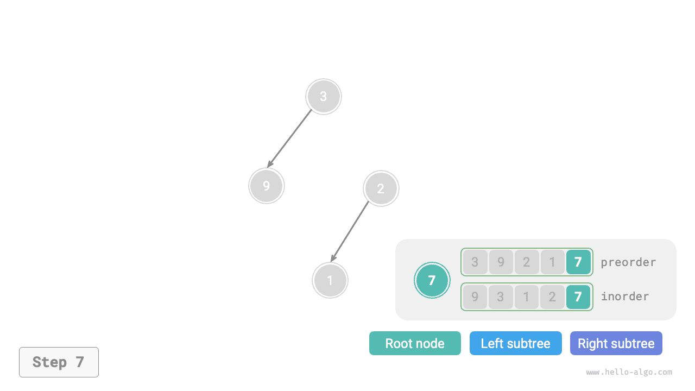
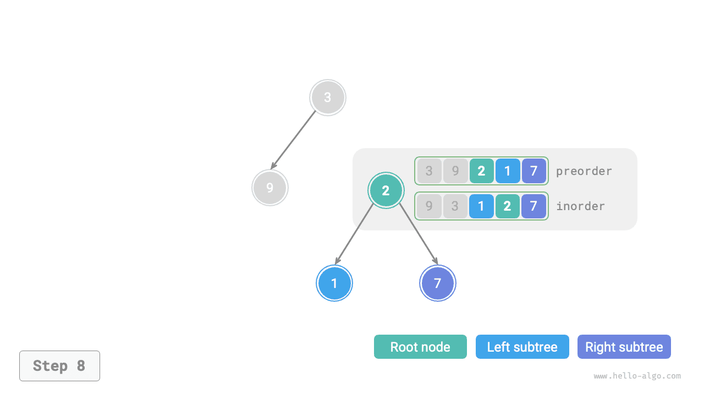
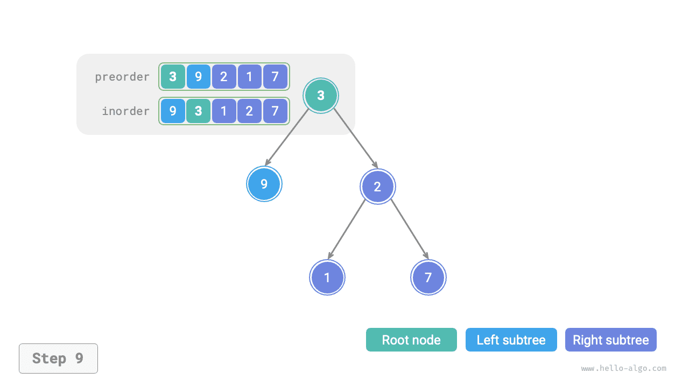

# Bài toán xây dựng cây nhị phân

!!! question

    Cho phép duyệt preorder `preorder` và phép duyệt inorder `inorder` của một cây nhị phân, hãy xây dựng cây nhị phân và trả về nút gốc của cây nhị phân đó. Giả sử cây nhị phân không có các giá trị nút trùng nhau (như trong hình bên dưới).


### Xác định xem đây có phải là bài toán Divide and Conquer hay không

Bài toán ban đầu được định nghĩa là xây dựng một cây nhị phân từ `preorder` và `inorder`, đây là một bài toán Divide and Conquer điển hình.

- **Bài toán có thể được phân rã**: Xét theo góc độ Divide and Conquer, chúng ta có thể chia bài toán ban đầu thành hai bài toán con: xây dựng cây con trái và xây dựng cây con phải, cùng với một thao tác: khởi tạo nút gốc. Với mỗi cây con (bài toán con), chúng ta vẫn có thể áp dụng lại phương pháp phân chia trên, tiếp tục chia thành các cây con nhỏ hơn (bài toán con) cho đến khi đạt đến bài toán con nhỏ nhất (cây con rỗng).
- **Các bài toán con độc lập với nhau**: Cây con trái và cây con phải độc lập với nhau; giữa chúng không có phần giao nhau. Khi xây dựng cây con trái, chúng ta chỉ cần tập trung vào các phần tương ứng với cây con trái trong phép duyệt inorder và preorder. Điều tương tự cũng áp dụng cho cây con phải.
- **Có thể hợp nhất lời giải của các bài toán con**: Sau khi có cây con trái và cây con phải (lời giải của các bài toán con), chúng ta có thể liên kết chúng với nút gốc để thu được lời giải cho bài toán ban đầu.

### Cách chia các cây con

Dựa trên phân tích trên, bài toán này có thể được giải bằng Divide and Conquer, **nhưng làm thế nào để chia cây con trái và cây con phải thông qua phép duyệt preorder `preorder` và phép duyệt inorder `inorder`**?

Theo định nghĩa, cả `preorder` và `inorder` đều có thể được chia thành ba phần.

- Phép duyệt preorder: `[ Root Node | Left Subtree | Right Subtree ]`, chẳng hạn, cây trong hình trên tương ứng với `[ 3 | 9 | 2 1 7 ]`.
- Phép duyệt inorder: `[ Left Subtree | Root Node | Right Subtree ]`, chẳng hạn, cây trong hình trên tương ứng với `[ 9 | 3 | 1 2 7 ]`.

Sử dụng dữ liệu trong hình trên làm ví dụ, chúng ta có thể thu được kết quả phân chia thông qua các bước được minh họa trong hình bên dưới.

1. Phần tử đầu tiên 3 trong phép duyệt preorder là giá trị của nút gốc.
2. Tìm chỉ số của nút gốc 3 trong `inorder`, rồi dùng chỉ số này để chia `inorder` thành `[ 9 | 3 | 1 2 7 ]`.
3. Dựa trên kết quả phân chia của `inorder`, có thể dễ dàng xác định rằng cây con trái và cây con phải lần lượt có 1 và 3 nút, từ đó chia `preorder` thành `[ 3 | 9 | 2 1 7 ]`.


### Mô tả các khoảng của cây con bằng các biến

Dựa trên phương pháp phân chia trên, **chúng ta đã thu được các khoảng chỉ số của nút gốc, cây con trái và cây con phải trong `preorder` và `inorder`**. Để mô tả các khoảng chỉ số này, chúng ta cần sử dụng một số biến chỉ số.

- Gọi chỉ số của nút gốc của cây hiện tại trong `preorder` là $i$.
- Gọi chỉ số của nút gốc của cây hiện tại trong `inorder` là $m$.
- Gọi khoảng chỉ số của cây hiện tại trong `inorder` là $[l, r]$.

Như minh họa trong bảng bên dưới, thông qua các biến này, chúng ta có thể biểu diễn chỉ số của nút gốc trong `preorder` và các khoảng chỉ số của các cây con trong `inorder`.

<p align="center"> Bảng <id> &nbsp; Chỉ số của nút gốc và các cây con trong phép duyệt preorder và inorder </p>

|              | Chỉ số nút gốc trong `preorder` | Khoảng chỉ số của cây con trong `inorder` |
| ------------ | ----------------------------- | ----------------------------------- |
| Cây hiện tại | $i$                           | $[l, r]$                            |
| Cây con trái | $i + 1$                       | $[l, m-1]$                          |
| Cây con phải| $i + 1 + (m - l)$             | $[m+1, r]$                          |

Lưu ý rằng $(m-l)$ trong chỉ số nút gốc của cây con phải biểu thị “số nút trong cây con trái”. Bạn nên kết hợp với hình bên dưới để hiểu rõ hơn.


### Triển khai mã

Để tăng hiệu quả khi truy vấn $m$, chúng ta sử dụng một hash table `hmap` để lưu ánh xạ từ các phần tử trong mảng `inorder` đến các chỉ số của chúng:

```src
[file]{build_tree}-[class]{}-[func]{build_tree}
```

Hình bên dưới minh họa quá trình đệ quy xây dựng cây nhị phân. Mỗi nút được tạo trong quá trình “đệ quy” đi xuống, còn mỗi cạnh (reference) được tạo trong quá trình “return” đi lên.

=== "<1>"
    

=== "<2>"
    

=== "<3>"
    

=== "<4>"
    

=== "<5>"
    

=== "<6>"
    

=== "<7>"
    

=== "<8>"
    

=== "<9>"
    

Kết quả phân chia của phép duyệt preorder `preorder` và phép duyệt inorder `inorder` trong mỗi hàm đệ quy được minh họa trong hình bên dưới.


Gọi số nút trong cây là $n$. Việc khởi tạo mỗi nút (thực thi một hàm đệ quy `dfs()`) mất thời gian $O(1)$. **Do đó, độ phức tạp thời gian tổng thể là $O(n)$**.

Hash table lưu ánh xạ từ các phần tử `inorder` đến các chỉ số của chúng, với độ phức tạp không gian là $O(n)$. Trong trường hợp xấu nhất, khi cây nhị phân suy biến thành một linked list, độ sâu đệ quy đạt $n$, sử dụng $O(n)$ không gian cho các stack frame. **Do đó, độ phức tạp không gian tổng thể là $O(n)$**.