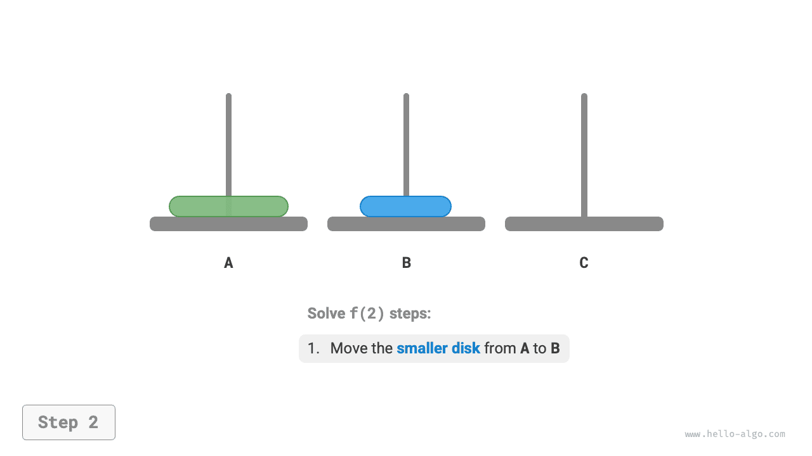
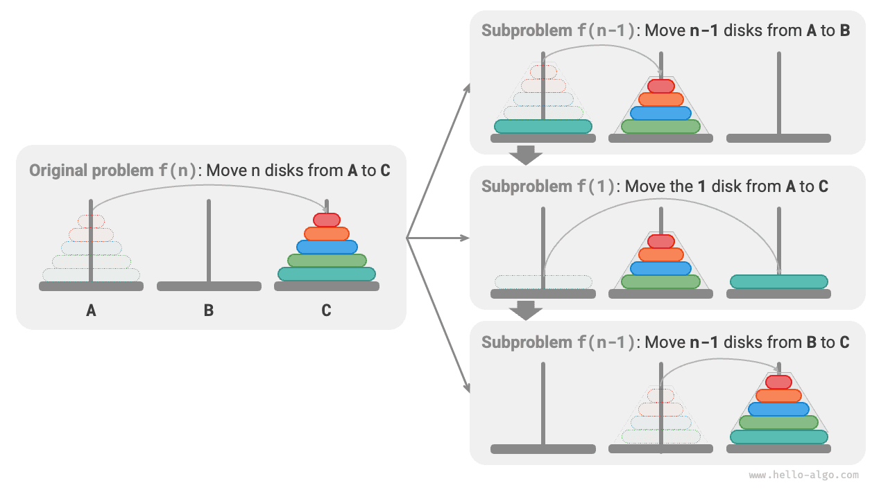

# Bài toán Tháp Hà Nội

Trong merge sort và việc xây dựng cây nhị phân, chúng ta phân rã bài toán ban đầu thành hai bài toán con, mỗi bài toán có kích thước bằng một nửa bài toán ban đầu. Tuy nhiên, đối với bài toán Tháp Hà Nội, chúng ta áp dụng một chiến lược phân rã khác.

!!! question

    Cho ba cột, lần lượt ký hiệu là `A`, `B` và `C`. Ban đầu, cột `A` có $n$ đĩa được xếp chồng lên nhau, theo thứ tự kích thước tăng dần từ trên xuống dưới. Nhiệm vụ của chúng ta là chuyển $n$ đĩa này sang cột `C` mà vẫn giữ nguyên thứ tự ban đầu (như trong hình bên dưới). Khi di chuyển các đĩa, phải tuân theo các quy tắc sau.

    1. Một đĩa chỉ có thể được lấy từ trên cùng của một cột và đặt lên trên cùng của một cột khác.
    2. Mỗi lần chỉ được di chuyển một đĩa.
    3. Đĩa nhỏ hơn luôn phải nằm trên đĩa lớn hơn.


**Chúng ta ký hiệu bài toán Tháp Hà Nội có kích thước $i$ là $f(i)$**. Ví dụ, $f(3)$ biểu thị việc chuyển $3$ đĩa từ `A` sang `C`.

### Xét các trường hợp cơ sở

Như trong hình bên dưới, đối với bài toán $f(1)$, khi chỉ có một đĩa, chúng ta có thể chuyển trực tiếp đĩa đó từ `A` sang `C`.

=== "<1>"
    

=== "<2>"
    

Như trong hình bên dưới, đối với bài toán $f(2)$, khi có hai đĩa, **vì chúng ta luôn phải giữ đĩa nhỏ hơn ở trên đĩa lớn hơn, nên cần sử dụng `B` để hỗ trợ việc di chuyển**.

1. Trước tiên, chuyển đĩa nhỏ hơn từ `A` sang `B`.
2. Sau đó, chuyển đĩa lớn hơn từ `A` sang `C`.
3. Cuối cùng, chuyển đĩa nhỏ hơn từ `B` sang `C`.

=== "<1>"
    

=== "<2>"
    

=== "<3>"
    

=== "<4>"
    

Quá trình giải bài toán $f(2)$ có thể được tóm tắt như sau: **chuyển hai đĩa từ `A` sang `C` với sự hỗ trợ của `B`**. Ở đây, `C` được gọi là cột đích, còn `B` được gọi là cột đệm.

### Phân rã bài toán con

Đối với bài toán $f(3)$, khi có ba đĩa, tình huống trở nên phức tạp hơn một chút.

Vì chúng ta đã biết lời giải của $f(1)$ và $f(2)$, có thể suy nghĩ theo góc nhìn chia để trị, **coi hai đĩa trên cùng của `A` là một thể thống nhất**, rồi thực hiện các bước được minh họa trong hình bên dưới. Cách này sẽ chuyển thành công ba đĩa từ `A` sang `C`.

1. Xem `B` là cột đích và `C` là cột đệm, rồi chuyển hai đĩa từ `A` sang `B`.
2. Chuyển đĩa còn lại trực tiếp từ `A` sang `C`.
3. Xem `C` là cột đích và `A` là cột đệm, rồi chuyển hai đĩa từ `B` sang `C`.

=== "<1>"
    

=== "<2>"
    

=== "<3>"
    

=== "<4>"
    

Về cơ bản, **chúng ta chia bài toán $f(3)$ thành hai bài toán con $f(2)$ và một bài toán con $f(1)$**. Bằng cách giải lần lượt ba bài toán con này, bài toán ban đầu được giải quyết. Điều này cho thấy các bài toán con độc lập với nhau và lời giải của chúng có thể được hợp nhất.

Từ đó, chúng ta có thể tóm tắt chiến lược chia để trị để giải bài toán Tháp Hà Nội như trong hình bên dưới: chia bài toán ban đầu $f(n)$ thành hai bài toán con $f(n-1)$ và một bài toán con $f(1)$, rồi giải ba bài toán con này theo thứ tự sau.

1. Chuyển $n-1$ đĩa từ `A` sang `B` với sự hỗ trợ của `C`.
2. Chuyển trực tiếp $1$ đĩa còn lại từ `A` sang `C`.
3. Chuyển $n-1$ đĩa từ `B` sang `C` với sự hỗ trợ của `A`.

Đối với hai bài toán con $f(n-1)$ này, **chúng ta có thể tiếp tục phân rã đệ quy theo cùng một cách** cho đến khi đạt đến bài toán con nhỏ nhất $f(1)$. Lời giải của $f(1)$ đã biết và chỉ cần một thao tác di chuyển.



### Triển khai mã

Trong mã, chúng ta khai báo một hàm đệ quy `dfs(i, src, buf, tar)`, có nhiệm vụ chuyển $i$ đĩa trên cùng từ cột `src` sang cột đích `tar` với sự hỗ trợ của cột đệm `buf`:

```src
[file]{hanota}-[class]{}-[func]{solve_hanota}
```

Như trong hình bên dưới, bài toán Tháp Hà Nội tạo thành một cây đệ quy có chiều cao $n$, trong đó mỗi nút biểu diễn một bài toán con tương ứng với một lần gọi hàm `dfs()`, **do đó độ phức tạp thời gian là $O(2^n)$ và độ phức tạp không gian là $O(n)$**.


!!! quote

    Bài toán Tháp Hà Nội bắt nguồn từ một truyền thuyết cổ xưa. Trong một ngôi đền ở Ấn Độ cổ đại, các nhà sư có ba cột kim cương cao và $64$ đĩa vàng với kích thước khác nhau. Các nhà sư liên tục di chuyển những chiếc đĩa, tin rằng khi chiếc đĩa cuối cùng được đặt đúng vị trí, thế giới sẽ đi đến hồi kết.

    Tuy nhiên, ngay cả khi các nhà sư di chuyển một đĩa mỗi giây, họ sẽ mất khoảng $2^{64} \approx 1.84×10^{19}$ giây, tương đương khoảng $585$ tỷ năm, vượt xa các ước tính hiện nay về tuổi của vũ trụ. Vì vậy, nếu truyền thuyết này là đúng, chúng ta không cần phải lo lắng về ngày tận thế.