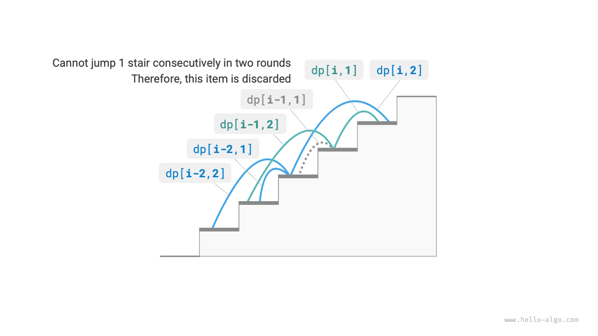

# Đặc điểm của các bài toán Quy hoạch động

Trong phần trước, chúng ta đã tìm hiểu cách quy hoạch động giải bài toán ban đầu bằng cách phân rã nó thành các bài toán con. Trên thực tế, phân rã bài toán con là một phương pháp tiếp cận thuật toán tổng quát, với những trọng tâm khác nhau trong chia để trị, quy hoạch động và quay lui.

- Các thuật toán chia để trị đệ quy chia bài toán ban đầu thành nhiều bài toán con độc lập cho đến khi đạt đến các bài toán con nhỏ nhất, sau đó hợp nhất lời giải của các bài toán con trong quá trình quay lui để cuối cùng thu được lời giải cho bài toán ban đầu.
- Quy hoạch động cũng đệ quy phân rã bài toán, nhưng điểm khác biệt chính so với các thuật toán chia để trị là các bài toán con trong quy hoạch động phụ thuộc lẫn nhau, và nhiều bài toán con chồng lấp xuất hiện trong quá trình phân rã.
- Các thuật toán quay lui liệt kê mọi lời giải khả dĩ thông qua thử và sai, đồng thời tránh các nhánh tìm kiếm không cần thiết bằng cách cắt tỉa. Lời giải cho bài toán ban đầu bao gồm một chuỗi các bước ra quyết định, và chúng ta có thể xem dãy con trước mỗi bước ra quyết định là một bài toán con.

Trên thực tế, quy hoạch động thường được dùng để giải các bài toán tối ưu hóa. Những bài toán này không chỉ có các bài toán con chồng lấp mà còn có hai đặc điểm quan trọng khác: cấu trúc con tối ưu và không có ảnh hưởng về sau.

## Cấu trúc con tối ưu

Chúng ta sẽ điều chỉnh một chút bài toán leo cầu thang để phù hợp hơn với việc minh họa khái niệm cấu trúc con tối ưu.

!!! question "Leo cầu thang với chi phí tối thiểu"

    Cho một cầu thang, mỗi lần bạn có thể đi $1$ hoặc $2$ bậc, và mỗi bậc được gắn một số nguyên không âm biểu thị chi phí bước lên bậc đó. Cho một mảng số nguyên không âm $cost$, trong đó $cost[i]$ biểu thị chi phí của bậc thứ $i$ và $cost[0]$ là mặt đất (điểm bắt đầu), chi phí tối thiểu cần thiết để lên đến đỉnh là bao nhiêu?

Như trong hình dưới đây, nếu chi phí của bậc thứ $1$, $2$ và $3$ lần lượt là $1$, $10$ và $1$, thì chi phí tối thiểu để đi từ mặt đất đến bậc thứ $3$ là $2$.


Gọi $dp[i]$ là chi phí tích lũy để leo đến bậc thứ $i$. Vì bậc thứ $i$ chỉ có thể đi đến từ bậc thứ $i-1$ hoặc $i-2$, nên $dp[i]$ chỉ có thể bằng $dp[i-1] + cost[i]$ hoặc $dp[i-2] + cost[i]$. Để tối thiểu hóa chi phí, chúng ta nên chọn giá trị nhỏ hơn trong hai giá trị này:

$$
dp[i] = \min(dp[i-1], dp[i-2]) + cost[i]
$$

Điều này dẫn chúng ta đến ý nghĩa của cấu trúc con tối ưu: **lời giải tối ưu cho bài toán ban đầu được xây dựng từ các lời giải tối ưu của các bài toán con**.

Bài toán này rõ ràng có cấu trúc con tối ưu: chúng ta chọn lời giải tốt hơn trong hai lời giải tối ưu của hai bài toán con $dp[i-1]$ và $dp[i-2]$, rồi dùng nó để xây dựng lời giải tối ưu cho bài toán ban đầu $dp[i]$.

Vậy bài toán leo cầu thang trong phần trước có cấu trúc con tối ưu không? Mục tiêu của bài toán là tìm số cách, dường như đây là một bài toán đếm, nhưng nếu chúng ta thay đổi câu hỏi thành: “Tìm số cách lớn nhất”. Chúng ta sẽ ngạc nhiên nhận ra rằng **mặc dù bài toán trước và sau khi điều chỉnh là tương đương, cấu trúc con tối ưu đã xuất hiện**: số cách lớn nhất để lên bậc thứ $n$ bằng tổng số cách lớn nhất để lên bậc thứ $n-1$ và $n-2$. Vì vậy, cách diễn giải cấu trúc con tối ưu khá linh hoạt và sẽ có những ý nghĩa khác nhau trong các bài toán khác nhau.

Dựa trên công thức chuyển trạng thái và các trạng thái ban đầu $dp[1] = cost[1]$ và $dp[2] = cost[2]$, chúng ta có thể viết mã quy hoạch động như sau:

```src
[file]{min_cost_climbing_stairs_dp}-[class]{}-[func]{min_cost_climbing_stairs_dp}
```

Hình dưới đây minh họa quá trình quy hoạch động của đoạn mã trên.


Bài toán này cũng có thể được tối ưu hóa về không gian, nén từ một chiều xuống không chiều, giảm độ phức tạp không gian từ $O(n)$ xuống $O(1)$:

```src
[file]{min_cost_climbing_stairs_dp}-[class]{}-[func]{min_cost_climbing_stairs_dp_comp}
```

## Không có ảnh hưởng về sau

Không có ảnh hưởng về sau là một trong những đặc điểm quan trọng giúp quy hoạch động giải quyết bài toán hiệu quả. Định nghĩa của nó là: **với một trạng thái nhất định, diễn biến trong tương lai chỉ liên quan đến trạng thái hiện tại và không liên quan đến tất cả các trạng thái trước đó**.

Lấy bài toán leo cầu thang làm ví dụ, với trạng thái $i$, nó sẽ phát triển thành các trạng thái $i+1$ và $i+2$, tương ứng với việc nhảy $1$ bậc và nhảy $2$ bậc. Khi đưa ra hai lựa chọn này, chúng ta không cần xét các trạng thái trước trạng thái $i$, vì chúng không ảnh hưởng đến tương lai của trạng thái $i$.

Tuy nhiên, nếu thêm một ràng buộc vào bài toán leo cầu thang, tình hình sẽ thay đổi.

!!! question "Leo cầu thang có ràng buộc"

    Cho một cầu thang gồm $n$ bậc, mỗi lần bạn có thể đi $1$ hoặc $2$ bậc, **nhưng không được nhảy $1$ bậc trong hai lượt liên tiếp**. Có bao nhiêu cách để lên đến đỉnh?

Như trong hình dưới đây, chỉ có $2$ cách hợp lệ để lên bậc thứ $3$. Đường đi gồm ba lần nhảy $1$ bậc liên tiếp không thỏa mãn ràng buộc nên bị loại.


Trong bài toán này, nếu lượt trước là một lần nhảy $1$ bậc thì lượt tiếp theo phải là một lần nhảy $2$ bậc. Điều này có nghĩa là **lựa chọn tiếp theo không thể được xác định chỉ dựa trên trạng thái hiện tại (số bậc hiện tại), mà còn phụ thuộc vào trạng thái trước đó (số bậc ở lượt trước)**.

Không khó để nhận thấy bài toán này không còn thỏa mãn điều kiện không có ảnh hưởng về sau, và công thức chuyển trạng thái $dp[i] = dp[i-1] + dp[i-2]$ cũng không còn đúng, vì $dp[i-1]$ biểu thị việc nhảy $1$ bậc trong lượt này, nhưng nó bao gồm nhiều lời giải trong đó “lượt trước là một lần nhảy $1$ bậc”, những lời giải không thể được tính trực tiếp vào $dp[i]$ để thỏa mãn ràng buộc.

Vì lý do này, chúng ta cần mở rộng định nghĩa trạng thái: **trạng thái $[i, j]$ biểu thị đang ở bậc thứ $i$ và trong lượt trước đã nhảy $j$ bậc**, trong đó $j \in \{1, 2\}$. Định nghĩa trạng thái này phân biệt hiệu quả việc lượt trước là một lần nhảy $1$ bậc hay $2$ bậc, cho phép chúng ta xác định trạng thái hiện tại bắt nguồn từ đâu.

- Khi lượt trước đã nhảy $1$ bậc, lượt trước đó chỉ có thể chọn nhảy $2$ bậc, tức là $dp[i, 1]$ chỉ có thể chuyển từ $dp[i-1, 2]$.
- Khi lượt trước đã nhảy $2$ bậc, lượt trước đó có thể chọn nhảy $1$ bậc hoặc $2$ bậc, tức là $dp[i, 2]$ có thể chuyển từ $dp[i-2, 1]$ hoặc $dp[i-2, 2]$.

Như trong hình dưới đây, với định nghĩa này, $dp[i, j]$ biểu thị số cách của trạng thái $[i, j]$. Khi đó, công thức chuyển trạng thái là:

$$
\begin{cases}
dp[i, 1] = dp[i-1, 2] \\
dp[i, 2] = dp[i-2, 1] + dp[i-2, 2]
\end{cases}
$$



Cuối cùng, trả về $dp[n, 1] + dp[n, 2]$, trong đó tổng của hai giá trị này biểu thị tổng số cách để lên bậc thứ $n$:

```src
[file]{climbing_stairs_constraint_dp}-[class]{}-[func]{climbing_stairs_constraint_dp}
```

Trong trường hợp trên, vì chúng ta chỉ cần xét thêm một trạng thái trước đó, nên vẫn có thể khiến bài toán thỏa mãn điều kiện không có ảnh hưởng về sau bằng cách mở rộng định nghĩa trạng thái. Tuy nhiên, một số bài toán có “ảnh hưởng về sau” rất nghiêm trọng.

!!! question "Leo cầu thang với việc phát sinh chướng ngại vật"

    Cho một cầu thang gồm $n$ bậc, mỗi lần bạn có thể đi $1$ hoặc $2$ bậc. **Mỗi khi bạn đến bậc thứ $i$, hệ thống sẽ tự động đặt một chướng ngại vật trên bậc thứ $2i$, và từ đó về sau không lượt nào được phép nhảy đến bậc thứ $2i$**. Ví dụ, nếu hai lượt đầu tiên lần lượt nhảy đến bậc thứ $2$ và $3$, thì sau đó bạn không thể nhảy đến bậc thứ $4$ và $6$. Có bao nhiêu cách để lên đến đỉnh?

Trong bài toán này, bước nhảy tiếp theo phụ thuộc vào tất cả các trạng thái trước đó, vì mỗi bước nhảy đặt các chướng ngại vật trên những bậc cao hơn, ảnh hưởng đến các bước nhảy trong tương lai. Với những bài toán như vậy, quy hoạch động thường rất khó áp dụng.

Trên thực tế, nhiều bài toán tối ưu hóa tổ hợp phức tạp (chẳng hạn như bài toán người bán hàng) không thỏa mãn điều kiện không có ảnh hưởng về sau. Với những bài toán như vậy, chúng ta thường sử dụng các phương pháp khác, chẳng hạn như tìm kiếm heuristic, thuật toán di truyền và học tăng cường, để thu được các lời giải tối ưu cục bộ có thể sử dụng trong một khoảng thời gian giới hạn.