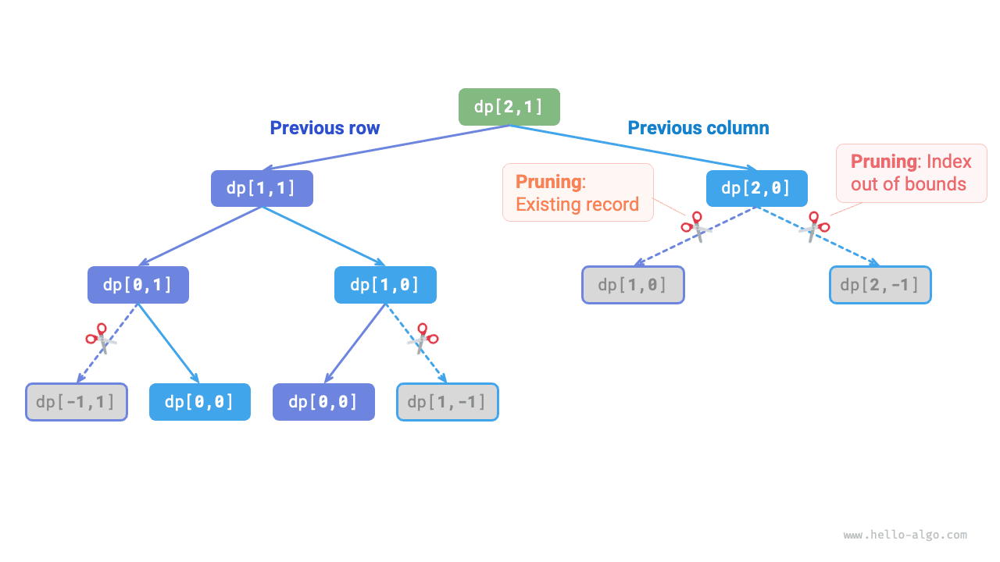
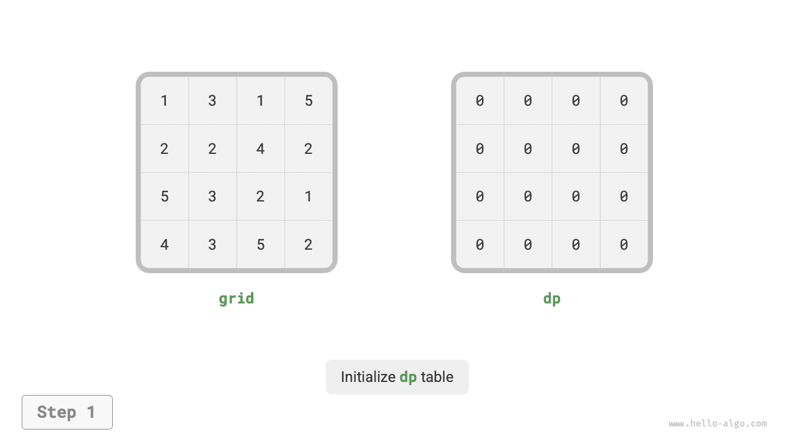
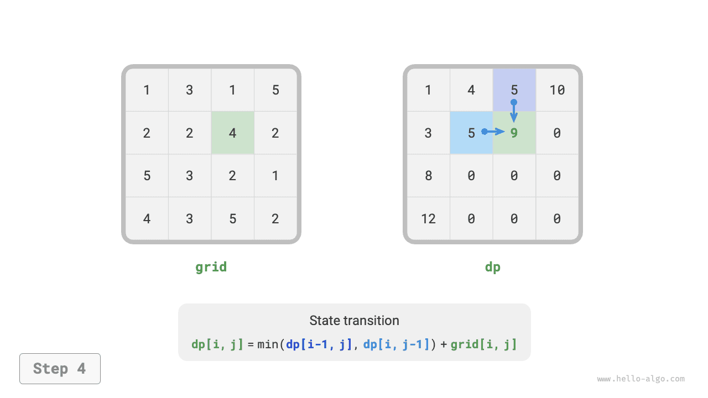
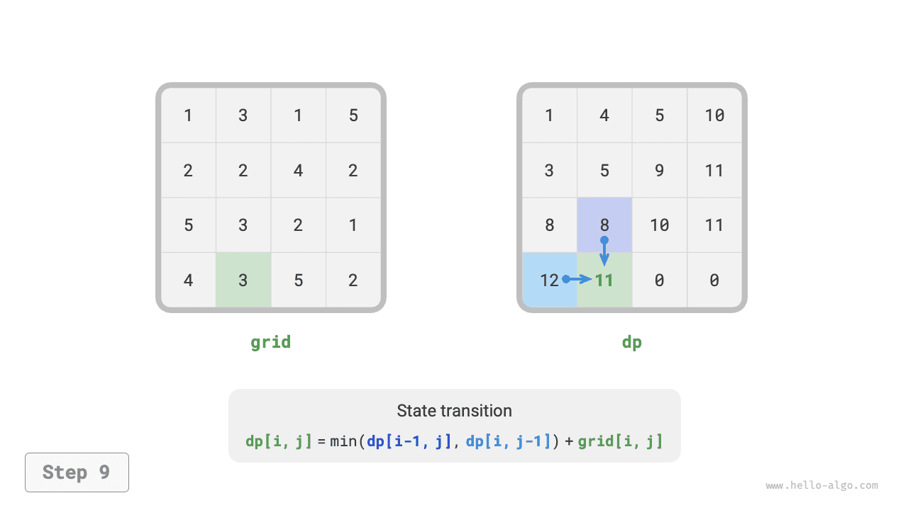
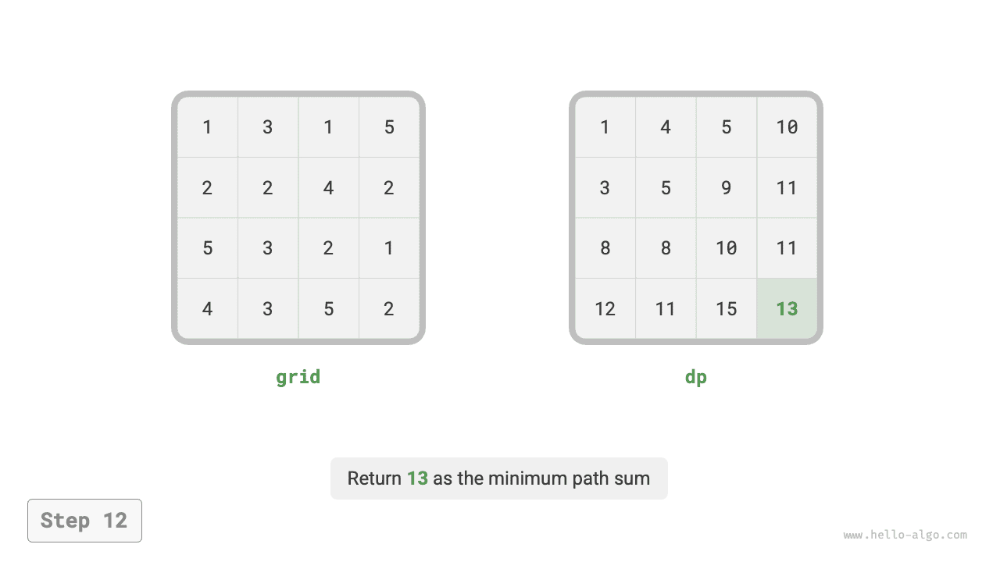

# Phương pháp giải bài toán Quy hoạch động

Hai phần trước đã giới thiệu những đặc điểm chính của các bài toán quy hoạch động. Tiếp theo, hãy cùng tìm hiểu thêm hai vấn đề thực tiễn.

1. Làm thế nào để xác định một bài toán có phải là bài toán quy hoạch động hay không?
2. Quy trình hoàn chỉnh để giải một bài toán quy hoạch động là gì, và nên bắt đầu từ đâu?

## Nhận diện bài toán

Nói chung, nếu một bài toán có các bài toán con chồng lấn, cấu trúc con tối ưu và thỏa mãn tính không có hậu quả về sau, thì bài toán đó thường phù hợp để giải bằng quy hoạch động. Tuy nhiên, rất khó trực tiếp nhận ra những đặc điểm này chỉ từ mô tả bài toán. Vì vậy, chúng ta thường nới lỏng các điều kiện và **trước tiên quan sát xem bài toán có phù hợp để giải bằng quay lui (tìm kiếm vét cạn) hay không**.

**Các bài toán phù hợp để giải bằng quay lui thường thỏa mãn "mô hình cây quyết định"**, nghĩa là bài toán có thể được mô tả bằng một cấu trúc cây, trong đó mỗi nút biểu diễn một quyết định và mỗi đường đi biểu diễn một chuỗi quyết định.

Nói cách khác, nếu một bài toán chứa khái niệm quyết định rõ ràng và lời giải được tạo ra thông qua một chuỗi quyết định, thì bài toán đó thỏa mãn mô hình cây quyết định và thường có thể được giải bằng quay lui.

Trên cơ sở đó, các bài toán quy hoạch động cũng có một số dấu hiệu tích cực.

- Bài toán chứa các mô tả như lớn nhất (nhỏ nhất) hoặc nhiều nhất (ít nhất), cho thấy đây là một bài toán tối ưu hóa.
- Trạng thái của bài toán có thể được biểu diễn bằng một danh sách, ma trận nhiều chiều hoặc cây, và một trạng thái có quan hệ truy hồi với các trạng thái xung quanh nó.

Tương ứng, cũng có một số dấu hiệu tiêu cực.

- Mục tiêu của bài toán là tìm tất cả các lời giải khả dĩ, thay vì tìm lời giải tối ưu.
- Mô tả bài toán có đặc điểm rõ ràng của bài toán hoán vị và tổ hợp, yêu cầu trả về nhiều lời giải cụ thể.

Nếu một bài toán thỏa mãn mô hình cây quyết định và có các dấu hiệu tích cực tương đối rõ ràng, chúng ta có thể giả định đó là một bài toán quy hoạch động và kiểm chứng giả định này trong quá trình giải.

## Các bước giải bài toán

Quy trình giải bài toán quy hoạch động thay đổi tùy theo bản chất và độ khó của bài toán, nhưng nhìn chung gồm các bước sau: mô tả các quyết định, định nghĩa trạng thái, xây dựng bảng $dp$, suy ra phương trình chuyển trạng thái, xác định điều kiện biên, v.v.

Để minh họa sinh động hơn các bước giải bài toán, chúng ta sử dụng bài toán kinh điển "tổng đường đi nhỏ nhất" làm ví dụ.

!!! question

    Cho một lưới hai chiều $n \times m$ `grid` trong đó mỗi ô chứa một số nguyên không âm biểu diễn chi phí của ô đó. Một robot bắt đầu từ ô trên cùng bên trái và ở mỗi bước chỉ có thể di chuyển xuống hoặc sang phải cho đến khi đến ô dưới cùng bên phải. Hãy trả về tổng đường đi nhỏ nhất từ ô trên cùng bên trái đến ô dưới cùng bên phải.

Hình bên dưới minh họa một ví dụ trong đó tổng đường đi nhỏ nhất của lưới đã cho là $13$.


**Bước 1: Suy nghĩ về các quyết định trong mỗi lượt, định nghĩa trạng thái và từ đó xây dựng bảng $dp$**

Quyết định trong mỗi lượt của bài toán này là di chuyển một bước xuống hoặc sang phải từ ô hiện tại. Gọi chỉ số hàng và cột của ô hiện tại lần lượt là $[i, j]$. Sau khi di chuyển xuống hoặc sang phải, các chỉ số sẽ trở thành $[i+1, j]$ hoặc $[i, j+1]$. Vì vậy, trạng thái cần chứa hai biến: chỉ số hàng và chỉ số cột, được ký hiệu là $[i, j]$.

Trạng thái $[i, j]$ tương ứng với bài toán con: **tổng đường đi nhỏ nhất từ điểm bắt đầu $[0, 0]$ đến $[i, j]$**, được ký hiệu là $dp[i, j]$.

Từ đó, chúng ta có ma trận $dp$ hai chiều như trong hình bên dưới, với kích thước giống với lưới đầu vào $grid$.


!!! note

    Quy hoạch động và quá trình quay lui đều có thể được mô tả dưới dạng một chuỗi quyết định, còn trạng thái bao gồm tất cả các biến quyết định. Trạng thái cần chứa tất cả các biến mô tả tiến trình giải bài toán và phải chứa đủ thông tin để suy ra trạng thái tiếp theo.

    Mỗi trạng thái tương ứng với một bài toán con, và chúng ta định nghĩa một bảng $dp$ để lưu lời giải của tất cả các bài toán con. Mỗi biến độc lập của trạng thái tương ứng với một chiều của bảng $dp$. Về bản chất, bảng $dp$ là ánh xạ giữa các trạng thái và lời giải của các bài toán con.

**Bước 2: Xác định cấu trúc con tối ưu, sau đó suy ra phương trình chuyển trạng thái**

Với trạng thái $[i, j]$, nó chỉ có thể chuyển tiếp từ ô phía trên $[i-1, j]$ hoặc ô bên trái $[i, j-1]$. Vì vậy, cấu trúc con tối ưu là: tổng đường đi nhỏ nhất để đến $[i, j]$ được quyết định bởi giá trị nhỏ hơn trong tổng đường đi nhỏ nhất đến $[i, j-1]$ và $[i-1, j]$.

Dựa trên phân tích trên, chúng ta có thể suy ra phương trình chuyển trạng thái như trong hình bên dưới:

$$
dp[i, j] = \min(dp[i-1, j], dp[i, j-1]) + grid[i, j]
$$


!!! note

    Dựa trên bảng $dp$ đã định nghĩa, hãy suy nghĩ về mối quan hệ giữa bài toán gốc và các bài toán con, đồng thời tìm cách xây dựng lời giải tối ưu cho bài toán gốc từ các lời giải tối ưu của những bài toán con; đó chính là cấu trúc con tối ưu.

    Sau khi xác định được cấu trúc con tối ưu, chúng ta có thể sử dụng nó để xây dựng phương trình chuyển trạng thái.

**Bước 3: Xác định điều kiện biên và thứ tự chuyển trạng thái**

Trong bài toán này, các trạng thái ở hàng đầu tiên chỉ có thể đi đến từ trạng thái bên trái, còn các trạng thái ở cột đầu tiên chỉ có thể đi đến từ trạng thái phía trên. Vì vậy, hàng đầu tiên $i = 0$ và cột đầu tiên $j = 0$ là các điều kiện biên.

Như trong hình bên dưới, vì mỗi ô chuyển trạng thái từ ô bên trái và ô phía trên nó, chúng ta sử dụng các vòng lặp để duyệt ma trận, trong đó vòng lặp bên ngoài duyệt các hàng và vòng lặp bên trong duyệt các cột.


!!! note

    Trong quy hoạch động, điều kiện biên được dùng để khởi tạo bảng $dp$, còn trong quá trình tìm kiếm, chúng được dùng để cắt tỉa.

    Cốt lõi của thứ tự chuyển trạng thái là bảo đảm rằng khi tính lời giải cho bài toán hiện tại, tất cả các bài toán con nhỏ hơn mà nó phụ thuộc vào đã được tính chính xác.

Dựa trên phân tích trên, chúng ta có thể trực tiếp viết mã quy hoạch động. Tuy nhiên, phân rã bài toán con là một cách tiếp cận từ trên xuống, vì vậy việc triển khai theo thứ tự "tìm kiếm vét cạn $\rightarrow$ memoization $\rightarrow$ quy hoạch động" phù hợp hơn với thói quen tư duy.

### Phương pháp 1: Tìm kiếm vét cạn

Bắt đầu từ trạng thái $[i, j]$, chúng ta liên tục phân rã nó thành các trạng thái nhỏ hơn $[i-1, j]$ và $[i, j-1]$. Hàm đệ quy bao gồm các thành phần sau:

- **Tham số đệ quy**: trạng thái $[i, j]$.
- **Giá trị trả về**: tổng đường đi nhỏ nhất từ $[0, 0]$ đến $[i, j]$, tức là $dp[i, j]$.
- **Điều kiện kết thúc**: khi $i = 0$ và $j = 0$, trả về chi phí $grid[0, 0]$.
- **Cắt tỉa**: khi $i < 0$ hoặc $j < 0$, chỉ số nằm ngoài giới hạn; trả về chi phí $+\infty$, biểu thị trạng thái không khả thi.

Mã triển khai như sau:

```src
[file]{min_path_sum}-[class]{}-[func]{min_path_sum_dfs}
```

Hình bên dưới minh họa cây đệ quy bắt nguồn từ $dp[2, 1]$, trong đó có một số bài toán con chồng lấn; số lượng của chúng sẽ tăng nhanh khi kích thước của grid `grid` tăng.

Về bản chất, nguyên nhân của các bài toán con chồng lấn là: **có nhiều đường đi từ góc trên bên trái đến một ô nhất định**.


Mỗi trạng thái có hai lựa chọn là đi xuống và sang phải, vì vậy tổng số bước từ góc trên bên trái đến góc dưới bên phải là $m + n - 2$, dẫn đến độ phức tạp thời gian trong trường hợp xấu nhất là $O(2^{m + n})$, trong đó $n$ và $m$ lần lượt là số hàng và số cột của lưới. Lưu ý rằng phép tính này không xét các tình huống gần biên của lưới, nơi chỉ còn một lựa chọn khi đi đến biên lưới, vì vậy số đường đi thực tế sẽ nhỏ hơn đôi chút.

### Phương pháp 2: Memoization

Chúng ta đưa vào một danh sách memo `mem` có cùng kích thước với grid `grid` để ghi lại lời giải của các bài toán con và cắt tỉa những bài toán con chồng lấn:

```src
[file]{min_path_sum}-[class]{}-[func]{min_path_sum_dfs_mem}
```

Như trong hình bên dưới, sau khi áp dụng memoization, lời giải của mỗi bài toán con chỉ cần được tính một lần. Vì vậy, độ phức tạp thời gian phụ thuộc vào tổng số trạng thái, tức là kích thước của lưới $O(nm)$.



### Phương pháp 3: Quy hoạch động

Triển khai lời giải quy hoạch động dựa trên phép lặp, như trong đoạn mã dưới đây:

```src
[file]{min_path_sum}-[class]{}-[func]{min_path_sum_dp}
```

Hình bên dưới minh họa quá trình chuyển trạng thái để tính tổng đường đi nhỏ nhất, trong đó toàn bộ lưới được duyệt, **vì vậy độ phức tạp thời gian là $O(nm)$**.

Mảng `dp` có kích thước $n \times m$, **vì vậy độ phức tạp không gian là $O(nm)$**.

=== "<1>"
    

=== "<2>"
    

=== "<3>"
    

=== "<4>"
    

=== "<5>"
    

=== "<6>"
    

=== "<7>"
    

=== "<8>"
    

=== "<9>"
    

=== "<10>"
    

=== "<11>"
    

=== "<12>"
    

### Tối ưu hóa không gian

Vì mỗi ô chỉ liên quan đến ô bên trái và ô phía trên nó, chúng ta có thể sử dụng một mảng một hàng để triển khai bảng $dp$.

Lưu ý rằng vì mảng `dp` chỉ có thể biểu diễn trạng thái của một hàng, chúng ta không thể khởi tạo trước trạng thái của cột đầu tiên mà phải cập nhật trạng thái đó khi duyệt qua từng hàng:

```src
[file]{min_path_sum}-[class]{}-[func]{min_path_sum_dp_comp}
```
