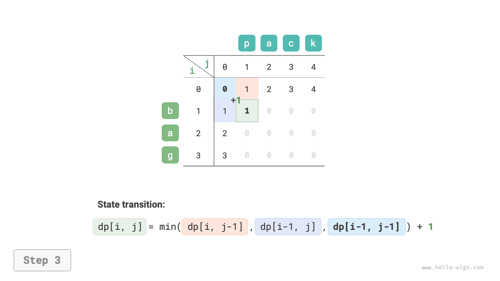
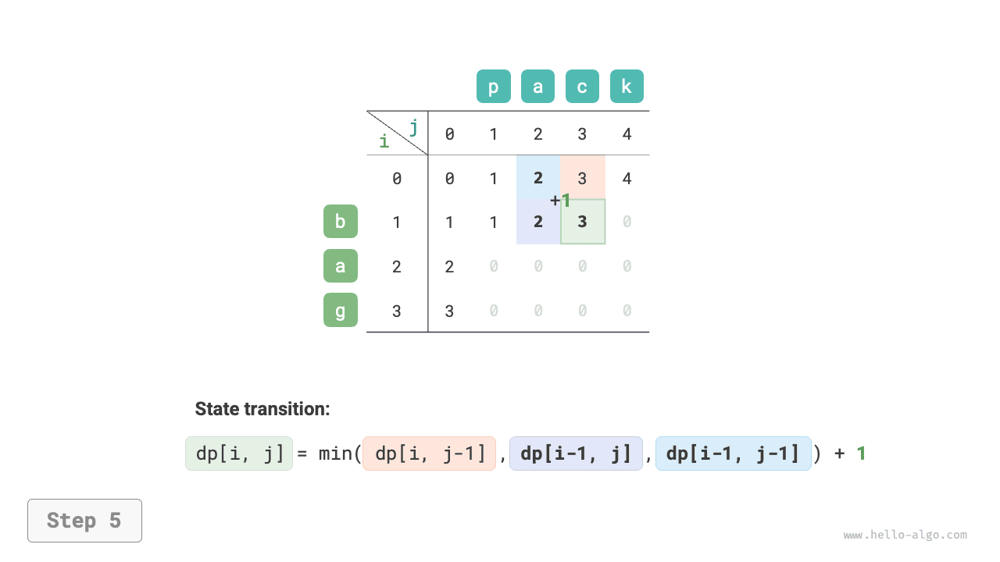
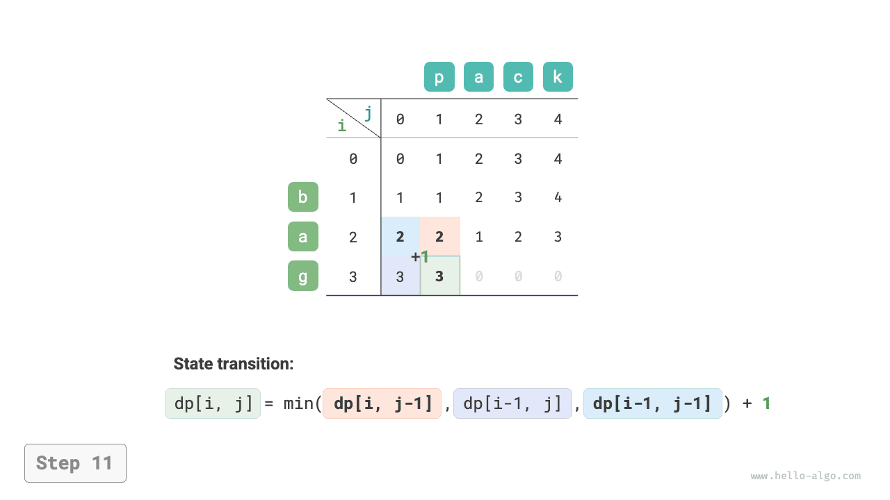
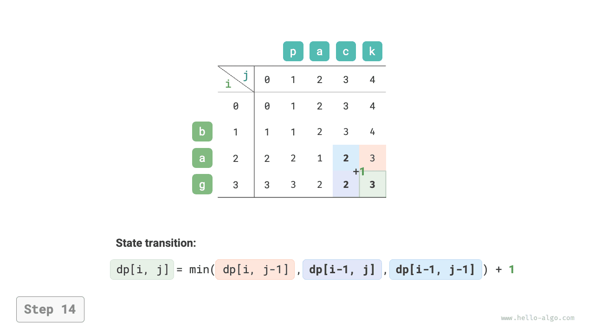

# Bài toán khoảng cách chỉnh sửa

Khoảng cách chỉnh sửa, còn được gọi là khoảng cách Levenshtein, là số lượng chỉnh sửa tối thiểu cần thiết để biến đổi một chuỗi này thành một chuỗi khác. Khoảng cách này thường được sử dụng trong truy xuất thông tin và xử lý ngôn ngữ tự nhiên để đo độ tương đồng giữa hai dãy.

!!! question

    Cho hai chuỗi $s$ và $t$, hãy trả về số lượng chỉnh sửa tối thiểu cần thiết để biến đổi $s$ thành $t$.

    Bạn có thể thực hiện ba loại thao tác chỉnh sửa trên một chuỗi: chèn một ký tự, xóa một ký tự hoặc thay thế một ký tự bằng bất kỳ ký tự nào khác.

Như minh họa trong hình dưới đây, để biến đổi `kitten` thành `sitting` cần 3 lần chỉnh sửa, gồm 2 lần thay thế và 1 lần chèn; để biến đổi `hello` thành `algo` cần 3 bước, gồm 2 lần thay thế và 1 lần xóa.


**Bài toán khoảng cách chỉnh sửa có thể được giải thích một cách tự nhiên bằng mô hình cây quyết định**. Các chuỗi tương ứng với các nút của cây, còn mỗi thao tác chỉnh sửa tương ứng với một cạnh trong cây.

Như minh họa trong hình dưới đây, nếu không giới hạn các thao tác, mỗi nút có thể phân nhánh thành nhiều cạnh, trong đó mỗi cạnh tương ứng với một thao tác. Điều này có nghĩa là có nhiều đường đi có thể biến đổi `hello` thành `algo`.

Xét theo góc độ cây quyết định, mục tiêu của bài toán này là tìm đường đi ngắn nhất giữa nút `hello` và nút `algo`.


### Phương pháp quy hoạch động

**Bước 1: Suy nghĩ về các quyết định trong mỗi vòng, xác định state và từ đó xây dựng bảng $dp$**

Mỗi vòng quyết định bao gồm việc thực hiện một thao tác chỉnh sửa trên chuỗi $s$.

Ta muốn kích thước bài toán giảm dần trong quá trình chỉnh sửa để có thể xây dựng các bài toán con. Gọi độ dài của các chuỗi $s$ và $t$ lần lượt là $n$ và $m$. Trước tiên, ta xét các ký tự cuối của hai chuỗi là $s[n-1]$ và $t[m-1]$.

- Nếu $s[n-1]$ và $t[m-1]$ giống nhau, ta có thể bỏ qua chúng và trực tiếp xét $s[n-2]$ và $t[m-2]$.
- Nếu $s[n-1]$ và $t[m-1]$ khác nhau, ta cần thực hiện một thao tác chỉnh sửa trên $s$ (chèn, xóa hoặc thay thế) để làm cho các ký tự cuối của hai chuỗi giống nhau, từ đó có thể bỏ qua chúng và xét một bài toán có quy mô nhỏ hơn.

Nói cách khác, mỗi vòng quyết định (thao tác chỉnh sửa) được thực hiện trên chuỗi $s$ sẽ thay đổi các ký tự còn lại cần được đối sánh trong $s$ và $t$. Vì vậy, state là ký tự thứ $i$ và thứ $j$ hiện đang được xét trong $s$ và $t$, được ký hiệu là $[i, j]$.

State $[i, j]$ tương ứng với bài toán con: **số lượng chỉnh sửa tối thiểu cần thiết để biến đổi $i$ ký tự đầu tiên của $s$ thành $j$ ký tự đầu tiên của $t$**.

Từ đó, ta có một bảng $dp$ hai chiều có kích thước $(n+1) \times (m+1)$.

**Bước 2: Xác định cấu trúc tối ưu, sau đó suy ra phương trình chuyển state**

Xét bài toán con $dp[i, j]$, trong đó các ký tự cuối của hai chuỗi tương ứng là $s[i-1]$ và $t[j-1]$. Dựa trên các thao tác chỉnh sửa khác nhau, bài toán có thể được chia thành ba trường hợp như trong hình dưới đây.

1. Chèn $t[j-1]$ sau $s[i-1]$, khi đó bài toán con còn lại là $dp[i, j-1]$.
2. Xóa $s[i-1]$, khi đó bài toán con còn lại là $dp[i-1, j]$.
3. Thay thế $s[i-1]$ bằng $t[j-1]$, khi đó bài toán con còn lại là $dp[i-1, j-1]$.


Dựa trên phân tích trên, ta có được cấu trúc tối ưu: số lượng chỉnh sửa tối thiểu của $dp[i, j]$ bằng giá trị nhỏ nhất trong các giá trị $dp[i, j-1]$, $dp[i-1, j]$ và $dp[i-1, j-1]$, cộng với chi phí chỉnh sửa hiện tại là $1$. Phương trình chuyển state tương ứng là:

$$
dp[i, j] = \min(dp[i, j-1], dp[i-1, j], dp[i-1, j-1]) + 1
$$

Lưu ý rằng **khi $s[i-1]$ và $t[j-1]$ giống nhau, không cần chỉnh sửa ký tự hiện tại**, khi đó phương trình chuyển state là:

$$
dp[i, j] = dp[i-1, j-1]
$$

**Bước 3: Xác định điều kiện biên và thứ tự chuyển state**

Khi cả hai chuỗi đều rỗng, số bước chỉnh sửa là $0$, tức là $dp[0, 0] = 0$. Khi $s$ rỗng nhưng $t$ không rỗng, số bước chỉnh sửa tối thiểu bằng độ dài của $t$, tức là hàng đầu tiên thỏa mãn $dp[0, j] = j$. Khi $s$ không rỗng nhưng $t$ rỗng, số bước chỉnh sửa tối thiểu bằng độ dài của $s$, tức là cột đầu tiên thỏa mãn $dp[i, 0] = i$.

Quan sát phương trình chuyển state, nghiệm $dp[i, j]$ phụ thuộc vào các nghiệm ở bên trái, bên trên và phía trên bên trái. Vì vậy, có thể duyệt toàn bộ bảng $dp$ theo thứ tự bằng hai vòng lặp lồng nhau.

### Cài đặt bằng code

```src
[file]{edit_distance}-[class]{}-[func]{edit_distance_dp}
```

Như minh họa trong hình dưới đây, quá trình chuyển state của bài toán khoảng cách chỉnh sửa rất giống với bài toán ba lô; cả hai đều có thể được xem là quá trình điền vào một lưới hai chiều.

=== "<1>"
    

=== "<2>"
    

=== "<3>"
    

=== "<4>"
    

=== "<5>"
    

=== "<6>"
    

=== "<7>"
    

=== "<8>"
    

=== "<9>"
    

=== "<10>"
    

=== "<11>"
    

=== "<12>"
    

=== "<13>"
    

=== "<14>"
    

=== "<15>"
    

### Tối ưu hóa không gian

Vì $dp[i, j]$ phụ thuộc vào state bên trên $dp[i-1, j]$, bên trái $dp[i, j-1]$ và phía trên bên trái $dp[i-1, j-1]$, nên việc duyệt theo chiều thuận sẽ làm mất state phía trên bên trái $dp[i-1, j-1]$, còn việc duyệt theo chiều ngược lại không thể xây dựng trước $dp[i, j-1]$. Do đó, không thứ tự duyệt nào trong hai thứ tự này là phù hợp.

Vì lý do này, ta có thể sử dụng một biến `leftup` để tạm thời lưu nghiệm phía trên bên trái $dp[i-1, j-1]$, nhờ đó chỉ cần xét các nghiệm ở bên trái và bên trên. Trường hợp này giống với bài toán ba lô không giới hạn, vì vậy ta có thể sử dụng cách duyệt theo chiều thuận. Code như sau:

```src
[file]{edit_distance}-[class]{}-[func]{edit_distance_dp_comp}
```
