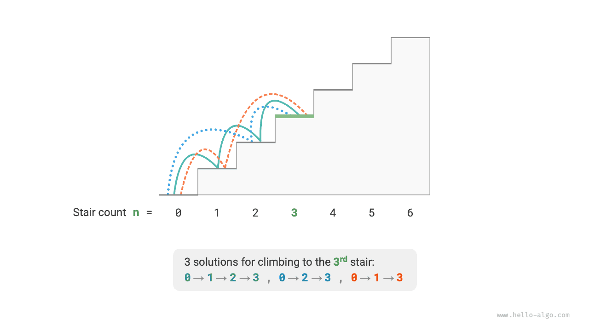
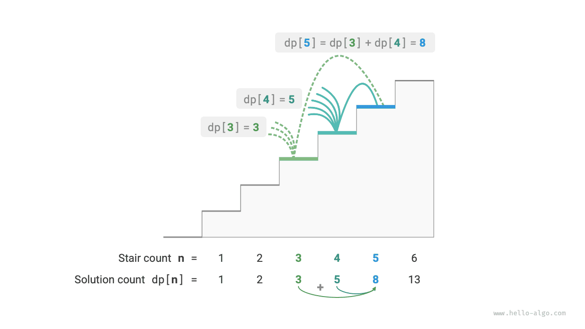

# Giới thiệu về Quy hoạch động

<u>Quy hoạch động</u> là một mô hình thuật toán quan trọng, phân rã một bài toán thành một chuỗi các bài toán con nhỏ hơn và tránh tính toán dư thừa bằng cách lưu trữ lời giải của các bài toán con, từ đó cải thiện đáng kể hiệu quả về thời gian.

Trong phần này, chúng ta bắt đầu với một ví dụ kinh điển: trước tiên trình bày lời giải vét cạn bằng quay lui, quan sát các bài toán con chồng lấn trong đó, sau đó từng bước suy ra lời giải quy hoạch động hiệu quả hơn.

!!! question "Leo cầu thang"

    Cho một cầu thang có $n$ bậc, trong đó mỗi lần bạn có thể đi lên $1$ hoặc $2$ bậc, có bao nhiêu cách khác nhau để đi đến đỉnh?

Như minh họa trong hình dưới đây, với cầu thang có $3$ bậc, có $3$ cách khác nhau để đi đến đỉnh.



Mục tiêu của bài toán này là xác định số cách, vì vậy **chúng ta có thể cân nhắc sử dụng quay lui để liệt kê mọi khả năng**. Cụ thể, hãy hình dung việc leo cầu thang như một quá trình lựa chọn gồm nhiều lượt: bắt đầu từ mặt đất, ở mỗi lượt chọn đi lên $1$ hoặc $2$ bậc, tăng bộ đếm lên $1$ mỗi khi đến đỉnh cầu thang và cắt tỉa khi vượt quá đỉnh. Code như sau:

```src
[file]{climbing_stairs_backtrack}-[class]{}-[func]{climbing_stairs_backtrack}
```

## Phương pháp 1: Tìm kiếm vét cạn

Các thuật toán quay lui thường không phân rã bài toán một cách rõ ràng, mà xem việc giải bài toán là một chuỗi các bước ra quyết định, tìm kiếm tất cả lời giải khả dĩ thông qua thử và cắt tỉa.

Chúng ta có thể thử phân tích bài toán này dưới góc độ phân rã bài toán. Gọi số cách leo đến bậc thứ $i$ là $dp[i]$, khi đó $dp[i]$ là bài toán ban đầu, còn các bài toán con của nó bao gồm:

$$
dp[i-1], dp[i-2], \dots, dp[2], dp[1]
$$

Vì mỗi lượt chúng ta chỉ có thể đi lên $1$ hoặc $2$ bậc, khi đứng ở bậc thứ $i$, ở lượt trước chúng ta chỉ có thể đứng tại bậc thứ $i-1$ hoặc $i-2$. Nói cách khác, chúng ta chỉ có thể đến bậc thứ $i$ từ bậc thứ $i-1$ hoặc $i-2$.

Điều này dẫn đến một kết luận quan trọng: **số cách leo đến bậc thứ $i-1$ cộng với số cách leo đến bậc thứ $i-2$ bằng số cách leo đến bậc thứ $i$**. Công thức như sau:

$$
dp[i] = dp[i-1] + dp[i-2]
$$

Điều này có nghĩa là trong bài toán leo cầu thang, tồn tại một quan hệ truy hồi giữa các bài toán con, và **lời giải của bài toán ban đầu có thể được xây dựng từ lời giải của các bài toán con**. Hình dưới đây minh họa quan hệ truy hồi này.



Dựa trên công thức truy hồi, chúng ta có thể xây dựng lời giải tìm kiếm vét cạn. Bắt đầu từ $dp[n]$, **đệ quy phân rã một bài toán lớn hơn thành tổng của hai bài toán nhỏ hơn**, cho đến khi đạt đến các bài toán con nhỏ nhất $dp[1]$ và $dp[2]$ rồi trả về. Trong đó, lời giải của các bài toán con nhỏ nhất đã biết, cụ thể là $dp[1] = 1$ và $dp[2] = 2$, tương ứng với $1$ và $2$ cách leo đến bậc thứ $1$ và thứ $2$.

Hãy quan sát đoạn code sau: giống như code quay lui tiêu chuẩn, đoạn code này cũng sử dụng tìm kiếm theo chiều sâu nhưng ngắn gọn hơn:

```src
[file]{climbing_stairs_dfs}-[class]{}-[func]{climbing_stairs_dfs}
```

Hình dưới đây cho thấy cây đệ quy được tạo ra bởi tìm kiếm vét cạn. Với bài toán $dp[n]$, độ sâu của cây đệ quy là $n$, và độ phức tạp thời gian là $O(2^n)$. Tăng trưởng theo cấp số nhân là cực kỳ nhanh; nếu nhập một $n$ tương đối lớn, thời gian chờ có thể rất lâu.


Quan sát hình trên, **độ phức tạp thời gian theo cấp số nhân là do "các bài toán con chồng lấn"**. Ví dụ, $dp[9]$ được phân rã thành $dp[8]$ và $dp[7]$, còn $dp[8]$ được phân rã thành $dp[7]$ và $dp[6]$; cả hai đều chứa bài toán con $dp[7]$.

Tương tự, các bài toán con chứa những bài toán con nhỏ hơn bị chồng lấn, cứ tiếp diễn vô hạn. Phần lớn tài nguyên tính toán bị lãng phí cho các bài toán con chồng lấn này.

## Phương pháp 2: Memoization

Để cải thiện hiệu quả thuật toán, **chúng ta muốn mỗi bài toán con chồng lấn chỉ được tính một lần**. Vì mục đích này, chúng ta khai báo một mảng `mem` để ghi lại lời giải của từng bài toán con và cắt tỉa các bài toán con chồng lấn trong quá trình tìm kiếm.

1. Khi tính $dp[i]$ lần đầu tiên, chúng ta ghi lại nó vào `mem[i]` để sử dụng sau này.
2. Khi cần tính lại $dp[i]$, chúng ta có thể trực tiếp lấy kết quả từ `mem[i]`, nhờ đó tránh tính toán dư thừa cho bài toán con này.

Code như sau:

```src
[file]{climbing_stairs_dfs_mem}-[class]{}-[func]{climbing_stairs_dfs_mem}
```

Hãy quan sát hình dưới đây: **sau khi sử dụng memoization, tất cả các bài toán con chồng lấn chỉ cần được tính một lần, làm giảm độ phức tạp thời gian xuống còn $O(n)$**, đây là một bước tiến vượt bậc.


## Phương pháp 3: Quy hoạch động

**Memoization là một phương pháp "top-down"**: chúng ta bắt đầu từ bài toán ban đầu (nút gốc), đệ quy phân rã các bài toán con lớn hơn thành những bài toán nhỏ hơn, cho đến khi đạt đến các bài toán con nhỏ nhất đã biết (nút lá). Sau đó, bằng cách quay lui, chúng ta thu thập lời giải của các bài toán con theo từng tầng để xây dựng lời giải cho bài toán ban đầu.

Ngược lại, **quy hoạch động là một phương pháp "bottom-up"**: bắt đầu từ lời giải của các bài toán con nhỏ nhất, lặp đi lặp lại để xây dựng lời giải cho các bài toán con lớn hơn cho đến khi thu được lời giải của bài toán ban đầu.

Vì quy hoạch động không bao gồm quá trình quay lui, nên khi triển khai chỉ cần lặp và không cần đệ quy. Trong đoạn code sau, chúng ta khởi tạo một mảng `dp` để lưu trữ lời giải của các bài toán con; mảng này có cùng chức năng ghi nhận như mảng `mem` trong memoization:

```src
[file]{climbing_stairs_dp}-[class]{}-[func]{climbing_stairs_dp}
```

Hình dưới đây mô phỏng quá trình thực thi của đoạn code trên.


Giống như các thuật toán quay lui, quy hoạch động cũng sử dụng khái niệm "state" để biểu diễn các giai đoạn cụ thể trong quá trình giải bài toán, trong đó mỗi state tương ứng với một bài toán con và lời giải tối ưu cục bộ tương ứng của nó. Ví dụ, state trong bài toán leo cầu thang được định nghĩa là số thứ tự của bậc thang hiện tại $i$.

Dựa trên nội dung trên, chúng ta có thể tổng hợp các thuật ngữ thường dùng trong quy hoạch động.

- Mảng `dp` được gọi là <u>bảng dp</u>, trong đó $dp[i]$ biểu diễn lời giải của bài toán con tương ứng với state $i$.
- Các state tương ứng với những bài toán con nhỏ nhất (bậc thứ $1$ và thứ $2$) được gọi là <u>state ban đầu</u>.
- Công thức truy hồi $dp[i] = dp[i-1] + dp[i-2]$ được gọi là <u>phương trình chuyển state</u>.

## Tối ưu hóa không gian

Những độc giả tinh ý có thể đã nhận ra rằng **vì $dp[i]$ chỉ liên quan đến $dp[i-1]$ và $dp[i-2]$, chúng ta không cần sử dụng một mảng `dp` để lưu trữ lời giải của tất cả các bài toán con**, mà có thể sử dụng hai biến lần lượt tiến lên. Code như sau:

```src
[file]{climbing_stairs_dp}-[class]{}-[func]{climbing_stairs_dp_comp}
```

Như đoạn code trên cho thấy, bằng cách loại bỏ phần không gian mà mảng `dp` chiếm dụng, độ phức tạp không gian được giảm từ $O(n)$ xuống $O(1)$.

Trong các bài toán quy hoạch động, state hiện tại thường chỉ phụ thuộc vào một số lượng hữu hạn các state đứng trước, cho phép chúng ta chỉ giữ lại những state cần thiết và tiết kiệm không gian bộ nhớ thông qua "giảm số chiều". **Kỹ thuật tối ưu hóa không gian này được gọi là "rolling variable" hoặc "rolling array"**.