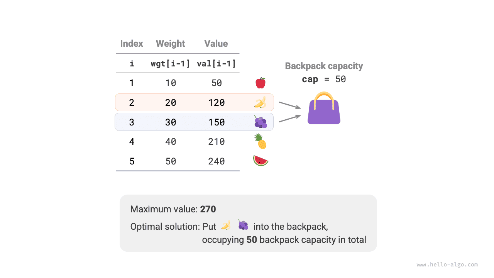
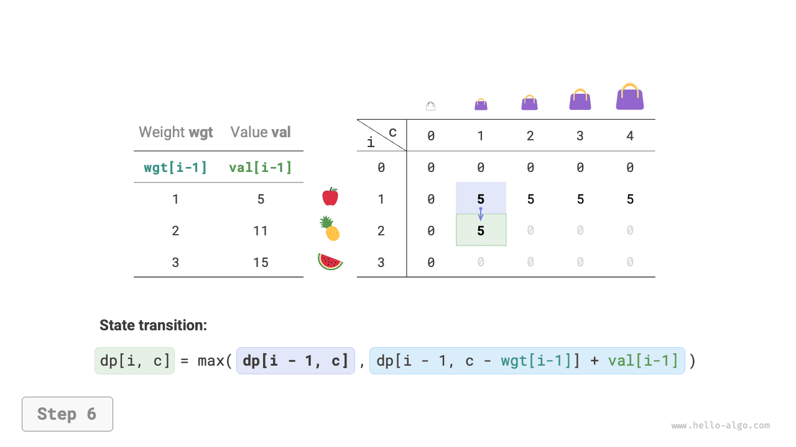
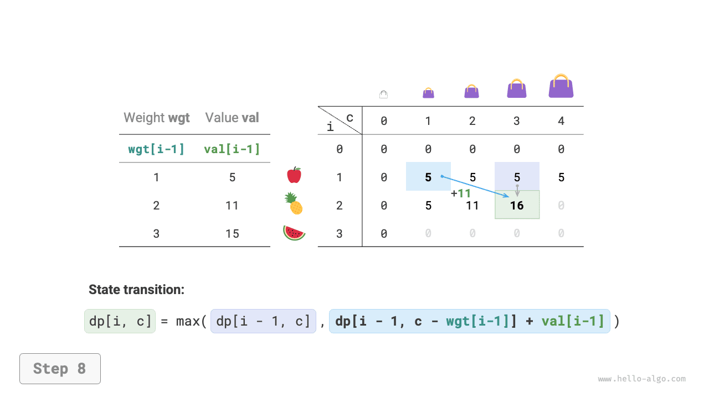
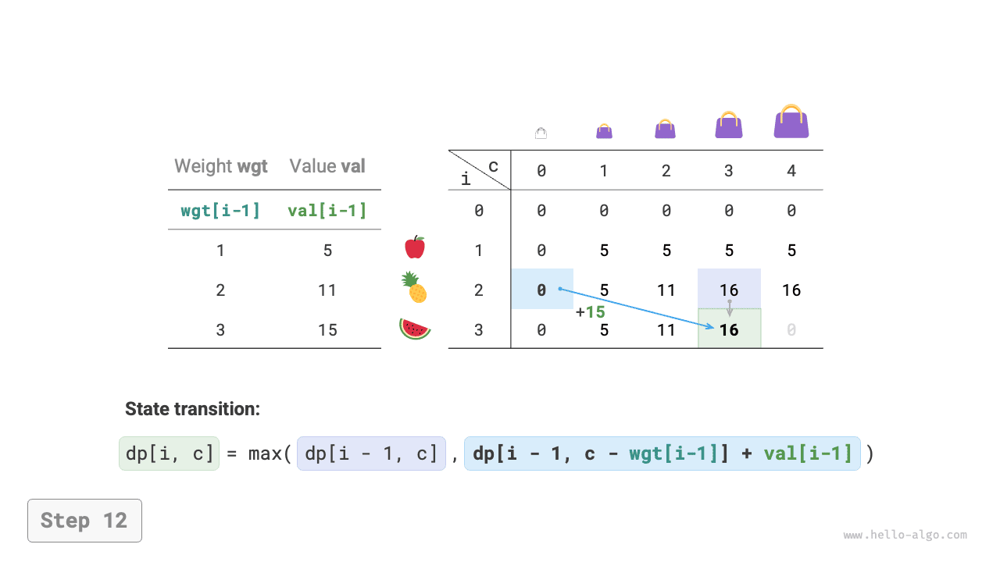
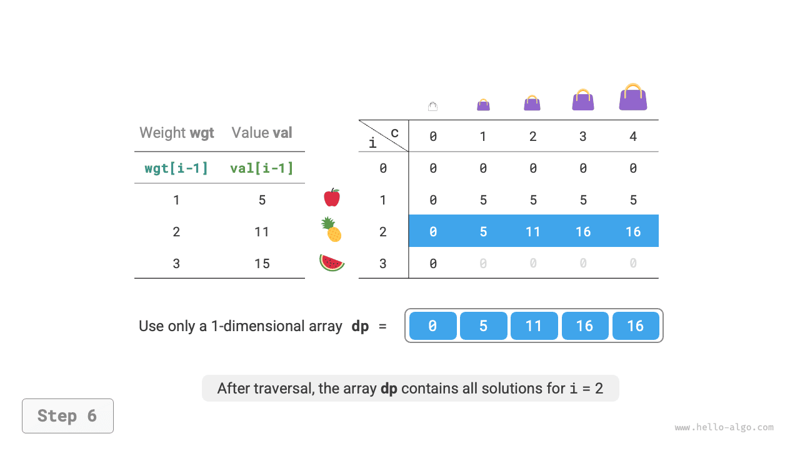

# Bài toán ba lô 0-1

Bài toán ba lô là một bài toán nhập môn tuyệt vời cho quy hoạch động và là một trong những dạng bài toán phổ biến nhất trong quy hoạch động. Bài toán này có nhiều biến thể, chẳng hạn như bài toán ba lô 0-1, bài toán ba lô không giới hạn và bài toán ba lô nhiều lựa chọn.

Trong phần này, trước tiên chúng ta sẽ giải bài toán ba lô 0-1 phổ biến nhất.

!!! question

    Cho $n$ vật phẩm và một chiếc ba lô có sức chứa $cap$, trong đó trọng lượng và giá trị của vật phẩm thứ $i$ lần lượt là $wgt[i-1]$ và $val[i-1]$. Mỗi vật phẩm chỉ có thể được chọn nhiều nhất một lần. Giá trị lớn nhất có thể cho vào ba lô trong giới hạn sức chứa là bao nhiêu?

Hãy quan sát hình dưới đây. Vì số thứ tự vật phẩm $i$ bắt đầu từ $1$, còn chỉ số mảng bắt đầu từ $0$, nên vật phẩm $i$ tương ứng với trọng lượng $wgt[i-1]$ và giá trị $val[i-1]$.



Chúng ta có thể xem bài toán ba lô 0-1 như một quá trình gồm $n$ vòng quyết định. Với mỗi vật phẩm, có hai quyết định: không cho vật phẩm vào ba lô hoặc cho vật phẩm vào ba lô. Do đó, bài toán này thỏa mãn mô hình cây quyết định.

Mục tiêu của bài toán là tìm "giá trị lớn nhất có thể cho vào ba lô trong giới hạn sức chứa", vì vậy đây nhiều khả năng là một bài toán quy hoạch động.

**Bước 1: Suy nghĩ về các quyết định trong mỗi vòng, định nghĩa trạng thái, từ đó xây dựng bảng $dp$**

Với mỗi vật phẩm, nếu không cho vào ba lô thì sức chứa của ba lô không thay đổi; nếu cho vào thì sức chứa của ba lô giảm xuống. Từ đó, ta có thể suy ra định nghĩa trạng thái: số thứ tự vật phẩm hiện tại $i$ và sức chứa ba lô $c$, ký hiệu là $[i, c]$.

Trạng thái $[i, c]$ tương ứng với bài toán con: **giá trị lớn nhất trong số $i$ vật phẩm đầu tiên khi ba lô có sức chứa $c$**, ký hiệu là $dp[i, c]$.

Điều chúng ta cần tìm là $dp[n, cap]$, vì vậy cần một bảng $dp$ hai chiều có kích thước $(n+1) \times (cap+1)$.

**Bước 2: Xác định cấu trúc con tối ưu, sau đó suy ra phương trình chuyển trạng thái**

Sau khi đưa ra quyết định cho vật phẩm $i$, phần còn lại là bài toán con gồm $i-1$ vật phẩm đầu tiên, có thể chia thành hai trường hợp sau:

- **Không cho vật phẩm $i$ vào ba lô**: Sức chứa ba lô không thay đổi, trạng thái chuyển thành $[i-1, c]$.
- **Cho vật phẩm $i$ vào ba lô**: Sức chứa ba lô giảm đi $wgt[i-1]$, giá trị tăng thêm $val[i-1]$, và trạng thái chuyển thành $[i-1, c-wgt[i-1]]$.

Phân tích trên cho thấy cấu trúc con tối ưu của bài toán này: **giá trị lớn nhất $dp[i, c]$ bằng giá trị lớn hơn giữa việc không cho vật phẩm $i$ vào ba lô và việc cho vật phẩm đó vào ba lô**. Từ đó, ta suy ra phương trình chuyển trạng thái:

$$
dp[i, c] = \max(dp[i-1, c], dp[i-1, c - wgt[i-1]] + val[i-1])
$$

Lưu ý rằng nếu trọng lượng của vật phẩm hiện tại $wgt[i - 1]$ lớn hơn sức chứa còn lại của ba lô $c$, thì lựa chọn duy nhất là không cho vật phẩm đó vào ba lô.

**Bước 3: Xác định điều kiện biên và thứ tự chuyển trạng thái**

Khi không có vật phẩm nào hoặc sức chứa ba lô bằng $0$, giá trị lớn nhất là $0`, tức là cột đầu tiên $dp[i, 0]$ và hàng đầu tiên $dp[0, c]$ đều bằng $0$.

Trạng thái hiện tại $[i, c]$ được chuyển từ trạng thái phía trên $[i-1, c]$ và trạng thái phía trên bên trái $[i-1, c-wgt[i-1]]$, vì vậy chúng ta có thể duyệt toàn bộ bảng $dp$ theo thứ tự tiến bằng hai vòng lặp lồng nhau.

Dựa trên phân tích trên, tiếp theo chúng ta sẽ lần lượt triển khai các lời giải bằng tìm kiếm vét cạn, memoization và quy hoạch động.

### Phương pháp 1: Tìm kiếm vét cạn

Mã tìm kiếm bao gồm các thành phần sau:

- **Tham số đệ quy**: trạng thái $[i, c]$.
- **Giá trị trả về**: lời giải của bài toán con $dp[i, c]$.
- **Điều kiện kết thúc**: khi không còn vật phẩm nào ($i = 0$) hoặc sức chứa ba lô còn lại bằng $0$, kết thúc đệ quy và trả về giá trị $0$.
- **Cắt tỉa**: nếu trọng lượng của vật phẩm hiện tại lớn hơn sức chứa ba lô còn lại, chỉ có thể chọn phương án không cho vật phẩm đó vào ba lô.

```src
[file]{knapsack}-[class]{}-[func]{knapsack_dfs}
```

Như trong hình dưới đây, vì mỗi vật phẩm tạo ra hai nhánh tìm kiếm — loại bỏ vật phẩm và đưa vật phẩm vào ba lô — nên độ phức tạp thời gian là $O(2^n)$.

Quan sát cây đệ quy, ta dễ dàng nhận thấy các bài toán con chồng lặp, chẳng hạn như $dp[1, 10]$. Khi có nhiều vật phẩm, sức chứa ba lô lớn và đặc biệt là nhiều vật phẩm có cùng trọng lượng, số lượng bài toán con chồng lặp sẽ tăng đáng kể.


### Phương pháp 2: Memoization

Để bảo đảm các bài toán con chồng lặp chỉ được tính một lần, chúng ta sử dụng một danh sách memo `mem` để ghi lại lời giải của các bài toán con, trong đó `mem[i][c]` tương ứng với $dp[i, c]$.

Sau khi áp dụng memoization, **độ phức tạp thời gian phụ thuộc vào số lượng bài toán con**, là $O(n \times cap)$. Mã triển khai như sau:

```src
[file]{knapsack}-[class]{}-[func]{knapsack_dfs_mem}
```

Hình dưới đây cho thấy các nhánh tìm kiếm được cắt tỉa trong memoization.


### Phương pháp 3: Quy hoạch động

Về bản chất, quy hoạch động là quá trình điền bảng $dp$ trong quá trình chuyển trạng thái. Mã như sau:

```src
[file]{knapsack}-[class]{}-[func]{knapsack_dp}
```

Như trong hình dưới đây, cả độ phức tạp thời gian và độ phức tạp không gian đều được quyết định bởi kích thước của mảng `dp`, là $O(n \times cap)$.

=== "<1>"
    

=== "<2>"
    

=== "<3>"
    

=== "<4>"
    

=== "<5>"
    

=== "<6>"
    

=== "<7>"
    

=== "<8>"
    

=== "<9>"
    

=== "<10>"
    

=== "<11>"
    

=== "<12>"
    

=== "<13>"
    

=== "<14>"
    

### Tối ưu hóa không gian

Vì mỗi trạng thái chỉ liên quan đến trạng thái ở hàng ngay phía trên, chúng ta có thể sử dụng hai mảng luân phiên để giảm độ phức tạp không gian từ $O(n \times cap)$ xuống $O(cap)$.

Suy nghĩ sâu hơn, liệu chúng ta có thể tối ưu hóa không gian chỉ bằng một mảng hay không? Quan sát cho thấy mỗi trạng thái được chuyển từ ô ngay phía trên hoặc ô phía trên bên trái. Nếu chỉ có một mảng, khi bắt đầu duyệt hàng $i$, mảng đó vẫn lưu trạng thái của hàng $i-1$.

- Nếu duyệt theo chiều tiến, khi duyệt đến $dp[i, j]$, các giá trị ở vùng phía trên bên trái $dp[i-1, 1]$ ~ $dp[i-1, j-1]$ có thể đã bị ghi đè, khiến việc chuyển trạng thái chính xác không thể thực hiện được.
- Nếu duyệt theo chiều ngược, sẽ không xảy ra vấn đề ghi đè và việc chuyển trạng thái có thể diễn ra chính xác.

Hình dưới đây minh họa quá trình chuyển từ hàng $i = 1$ sang hàng $i = 2$ bằng một mảng duy nhất. Hãy chú ý sự khác biệt giữa duyệt theo chiều tiến và duyệt theo chiều ngược.

=== "<1>"
    

=== "<2>"
    

=== "<3>"
    

=== "<4>"
    

=== "<5>"
    

=== "<6>"
    

Trong phần triển khai mã, chúng ta chỉ cần xóa chiều đầu tiên $i$ của mảng `dp` và thay đổi vòng lặp bên trong thành duyệt theo chiều ngược:

```src
[file]{knapsack}-[class]{}-[func]{knapsack_dp_comp}
```
