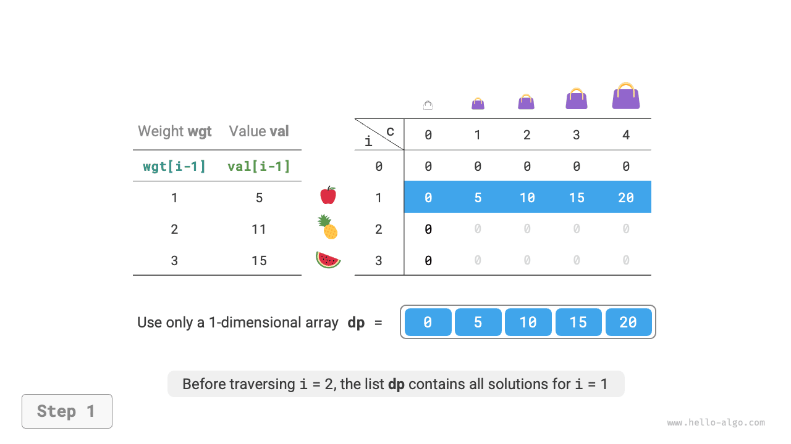
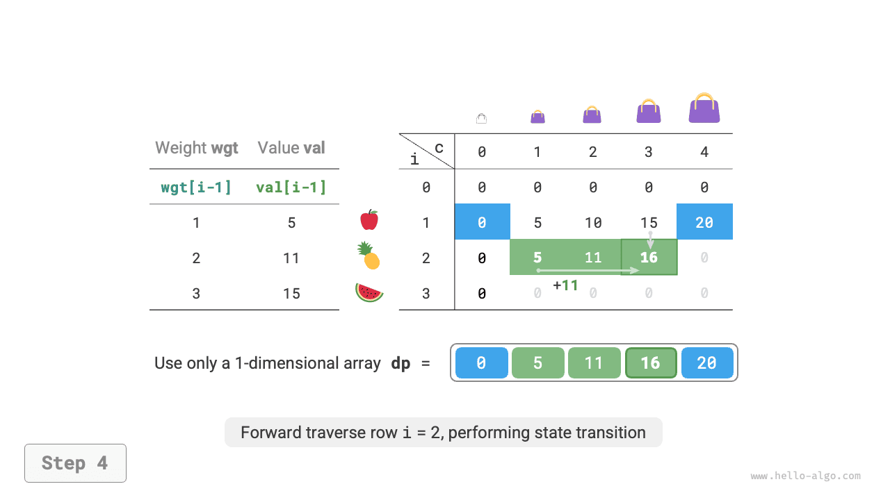
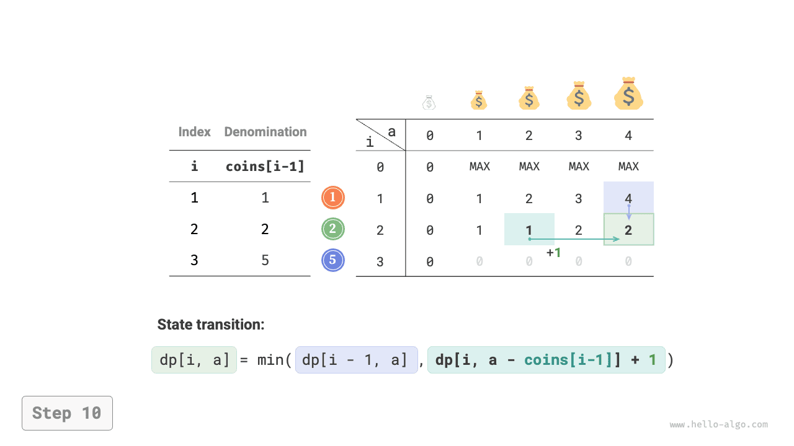

# Bài toán ba lô không giới hạn

Trong phần này, trước tiên chúng ta sẽ giải một bài toán ba lô phổ biến khác: bài toán ba lô không giới hạn, sau đó tìm hiểu một trường hợp đặc biệt của nó: bài toán đổi tiền.

## Bài toán ba lô không giới hạn

!!! question

    Cho $n$ vật phẩm, trong đó trọng lượng của vật phẩm thứ $i$ là $wgt[i-1]$ và giá trị của nó là $val[i-1]$, cùng một chiếc ba lô có sức chứa $cap$. **Mỗi vật phẩm có thể được chọn nhiều lần**. Giá trị lớn nhất có thể đặt vào ba lô trong giới hạn sức chứa là bao nhiêu? Hình dưới đây minh họa một ví dụ.


### Phương pháp quy hoạch động

Bài toán ba lô không giới hạn rất giống với bài toán ba lô 0-1, **chỉ khác ở chỗ không giới hạn số lần một vật phẩm có thể được chọn**.

- Trong bài toán ba lô 0-1, mỗi loại vật phẩm chỉ có một vật phẩm, vì vậy sau khi đặt vật phẩm $i$ vào ba lô, chúng ta chỉ có thể chọn từ $i-1$ vật phẩm đầu tiên.
- Trong bài toán ba lô không giới hạn, số lượng của mỗi loại vật phẩm là không giới hạn, vì vậy sau khi đặt vật phẩm $i$ vào ba lô, **chúng ta vẫn có thể chọn từ $i$ vật phẩm đầu tiên**.

Theo quy tắc của bài toán ba lô không giới hạn, các thay đổi của trạng thái $[i, c]$ được chia thành hai trường hợp.

- **Không đặt vật phẩm $i$**: Giống như bài toán ba lô 0-1, chuyển sang $[i-1, c]$.
- **Đặt vật phẩm $i$**: Khác với bài toán ba lô 0-1, chuyển sang $[i, c-wgt[i-1]]$.

Do đó, công thức chuyển trạng thái là:

$$
dp[i, c] = \max(dp[i-1, c], dp[i, c - wgt[i-1]] + val[i-1])
$$

### Cài đặt bằng code

So sánh code của hai bài toán, ta thấy có một thay đổi trong phép chuyển trạng thái từ $i-1$ thành $i$, còn mọi thứ khác đều giống nhau:

```src
[file]{unbounded_knapsack}-[class]{}-[func]{unbounded_knapsack_dp}
```


### Tối ưu hóa không gian

Vì trạng thái hiện tại được chuyển từ các trạng thái bên trái và bên trên, **sau khi tối ưu hóa không gian, mỗi hàng trong bảng $dp$ cần được duyệt theo thứ tự từ đầu đến cuối**.

Thứ tự duyệt này hoàn toàn ngược với bài toán ba lô 0-1. Hãy xem hình dưới đây để hiểu sự khác biệt giữa hai bài toán.

=== "<1>"
    

=== "<2>"
    

=== "<3>"
    

=== "<4>"
    

=== "<5>"
    

=== "<6>"
    

Cài đặt bằng code tương đối đơn giản, chỉ cần xóa chiều thứ nhất của mảng `dp`:

```src
[file]{unbounded_knapsack}-[class]{}-[func]{unbounded_knapsack_dp_comp}
```


## Bài toán đổi tiền

Bài toán ba lô đại diện cho một nhóm lớn các bài toán quy hoạch động và có nhiều biến thể, chẳng hạn như bài toán đổi tiền.

!!! question

    Cho $n$ loại tiền xu, trong đó mệnh giá của loại tiền xu thứ $i$ là $coins[i - 1]$, và số tiền mục tiêu là $amt$. **Mỗi loại tiền xu có thể được chọn nhiều lần**. Cần ít nhất bao nhiêu tiền xu để tạo thành số tiền mục tiêu? Nếu không thể tạo thành số tiền mục tiêu, trả về $-1$. Hình dưới đây minh họa một ví dụ.


### Phương pháp quy hoạch động

**Bài toán đổi tiền có thể được xem là một trường hợp đặc biệt của bài toán ba lô không giới hạn**, với các điểm tương đồng và khác biệt sau:

- Hai bài toán có thể chuyển đổi cho nhau: “vật phẩm” tương ứng với “tiền xu”, “trọng lượng vật phẩm” tương ứng với “mệnh giá tiền xu”, và “sức chứa ba lô” tương ứng với “số tiền mục tiêu”.
- Mục tiêu tối ưu hóa là ngược nhau: bài toán ba lô không giới hạn nhằm tối đa hóa giá trị vật phẩm, còn bài toán đổi tiền nhằm tối thiểu hóa số lượng tiền xu.
- Bài toán ba lô không giới hạn tìm các nghiệm “không vượt quá” sức chứa ba lô, còn bài toán đổi tiền tìm các nghiệm “chính xác” tạo thành số tiền mục tiêu.

**Bước 1: Suy nghĩ về các quyết định trong mỗi lượt, xác định trạng thái, từ đó xây dựng bảng $dp$**

Trạng thái $[i, a]$ tương ứng với bài toán con: **số lượng tiền xu ít nhất trong $i$ loại tiền xu đầu tiên có thể tạo thành số tiền $a$**, được ký hiệu là $dp[i, a]$.

Bảng $dp$ hai chiều có kích thước $(n+1) \times (amt+1)$.

**Bước 2: Xác định cấu trúc con tối ưu, sau đó suy ra công thức chuyển trạng thái**

Bài toán này khác với bài toán ba lô không giới hạn ở hai khía cạnh sau trong công thức chuyển trạng thái:

- Bài toán này tìm giá trị nhỏ nhất, vì vậy toán tử $\max()$ cần được đổi thành $\min()$.
- Mục tiêu tối ưu hóa là số lượng tiền xu thay vì giá trị vật phẩm, vì vậy khi chọn một đồng xu, chỉ cần cộng thêm $1$.

$$
dp[i, a] = \min(dp[i-1, a], dp[i, a - coins[i-1]] + 1)
$$

**Bước 3: Xác định điều kiện biên và thứ tự chuyển trạng thái**

Khi số tiền mục tiêu bằng $0$, số lượng tiền xu ít nhất cần dùng để tạo thành số tiền đó là $0$, vì vậy tất cả $dp[i, 0]$ trong cột đầu tiên đều bằng $0$.

Khi không có đồng xu nào, **không thể tạo thành bất kỳ số tiền nào $> 0$**, đây là một nghiệm không hợp lệ. Để hàm $\min()$ trong công thức chuyển trạng thái có thể nhận diện và loại bỏ các nghiệm không hợp lệ, chúng ta dùng $+ \infty$ để biểu diễn chúng, tức là đặt tất cả $dp[0, a]$ trong hàng đầu tiên bằng $+ \infty$.

### Cài đặt bằng code

Hầu hết các ngôn ngữ lập trình không cung cấp biến $+ \infty$ và chỉ có thể dùng giá trị lớn nhất của kiểu số nguyên `int` để thay thế. Tuy nhiên, điều này có thể dẫn đến tràn số nguyên: phép cộng $+ 1$ trong công thức chuyển trạng thái có thể gây tràn.

Vì lý do này, chúng ta dùng số $amt + 1$ để biểu diễn các nghiệm không hợp lệ, bởi vì số lượng tiền xu tối đa cần để tạo thành $amt$ nhiều nhất là $amt$. Trước khi trả về, hãy kiểm tra xem $dp[n, amt]$ có bằng $amt + 1$ hay không; nếu có, trả về $-1$, cho biết không thể tạo thành số tiền mục tiêu. Code như sau:

```src
[file]{coin_change}-[class]{}-[func]{coin_change_dp}
```


Hình dưới đây minh họa quy trình quy hoạch động cho bài toán đổi tiền, rất giống với bài toán ba lô không giới hạn.

=== "<1>"
    

=== "<2>"
    

=== "<3>"
    

=== "<4>"
    

=== "<5>"
    

=== "<6>"
    

=== "<7>"
    

=== "<8>"
    

=== "<9>"
    

=== "<10>"
    

=== "<11>"
    

=== "<12>"
    

=== "<13>"
    

=== "<14>"
    

=== "<15>"
    

### Tối ưu hóa không gian

Việc tối ưu hóa không gian cho bài toán đổi tiền được thực hiện giống như đối với bài toán ba lô không giới hạn:

```src
[file]{coin_change}-[class]{}-[func]{coin_change_dp_comp}
```


## Bài toán đổi tiền II

!!! question

    Cho $n$ loại tiền xu, trong đó mệnh giá của loại tiền xu thứ $i$ là $coins[i - 1]$, và số tiền mục tiêu là $amt$. Mỗi loại tiền xu có thể được chọn nhiều lần. **Có bao nhiêu tổ hợp tiền xu có thể tạo thành số tiền mục tiêu?** Hình dưới đây minh họa một ví dụ.


### Phương pháp quy hoạch động

So với bài toán trước, mục tiêu của bài toán này là tìm số lượng tổ hợp, vì vậy bài toán con trở thành: **số lượng tổ hợp trong $i$ loại tiền xu đầu tiên có thể tạo thành số tiền $a$**. Bảng $dp$ vẫn là một ma trận hai chiều có kích thước $(n+1) \times (amt + 1)$.

Số lượng tổ hợp của trạng thái hiện tại bằng tổng số tổ hợp của hai trường hợp: không chọn đồng xu hiện tại và chọn đồng xu hiện tại. Công thức chuyển trạng thái là:

$$
dp[i, a] = dp[i-1, a] + dp[i, a - coins[i-1]]
$$

Khi số tiền mục tiêu là $0$, không cần chọn đồng xu nào để tạo thành số tiền mục tiêu, vì vậy tất cả $dp[i, 0]$ trong cột đầu tiên phải được khởi tạo bằng $1$. Khi không có đồng xu nào, không thể tạo thành bất kỳ số tiền nào $>0$, vì vậy tất cả $dp[0, a]$ trong hàng đầu tiên đều bằng $0$.

### Triển khai mã

```src
[file]{coin_change_ii}-[class]{}-[func]{coin_change_ii_dp}
```

### Tối ưu hóa không gian

Việc tối ưu hóa không gian được thực hiện theo cách tương tự, chỉ cần xóa chiều đồng xu:

```src
[file]{coin_change_ii}-[class]{}-[func]{coin_change_ii_dp_comp}
```
