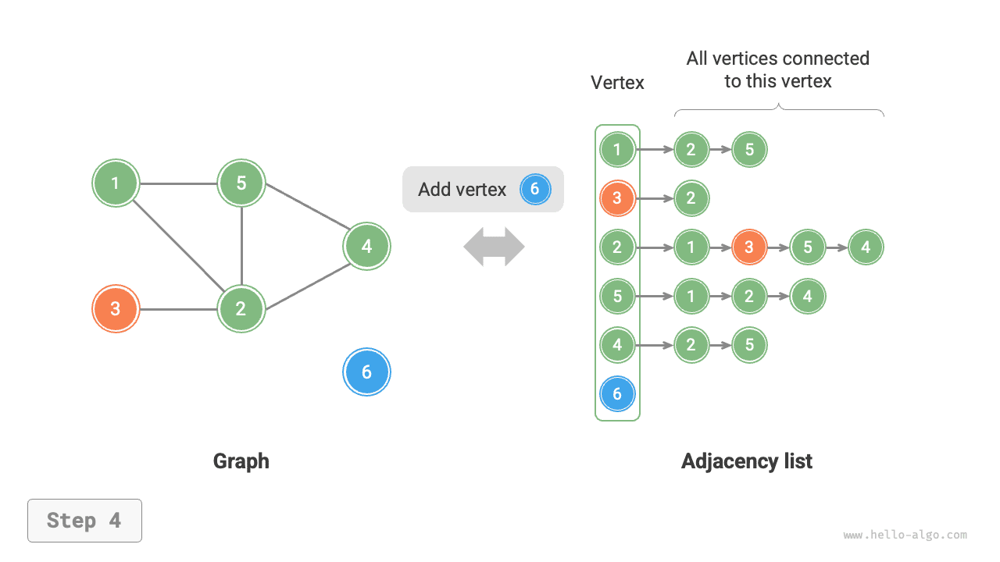

# Các thao tác cơ bản trên đồ thị

Các thao tác cơ bản trên đồ thị có thể được chia thành các thao tác trên "cạnh" và các thao tác trên "đỉnh". Cách triển khai chúng khác nhau tùy thuộc vào việc đồ thị được biểu diễn bằng "ma trận kề" hay "danh sách kề".

## Triển khai dựa trên ma trận kề

Cho một đồ thị vô hướng có $n$ đỉnh, các thao tác khác nhau được triển khai như trong hình dưới đây.

- **Thêm hoặc xóa một cạnh**: Trực tiếp sửa đổi cạnh được chỉ định trong ma trận kề, với thời gian $O(1)$. Vì đây là đồ thị vô hướng, cả hai hướng của cạnh cần được cập nhật đồng thời.
- **Thêm một đỉnh**: Thêm một hàng và một cột vào cuối ma trận kề, rồi điền toàn bộ bằng các giá trị $0$, với thời gian $O(n)$.
- **Xóa một đỉnh**: Xóa một hàng và một cột trong ma trận kề. Trường hợp xấu nhất xảy ra khi xóa hàng và cột đầu tiên, cần "di chuyển lên trên và sang trái" $(n-1)^2$ phần tử, do đó mất thời gian $O(n^2)$.
- **Khởi tạo**: Với $n$ đỉnh, khởi tạo danh sách đỉnh `vertices` có độ dài $n$, với thời gian $O(n)$; khởi tạo ma trận kề `adjMat` có kích thước $n \times n$, với thời gian $O(n^2)$.

=== "<1>"
    

=== "<2>"
    

=== "<3>"
    

=== "<4>"
    

=== "<5>"
    

Sau đây là mã triển khai đồ thị được biểu diễn bằng ma trận kề:

```src
[file]{graph_adjacency_matrix}-[class]{graph_adj_mat}-[func]{}
```

## Triển khai dựa trên danh sách kề

Cho một đồ thị vô hướng có tổng cộng $n$ đỉnh và $m$ cạnh, các thao tác khác nhau có thể được triển khai như trong hình dưới đây.

- **Thêm một cạnh**: Thêm cạnh vào cuối danh sách liên kết tương ứng với đỉnh đó, với thời gian $O(1)$. Vì đây là đồ thị vô hướng, các cạnh theo cả hai hướng cần được thêm đồng thời.
- **Xóa một cạnh**: Tìm và xóa cạnh được chỉ định trong danh sách liên kết tương ứng với đỉnh đó, với thời gian $O(m)$. Trong đồ thị vô hướng, các cạnh theo cả hai hướng cần được xóa đồng thời.
- **Thêm một đỉnh**: Thêm một danh sách liên kết vào danh sách kề, với đỉnh mới làm nút đầu, với thời gian $O(1)$.
- **Xóa một đỉnh**: Duyệt toàn bộ danh sách kề và xóa tất cả các cạnh chứa đỉnh được chỉ định, với thời gian $O(n + m)$.
- **Khởi tạo**: Tạo $n$ đỉnh và $2m$ cạnh trong danh sách kề, với thời gian $O(n + m)$.

=== "<1>"
    

=== "<2>"
    

=== "<3>"
    

=== "<4>"
    

=== "<5>"
    

Đoạn mã sau đây cho thấy cách triển khai danh sách kề. So với hình trên, mã thực tế có những điểm khác biệt sau.

- Để thuận tiện cho việc thêm và xóa đỉnh, đồng thời đơn giản hóa mã, chúng ta sử dụng các list (mảng động) thay vì danh sách liên kết.
- Một hash table được sử dụng để lưu trữ danh sách kề, trong đó `key` là instance của đỉnh và `value` là list (danh sách liên kết) các đỉnh kề với đỉnh đó.

Ngoài ra, chúng ta sử dụng lớp `Vertex` để biểu diễn các đỉnh trong danh sách kề vì lý do sau: nếu sử dụng chỉ số của list để phân biệt các đỉnh khác nhau, như với ma trận kề, thì khi xóa đỉnh tại chỉ số $i$, chúng ta sẽ phải duyệt toàn bộ danh sách kề và giảm tất cả các chỉ số lớn hơn $i$ đi $1$, điều này rất kém hiệu quả. Tuy nhiên, nếu mỗi đỉnh là một instance `Vertex` duy nhất, việc xóa một đỉnh không yêu cầu sửa đổi các đỉnh khác.

```src
[file]{graph_adjacency_list}-[class]{graph_adj_list}-[func]{}
```

## So sánh hiệu suất

Giả sử đồ thị có $n$ đỉnh và $m$ cạnh, bảng dưới đây so sánh hiệu suất về thời gian và hiệu suất về không gian của ma trận kề và danh sách kề. Lưu ý rằng danh sách kề (danh sách liên kết) tương ứng với cách triển khai được sử dụng trong phần này, còn danh sách kề (hash table) chỉ đề cập đến cách triển khai trong đó tất cả các danh sách liên kết được thay thế bằng hash table.

<p align="center"> Bảng <id> &nbsp; So sánh ma trận kề và danh sách kề </p>

|                        | Ma trận kề | Danh sách kề (danh sách liên kết) | Danh sách kề (hash table) |
| ---------------------- | ---------- | --------------------------------- | ------------------------- |
| Xác định tính kề nhau  | $O(1)$     | $O(n)$                            | $O(1)$                    |
| Thêm một cạnh          | $O(1)$     | $O(1)$                            | $O(1)$                    |
| Xóa một cạnh           | $O(1)$     | $O(n)$                            | $O(1)$                    |
| Thêm một đỉnh          | $O(n)$     | $O(1)$                            | $O(1)$                    |
| Xóa một đỉnh           | $O(n^2)$   | $O(n + m)$                        | $O(n)$                    |
| Mức sử dụng bộ nhớ     | $O(n^2)$   | $O(n + m)$                        | $O(n + m)$                |

Quan sát bảng trên, có vẻ như danh sách kề (hash table) có hiệu suất tốt nhất cả về thời gian lẫn không gian. Tuy nhiên, trong thực tế, việc thao tác trên các cạnh trong ma trận kề hiệu quả hơn, vì chỉ yêu cầu một thao tác truy cập hoặc gán mảng duy nhất. Nhìn chung, ma trận kề thể hiện nguyên tắc "đánh đổi không gian lấy thời gian", trong khi danh sách kề thể hiện nguyên tắc "đánh đổi thời gian lấy không gian".