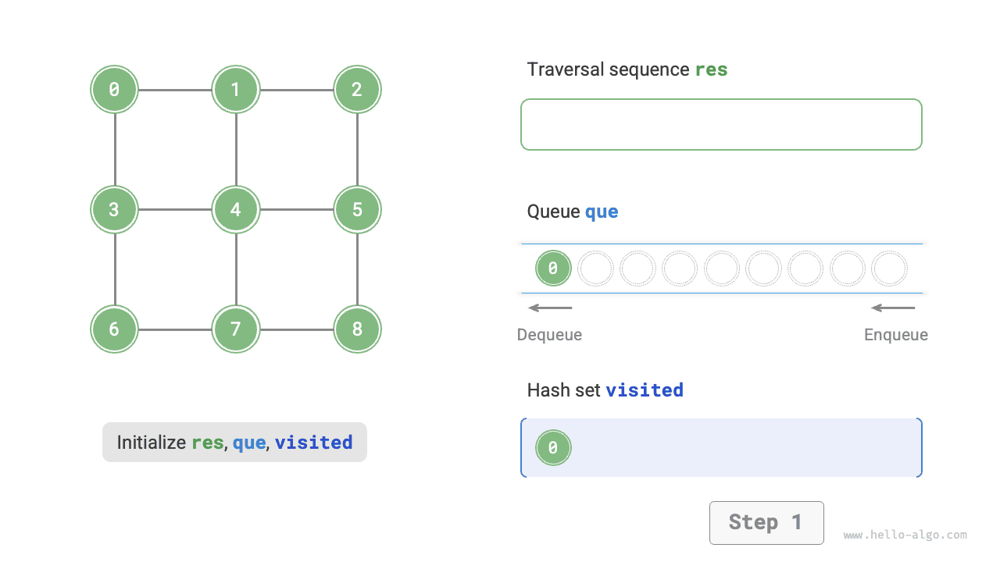
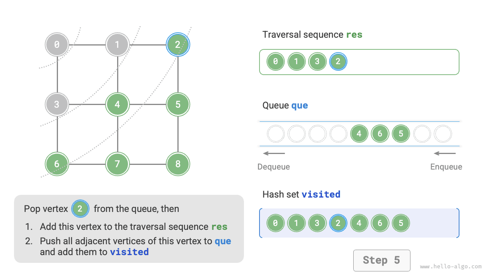
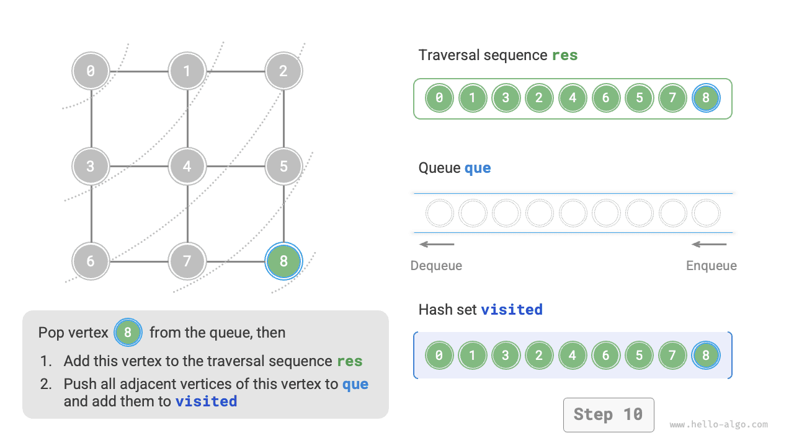
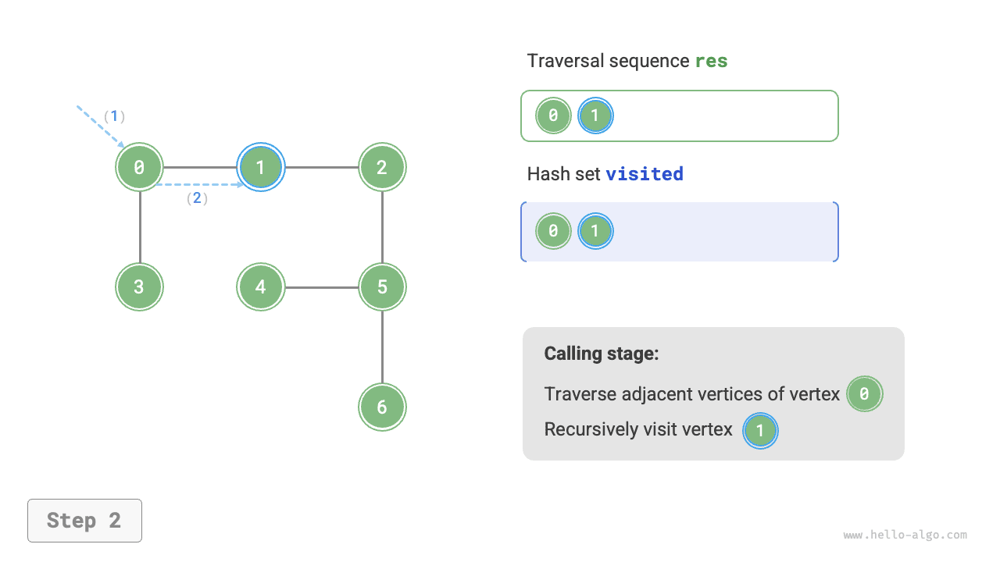
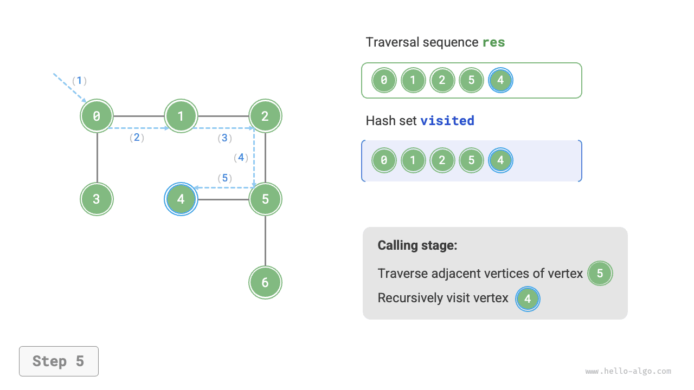

# Duyệt đồ thị

Cây biểu diễn các mối quan hệ “một-nhiều”, trong khi đồ thị có mức độ tự do cao hơn và có thể biểu diễn mọi mối quan hệ “nhiều-nhiều”. Do đó, ta có thể xem cây là một trường hợp đặc biệt của đồ thị. Rõ ràng, **các thao tác duyệt cây cũng là một trường hợp đặc biệt của các thao tác duyệt đồ thị**.

Cả đồ thị và cây đều cần áp dụng các thuật toán tìm kiếm để triển khai các thao tác duyệt. Các phương pháp duyệt đồ thị cũng có thể được chia thành hai loại: <u>duyệt theo chiều rộng</u> và <u>duyệt theo chiều sâu</u>.

## Tìm kiếm theo chiều rộng

**Tìm kiếm theo chiều rộng tiến hành từ gần đến xa: bắt đầu từ một đỉnh cho trước, luôn truy cập các đỉnh gần nhất trước và mở rộng ra ngoài theo từng lớp**. Như minh họa trong hình bên dưới, bắt đầu từ đỉnh ở góc trên bên trái, trước tiên duyệt tất cả các đỉnh kề với đỉnh đó, sau đó duyệt tất cả các đỉnh kề với đỉnh tiếp theo, cứ như vậy cho đến khi mọi đỉnh đều được truy cập.


### Triển khai thuật toán

BFS thường được triển khai với sự hỗ trợ của một queue, như trong đoạn mã bên dưới. Queue có tính chất “vào trước, ra trước”, phù hợp với ý tưởng “từ gần đến xa” của BFS.

1. Thêm đỉnh bắt đầu `startVet` vào queue và bắt đầu vòng lặp.
2. Trong mỗi lần lặp, lấy đỉnh ở đầu queue ra và ghi nhận đỉnh đó là đã được truy cập, sau đó thêm tất cả các đỉnh kề với đỉnh đó vào cuối queue.
3. Lặp lại bước `2.` cho đến khi mọi đỉnh đều đã được truy cập.

Để ngăn việc truy cập lại các đỉnh, ta sử dụng một hash set `visited` để ghi nhận những node đã được truy cập.

!!! tip

    Có thể xem hash set là một hash table chỉ lưu `key` mà không lưu `value`. Nó hỗ trợ các thao tác chèn, xóa, tra cứu và cập nhật trên `key` trong thời gian $O(1)$. Dựa trên tính duy nhất của `key`, hash set thường được dùng để loại bỏ dữ liệu trùng lặp và trong các tình huống tương tự.

```src
[file]{graph_bfs}-[class]{}-[func]{graph_bfs}
```

Đoạn mã tương đối trừu tượng; bạn nên tham khảo hình bên dưới để hiểu rõ hơn.

=== "<1>"
    

=== "<2>"
    

=== "<3>"
    

=== "<4>"
    

=== "<5>"
    

=== "<6>"
    

=== "<7>"
    

=== "<8>"
    

=== "<9>"
    

=== "<10>"
    

=== "<11>"
    

!!! question "Thứ tự duyệt theo chiều rộng có duy nhất không?"

    Không duy nhất. Tìm kiếm theo chiều rộng chỉ yêu cầu duyệt theo thứ tự “từ gần đến xa”, **và thứ tự duyệt các đỉnh có cùng khoảng cách có thể được xáo trộn tùy ý**. Lấy hình trên làm ví dụ, có thể hoán đổi thứ tự truy cập các đỉnh $1$ và $3$, cũng như thứ tự truy cập các đỉnh $2$, $4$ và $6$.

### Phân tích độ phức tạp

**Độ phức tạp thời gian**: Mọi đỉnh sẽ được đưa vào queue và lấy ra khỏi queue đúng một lần, tốn thời gian $O(|V|)$; trong quá trình duyệt các đỉnh kề, vì đây là đồ thị vô hướng nên mọi cạnh sẽ được truy cập $2$ lần, tốn thời gian $O(2|E|)$; tổng thể tốn thời gian $O(|V| + |E|)$.

**Độ phức tạp không gian**: Danh sách `res`, hash set `visited` và queue `que` có thể chứa tối đa $|V|$ đỉnh, nên tốn không gian $O(|V|)$.

## Tìm kiếm theo chiều sâu

**Tìm kiếm theo chiều sâu là phương pháp duyệt ưu tiên đi xa nhất có thể, sau đó quay lui khi không còn đường đi**. Như minh họa trong hình bên dưới, bắt đầu từ đỉnh ở góc trên bên trái, truy cập một đỉnh kề với đỉnh hiện tại, tiếp tục cho đến khi đi vào ngõ cụt, sau đó quay lại và tiếp tục đi xa nhất có thể trước khi lại quay về, cứ như vậy cho đến khi mọi đỉnh đều đã được duyệt.


### Triển khai thuật toán

Mô hình thuật toán “đi xa nhất có thể rồi quay về” thường được triển khai bằng đệ quy. Tương tự tìm kiếm theo chiều rộng, trong tìm kiếm theo chiều sâu, ta cũng cần một hash set `visited` để ghi nhận các đỉnh đã được truy cập và tránh truy cập lại.

```src
[file]{graph_dfs}-[class]{}-[func]{graph_dfs}
```

Quy trình thuật toán tìm kiếm theo chiều sâu được minh họa trong hình bên dưới.

- **Các đường nét đứt thẳng biểu diễn việc đệ quy đi xuống**, cho biết một phương thức đệ quy mới đã được bắt đầu để truy cập một đỉnh mới.
- **Các đường nét đứt cong biểu diễn việc quay lui đi lên**, cho biết lời gọi đệ quy này đã quay lại điểm nơi nó được thực hiện.

Để hiểu rõ hơn, bạn nên kết hợp hình bên dưới với đoạn mã để mô phỏng trong đầu (hoặc vẽ ra) toàn bộ quy trình DFS, bao gồm thời điểm mỗi lời gọi đệ quy bắt đầu và thời điểm nó trả về.

=== "<1>"
    

=== "<2>"
    

=== "<3>"
    

=== "<4>"
    

=== "<5>"
    

=== "<6>"
    

=== "<7>"
    

=== "<8>"
    

=== "<9>"
    

=== "<10>"
    

=== "<11>"
    

!!! question "Thứ tự duyệt theo chiều sâu có duy nhất không?"

    Tương tự tìm kiếm theo chiều rộng, các thứ tự duyệt theo chiều sâu cũng không duy nhất. Với một đỉnh cho trước, có thể chọn bất kỳ hướng khám phá nào trước; nói cách khác, thứ tự của các đỉnh kề có thể được sắp xếp lại tùy ý mà vẫn tạo thành tìm kiếm theo chiều sâu.

    Lấy việc duyệt cây làm ví dụ, “root $\rightarrow$ left $\rightarrow$ right”, “left $\rightarrow$ root $\rightarrow$ right” và “left $\rightarrow$ right $\rightarrow$ root” lần lượt tương ứng với duyệt pre-order, in-order và post-order. Chúng biểu diễn ba thứ tự ưu tiên duyệt khác nhau, nhưng cả ba đều thuộc tìm kiếm theo chiều sâu.

### Phân tích độ phức tạp

**Độ phức tạp thời gian**: Mọi đỉnh sẽ được truy cập $1$ lần, tốn thời gian $O(|V|)$; mọi cạnh sẽ được truy cập $2$ lần, tốn thời gian $O(2|E|)$; tổng thể tốn thời gian $O(|V| + |E|)$.

**Độ phức tạp không gian**: Danh sách `res` và hash set `visited` có thể chứa tối đa $|V|$ đỉnh, và độ sâu đệ quy tối đa là $|V|$, do đó tốn không gian $O(|V|)$.