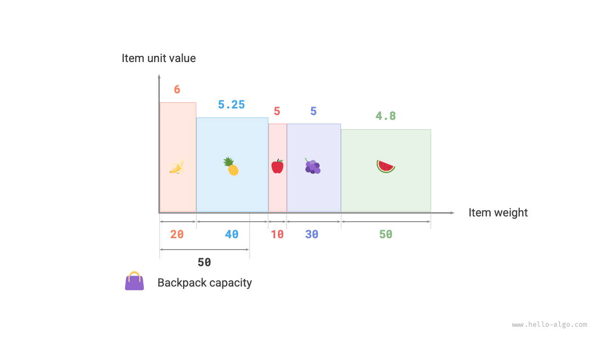

# Bài toán ba lô phân số

!!! question

    Cho $n$ vật phẩm, trong đó trọng lượng của vật phẩm thứ $i$ là $wgt[i-1]$ và giá trị của nó là $val[i-1]$, cùng một chiếc ba lô có sức chứa $cap$. Mỗi vật phẩm chỉ có thể được chọn một lần, **nhưng có thể chọn một phần của vật phẩm, với giá trị tỷ lệ thuận với trọng lượng được chọn**. Giá trị tổng lớn nhất có thể đặt vào ba lô dưới ràng buộc về sức chứa là bao nhiêu? Ví dụ được minh họa trong hình dưới đây.


Nhìn chung, bài toán ba lô phân số rất giống bài toán ba lô 0-1, với các trạng thái bao gồm vật phẩm hiện tại $i$ và sức chứa $c$, mục tiêu là tối đa hóa giá trị trong giới hạn sức chứa của ba lô.

Điểm khác biệt là bài toán này cho phép chọn một phần của vật phẩm. Như minh họa trong hình dưới đây, **ta có thể chia một vật phẩm tùy ý và tính giá trị của nó tỷ lệ với trọng lượng được chọn**.

1. Với vật phẩm $i$, giá trị trên mỗi đơn vị trọng lượng là $val[i-1] / wgt[i-1]$, được gọi là giá trị đơn vị.
2. Giả sử ta đặt một phần của vật phẩm $i$ có trọng lượng $w$ vào ba lô, khi đó giá trị được thêm vào ba lô là $w \times val[i-1] / wgt[i-1]$.


### Xác định chiến lược tham lam

Tối đa hóa tổng giá trị trong ba lô **về bản chất có nghĩa là ưu tiên các vật phẩm có giá trị trên mỗi đơn vị trọng lượng cao hơn**. Từ nhận xét này, ta có thể suy ra chiến lược tham lam được minh họa trong hình dưới đây.

1. Sắp xếp các vật phẩm theo giá trị đơn vị từ cao xuống thấp.
2. Duyệt qua tất cả các vật phẩm, **tham lam chọn vật phẩm có giá trị đơn vị cao nhất ở mỗi lượt**.
3. Nếu sức chứa còn lại của ba lô không đủ, sử dụng một phần của vật phẩm hiện tại để lấp đầy ba lô.


### Cài đặt bằng mã

Ta định nghĩa một `Item` để các vật phẩm có thể được sắp xếp theo giá trị đơn vị. Sau đó, ta tham lam duyệt qua các vật phẩm đã sắp xếp, dừng lại khi ba lô đầy và trả về kết quả:

```src
[file]{fractional_knapsack}-[class]{}-[func]{fractional_knapsack}
```

Các thuật toán sắp xếp dựng sẵn thường có thời gian chạy $O(n \log n)$, và độ phức tạp không gian thường là $O(\log n)$ hoặc $O(n)$, tùy thuộc vào cách cài đặt cụ thể của ngôn ngữ lập trình.

Ngoài thao tác sắp xếp, trong trường hợp xấu nhất, toàn bộ danh sách vật phẩm cần được duyệt qua, **do đó độ phức tạp thời gian là $O(n)$**, trong đó $n$ là số lượng vật phẩm.

Vì một danh sách đối tượng `Item` được khởi tạo, **độ phức tạp không gian là $O(n)$**.

### Chứng minh tính đúng đắn

Ta sử dụng phương pháp chứng minh phản chứng. Giả sử vật phẩm $x$ có giá trị đơn vị cao nhất, và một thuật toán tạo ra giá trị tối ưu `res`, nhưng nghiệm thu được không bao gồm vật phẩm $x$.

Bây giờ, lấy một đơn vị trọng lượng từ bất kỳ vật phẩm nào trong ba lô và thay thế nó bằng một đơn vị trọng lượng của vật phẩm $x$. Vì vật phẩm $x$ có giá trị đơn vị cao nhất, tổng giá trị sau khi thay thế chắc chắn phải lớn hơn `res`. **Điều này mâu thuẫn với giả định rằng `res` là tối ưu, qua đó chứng minh rằng mọi nghiệm tối ưu đều phải bao gồm vật phẩm $x$**.

Ta cũng có thể xây dựng phản chứng tương tự cho các vật phẩm khác trong nghiệm. Tóm lại, **các vật phẩm có giá trị đơn vị cao hơn luôn là lựa chọn tốt hơn**, qua đó chứng minh chiến lược tham lam là hiệu quả.

Như minh họa trong hình dưới đây, nếu xem trọng lượng vật phẩm và giá trị đơn vị lần lượt là trục ngang và trục dọc của một biểu đồ hai chiều, thì bài toán ba lô phân số có thể được xem là “tìm diện tích lớn nhất được bao quanh trong một khoảng bị giới hạn trên trục ngang”. Sự tương đồng này giúp giải thích tính hiệu quả của chiến lược tham lam từ góc nhìn hình học.

