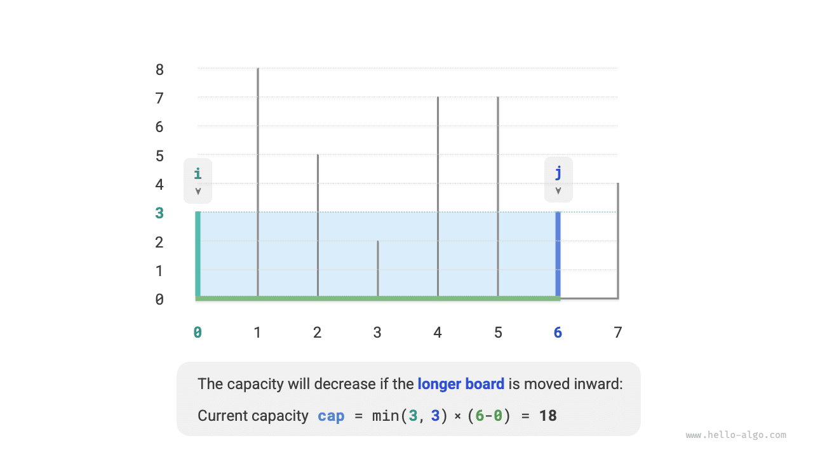
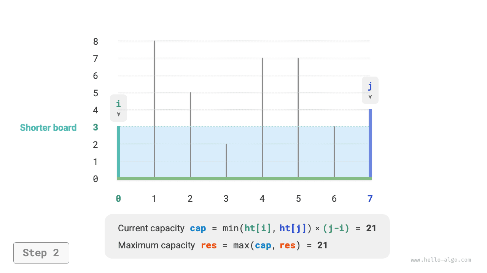
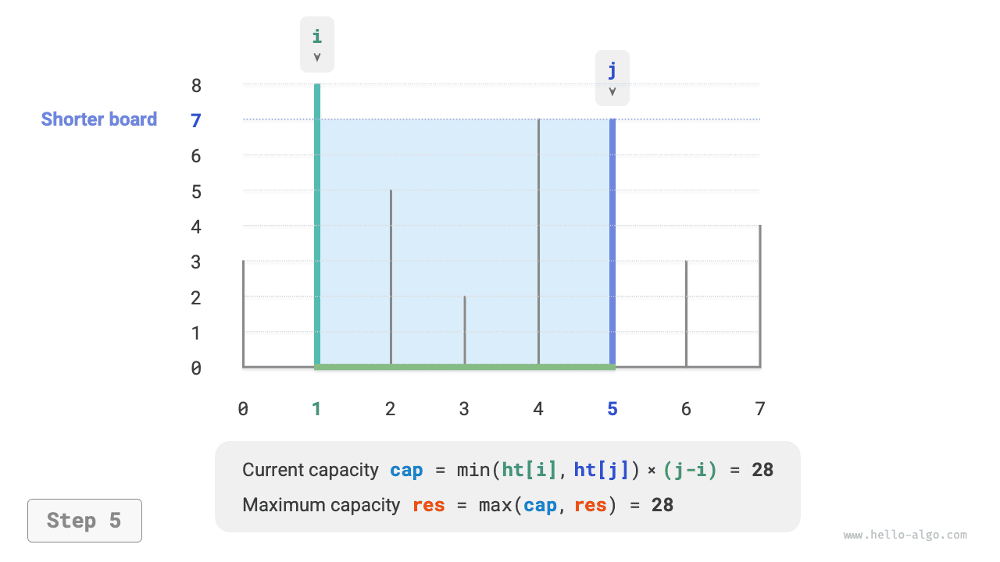
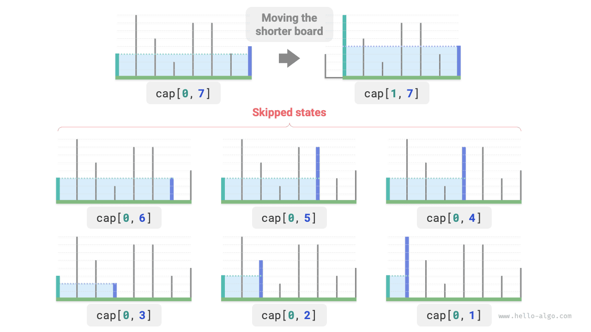

# Bài toán dung tích lớn nhất

!!! question

    Cho một mảng $ht$, trong đó mỗi phần tử biểu diễn chiều cao của một thanh chắn đứng. Bất kỳ hai thanh chắn nào trong mảng, cùng với khoảng không gian giữa chúng, đều có thể tạo thành một container.

    Dung tích của container bằng tích của chiều cao và chiều rộng (tức là diện tích), trong đó chiều cao được xác định bởi thanh chắn thấp hơn và chiều rộng là hiệu giữa chỉ số mảng của hai thanh chắn.

    Hãy chọn hai thanh chắn trong mảng sao cho dung tích của container tạo thành là lớn nhất, rồi trả về dung tích lớn nhất đó. Ví dụ được minh họa trong hình dưới đây.


Container được tạo bởi bất kỳ hai thanh chắn nào, **vì vậy trạng thái của bài toán là chỉ số của hai thanh chắn, được ký hiệu là $[i, j]$**.

Theo đề bài, dung tích bằng chiều cao nhân với chiều rộng, trong đó chiều cao được xác định bởi thanh chắn thấp hơn và chiều rộng là hiệu giữa chỉ số mảng của hai thanh chắn. Gọi dung tích là $cap[i, j]$; khi đó ta có công thức sau:

$$
cap[i, j] = \min(ht[i], ht[j]) \times (j - i)
$$

Gọi độ dài mảng là $n$. Khi đó, số cách chọn hai thanh chắn (tức tổng số trạng thái) là $C_n^2 = \frac{n(n - 1)}{2}$. Cách trực tiếp nhất là **duyệt toàn bộ các trạng thái** để tìm dung tích lớn nhất, với độ phức tạp thời gian là $O(n^2)$.

### Xác định chiến lược tham lam

Bài toán này có một lời giải hiệu quả hơn. Như minh họa trong hình dưới đây, xét một trạng thái $[i, j]$ với $i < j$ và $ht[i] < ht[j]$. Trong trường hợp này, $i$ là thanh chắn thấp hơn còn $j$ là thanh chắn cao hơn.


Như minh họa trong hình dưới đây, **nếu bây giờ ta di chuyển thanh chắn cao hơn $j$ vào phía trong, về phía thanh chắn thấp hơn $i$, dung tích chắc chắn sẽ giảm**.

Điều này là do sau khi di chuyển thanh chắn cao hơn $j$, chiều rộng $j-i$ chắc chắn giảm. Vì chiều cao được xác định bởi thanh chắn thấp hơn, chiều cao chỉ có thể giữ nguyên ($i$ vẫn là thanh chắn thấp hơn) hoặc giảm ($j$ trở thành thanh chắn thấp hơn sau khi được di chuyển).



Ngược lại, **chỉ khi di chuyển thanh chắn thấp hơn $i$ vào phía trong thì dung tích mới có khả năng tăng**. Mặc dù chiều rộng chắc chắn giảm, **chiều cao có thể tăng** (thanh chắn được di chuyển tại $i$ có thể cao hơn). Ví dụ, trong hình dưới đây, diện tích tăng sau khi di chuyển thanh chắn thấp hơn.


Từ đó, ta có thể suy ra chiến lược tham lam cho bài toán này: khởi tạo hai con trỏ ở hai đầu mảng, rồi trong mỗi vòng lặp di chuyển con trỏ tương ứng với thanh chắn thấp hơn vào phía trong cho đến khi hai con trỏ gặp nhau.

Hình dưới đây minh họa quá trình thực hiện chiến lược tham lam.

1. Ở trạng thái ban đầu, hai con trỏ $i$ và $j$ nằm ở hai đầu mảng.
2. Tính dung tích của trạng thái hiện tại $cap[i, j]$ và cập nhật dung tích lớn nhất.
3. So sánh chiều cao của các thanh chắn $i$ và $j$, rồi di chuyển con trỏ tương ứng với thanh chắn thấp hơn vào phía trong một vị trí.
4. Lặp lại các bước `2.` và `3.` cho đến khi $i$ và $j$ gặp nhau.

=== "<1>"
    

=== "<2>"
    

=== "<3>"
    

=== "<4>"
    

=== "<5>"
    

=== "<6>"
    

=== "<7>"
    

=== "<8>"
    

=== "<9>"
    

### Cài đặt mã

Mã chạy nhiều nhất $n$ vòng lặp, **vì vậy độ phức tạp thời gian là $O(n)$**.

Các biến $i$, $j$ và $res$ chỉ sử dụng một lượng không gian bổ sung hằng số, **vì vậy độ phức tạp không gian là $O(1)$**.

```src
[file]{max_capacity}-[class]{}-[func]{max_capacity}
```

### Chứng minh tính đúng đắn

Lý do chiến lược tham lam nhanh hơn việc duyệt toàn bộ là trong mỗi vòng lặp, lựa chọn tham lam sẽ “bỏ qua” một số trạng thái.

Ví dụ, trong trạng thái $cap[i, j]$, giả sử $i$ là thanh chắn thấp hơn còn $j$ là thanh chắn cao hơn. Nếu ta tham lam di chuyển thanh chắn thấp hơn $i$ vào phía trong một vị trí, các trạng thái được minh họa trong hình dưới đây sẽ bị “bỏ qua”. **Điều này có nghĩa là dung tích của chúng sẽ không còn được kiểm tra về sau**.

$$
cap[i, i+1], cap[i, i+2], \dots, cap[i, j-2], cap[i, j-1]
$$



Xem xét kỹ hơn, ta thấy rằng **các trạng thái bị bỏ qua này chính là các trạng thái nhận được khi di chuyển thanh chắn cao hơn $j$ vào phía trong**. Trước đó, ta đã chứng minh rằng di chuyển thanh chắn cao hơn vào phía trong chắc chắn sẽ làm giảm dung tích. Vì vậy, không trạng thái nào trong số các trạng thái bị bỏ qua có thể là lời giải tối ưu, **nên việc bỏ qua chúng không khiến ta bỏ lỡ giá trị tối ưu**.

Phân tích trên cho thấy di chuyển thanh chắn thấp hơn là một thao tác “an toàn” và chiến lược tham lam là hiệu quả.