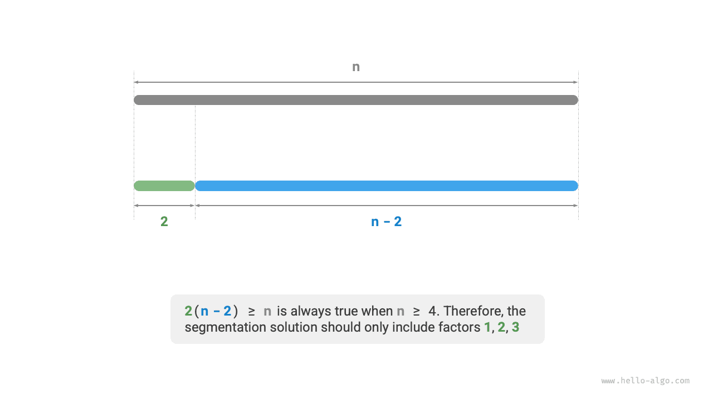

# Bài toán cắt thành tích lớn nhất

!!! question

    Cho một số nguyên dương $n$, hãy chia nó thành tổng của ít nhất hai số nguyên dương và tìm tích lớn nhất của các số nguyên nhận được, như minh họa trong hình dưới đây.


Giả sử chúng ta chia $n$ thành $m$ thừa số nguyên, trong đó thừa số thứ $i$ được ký hiệu là $n_i$, tức là

$$
n = \sum_{i=1}^{m}n_i
$$

Mục tiêu của bài toán này là tìm tích lớn nhất của tất cả các thừa số nguyên, cụ thể là

$$
\max(\prod_{i=1}^{m}n_i)
$$

Chúng ta cần xác định số phần $m$ và giá trị của từng $n_i$.

### Xác định chiến lược tham lam

Theo kinh nghiệm, tích của hai số nguyên thường lớn hơn tổng của chúng. Giả sử chúng ta tách một thừa số $2$ khỏi $n$; tích nhận được là $2(n-2)$. Ta so sánh tích này với $n$:

$$
\begin{aligned}
2(n-2) & \geq n \newline
2n - n - 4 & \geq 0 \newline
n & \geq 4
\end{aligned}
$$

Như minh họa trong hình dưới đây, khi $n \geq 4$, việc tách một $2$ sẽ làm tăng tích, **điều này cho thấy mọi số nguyên lớn hơn hoặc bằng $4$ đều nên được tiếp tục tách**.

**Chiến lược tham lam một**: Nếu phương án phân chia chứa một thừa số $\geq 4$, thừa số đó nên được tiếp tục tách. Phương án phân chia cuối cùng chỉ nên chứa các thừa số $1$, $2$ và $3$.



Tiếp theo, hãy xem thừa số nào là tối ưu. Trong ba thừa số $1$, $2$ và $3$, rõ ràng $1$ là lựa chọn tệ nhất, vì $1 \times (n-1) < n$ luôn đúng, nghĩa là việc tách một $1$ thực tế sẽ làm giảm tích.

Như minh họa trong hình dưới đây, khi $n = 6$, ta có $3 \times 3 > 2 \times 2 \times 2$. **Điều này có nghĩa là tách một $3$ tốt hơn tách một $2$**.

**Chiến lược tham lam hai**: Trong phương án phân chia, có nhiều nhất hai số $2$, vì ba số $2$ luôn có thể được thay thế bằng hai số $3$ để thu được tích lớn hơn.


Tóm lại, có thể rút ra các chiến lược tham lam sau:

1. Nhập số nguyên $n$, liên tục tách thừa số $3$ cho đến khi phần dư là $0$, $1$ hoặc $2$.
2. Khi phần dư là $0$, điều đó có nghĩa là $n$ là bội của $3$, nên không cần thực hiện thêm thao tác nào.
3. Khi phần dư là $2$, không tiếp tục tách nó; giữ nguyên giá trị đó.
4. Khi phần dư là $1$, vì $2 \times 2 > 1 \times 3$, hãy thay thế $3$ cuối cùng và phần dư $1$ bằng hai số $2$.

### Cài đặt bằng code

Như minh họa trong hình dưới đây, chúng ta không cần dùng vòng lặp để tách số nguyên. Thay vào đó, ta sử dụng phép chia nguyên để lấy số lượng số $3$, ký hiệu là $a$, và phép toán modulo để lấy phần dư $b$, từ đó có:

$$
n = 3 a + b
$$

Lưu ý rằng với trường hợp đặc biệt $n \leq 3$, cần tách một $1$, khi đó tích là $1 \times (n - 1)$.

```src
[file]{max_product_cutting}-[class]{}-[func]{max_product_cutting}
```


**Độ phức tạp thời gian phụ thuộc vào cách lũy thừa được triển khai trong ngôn ngữ lập trình**. Lấy Python làm ví dụ, có ba cách thường dùng để tính lũy thừa.

- Cả toán tử `**` và hàm `pow()` đều có độ phức tạp thời gian là $O(\log⁡ a)$.
- Hàm `math.pow()` bên trong gọi hàm `pow()` của thư viện C, hàm này thực hiện phép lũy thừa số thực động với độ phức tạp thời gian là $O(1)$.

Các biến $a$ và $b$ sử dụng một lượng không gian bổ sung không đổi, **do đó độ phức tạp không gian là $O(1)$**.

### Chứng minh tính đúng đắn

Chúng ta sử dụng phương pháp chứng minh phản chứng và chỉ xét trường hợp $n \geq 4$.

1. **Mọi thừa số đều $\leq 3$**: Giả sử phương án phân chia tối ưu chứa một thừa số $x \geq 4$. Khi đó, thừa số này có thể được tiếp tục tách thành $2(x-2)$ để thu được tích lớn hơn hoặc bằng. Điều này mâu thuẫn với giả định.
2. **Phương án phân chia không chứa $1$**: Giả sử phương án phân chia tối ưu chứa một thừa số $1$. Khi đó, có thể gộp nó vào một thừa số khác để thu được tích lớn hơn. Điều này mâu thuẫn với giả định.
3. **Phương án phân chia chứa nhiều nhất hai số $2$**: Giả sử phương án phân chia tối ưu chứa ba số $2$. Khi đó, có thể thay thế chúng bằng hai số $3$, qua đó thu được tích lớn hơn. Điều này mâu thuẫn với giả định.