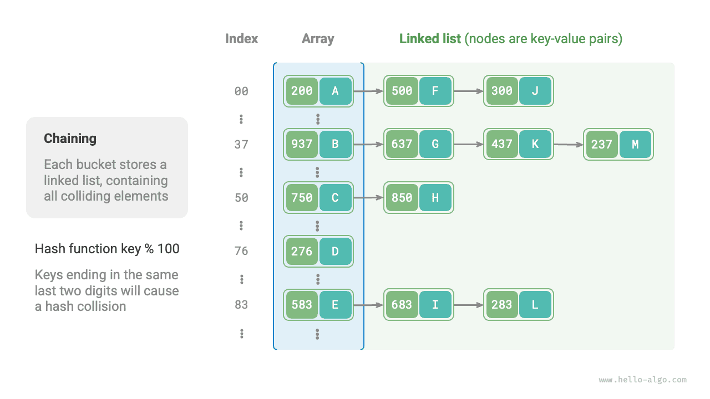

# Va chạm băm

Phần trước đã đề cập rằng, **trong hầu hết trường hợp, không gian đầu vào của một hàm băm lớn hơn nhiều so với không gian đầu ra**, vì vậy về mặt lý thuyết, va chạm băm là điều không thể tránh khỏi. Ví dụ, nếu không gian đầu vào là tất cả các số nguyên và không gian đầu ra là kích thước của mảng, thì chắc chắn nhiều số nguyên sẽ được ánh xạ đến cùng một chỉ số bucket.

Va chạm băm có thể dẫn đến kết quả truy vấn không chính xác, ảnh hưởng nghiêm trọng đến khả năng sử dụng của hash table. Để giải quyết vấn đề này, mỗi khi xảy ra va chạm băm, chúng ta có thể mở rộng hash table cho đến khi va chạm biến mất. Cách tiếp cận này đơn giản, trực tiếp và hiệu quả, nhưng rất kém hiệu quả vì việc mở rộng hash table liên quan đến quá trình di chuyển một lượng lớn dữ liệu và tính toán lại giá trị băm. Để cải thiện hiệu suất, chúng ta có thể áp dụng các chiến lược sau:

1. Cải thiện cấu trúc dữ liệu của hash table để **hash table vẫn có thể hoạt động bình thường khi xảy ra va chạm băm**.
2. Chỉ mở rộng khi cần thiết, tức là chỉ khi va chạm băm trở nên nghiêm trọng.

Các phương pháp chính để cải thiện cấu trúc của hash table là separate chaining và open addressing.

## Separate Chaining

Trong hash table ban đầu, mỗi bucket chỉ có thể lưu một cặp key-value. <u>Separate chaining</u> thay thế phần tử đơn trong mỗi bucket bằng một linked list, xem mỗi cặp key-value như một node và lưu trữ tất cả các cặp key-value bị va chạm trong cùng một danh sách. Hình dưới đây minh họa một hash table sử dụng separate chaining.



Trong hash table được triển khai bằng separate chaining, các thao tác cơ bản hoạt động như sau:

- **Truy vấn phần tử**: Nhập `key`, tính chỉ số bucket bằng hàm băm, truy cập phần đầu của linked list tương ứng và duyệt danh sách trong khi so sánh các key cho đến khi tìm thấy cặp key-value đích.
- **Thêm phần tử**: Trước tiên, sử dụng hàm băm để xác định linked list tương ứng, sau đó chèn node (cặp key-value) vào danh sách.
- **Xóa phần tử**: Sử dụng hàm băm để xác định linked list tương ứng, sau đó duyệt danh sách để tìm và xóa node đích.

Separate chaining có những hạn chế sau:

- **Tốn thêm không gian**: Linked list chứa các con trỏ node, tiêu tốn nhiều không gian bộ nhớ hơn array.
- **Hiệu quả truy vấn giảm**: Vì cần duyệt tuần tự linked list để tìm phần tử tương ứng.

Đoạn code dưới đây cung cấp một cách triển khai đơn giản của hash table sử dụng separate chaining, trong đó cần lưu ý hai điểm:

- List (dynamic array) được sử dụng thay cho linked list để đơn giản hóa code. Trong thiết lập này, hash table (array) chứa nhiều bucket, mỗi bucket là một list.
- Cách triển khai này bao gồm phương thức mở rộng hash table. Khi load factor vượt quá $\frac{2}{3}$, chúng ta mở rộng hash table lên $2$ lần kích thước ban đầu.

```src
[file]{hash_map_chaining}-[class]{hash_map_chaining}-[func]{}
```

Cần lưu ý rằng khi linked list trở nên quá dài, thời gian truy vấn $O(n)$ sẽ kém. **Trong trường hợp này, linked list có thể được chuyển đổi thành cây AVL hoặc cây red-black**, giúp giảm độ phức tạp thời gian của thao tác tìm kiếm xuống còn $O(\log n)$.

## Open Addressing

<u>Open addressing</u> không sử dụng thêm cấu trúc dữ liệu nào. Thay vào đó, nó xử lý va chạm băm bằng cách probing lặp lại. Các chiến lược probing phổ biến bao gồm linear probing, quadratic probing và multiple hashing.

Hãy sử dụng linear probing làm ví dụ để giới thiệu cơ chế của hash table sử dụng open addressing.

### Linear Probing

Linear probing sử dụng một bước nhảy cố định để probing tuần tự, vì vậy các thao tác của nó có phần khác với hash table thông thường.

- **Chèn phần tử**: Tính chỉ số bucket bằng hàm băm. Nếu bucket đã được sử dụng, tiếp tục probing về phía trước từ vị trí xảy ra va chạm với bước nhảy cố định (thường là $1$) cho đến khi tìm thấy một bucket trống, sau đó chèn phần tử vào đó.
- **Tìm kiếm phần tử**: Nếu xảy ra va chạm, tiếp tục probing về phía trước với cùng bước nhảy cho đến khi tìm thấy phần tử tương ứng và trả về `value`; nếu gặp một bucket trống, phần tử đích không có trong hash table, vì vậy trả về `None`.

Hình dưới đây minh họa sự phân bố của các cặp key-value trong hash table sử dụng open addressing (linear probing). Với hàm băm này, các key có cùng hai chữ số cuối sẽ được ánh xạ đến cùng một bucket. Sau đó, linear probing đặt chúng vào bucket đó và các bucket tiếp theo.


Tuy nhiên, **linear probing dễ xảy ra hiện tượng clustering**. Cụ thể, một vùng liên tiếp các vị trí đã được sử dụng trong array càng dài thì các va chạm mới càng có khả năng xảy ra trong vùng đó. Điều này lại khiến cluster tiếp tục mở rộng, tạo thành một vòng lặp tiêu cực và dần làm suy giảm hiệu quả của các thao tác chèn, xóa, tìm kiếm và cập nhật.

Điều quan trọng cần lưu ý là **chúng ta không thể trực tiếp xóa phần tử khỏi hash table sử dụng open addressing**. Việc xóa một phần tử sẽ tạo ra một bucket trống `None` trong array. Trong quá trình tìm kiếm, khi linear probing chạm đến bucket trống đó, nó sẽ dừng lại, khiến mọi phần tử được lưu trữ ở xa hơn trong chuỗi probing trở nên không thể truy cập. Do đó, chương trình có thể kết luận sai rằng các phần tử đó không tồn tại, như minh họa trong hình dưới đây.


Để giải quyết vấn đề này, chúng ta có thể áp dụng <u>lazy deletion</u>: thay vì trực tiếp xóa một phần tử khỏi hash table, **sử dụng một hằng số `TOMBSTONE` để đánh dấu bucket**. Theo cơ chế này, cả `None` và `TOMBSTONE` đều biểu thị các bucket có thể nhận các cặp key-value. Điểm khác biệt là khi linear probing gặp `TOMBSTONE`, nó phải tiếp tục probing, vì các cặp key-value vẫn có thể tồn tại ở xa hơn trong chuỗi.

Tuy nhiên, **lazy deletion có thể đẩy nhanh quá trình suy giảm hiệu suất của hash table**. Mỗi lần xóa để lại một marker, và khi số lượng entry `TOMBSTONE` tăng lên, thời gian tìm kiếm cũng tăng theo, vì linear probing có thể phải bỏ qua nhiều tombstone trước khi tìm thấy phần tử đích.

Để giải quyết vấn đề này, chúng ta có thể ghi lại chỉ số của `TOMBSTONE` đầu tiên gặp phải trong quá trình linear probing và chuyển phần tử đích đã tìm thấy vào vị trí đó. Lợi ích của cách này là mỗi lần truy vấn hoặc chèn, các phần tử có thể được di chuyển đến gần vị trí lý tưởng hơn, tức là gần nơi bắt đầu probing hơn, qua đó cải thiện hiệu quả tìm kiếm.

Đoạn code dưới đây triển khai một hash table sử dụng open addressing (linear probing) với lazy deletion. Để tận dụng không gian của hash table tốt hơn, chúng ta xem hash table như một "circular array". Khi vượt qua cuối array, chúng ta quay lại đầu và tiếp tục duyệt.

```src
[file]{hash_map_open_addressing}-[class]{hash_map_open_addressing}-[func]{}
```

### Quadratic Probing

Quadratic probing tương tự linear probing và là một trong những chiến lược phổ biến của open addressing. Khi xảy ra va chạm, quadratic probing không chỉ bỏ qua một số bước cố định mà bỏ qua số bước bằng "bình phương của số lần probing", tức là $1, 4, 9, \dots$ bước.

Quadratic probing có những ưu điểm sau:

- Quadratic probing cố gắng giảm thiểu hiệu ứng clustering của linear probing bằng cách bỏ qua khoảng cách bằng bình phương của số lần probing.
- Quadratic probing bỏ qua những khoảng cách lớn hơn để tìm các vị trí trống, giúp phân bố dữ liệu đồng đều hơn.

Tuy nhiên, quadratic probing không hoàn hảo:

- Clustering vẫn tồn tại, tức là một số vị trí có khả năng được sử dụng cao hơn các vị trí khác.
- Do giá trị bình phương tăng nhanh, quadratic probing có thể không probing được toàn bộ hash table, nghĩa là ngay cả khi trong hash table vẫn còn bucket trống, quadratic probing có thể không truy cập được chúng.

### Multiple Hashing

Đúng như tên gọi, multiple hashing sử dụng nhiều hàm băm $f_1(x)$, $f_2(x)$, $f_3(x)$, $\dots$ để probing.

- **Chèn phần tử**: Nếu hàm băm $f_1(x)$ gặp xung đột, hãy thử $f_2(x)$, tiếp tục như vậy cho đến khi tìm thấy một vị trí trống và chèn phần tử vào đó.
- **Tìm kiếm phần tử**: Tìm kiếm theo cùng thứ tự của các hàm băm cho đến khi tìm thấy phần tử đích và trả về phần tử đó; nếu gặp một vị trí trống hoặc đã thử tất cả các hàm băm, điều đó cho biết phần tử không có trong hash table, khi đó trả về `None`.

So với linear probing, multiple hashing ít xảy ra clustering hơn, nhưng việc sử dụng nhiều hàm băm sẽ tạo thêm chi phí tính toán.

!!! tip

    Hãy lưu ý rằng các hash table dựa trên open addressing, bao gồm linear probing, quadratic probing và multiple hashing, đều gặp vấn đề là không thể trực tiếp xóa các phần tử.

## Lựa chọn ngôn ngữ lập trình

Các ngôn ngữ lập trình khác nhau áp dụng những chiến lược triển khai hash table khác nhau. Dưới đây là một vài ví dụ:

- Python sử dụng phương pháp open addressing. Từ điển `dict` sử dụng các số giả ngẫu nhiên để thăm dò.
- Java sử dụng phương pháp separate chaining. Kể từ JDK 1.8, khi độ dài mảng trong `HashMap` đạt 64 và độ dài danh sách liên kết đạt 8, danh sách liên kết sẽ được chuyển đổi thành cây đỏ-đen để cải thiện hiệu suất tìm kiếm.
- Bắt đầu từ Go 1.24, `map` tích hợp sẵn mặc định sử dụng một triển khai open addressing dựa trên Swiss Tables. Go 1.23 trở về trước sử dụng separate chaining, với tối đa 8 cặp khóa-giá trị cho mỗi bucket và các bucket tràn được liên kết khi vượt quá sức chứa đó.