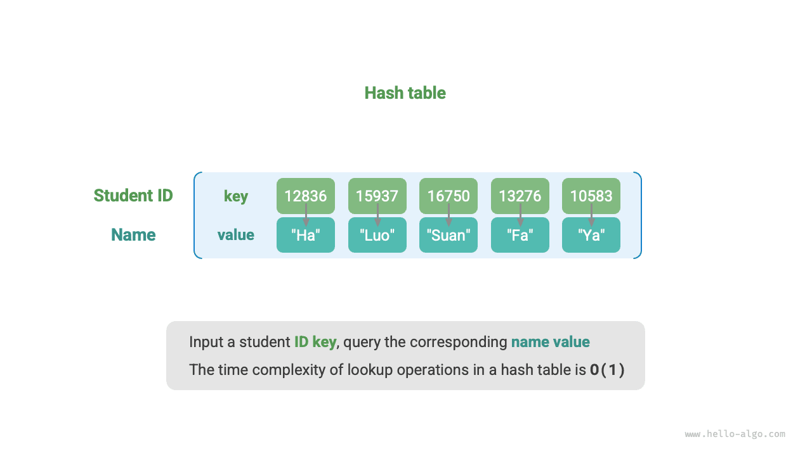
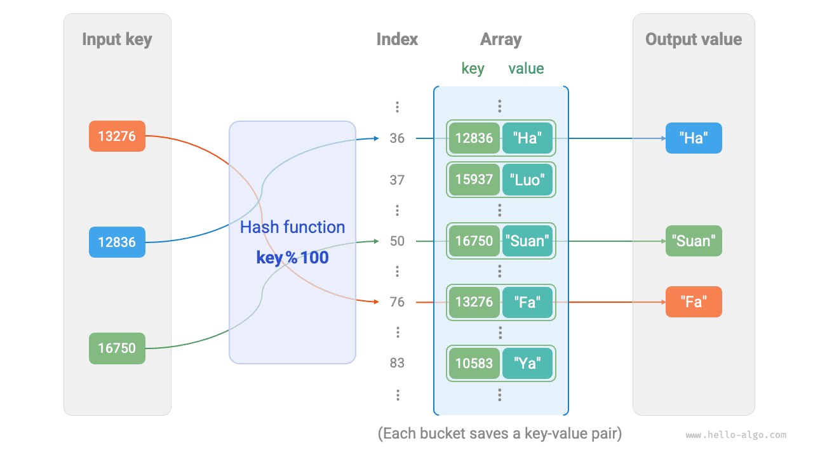

# Bảng băm

Một <u>bảng băm</u>, còn được gọi là <u>hash map</u>, lưu trữ ánh xạ từ khóa `key` đến giá trị `value`, cho phép tra cứu hiệu quả. Cụ thể, với một khóa `key`, ta có thể lấy giá trị tương ứng `value` từ bảng băm trong thời gian $O(1)$.

Như minh họa bên dưới, giả sử có $n$ sinh viên, mỗi sinh viên có hai thông tin: tên và mã sinh viên. Nếu muốn hỗ trợ truy vấn “cho trước một mã sinh viên, trả về tên tương ứng”, ta có thể sử dụng bảng băm như bên dưới.



Ngoài bảng băm, mảng và linked list cũng có thể triển khai chức năng truy vấn. So sánh hiệu năng của chúng được trình bày trong bảng sau.

- **Thêm phần tử**: Chỉ cần thêm phần tử vào cuối mảng (linked list), mất thời gian $O(1)$.
- **Truy vấn phần tử**: Vì mảng (linked list) không có thứ tự, cần duyệt qua tất cả phần tử, mất thời gian $O(n)$.
- **Xóa phần tử**: Trước tiên phải xác định vị trí của phần tử, sau đó xóa phần tử khỏi mảng (linked list), mất thời gian $O(n)$.

<p align="center"> Bảng <id> &nbsp; So sánh hiệu năng truy vấn phần tử </p>

|                 | Mảng  | Linked List | Bảng băm |
| --------------- | ------ | ----------- | ---------- |
| Tìm phần tử    | $O(n)$ | $O(n)$      | $O(1)$     |
| Thêm phần tử     | $O(1)$ | $O(1)$      | $O(1)$     |
| Xóa phần tử  | $O(n)$ | $O(n)$      | $O(1)$     |

Như ta có thể thấy, **các thao tác chèn, xóa, tra cứu và cập nhật trong bảng băm đều có độ phức tạp thời gian là $O(1)$**, khiến bảng băm trở nên rất hiệu quả.

## Các thao tác phổ biến trên bảng băm

Các thao tác phổ biến trên bảng băm gồm: khởi tạo, truy vấn, thêm các cặp khóa-giá trị và xóa các cặp khóa-giá trị. Mã ví dụ như sau:

=== "Python"

    ```python title="hash_map.py"
    # Khởi tạo bảng băm
    hmap: dict = {}

    # Thao tác thêm
    # Thêm cặp khóa-giá trị (key, value) vào bảng băm
    hmap[12836] = "XiaoHa"
    hmap[15937] = "XiaoLuo"
    hmap[16750] = "XiaoSuan"
    hmap[13276] = "XiaoFa"
    hmap[10583] = "XiaoYa"

    # Thao tác truy vấn
    # Nhập khóa vào bảng băm để lấy giá trị
    name: str = hmap[15937]

    # Thao tác xóa
    # Xóa cặp khóa-giá trị (key, value) khỏi bảng băm
    hmap.pop(10583)
    ```

=== "C++"

    ```cpp title="hash_map.cpp"
    /* Khởi tạo bảng băm */
    unordered_map<int, string> map;

    /* Thao tác thêm */
    // Thêm cặp khóa-giá trị (key, value) vào bảng băm
    map[12836] = "XiaoHa";
    map[15937] = "XiaoLuo";
    map[16750] = "XiaoSuan";
    map[13276] = "XiaoFa";
    map[10583] = "XiaoYa";

    /* Thao tác truy vấn */
    // Nhập khóa vào bảng băm để lấy giá trị
    string name = map[15937];

    /* Thao tác xóa */
    // Xóa cặp khóa-giá trị (key, value) khỏi bảng băm
    map.erase(10583);
    ```

=== "Java"

    ```java title="hash_map.java"
    /* Khởi tạo bảng băm */
    Map<Integer, String> map = new HashMap<>();

    /* Thao tác thêm */
    // Thêm cặp khóa-giá trị (key, value) vào bảng băm
    map.put(12836, "XiaoHa");
    map.put(15937, "XiaoLuo");
    map.put(16750, "XiaoSuan");
    map.put(13276, "XiaoFa");
    map.put(10583, "XiaoYa");

    /* Thao tác truy vấn */
    // Nhập khóa vào bảng băm để lấy giá trị
    String name = map.get(15937);

    /* Thao tác xóa */
    // Xóa cặp khóa-giá trị (key, value) khỏi bảng băm
    map.remove(10583);
    ```

=== "C#"

    ```csharp title="hash_map.cs"
    /* Khởi tạo bảng băm */
    Dictionary<int, string> map = new() {
        /* Thao tác thêm */
        // Thêm cặp khóa-giá trị (key, value) vào bảng băm
        { 12836, "XiaoHa" },
        { 15937, "XiaoLuo" },
        { 16750, "XiaoSuan" },
        { 13276, "XiaoFa" },
        { 10583, "XiaoYa" }
    };

    /* Thao tác truy vấn */
    // Nhập khóa vào bảng băm để lấy giá trị
    string name = map[15937];

    /* Thao tác xóa */
    // Xóa cặp khóa-giá trị (key, value) khỏi bảng băm
    map.Remove(10583);
    ```

=== "Go"

    ```go title="hash_map_test.go"
    /* Khởi tạo bảng băm */
    hmap := make(map[int]string)

    /* Thao tác thêm */
    // Thêm cặp khóa-giá trị (key, value) vào bảng băm
    hmap[12836] = "XiaoHa"
    hmap[15937] = "XiaoLuo"
    hmap[16750] = "XiaoSuan"
    hmap[13276] = "XiaoFa"
    hmap[10583] = "XiaoYa"

    /* Thao tác truy vấn */
    // Nhập khóa vào bảng băm để lấy giá trị
    name := hmap[15937]

    /* Thao tác xóa */
    // Xóa cặp khóa-giá trị (key, value) khỏi bảng băm
    delete(hmap, 10583)
    ```

=== "Swift"

    ```swift title="hash_map.swift"
    /* Khởi tạo bảng băm */
    var map: [Int: String] = [:]

    /* Thao tác thêm */
    // Thêm cặp khóa-giá trị (key, value) vào bảng băm
    map[12836] = "XiaoHa"
    map[15937] = "XiaoLuo"
    map[16750] = "XiaoSuan"
    map[13276] = "XiaoFa"
    map[10583] = "XiaoYa"

    /* Thao tác truy vấn */
    // Nhập khóa vào bảng băm để lấy giá trị
    let name = map[15937]!

    /* Thao tác xóa */
    // Xóa cặp khóa-giá trị (key, value) khỏi bảng băm
    map.removeValue(forKey: 10583)
    ```

=== "JS"

    ```javascript title="hash_map.js"
    /* Khởi tạo bảng băm */
    const map = new Map();
    /* Thao tác thêm */
    // Thêm cặp khóa-giá trị (key, value) vào bảng băm
    map.set(12836, 'XiaoHa');
    map.set(15937, 'XiaoLuo');
    map.set(16750, 'XiaoSuan');
    map.set(13276, 'XiaoFa');
    map.set(10583, 'XiaoYa');

    /* Thao tác truy vấn */
    // Nhập khóa vào bảng băm để lấy giá trị
    let name = map.get(15937);

    /* Thao tác xóa */
    // Xóa cặp khóa-giá trị (key, value) khỏi bảng băm
    map.delete(10583);
    ```

=== "TS"

    ```typescript title="hash_map.ts"
    /* Khởi tạo bảng băm */
    const map = new Map<number, string>();
    /* Thao tác thêm */
    // Thêm cặp khóa-giá trị (key, value) vào bảng băm
    map.set(12836, 'XiaoHa');
    map.set(15937, 'XiaoLuo');
    map.set(16750, 'XiaoSuan');
    map.set(13276, 'XiaoFa');
    map.set(10583, 'XiaoYa');
    console.info('\nAfter adding, hash table is\nKey -> Value');
    console.info(map);

    /* Thao tác truy vấn */
    // Nhập khóa vào bảng băm để lấy giá trị
    let name = map.get(15937);
    console.info('\nInput student ID 15937, queried name ' + name);

    /* Thao tác xóa */
    // Xóa cặp khóa-giá trị (key, value) khỏi bảng băm
    map.delete(10583);
    console.info('\nAfter deleting 10583, hash table is\nKey -> Value');
    console.info(map);
    ```

=== "Dart"

    ```dart title="hash_map.dart"
    /* Khởi tạo bảng băm */
    Map<int, String> map = {};

    /* Thao tác thêm */
    // Thêm cặp khóa-giá trị (key, value) vào bảng băm
    map[12836] = "XiaoHa";
    map[15937] = "XiaoLuo";
    map[16750] = "XiaoSuan";
    map[13276] = "XiaoFa";
    map[10583] = "XiaoYa";

    /* Thao tác truy vấn */
    // Nhập khóa vào bảng băm để lấy giá trị
    String name = map[15937];

    /* Thao tác xóa */
    // Xóa cặp khóa-giá trị (key, value) khỏi bảng băm
    map.remove(10583);
    ```

=== "Rust"

    ```rust title="hash_map.rs"
    use std::collections::HashMap;

    /* Khởi tạo bảng băm */
    let mut map: HashMap<i32, String> = HashMap::new();

    /* Thao tác thêm */
    // Thêm cặp khóa-giá trị (key, value) vào bảng băm
    map.insert(12836, "XiaoHa".to_string());
    map.insert(15937, "XiaoLuo".to_string());
    map.insert(16750, "XiaoSuan".to_string());
    map.insert(13276, "XiaoFa".to_string());
    map.insert(10583, "XiaoYa".to_string());

    /* Thao tác truy vấn */
    // Nhập khóa vào bảng băm để lấy giá trị
    let _name: Option<&String> = map.get(&15937);

    /* Thao tác xóa */
    // Xóa cặp khóa-giá trị (key, value) khỏi bảng băm
    let _removed_value: Option<String> = map.remove(&10583);
    ```

=== "C"

    ```c title="hash_map.c"
    // C không cung cấp bảng băm tích hợp sẵn
    ```

=== "Kotlin"

    ```kotlin title="hash_map.kt"
    /* Khởi tạo bảng băm */
    val map = HashMap<Int,String>()

    /* Thao tác thêm */
    // Thêm cặp khóa-giá trị (key, value) vào bảng băm
    map[12836] = "XiaoHa"
    map[15937] = "XiaoLuo"
    map[16750] = "XiaoSuan"
    map[13276] = "XiaoFa"
    map[10583] = "XiaoYa"

    /* Thao tác truy vấn */
    // Nhập khóa vào bảng băm để lấy giá trị
    val name = map[15937]

    /* Thao tác xóa */
    // Xóa cặp khóa-giá trị (key, value) khỏi bảng băm
    map.remove(10583)
    ```

=== "Ruby"

    ```ruby title="hash_map.rb"
    # Khởi tạo bảng băm
    hmap = {}

    # Thao tác thêm
    # Thêm cặp khóa-giá trị (key, value) vào bảng băm
    hmap[12836] = "XiaoHa"
    hmap[15937] = "XiaoLuo"
    hmap[16750] = "XiaoSuan"
    hmap[13276] = "XiaoFa"
    hmap[10583] = "XiaoYa"

    # Thao tác truy vấn
    # Nhập khóa vào bảng băm để lấy giá trị
    name = hmap[15937]

    # Thao tác xóa
    # Xóa cặp khóa-giá trị (key, value) khỏi bảng băm
    hmap.delete(10583)
    ```

??? pythontutor "Thực thi trực quan"

    https://pythontutor.com/render.html#code=%22%22%22Driver%20Code%22%22%22%0Aif%20__name__%20%3D%3D%20%22__main__%22%3A%0A%20%20%20%20%23%20%E5%88%9D%E5%A7%8B%E5%8C%96%E5%93%88%E5%B8%8C%E8%A1%A8%0A%20%20%20%20hmap%20%3D%20%7B%7D%0A%20%20%20%20%0A%20%20%20%20%23%20%E6%B7%BB%E5%8A%A0%E6%93%8D%E4%BD%9C%0A%20%20%20%20%23%20%E5%9C%A8%E5%93%88%E5%B8%8C%E8%A1%A8%E4%B8%AD%E6%B7%BB%E5%8A%A0%E9%94%AE%E5%80%BC%E5%AF%B9%20%28key,%20value%29%0A%20%20%20%20hmap%5B12836%5D%20%3D%20%22%E5%B0%8F%E5%93%88%22%0A%20%20%20%20hmap%5B15937%5D%20%3D%20%22%E5%B0%8F%E5%95%B0%22%0A%20%20%20%20hmap%5B16750%5D%20%3D%20%22%E5%B0%8F%E7%AE%97%22%0A%20%20%20%20hmap%5B13276%5D%20%3D%20%22%E5%B0%8F%E6%B3%95%22%0A%20%20%20%20hmap%5B10583%5D%20%3D%20%22%E5%B0%8F%E9%B8%AD%22%0A%20%20%20%20%0A%20%20%20%20%23%20%E6%9F%A5%E8%AF%A2%E6%93%8D%E4%BD%9C%0A%20%20%20%20%23%20%E5%90%91%E5%93%88%E5%B8%8C%E8%A1%A8%E4%B8%AD%E8%BE%93%E5%85%A5%E9%94%AE%20key%20%EF%BC%8C%E5%BE%97%E5%88%B0%E5%80%BC%20value%0A%20%20%20%20name%20%3D%20hmap%5B15937%5D%0A%20%20%20%20%0A%20%20%20%20%23%20%E5%88%A0%E9%99%A4%E6%93%8D%E4%BD%9C%0A%20%20%20%20%23%20%E5%9C%A8%E5%93%88%E5%B8%8C%E8%A1%A8%E4%B8%AD%E5%88%A0%E9%99%A4%E9%94%AE%E5%80%BC%E5%AF%B9%20%28key,%20value%29%0A%20%20%20%20hmap.pop%2810583%29&cumulative=false&curInstr=2&heapPrimitives=nevernest&mode=display&origin=opt-frontend.js&py=311&rawInputLstJSON=%5B%5D&textReferences=false

Có ba cách phổ biến để duyệt qua một bảng băm: duyệt các cặp khóa-giá trị, duyệt các khóa và duyệt các giá trị. Mã ví dụ như sau:

=== "Python"

    ```python title="hash_map.py"
    # Duyệt bảng băm
    # Duyệt các cặp khóa-giá trị key->value
    for key, value in hmap.items():
        print(key, "->", value)
    # Chỉ duyệt các khóa
    for key in hmap.keys():
        print(key)
    # Chỉ duyệt các giá trị
    for value in hmap.values():
        print(value)
    ```

=== "C++"

    ```cpp title="hash_map.cpp"
    /* Duyệt bảng băm */
    // Duyệt các cặp khóa-giá trị key->value
    for (auto kv: map) {
        cout << kv.first << " -> " << kv.second << endl;
    }
    // Duyệt bằng iterator key->value
    for (auto iter = map.begin(); iter != map.end(); iter++) {
        cout << iter->first << "->" << iter->second << endl;
    }
    ```

=== "Java"

    ```java title="hash_map.java"
    /* Duyệt bảng băm */
    // Duyệt các cặp khóa-giá trị key->value
    for (Map.Entry<Integer, String> kv: map.entrySet()) {
        System.out.println(kv.getKey() + " -> " + kv.getValue());
    }
    // Chỉ duyệt các khóa
    for (int key: map.keySet()) {
        System.out.println(key);
    }
    // Chỉ duyệt các giá trị
    for (String val: map.values()) {
        System.out.println(val);
    }
    ```

=== "C#"

    ```csharp title="hash_map.cs"
    /* Duyệt bảng băm */
    // Duyệt các cặp khóa-giá trị Key->Value
    foreach (var kv in map) {
        Console.WriteLine(kv.Key + " -> " + kv.Value);
    }
    // Chỉ duyệt các khóa
    foreach (int key in map.Keys) {
        Console.WriteLine(key);
    }
    // Chỉ duyệt các giá trị
    foreach (string val in map.Values) {
        Console.WriteLine(val);
    }
    ```

=== "Go"

    ```go title="hash_map_test.go"
    /* Duyệt bảng băm */
    // Duyệt các cặp khóa-giá trị key->value
    for key, value := range hmap {
        fmt.Println(key, "->", value)
    }
    // Chỉ duyệt các khóa
    for key := range hmap {
        fmt.Println(key)
    }
    // Chỉ duyệt các giá trị
    for _, value := range hmap {
        fmt.Println(value)
    }
    ```

=== "Swift"

    ```swift title="hash_map.swift"
    /* Duyệt bảng băm */
    // Duyệt các cặp khóa-giá trị Key->Value
    for (key, value) in map {
        print("\(key) -> \(value)")
    }
    // Chỉ duyệt các khóa
    for key in map.keys {
        print(key)
    }
    // Chỉ duyệt các giá trị
    for value in map.values {
        print(value)
    }
    ```

=== "JS"

    ```javascript title="hash_map.js"
    /* Duyệt bảng băm */
    console.info('\nTraverse key-value pairs Key->Value');
    for (const [k, v] of map.entries()) {
        console.info(k + ' -> ' + v);
    }
    console.info('\nTraverse keys only Key');
    for (const k of map.keys()) {
        console.info(k);
    }
    console.info('\nTraverse values only Value');
    for (const v of map.values()) {
        console.info(v);
    }
    ```

=== "TS"

    ```typescript title="hash_map.ts"
    /* Duyệt bảng băm */
    console.info('\nTraverse key-value pairs Key->Value');
    for (const [k, v] of map.entries()) {
        console.info(k + ' -> ' + v);
    }
    console.info('\nTraverse keys only Key');
    for (const k of map.keys()) {
        console.info(k);
    }
    console.info('\nTraverse values only Value');
    for (const v of map.values()) {
        console.info(v);
    }
    ```

=== "Dart"

    ```dart title="hash_map.dart"
    /* Duyệt bảng băm */
    // Duyệt các cặp khóa-giá trị Key->Value
    map.forEach((key, value) {
      print('$key -> $value');
    });

    // Chỉ duyệt các khóa
    map.keys.forEach((key) {
      print(key);
    });

    // Chỉ duyệt các giá trị
    map.values.forEach((value) {
      print(value);
    });
    ```

=== "Rust"

    ```rust title="hash_map.rs"
    /* Duyệt bảng băm */
    // Duyệt các cặp khóa-giá trị Key->Value
    for (key, value) in &map {
        println!("{key} -> {value}");
    }

    // Chỉ duyệt các khóa
    for key in map.keys() {
        println!("{key}");
    }

    // Chỉ duyệt các giá trị
    for value in map.values() {
        println!("{value}");
    }
    ```

=== "C"

    ```c title="hash_map.c"
    // C không cung cấp bảng băm tích hợp sẵn
    ```

=== "Kotlin"

    ```kotlin title="hash_map.kt"
    /* Duyệt bảng băm */
    // Duyệt các cặp khóa-giá trị key->value
    for ((key, value) in map) {
        println("$key -> $value")
    }
    // Chỉ duyệt các khóa
    for (key in map.keys) {
        println(key)
    }
    // Chỉ duyệt các giá trị
    for (_val in map.values) {
        println(_val)
    }
    ```

=== "Ruby"

    ```ruby title="hash_map.rb"
    # Duyệt bảng băm
    # Duyệt các cặp khóa-giá trị key->value
    hmap.entries.each { |key, value| puts "#{key} -> #{value}" }

    # Chỉ duyệt các khóa
    hmap.keys.each { |key| puts key }

    # Chỉ duyệt các giá trị
    hmap.values.each { |val| puts val }
    ```

??? pythontutor "Thực thi trực quan"

    https://pythontutor.com/render.html#code=%22%22%22Driver%20Code%22%22%22%0Aif%20__name__%20%3D%3D%20%22__main__%22%3A%0A%20%20%20%20%23%20%E5%88%9D%E5%A7%8B%E5%8C%96%E5%93%88%E5%B8%8C%E8%A1%A8%0A%20%20%20%20hmap%20%3D%20%7B%7D%0A%20%20%20%20%0A%20%20%20%20%23%20%E6%B7%BB%E5%8A%A0%E6%93%8D%E4%BD%9C%0A%20%20%20%20%23%20%E5%9C%A8%E5%93%88%E5%B8%8C%E8%A1%A8%E4%B8%AD%E6%B7%BB%E5%8A%A0%E9%94%AE%E5%80%BC%E5%AF%B9%20%28key,%20value%29%0A%20%20%20%20hmap%5B12836%5D%20%3D%20%22%E5%B0%8F%E5%93%88%22%0A%20%20%20%20hmap%5B15937%5D%20%3D%20%22%E5%B0%8F%E5%95%B0%22%0A%20%20%20%20hmap%5B16750%5D%20%3D%20%22%E5%B0%8F%E7%AE%97%22%0A%20%20%20%20hmap%5B13276%5D%20%3D%20%22%E5%B0%8F%E6%B3%95%22%0A%20%20%20%20hmap%5B10583%5D%20%3D%20%22%E5%B0%8F%E9%B8%AD%22%0A%20%20%20%20%0A%20%20%20%20%23%20%E9%81%8D%E5%8E%86%E5%93%88%E5%B8%8C%E8%A1%A8%0A%20%20%20%20%23%20%E9%81%8D%E5%8E%86%E9%94%AE%E5%80%BC%E5%AF%B9%20key-%3Evalue%0A%20%20%20%20for%20key,%20value%20in%20hmap.items%28%29%3A%0A%20%20%20%20%20%20%20%20print%28key,%20%22-%3E%22,%20value%29%0A%20%20%20%20%23%20%E5%8D%95%E7%8B%AC%E9%81%8D%E5%8E%86%E9%94%AE%20key%0A%20%20%20%20for%20key%20in%20hmap.keys%28%29%3A%0A%20%20%20%20%20%20%20%20print%28key%29%0A%20%20%20%20%23%20%E5%8D%95%E7%8B%AC%E9%81%8D%E5%8E%86%E5%80%BC%20value%0A%20%20%20%20for%20value%20in%20hmap.values%28%29%3A%0A%20%20%20%20%20%20%20%20print%28value%29&cumulative=false&curInstr=8&heapPrimitives=nevernest&mode=display&origin=opt-frontend.js&py=311&rawInputLstJSON=%5B%5D&textReferences=false

## Triển khai bảng băm đơn giản

Hãy bắt đầu với trường hợp đơn giản nhất: **triển khai một bảng băm chỉ bằng một mảng**. Trong bảng băm, mỗi ô trống trong mảng được gọi là <u>bucket</u>, và mỗi bucket có thể lưu trữ một cặp khóa-giá trị. Vì vậy, việc tra cứu bao gồm tìm bucket của `key` và đọc `value` được lưu trữ tại đó.

Vậy làm thế nào để tìm đúng bucket cho một `key` cho trước? Chúng ta thực hiện việc này bằng một <u>hàm băm</u>. Hàm băm ánh xạ một không gian đầu vào lớn hơn tới một không gian đầu ra nhỏ hơn. Trong bảng băm, không gian đầu vào là tập hợp tất cả `key`s, còn không gian đầu ra là tập hợp tất cả các bucket (chỉ số mảng). Nói cách khác, với một `key`, **hàm băm cho chúng ta biết vị trí lưu trữ cặp khóa-giá trị tương ứng trong mảng**.

Với một `key`, việc tính chỉ số bucket bao gồm hai bước sau:

1. Sử dụng thuật toán băm `hash()` để tính giá trị băm.
2. Lấy giá trị băm modulo cho số lượng bucket (độ dài mảng), `capacity`, để thu được bucket (chỉ số mảng) `index` tương ứng với `key`.

```shell
index = hash(key) % capacity
```

Sau đó, chúng ta có thể sử dụng `index` để truy cập bucket tương ứng trong bảng băm và lấy `value`.

Giả sử độ dài mảng là `capacity = 100` và thuật toán băm là `hash(key) = key`. Khi đó, hàm băm là `key % 100`. Hình bên dưới minh họa cách hoạt động của hàm băm này, sử dụng mã số sinh viên làm `key` và tên làm `value`.



Đoạn mã sau triển khai một bảng băm đơn giản. Ở đây, chúng ta đóng gói `key` và `value` vào một lớp `Pair` để biểu diễn một cặp khóa-giá trị.

```src
[file]{array_hash_map}-[class]{array_hash_map}-[func]{}
```

## Xung đột băm và thay đổi kích thước

Về bản chất, một hàm băm ánh xạ không gian đầu vào gồm tất cả `key`s tới không gian đầu ra gồm tất cả các chỉ số mảng, và không gian đầu vào thường lớn hơn nhiều so với không gian đầu ra. Do đó, **về lý thuyết, đôi khi các đầu vào khác nhau bắt buộc phải được ánh xạ tới cùng một đầu ra**.

Đối với hàm băm trong ví dụ trên, khi các `key`s đầu vào có cùng hai chữ số cuối, hàm băm sẽ tạo ra cùng một đầu ra. Ví dụ, khi truy vấn hai sinh viên có mã số 12836 và 20336, chúng ta nhận được:

```shell
12836 % 100 = 36
20336 % 100 = 36
```

Như minh họa bên dưới, hai mã số sinh viên hiện trỏ tới cùng một tên, điều này rõ ràng là không chính xác. Chúng ta gọi tình huống nhiều đầu vào được ánh xạ tới cùng một đầu ra là <u>xung đột băm</u>.


Dễ thấy rằng dung lượng bảng băm $n$ càng lớn thì xác suất nhiều `key`s được gán vào cùng một bucket càng thấp và số lượng xung đột càng ít. Vì vậy, **chúng ta có thể giảm xung đột băm bằng cách mở rộng bảng băm**.

Như minh họa trong hình bên dưới, trước khi mở rộng, các cặp khóa-giá trị `(136, A)` và `(236, D)` bị xung đột, nhưng sau khi mở rộng, xung đột biến mất.


Tương tự như thay đổi kích thước mảng, việc thay đổi kích thước bảng băm yêu cầu di chuyển tất cả các cặp khóa-giá trị từ bảng ban đầu sang bảng mới, đây là một thao tác tốn kém. Ngoài ra, vì dung lượng bảng băm `capacity` thay đổi, chúng ta phải tính lại vị trí lưu trữ của mọi cặp khóa-giá trị bằng hàm băm, làm tăng thêm chi phí thay đổi kích thước. Vì lý do này, các ngôn ngữ lập trình thường dự trữ dung lượng bảng băm đủ lớn để tránh việc thay đổi kích thước thường xuyên.

<u>Hệ số tải</u> là một khái niệm quan trọng trong bảng băm. Nó được định nghĩa là số lượng phần tử trong bảng băm chia cho số lượng bucket và được dùng để đo mức độ nghiêm trọng của các xung đột băm. **Nó cũng thường được dùng làm ngưỡng để kích hoạt việc thay đổi kích thước bảng băm**. Ví dụ, trong Java, khi hệ số tải vượt quá $0.75$, hệ thống sẽ mở rộng bảng băm lên gấp đôi kích thước ban đầu.