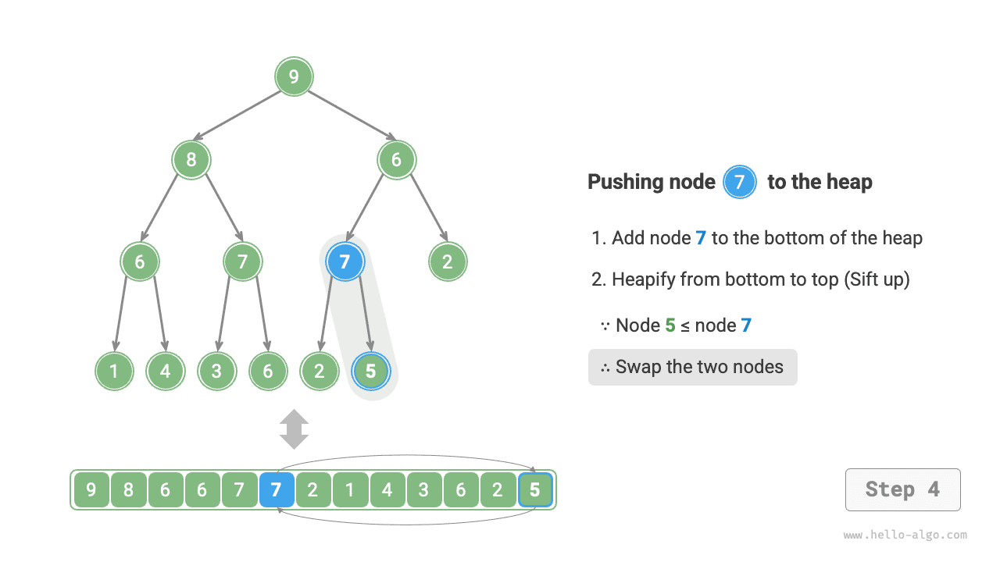
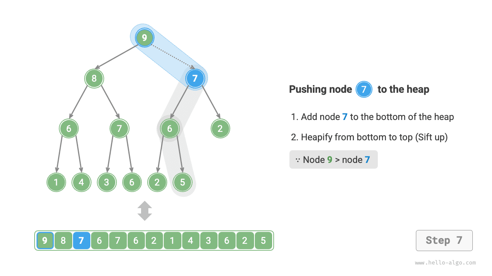
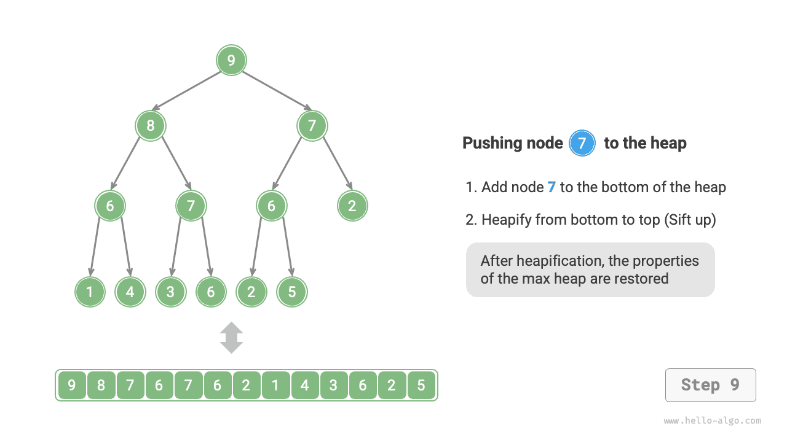
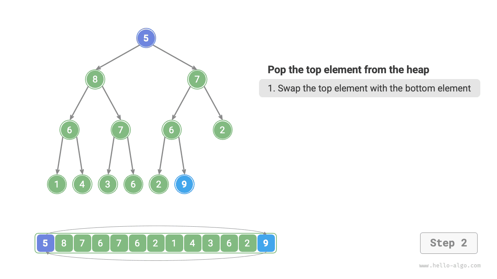
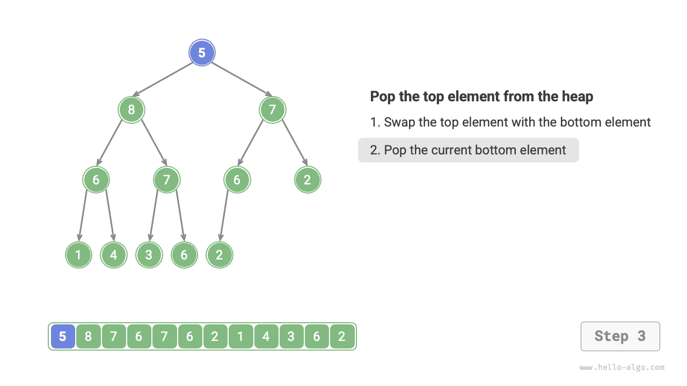
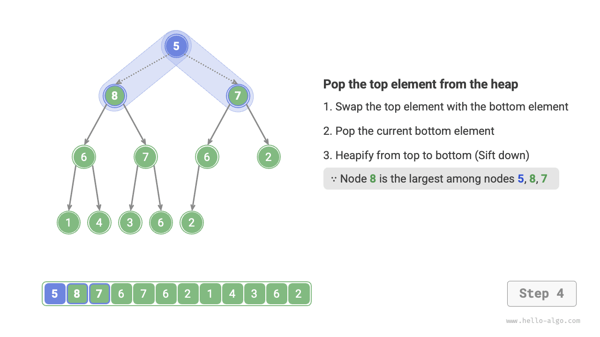

# Đống

Một <u>heap</u> là một cây nhị phân hoàn chỉnh thỏa mãn các điều kiện cụ thể và chủ yếu được phân thành hai loại, như minh họa trong hình bên dưới.

- <u>min heap</u>: Giá trị của bất kỳ nút nào $\leq$ giá trị của các nút con.
- <u>max heap</u>: Giá trị của bất kỳ nút nào $\geq$ giá trị của các nút con.


Là một trường hợp đặc biệt của cây nhị phân hoàn chỉnh, heap có các đặc điểm sau.

- Các nút ở tầng dưới cùng được điền từ trái sang phải, còn các nút ở những tầng khác được điền đầy đủ.
- Ta gọi nút gốc của cây nhị phân là "đỉnh heap" và nút ngoài cùng bên phải ở dưới cùng là "đáy heap".
- Đối với max heap (min heap), giá trị của phần tử ở đỉnh heap (nút gốc) là lớn nhất (nhỏ nhất).

## Các thao tác heap phổ biến

Cần lưu ý rằng nhiều ngôn ngữ lập trình cung cấp <u>priority queue</u>, một cấu trúc dữ liệu trừu tượng được định nghĩa là một hàng đợi trong đó các phần tử được sắp xếp theo mức độ ưu tiên.

Trên thực tế, **heap thường được dùng để triển khai priority queue, trong đó max heap tương ứng với priority queue lấy các phần tử ra theo thứ tự giảm dần**. Xét về cách sử dụng, ta có thể coi "priority queue" và "heap" là các cấu trúc dữ liệu tương đương. Vì vậy, cuốn sách này không phân biệt đặc biệt giữa hai khái niệm mà thống nhất gọi chúng là "heap".

Các thao tác heap phổ biến được trình bày trong bảng dưới đây; tên phương thức cần được xác định dựa trên ngôn ngữ lập trình.

<p align="center"> Bảng <id> &nbsp; Hiệu suất của các thao tác heap </p>

| Tên phương thức | Mô tả                                                               | Độ phức tạp thời gian |
| ----------- | ----------------------------------------------------------------- | --------------- |
| `push()`    | Chèn một phần tử vào heap                                   | $O(\log n)$     |
| `pop()`     | Xóa phần tử ở đỉnh heap                                       | $O(\log n)$     |
| `peek()`    | Truy cập phần tử ở đỉnh heap (giá trị lớn nhất/nhỏ nhất của max/min heap)     | $O(1)$          |
| `size()`    | Lấy số lượng phần tử trong heap                            | $O(1)$          |
| `isEmpty()` | Kiểm tra heap có rỗng hay không                                        | $O(1)$          |

Trong các ứng dụng thực tế, ta có thể trực tiếp sử dụng lớp heap (hoặc lớp priority queue) do ngôn ngữ lập trình cung cấp.

Tương tự như "thứ tự tăng dần" và "thứ tự giảm dần" trong các thuật toán sắp xếp, ta có thể chuyển đổi giữa "min heap" và "max heap" bằng cách thiết lập một `flag` hoặc sửa đổi `Comparator`. Mã lệnh như sau:

=== "Python"

    ```python title="heap.py"
    # Khởi tạo một min heap
    min_heap, flag = [], 1
    # Khởi tạo một max heap
    max_heap, flag = [], -1

    # Mô-đun heapq của Python mặc định triển khai min heap
    # Cân nhắc việc đổi dấu các phần tử trước khi đưa chúng vào heap; việc này đảo ngược quan hệ kích thước và do đó triển khai max heap
    # Trong ví dụ này, flag = 1 tương ứng với min heap, flag = -1 tương ứng với max heap

    # Đưa các phần tử vào heap
    heapq.heappush(max_heap, flag * 1)
    heapq.heappush(max_heap, flag * 3)
    heapq.heappush(max_heap, flag * 2)
    heapq.heappush(max_heap, flag * 5)
    heapq.heappush(max_heap, flag * 4)

    # Lấy phần tử ở đỉnh heap
    peek: int = flag * max_heap[0] # 5

    # Xóa phần tử ở đỉnh heap
    # Các phần tử bị xóa sẽ tạo thành một dãy giảm dần
    val = flag * heapq.heappop(max_heap) # 5
    val = flag * heapq.heappop(max_heap) # 4
    val = flag * heapq.heappop(max_heap) # 3
    val = flag * heapq.heappop(max_heap) # 2
    val = flag * heapq.heappop(max_heap) # 1

    # Lấy kích thước heap
    size: int = len(max_heap)

    # Kiểm tra heap có rỗng hay không
    is_empty: bool = not max_heap

    # Xây dựng heap từ một danh sách đầu vào
    min_heap: list[int] = [1, 3, 2, 5, 4]
    heapq.heapify(min_heap)
    ```

=== "C++"

    ```cpp title="heap.cpp"
    /* Khởi tạo một heap */
    // Khởi tạo một min heap
    priority_queue<int, vector<int>, greater<int>> minHeap;
    // Khởi tạo một max heap
    priority_queue<int, vector<int>, less<int>> maxHeap;

    /* Đưa các phần tử vào heap */
    maxHeap.push(1);
    maxHeap.push(3);
    maxHeap.push(2);
    maxHeap.push(5);
    maxHeap.push(4);

    /* Lấy phần tử ở đỉnh heap */
    int peek = maxHeap.top(); // 5

    /* Xóa phần tử ở đỉnh heap */
    // Các phần tử bị xóa sẽ tạo thành một dãy giảm dần
    maxHeap.pop(); // 5
    maxHeap.pop(); // 4
    maxHeap.pop(); // 3
    maxHeap.pop(); // 2
    maxHeap.pop(); // 1

    /* Lấy kích thước heap */
    int size = maxHeap.size();

    /* Kiểm tra heap có rỗng hay không */
    bool isEmpty = maxHeap.empty();

    /* Xây dựng heap từ một danh sách đầu vào */
    vector<int> input{1, 3, 2, 5, 4};
    priority_queue<int, vector<int>, greater<int>> minHeap(input.begin(), input.end());
    ```

=== "Java"

    ```java title="heap.java"
    /* Khởi tạo một heap */
    // Khởi tạo một min heap
    Queue<Integer> minHeap = new PriorityQueue<>();
    // Khởi tạo một max heap (sử dụng biểu thức lambda để sửa đổi Comparator)
    Queue<Integer> maxHeap = new PriorityQueue<>((a, b) -> b - a);

    /* Đưa các phần tử vào heap */
    maxHeap.offer(1);
    maxHeap.offer(3);
    maxHeap.offer(2);
    maxHeap.offer(5);
    maxHeap.offer(4);

    /* Lấy phần tử ở đỉnh heap */
    int peek = maxHeap.peek(); // 5

    /* Xóa phần tử ở đỉnh heap */
    // Các phần tử bị xóa sẽ tạo thành một dãy giảm dần
    peek = maxHeap.poll(); // 5
    peek = maxHeap.poll(); // 4
    peek = maxHeap.poll(); // 3
    peek = maxHeap.poll(); // 2
    peek = maxHeap.poll(); // 1

    /* Lấy kích thước heap */
    int size = maxHeap.size();

    /* Kiểm tra heap có rỗng hay không */
    boolean isEmpty = maxHeap.isEmpty();

    /* Xây dựng heap từ một danh sách đầu vào */
    minHeap = new PriorityQueue<>(Arrays.asList(1, 3, 2, 5, 4));
    ```

=== "C#"

    ```csharp title="heap.cs"
    /* Khởi tạo một heap */
    // Khởi tạo một min heap
    PriorityQueue<int, int> minHeap = new();
    // Khởi tạo một max heap (sử dụng biểu thức lambda để sửa đổi Comparer)
    PriorityQueue<int, int> maxHeap = new(Comparer<int>.Create((x, y) => y.CompareTo(x)));

    /* Đưa các phần tử vào heap */
    maxHeap.Enqueue(1, 1);
    maxHeap.Enqueue(3, 3);
    maxHeap.Enqueue(2, 2);
    maxHeap.Enqueue(5, 5);
    maxHeap.Enqueue(4, 4);

    /* Lấy phần tử ở đỉnh heap */
    int peek = maxHeap.Peek();//5

    /* Xóa phần tử ở đỉnh heap */
    // Các phần tử bị xóa sẽ tạo thành một dãy giảm dần
    peek = maxHeap.Dequeue();  // 5
    peek = maxHeap.Dequeue();  // 4
    peek = maxHeap.Dequeue();  // 3
    peek = maxHeap.Dequeue();  // 2
    peek = maxHeap.Dequeue();  // 1

    /* Lấy kích thước heap */
    int size = maxHeap.Count;

    /* Kiểm tra heap có rỗng hay không */
    bool isEmpty = maxHeap.Count == 0;

    /* Xây dựng heap từ một danh sách đầu vào */
    minHeap = new PriorityQueue<int, int>([(1, 1), (3, 3), (2, 2), (5, 5), (4, 4)]);
    ```

=== "Go"

    ```go title="heap.go"
    // Trong Go, ta có thể xây dựng một max heap chứa các số nguyên bằng cách triển khai heap.Interface
    // Việc triển khai heap.Interface cũng yêu cầu triển khai sort.Interface
    type intHeap []any

    // Push triển khai phương thức heap.Interface để đưa một phần tử vào heap
    func (h *intHeap) Push(x any) {
        // Push và Pop sử dụng pointer receiver làm tham số
        // vì chúng không chỉ điều chỉnh nội dung slice mà còn thay đổi độ dài slice
        *h = append(*h, x.(int))
    }

    // Pop triển khai phương thức heap.Interface để lấy phần tử ở đỉnh heap ra
    func (h *intHeap) Pop() any {
        // Phần tử cần xóa được lưu ở cuối
        last := (*h)[len(*h)-1]
        *h = (*h)[:len(*h)-1]
        return last
    }

    // Len là một phương thức của sort.Interface
    func (h *intHeap) Len() int {
        return len(*h)
    }

    // Less là một phương thức của sort.Interface
    func (h *intHeap) Less(i, j int) bool {
        // Để triển khai min heap, hãy đổi thành dấu nhỏ hơn
        return (*h)[i].(int) > (*h)[j].(int)
    }

    // Swap là một phương thức của sort.Interface
    func (h *intHeap) Swap(i, j int) {
        (*h)[i], (*h)[j] = (*h)[j], (*h)[i]
    }

    // Top lấy phần tử ở đỉnh heap
    func (h *intHeap) Top() any {
        return (*h)[0]
    }

    /* Mã driver */
    func TestHeap(t *testing.T) {
        /* Khởi tạo một heap */
        // Khởi tạo một max heap
        maxHeap := &intHeap{}
        heap.Init(maxHeap)
        /* Đưa các phần tử vào heap */
        // Gọi các phương thức heap.Interface để thêm phần tử
        heap.Push(maxHeap, 1)
        heap.Push(maxHeap, 3)
        heap.Push(maxHeap, 2)
        heap.Push(maxHeap, 4)
        heap.Push(maxHeap, 5)

        /* Lấy phần tử ở đỉnh heap */
        top := maxHeap.Top()
        fmt.Printf("Heap top element is %d\n", top)

        /* Xóa phần tử ở đỉnh heap */
        // Gọi các phương thức heap.Interface để xóa phần tử
        heap.Pop(maxHeap) // 5
        heap.Pop(maxHeap) // 4
        heap.Pop(maxHeap) // 3
        heap.Pop(maxHeap) // 2
        heap.Pop(maxHeap) // 1

        /* Lấy kích thước heap */
        size := len(*maxHeap)
        fmt.Printf("Number of heap elements is %d\n", size)

        /* Kiểm tra heap có rỗng không */
        isEmpty := len(*maxHeap) == 0
        fmt.Printf("Is the heap empty? %t\n", isEmpty)
    }
    ```

=== "Swift"

    ```swift title="heap.swift"
    /* Khởi tạo heap */
    // Kiểu Heap của Swift hỗ trợ cả max heap và min heap, đồng thời yêu cầu import swift-collections
    var heap = Heap<Int>()

    /* Thêm các phần tử vào heap */
    heap.insert(1)
    heap.insert(3)
    heap.insert(2)
    heap.insert(5)
    heap.insert(4)

    /* Lấy phần tử trên cùng của heap */
    var peek = heap.max()!

    /* Xóa phần tử trên cùng của heap */
    peek = heap.removeMax() // 5
    peek = heap.removeMax() // 4
    peek = heap.removeMax() // 3
    peek = heap.removeMax() // 2
    peek = heap.removeMax() // 1

    /* Lấy kích thước heap */
    let size = heap.count

    /* Kiểm tra heap có rỗng không */
    let isEmpty = heap.isEmpty

    /* Xây dựng heap từ một danh sách đầu vào */
    let heap2 = Heap([1, 3, 2, 5, 4])
    ```

=== "JS"

    ```javascript title="heap.js"
    // JavaScript không cung cấp lớp Heap tích hợp sẵn
    ```

=== "TS"

    ```typescript title="heap.ts"
    // TypeScript không cung cấp lớp Heap tích hợp sẵn
    ```

=== "Dart"

    ```dart title="heap.dart"
    // Dart không cung cấp lớp Heap tích hợp sẵn
    ```

=== "Rust"

    ```rust title="heap.rs"
    use std::collections::BinaryHeap;
    use std::cmp::Reverse;

    /* Khởi tạo heap */
    // Khởi tạo min heap
    let mut min_heap = BinaryHeap::<Reverse<i32>>::new();
    // Khởi tạo max heap
    let mut max_heap = BinaryHeap::new();

    /* Thêm các phần tử vào heap */
    max_heap.push(1);
    max_heap.push(3);
    max_heap.push(2);
    max_heap.push(5);
    max_heap.push(4);

    /* Lấy phần tử trên cùng của heap */
    let peek = max_heap.peek().unwrap();  // 5

    /* Xóa phần tử trên cùng của heap */
    // Các phần tử bị xóa sẽ tạo thành một dãy giảm dần
    let peek = max_heap.pop().unwrap();   // 5
    let peek = max_heap.pop().unwrap();   // 4
    let peek = max_heap.pop().unwrap();   // 3
    let peek = max_heap.pop().unwrap();   // 2
    let peek = max_heap.pop().unwrap();   // 1

    /* Lấy kích thước heap */
    let size = max_heap.len();

    /* Kiểm tra heap có rỗng không */
    let is_empty = max_heap.is_empty();

    /* Xây dựng heap từ một danh sách đầu vào */
    let min_heap = BinaryHeap::from(vec![Reverse(1), Reverse(3), Reverse(2), Reverse(5), Reverse(4)]);
    ```

=== "C"

    ```c title="heap.c"
    // C không cung cấp lớp Heap tích hợp sẵn
    ```

=== "Kotlin"

    ```kotlin title="heap.kt"
    /* Khởi tạo heap */
    // Khởi tạo min heap
    var minHeap = PriorityQueue<Int>()
    // Khởi tạo max heap (sử dụng biểu thức lambda để thay đổi Comparator)
    val maxHeap = PriorityQueue { a: Int, b: Int -> b - a }

    /* Thêm các phần tử vào heap */
    maxHeap.offer(1)
    maxHeap.offer(3)
    maxHeap.offer(2)
    maxHeap.offer(5)
    maxHeap.offer(4)

    /* Lấy phần tử trên cùng của heap */
    var peek = maxHeap.peek() // 5

    /* Xóa phần tử trên cùng của heap */
    // Các phần tử bị xóa sẽ tạo thành một dãy giảm dần
    peek = maxHeap.poll() // 5
    peek = maxHeap.poll() // 4
    peek = maxHeap.poll() // 3
    peek = maxHeap.poll() // 2
    peek = maxHeap.poll() // 1

    /* Lấy kích thước heap */
    val size = maxHeap.size

    /* Kiểm tra heap có rỗng không */
    val isEmpty = maxHeap.isEmpty()

    /* Xây dựng heap từ một danh sách đầu vào */
    minHeap = PriorityQueue(mutableListOf(1, 3, 2, 5, 4))
    ```

=== "Ruby"

    ```ruby title="heap.rb"
    # Ruby không cung cấp lớp Heap tích hợp sẵn
    ```

??? pythontutor "Code Visualization"

    https://pythontutor.com/render.html#code=import%20heapq%0A%0A%22%22%22Driver%20Code%22%22%22%0Aif%20__name__%20%3D%3D%20%22__main__%22%3A%0A%20%20%20%20%23%20%E5%88%9D%E5%A7%8B%E5%8C%96%E5%B0%8F%E9%A1%B6%E5%A0%86%0A%20%20%20%20min_heap,%20flag%20%3D%20%5B%5D,%201%0A%20%20%20%20%23%20%E5%88%9D%E5%A7%8B%E5%8C%96%E5%A4%A7%E9%A1%B6%E5%A0%86%0A%20%20%20%20max_heap,%20flag%20%3D%20%5B%5D,%20-1%0A%20%20%20%20%0A%20%20%20%20%23%20Python%20%E7%9A%84%20heapq%20%E6%A8%A1%E5%9D%97%E9%BB%98%E8%AE%A4%E5%AE%9E%E7%8E%B0%E5%B0%8F%E9%A1%B6%E5%A0%86%0A%20%20%20%20%23%20%E8%80%83%E8%99%91%E5%B0%86%E2%80%9C%E5%85%83%E7%B4%A0%E5%8F%96%E8%B4%9F%E2%80%9D%E5%90%8E%E5%86%8D%E5%85%A5%E5%A0%86%EF%BC%8C%E8%BF%99%E6%A0%B7%E5%B0%B1%E5%8F%AF%E4%BB%A5%E5%B0%86%E5%A4%A7%E5%B0%8F%E5%85%B3%E7%B3%BB%E9%A2%A0%E5%80%92%EF%BC%8C%E4%BB%8E%E8%80%8C%E5%AE%9E%E7%8E%B0%E5%A4%A7%E9%A1%B6%E5%A0%86%0A%20%20%20%20%23%20%E5%9C%A8%E6%9C%AC%E7%A4%BA%E4%BE%8B%E4%B8%AD%EF%BC%8Cflag%20%3D%201%20%E6%97%B6%E5%AF%B9%E5%BA%94%E5%B0%8F%E9%A1%B6%E5%A0%86%EF%BC%8Cflag%20%3D%20-1%20%E6%97%B6%E5%AF%B9%E5%BA%94%E5%A4%A7%E9%A1%B6%E5%A0%86%0A%20%20%20%20%0A%20%20%20%20%23%20%E5%85%83%E7%B4%A0%E5%85%A5%E5%A0%86%0A%20%20%20%20heapq.heappush%28max_heap,%20flag%20*%201%29%0A%20%20%20%20heapq.heappush%28max_heap,%20flag%20*%203%29%0A%20%20%20%20heapq.heappush%28max_heap,%20flag%20*%202%29%0A%20%20%20%20heapq.heappush%28max_heap,%20flag%20*%205%29%0A%20%20%20%20heapq.heappush%28max_heap,%20flag%20*%204%29%0A%20%20%20%20%0A%20%20%20%20%23%20%E8%8E%B7%E5%8F%96%E5%A0%86%E9%A1%B6%E5%85%83%E7%B4%A0%0A%20%20%20%20peek%20%3D%20flag%20*%20max_heap%5B0%5D%20%23%205%0A%20%20%20%20%0A%20%20%20%20%23%20%E5%A0%86%E9%A1%B6%E5%85%83%E7%B4%A0%E5%87%BA%E5%A0%86%0A%20%20%20%20%23%20%E5%87%BA%E5%A0%86%E5%85%83%E7%B4%A0%E4%BC%9A%E5%BD%A2%E6%88%90%E4%B8%80%E4%B8%AA%E4%BB%8E%E5%A4%A7%E5%88%B0%E5%B0%8F%E7%9A%84%E5%BA%8F%E5%88%97%0A%20%20%20%20val%20%3D%20flag%20*%20heapq.heappop%28max_heap%29%20%23%205%0A%20%20%20%20val%20%3D%20flag%20*%20heapq.heappop%28max_heap%29%20%23%204%0A%20%20%20%20val%20%3D%20flag%20*%20heapq.heappop%28max_heap%29%20%23%203%0A%20%20%20%20val%20%3D%20flag%20*%20heapq.heappop%28max_heap%29%20%23%202%0A%20%20%20%20val%20%3D%20flag%20*%20heapq.heappop%28max_heap%29%20%23%201%0A%20%20%20%20%0A%20%20%20%20%23%20%E8%8E%B7%E5%8F%96%E5%A0%86%E5%A4%A7%E5%B0%8F%0A%20%20%20%20size%20%3D%20len%28max_heap%29%0A%20%20%20%20%0A%20%20%20%20%23%20%E5%88%A4%E6%96%AD%E5%A0%86%E6%98%AF%E5%90%A6%E4%B8%BA%E7%A9%BA%0A%20%20%20%20is_empty%20%3D%20not%20max_heap%0A%20%20%20%20%0A%20%20%20%20%23%20%E8%BE%93%E5%85%A5%E5%88%97%E8%A1%A8%E5%B9%B6%E5%BB%BA%E5%A0%86%0A%20%20%20%20min_heap%20%3D%20%5B1,%203,%202,%205,%204%5D%0A%20%20%20%20heapq.heapify%28min_heap%29&cumulative=false&curInstr=3&heapPrimitives=nevernest&mode=display&origin=opt-frontend.js&py=311&rawInputLstJSON=%5B%5D&textReferences=false

## Cài đặt Heap

Phần cài đặt sau đây dành cho max heap. Để chuyển thành min heap, chỉ cần đảo ngược toàn bộ logic so sánh liên quan đến thứ tự (ví dụ: thay $\geq$ bằng $\leq$). Bạn đọc quan tâm có thể tự triển khai.

### Lưu trữ và biểu diễn Heap

Như đã đề cập trong chương "Cây nhị phân", cây nhị phân đầy đủ rất phù hợp để biểu diễn bằng mảng. Vì heap là một dạng cây nhị phân đầy đủ, **chúng ta sẽ sử dụng mảng để lưu trữ heap**.

Khi biểu diễn một cây nhị phân bằng mảng, các phần tử biểu diễn giá trị của nút, còn các chỉ số biểu diễn vị trí của nút trong cây nhị phân. **Quan hệ cha-con được biểu diễn thông qua các công thức ánh xạ chỉ số**.

Như thể hiện trong hình dưới đây, với một chỉ số $i$, chỉ số của nút con trái là $2i + 1$, chỉ số của nút con phải là $2i + 2$, còn chỉ số của nút cha là $(i - 1) / 2$ (phép chia lấy phần nguyên). Khi một chỉ số nằm ngoài phạm vi, điều đó cho biết nút tương ứng là nút null hoặc không tồn tại.


Chúng ta có thể đóng gói công thức ánh xạ chỉ số vào các hàm để thuận tiện sử dụng về sau:

```src
[file]{my_heap}-[class]{max_heap}-[func]{parent}
```

### Truy cập phần tử trên cùng của Heap

Phần tử trên cùng của heap là nút gốc của cây nhị phân, đồng thời cũng là phần tử đầu tiên của danh sách:

```src
[file]{my_heap}-[class]{max_heap}-[func]{peek}
```

### Chèn một phần tử vào Heap

Với một phần tử `val`, trước tiên chúng ta thêm phần tử đó vào cuối heap. Sau khi chèn, vì `val` có thể lớn hơn các phần tử khác trong heap, tính chất heap có thể bị vi phạm. **Do đó, chúng ta cần khôi phục tính chất heap dọc theo đường đi từ nút được chèn đến nút gốc**. Thao tác này được gọi là <u>heapify</u>.

Bắt đầu từ nút được chèn, **thực hiện heapify từ dưới lên trên**. Như thể hiện trong hình dưới đây, chúng ta so sánh nút được chèn với nút cha của nó; nếu nút được chèn lớn hơn, chúng ta hoán đổi chúng. Chúng ta tiếp tục quá trình này từ dưới lên trên cho đến khi vượt qua nút gốc hoặc gặp một nút không còn cần hoán đổi.

=== "<1>"
    

=== "<2>"
    

=== "<3>"
    

=== "<4>"
    

=== "<5>"
    

=== "<6>"
    

=== "<7>"
    

=== "<8>"
    

=== "<9>"
    

Với tổng cộng $n$ nút, chiều cao của cây là $O(\log n)$. Do đó, số lần lặp tối đa của vòng lặp trong thao tác heapify là $O(\log n)$, **khiến độ phức tạp thời gian của thao tác chèn phần tử là $O(\log n)$**. Mã được viết như sau:

```src
[file]{my_heap}-[class]{max_heap}-[func]{sift_up}
```

### Xóa phần tử trên cùng của Heap

Phần tử trên cùng của heap là nút gốc của cây nhị phân, cũng là phần tử đầu tiên của danh sách. Nếu trực tiếp xóa phần tử đầu tiên khỏi danh sách, tất cả chỉ số nút trong cây nhị phân sẽ thay đổi, khiến việc sửa chữa tiếp theo bằng heapify trở nên khó khăn. Để giảm thiểu thay đổi về chỉ số phần tử, chúng ta sử dụng các bước sau.

1. Hoán đổi phần tử trên cùng của heap với phần tử cuối cùng của heap (hoán đổi nút gốc với nút lá ngoài cùng bên phải).
2. Sau khi hoán đổi, xóa phần tử cuối cùng của heap khỏi danh sách (lưu ý rằng do đã hoán đổi, thực tế chúng ta đang xóa phần tử trên cùng ban đầu của heap).
3. Bắt đầu từ nút gốc, **thực hiện heapify từ trên xuống dưới**.

Như thể hiện trong hình dưới đây, **hướng của "heapify từ trên xuống dưới" ngược với "heapify từ dưới lên trên"**. Chúng ta so sánh giá trị của nút gốc với hai nút con của nó và hoán đổi nó với nút con lớn hơn. Sau đó lặp lại thao tác này cho đến khi vượt qua một nút lá hoặc gặp một nút không cần hoán đổi.

=== "<1>"
    

=== "<2>"
    

=== "<3>"
    

=== "<4>"
    

=== "<5>"
    

=== "<6>"
    

=== "<7>"
    

=== "<8>"
    

=== "<9>"
    

=== "<10>"
    

Tương tự thao tác chèn phần tử, độ phức tạp thời gian của thao tác xóa phần tử trên cùng của heap cũng là $O(\log n)$. Mã được viết như sau:

```src
[file]{my_heap}-[class]{max_heap}-[func]{sift_down}
```

## Các ứng dụng phổ biến của Heap

- **Hàng đợi ưu tiên**: Heap thường là cấu trúc dữ liệu được ưu tiên sử dụng để triển khai hàng đợi ưu tiên. Độ phức tạp thời gian của cả thao tác enqueue và dequeue đều là $O(\log n)$, còn việc xây dựng heap có độ phức tạp thời gian là $O(n)$, khiến các thao tác này đạt hiệu suất rất cao.
- **Heap sort**: Với một tập dữ liệu, chúng ta có thể xây dựng một heap từ tập dữ liệu đó, sau đó liên tục thực hiện các thao tác loại bỏ phần tử để thu được dữ liệu đã được sắp xếp. Tuy nhiên, chúng ta thường sử dụng một cách tiếp cận thanh lịch hơn để triển khai heap sort, như được trình bày chi tiết trong chương "Heap Sort".
- **Lấy $k$ phần tử lớn nhất**: Đây là một bài toán thuật toán kinh điển và cũng là một ứng dụng điển hình, chẳng hạn như chọn 10 tin tức thịnh hành nhất trên Weibo Hot Search hoặc 10 sản phẩm bán chạy nhất.