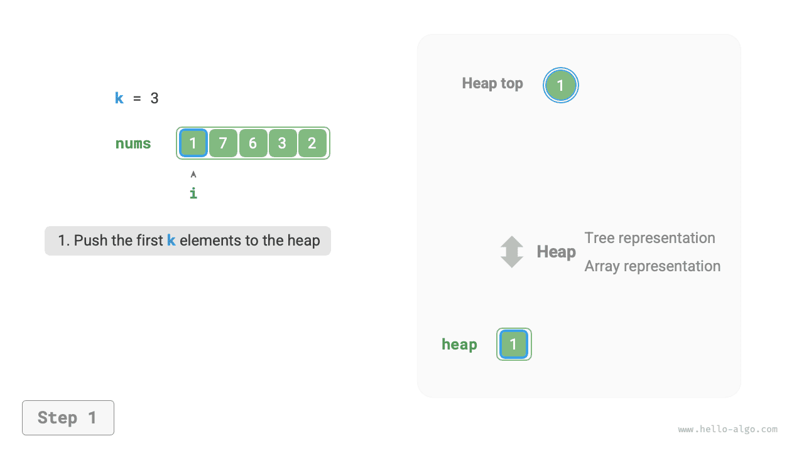
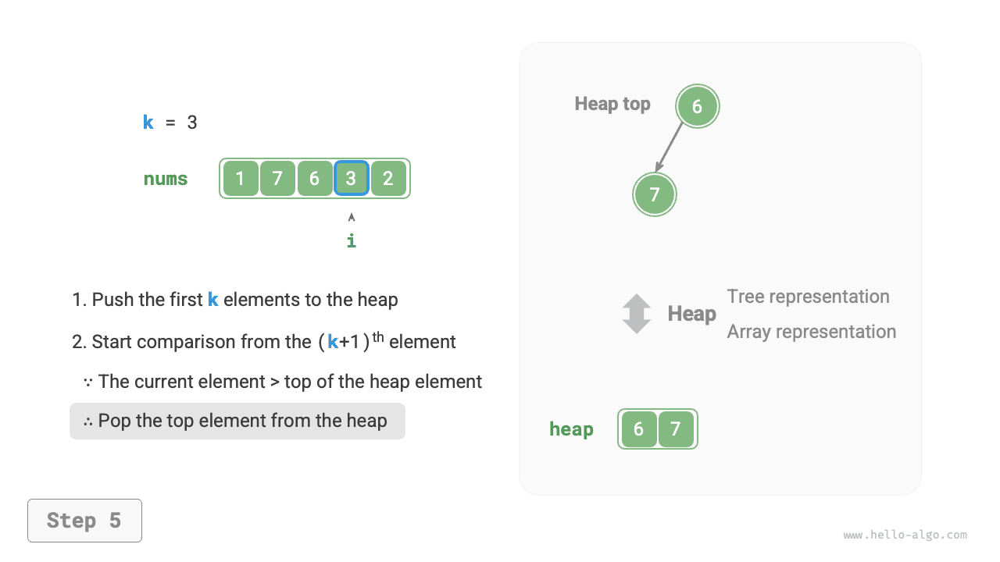
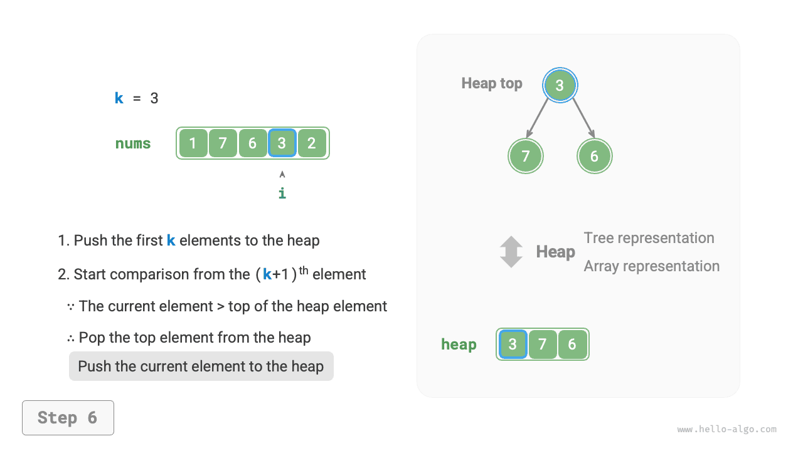

# Bài toán Top-k

!!! question

    Cho một mảng chưa được sắp xếp `nums` có độ dài $n$, hãy trả về $k$ phần tử lớn nhất trong mảng.

Trong bài toán này, trước tiên chúng ta sẽ giới thiệu hai lời giải tương đối đơn giản, sau đó là một lời giải dựa trên heap hiệu quả hơn.

## Phương pháp 1: Chọn tuần tự

Chúng ta có thể thực hiện $k$ lượt duyệt như trong hình dưới đây, lần lượt trích xuất phần tử lớn thứ $1^{st}$, lớn thứ $2^{nd}$, $\dots$, lớn thứ $k^{th}$ trong mỗi lượt, với độ phức tạp thời gian là $O(nk)$.

Phương pháp này chỉ phù hợp khi $k \ll n$, vì khi $k$ gần với $n$, độ phức tạp thời gian tiến tới $O(n^2)$, khiến phương pháp trở nên rất kém hiệu quả.


!!! tip

    Khi $k = n$, chúng ta có thể thu được một dãy được sắp xếp hoàn chỉnh, tương đương với thuật toán "selection sort".

## Phương pháp 2: Sắp xếp

Như trong hình dưới đây, trước tiên chúng ta có thể sắp xếp mảng `nums`, sau đó trả về $k$ phần tử ngoài cùng bên phải, với độ phức tạp thời gian là $O(n \log n)$.

Rõ ràng, phương pháp này thực hiện nhiều công việc hơn mức cần thiết, vì chúng ta chỉ cần tìm $k$ phần tử lớn nhất thay vì sắp xếp các phần tử còn lại.


## Phương pháp 3: Heap

Chúng ta có thể giải bài toán Top-k hiệu quả hơn bằng heap, như trong hình dưới đây.

1. Khởi tạo một min heap, trong đó phần tử ở đỉnh heap là phần tử nhỏ nhất.
2. Trước tiên, lần lượt chèn $k$ phần tử đầu tiên của mảng vào heap.
3. Bắt đầu từ phần tử thứ $(k + 1)^{th}$, nếu phần tử hiện tại lớn hơn phần tử ở đỉnh heap, hãy xóa phần tử ở đỉnh heap và chèn phần tử hiện tại vào heap.
4. Sau khi duyệt xong, heap sẽ chứa $k$ phần tử lớn nhất.

=== "<1>"
    

=== "<2>"
    

=== "<3>"
    

=== "<4>"
    

=== "<5>"
    

=== "<6>"
    

=== "<7>"
    

=== "<8>"
    

=== "<9>"
    

Mã ví dụ như sau:

```src
[file]{top_k}-[class]{}-[func]{top_k_heap}
```

Thực hiện tổng cộng $n$ lượt chèn và xóa phần tử trong heap, với độ dài tối đa của heap là $k$, nên độ phức tạp thời gian là $O(n \log k)$. Phương pháp này rất hiệu quả; khi $k$ nhỏ, độ phức tạp thời gian tiến tới $O(n)$; khi $k$ lớn, độ phức tạp thời gian không vượt quá $O(n \log n)$.

Ngoài ra, phương pháp này rất phù hợp với các luồng dữ liệu động. Khi dữ liệu mới xuất hiện, chúng ta có thể liên tục duy trì các phần tử trong heap, từ đó cho phép cập nhật động $k$ phần tử lớn nhất.