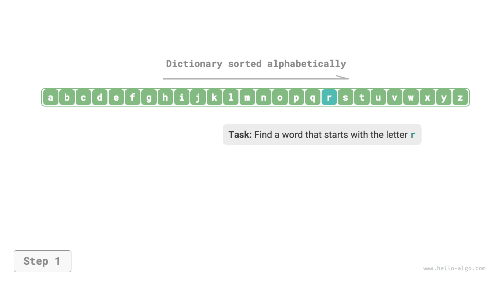
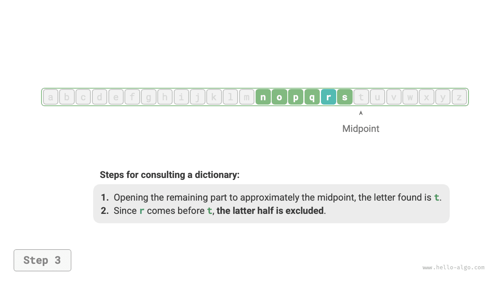
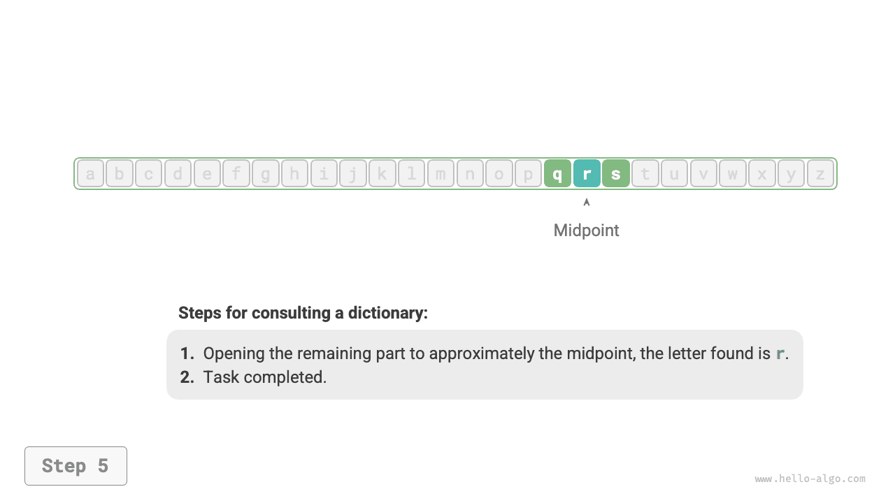
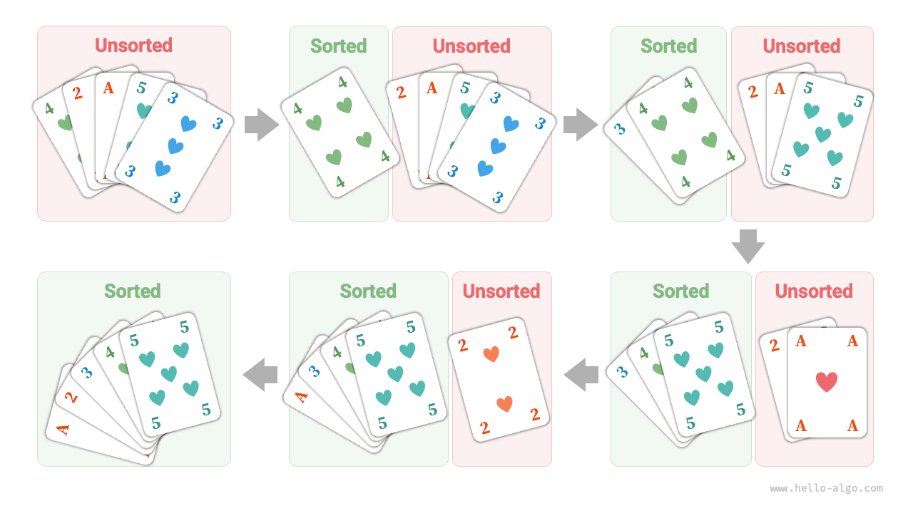

# Thuật toán có ở khắp mọi nơi

Khi nghe đến thuật ngữ "algorithm", chúng ta thường nghĩ ngay đến toán học. Tuy nhiên, nhiều thuật toán không liên quan đến toán học phức tạp mà chủ yếu dựa trên logic cơ bản, có thể bắt gặp ở khắp nơi trong cuộc sống hằng ngày.

Trước khi chính thức tìm hiểu về thuật toán, đây là một sự thật thú vị đáng chia sẻ: **bạn đã học nhiều thuật toán mà không hề nhận ra, và bạn vẫn thường áp dụng chúng trong cuộc sống hằng ngày**. Hãy cùng xem một vài ví dụ cụ thể để minh họa cho điều này.

**Ví dụ 1: Tra từ điển**. Trong một cuốn từ điển tiếng Anh, các từ được sắp xếp theo thứ tự bảng chữ cái. Giả sử chúng ta đang tìm một từ bắt đầu bằng chữ $r$, thường sẽ thực hiện như sau:

1. Mở từ điển ở khoảng giữa và kiểm tra từ đầu tiên trên trang đó; giả sử từ này bắt đầu bằng chữ $m$.
2. Vì $r$ đứng sau $m$ trong bảng chữ cái, có thể bỏ qua nửa đầu và thu hẹp phạm vi tìm kiếm xuống nửa sau.
3. Lặp lại bước `1.` và `2.` cho đến khi tìm được trang có các từ bắt đầu bằng $r$.

=== "<1>"
    

=== "<2>"
    

=== "<3>"
    

=== "<4>"
    

=== "<5>"
    

Tra từ điển, một kỹ năng thiết yếu đối với học sinh tiểu học, thực chất chính là thuật toán "Binary Search" nổi tiếng. Xét từ góc độ cấu trúc dữ liệu, chúng ta có thể xem từ điển như một "array" đã được sắp xếp; xét từ góc độ thuật toán, chuỗi hành động được thực hiện để tra một từ trong từ điển có thể được xem là thuật toán "Binary Search".

**Ví dụ 2: Sắp xếp bài playing card**. Khi chơi bài, chúng ta cần sắp xếp các lá bài trên tay theo thứ tự tăng dần, như trong quy trình sau:

1. Chia các lá bài thành phần "đã sắp xếp" và "chưa sắp xếp", ban đầu giả sử lá bài ngoài cùng bên trái đã ở đúng vị trí.
2. Lấy một lá bài từ phần chưa sắp xếp và chèn nó vào đúng vị trí trong phần đã sắp xếp; sau đó, hai lá bài ngoài cùng bên trái đã được sắp xếp đúng thứ tự.
3. Lặp lại bước `2` cho đến khi tất cả các lá bài đều được sắp xếp.

Phương pháp sắp xếp bài playing card ở trên thực chất là thuật toán "Insertion Sort", vốn rất hiệu quả đối với các tập dữ liệu nhỏ. Các triển khai sắp xếp tích hợp trong nhiều ngôn ngữ lập trình sử dụng insertion sort ở bên trong.

**Ví dụ 3: Đổi tiền thừa**. Giả sử bạn mua hàng hết $69$ tại siêu thị. Nếu bạn đưa cho thu ngân $100$, họ sẽ cần trả lại bạn $31$. Quy trình này có thể được hiểu rõ qua hình minh họa bên dưới.

1. Các mệnh giá nhỏ hơn $31$ hiện có là $1$, $5$, $10$ và $20$.
2. Lấy mệnh giá lớn nhất là $20$ trong các lựa chọn, còn lại $31 - 20 = 11$.
3. Lấy mệnh giá lớn nhất là $10$ trong các lựa chọn còn lại, còn lại $11 - 10 = 1$.
4. Lấy mệnh giá lớn nhất là $1$ trong các lựa chọn còn lại, còn lại $1 - 1 = 0$.
5. Hoàn tất việc đổi tiền, kết quả là $20 + 10 + 1 = 31$.

Trong các bước trên, ở mỗi giai đoạn, chúng ta chọn phương án có vẻ tốt nhất bằng cách sử dụng mệnh giá lớn nhất hiện có, từ đó tạo ra một cách đổi tiền hiệu quả. Xét từ góc độ cấu trúc dữ liệu và thuật toán, cách tiếp cận này được gọi là thuật toán "Greedy".

Từ việc nấu một bữa ăn cho đến du hành giữa các vì sao, hầu hết mọi hoạt động giải quyết vấn đề đều liên quan đến thuật toán. Sự ra đời của máy tính cho phép chúng ta lưu trữ các cấu trúc dữ liệu trong bộ nhớ và viết mã để gọi CPU và GPU thực thi các thuật toán. Nhờ đó, chúng ta có thể chuyển các vấn đề trong đời thực vào máy tính và giải quyết nhiều vấn đề phức tạp khác nhau một cách hiệu quả hơn.

!!! tip

    Nếu các khái niệm như cấu trúc dữ liệu, thuật toán, array và binary search vẫn chỉ quen thuộc một phần, hãy tiếp tục đọc. Cuốn sách này sẽ dẫn dắt bạn bước vào thế giới của cấu trúc dữ liệu và thuật toán.