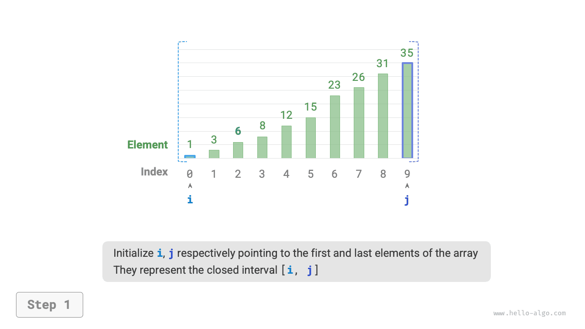
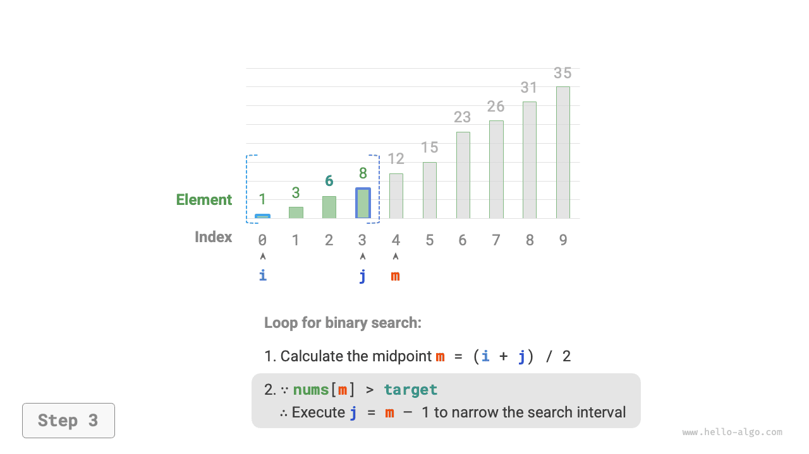

# Tìm kiếm nhị phân

<u>Tìm kiếm nhị phân</u> là một thuật toán tìm kiếm hiệu quả dựa trên chiến lược chia để trị. Thuật toán tận dụng thứ tự đã được sắp xếp của dữ liệu để giảm phạm vi tìm kiếm đi một nửa sau mỗi vòng lặp, cho đến khi tìm thấy phần tử mục tiêu hoặc khoảng tìm kiếm trở thành rỗng.

!!! question

    Cho một mảng `nums` có độ dài $n$, trong đó các phần tử được sắp xếp theo thứ tự tăng dần và không có phần tử trùng lặp, hãy tìm và trả về chỉ số của phần tử `target` trong mảng. Nếu mảng không chứa phần tử đó, hãy trả về $-1$. Ví dụ được minh họa trong hình bên dưới.


Như minh họa trong hình bên dưới, trước tiên chúng ta khởi tạo các con trỏ $i = 0$ và $j = n - 1$, lần lượt trỏ đến phần tử đầu tiên và cuối cùng của mảng, biểu diễn khoảng tìm kiếm $[0, n - 1]$. Lưu ý rằng dấu ngoặc vuông biểu thị một khoảng đóng, bao gồm cả các giá trị biên.

Tiếp theo, thực hiện hai bước sau trong một vòng lặp:

1. Tính chỉ số phần tử giữa $m = \lfloor {(i + j) / 2} \rfloor$, trong đó $\lfloor \: \rfloor$ biểu thị phép lấy phần nguyên.
2. So sánh `nums[m]` và `target`, từ đó có ba trường hợp:
    1. Khi `nums[m] < target`, điều đó cho biết `target` nằm trong khoảng $[m + 1, j]$, vì vậy thực hiện $i = m + 1$.
    2. Khi `nums[m] > target`, điều đó cho biết `target` nằm trong khoảng $[i, m - 1]$, vì vậy thực hiện $j = m - 1$.
    3. Khi `nums[m] = target`, điều đó cho biết đã tìm thấy `target`, vì vậy trả về chỉ số $m$.

Nếu mảng không chứa phần tử mục tiêu, khoảng tìm kiếm cuối cùng sẽ trở thành rỗng. Trong trường hợp này, trả về $-1$.

=== "<1>"
    

=== "<2>"
    

=== "<3>"
    

=== "<4>"
    

=== "<5>"
    

=== "<6>"
    

=== "<7>"
    

Cần lưu ý rằng vì cả $i$ và $j$ đều thuộc kiểu `int`, **$i + j$ có thể vượt quá phạm vi của kiểu `int`**. Để tránh tràn số nguyên, chúng ta thường sử dụng công thức $m = \lfloor {i + (j - i) / 2} \rfloor$ để tính phần tử giữa.

Mã được trình bày bên dưới:

```src
[file]{binary_search}-[class]{}-[func]{binary_search}
```

**Độ phức tạp thời gian là $O(\log n)$**: Trong vòng lặp tìm kiếm nhị phân, khoảng tìm kiếm giảm đi một nửa sau mỗi vòng, vì vậy số lần lặp là $\log_2 n$.

**Độ phức tạp không gian là $O(1)$**: Các con trỏ $i$ và $j$ sử dụng không gian có kích thước không đổi.

## Các phương pháp biểu diễn khoảng

Ngoài khoảng đóng được đề cập ở trên, một cách biểu diễn khoảng phổ biến khác là khoảng "đóng trái, mở phải", được định nghĩa là $[0, n)$, nghĩa là biên trái được bao gồm còn biên phải không được bao gồm. Theo cách biểu diễn này, khoảng $[i, j)$ là rỗng khi $i = j$.

Chúng ta có thể triển khai thuật toán tìm kiếm nhị phân với cùng chức năng dựa trên cách biểu diễn này:

```src
[file]{binary_search}-[class]{}-[func]{binary_search_lcro}
```

Như minh họa trong hình bên dưới, với hai cách biểu diễn khoảng, thao tác khởi tạo, điều kiện vòng lặp và các thao tác thu hẹp khoảng của thuật toán tìm kiếm nhị phân đều khác nhau.

Vì cả biên trái và biên phải trong cách biểu diễn "khoảng đóng" đều được định nghĩa là đóng, các thao tác thu hẹp khoảng thông qua các con trỏ $i$ và $j$ cũng đối xứng nhau. Điều này giúp giảm khả năng xảy ra lỗi, **vì vậy cách tiếp cận "khoảng đóng" thường được khuyến nghị**.


## Ưu điểm và hạn chế

Tìm kiếm nhị phân có hiệu năng tốt cả về thời gian lẫn không gian.

- Tìm kiếm nhị phân có hiệu quả cao về thời gian. Với lượng dữ liệu lớn, độ phức tạp thời gian logarit mang lại những lợi thế đáng kể. Ví dụ, khi kích thước dữ liệu $n = 2^{20}$, tìm kiếm tuyến tính cần $2^{20} = 1048576$ lần lặp, trong khi tìm kiếm nhị phân chỉ cần $\log_2 2^{20} = 20$ lần lặp.
- Tìm kiếm nhị phân không yêu cầu không gian bổ sung. So với các thuật toán tìm kiếm yêu cầu không gian bổ sung, chẳng hạn như tìm kiếm dựa trên hash, tìm kiếm nhị phân sử dụng không gian hiệu quả hơn.

Tuy nhiên, tìm kiếm nhị phân không phù hợp với mọi tình huống, chủ yếu vì những lý do sau:

- Tìm kiếm nhị phân chỉ áp dụng cho dữ liệu đã được sắp xếp. Nếu dữ liệu đầu vào chưa được sắp xếp, việc sắp xếp riêng để sử dụng tìm kiếm nhị phân sẽ phản tác dụng, vì các thuật toán sắp xếp thường có độ phức tạp thời gian $O(n \log n)$, cao hơn cả tìm kiếm tuyến tính và tìm kiếm nhị phân. Trong các trường hợp thường xuyên chèn phần tử, việc duy trì mảng đã sắp xếp đòi hỏi chèn các phần tử vào những vị trí cụ thể với độ phức tạp thời gian $O(n)$, điều này cũng rất tốn kém.
- Tìm kiếm nhị phân chỉ áp dụng cho mảng. Tìm kiếm nhị phân yêu cầu truy cập các phần tử không liên tục theo kiểu nhảy, và kiểu truy cập này không hiệu quả trong linked list, khiến thuật toán không phù hợp với linked list hoặc các cấu trúc dữ liệu dựa trên linked list.
- Với lượng dữ liệu nhỏ, tìm kiếm tuyến tính cho hiệu năng tốt hơn. Trong tìm kiếm tuyến tính, mỗi vòng chỉ yêu cầu 1 phép so sánh; trong khi đó, tìm kiếm nhị phân yêu cầu 1 phép cộng, 1 phép chia, 1–3 phép so sánh và 1 phép cộng (phép trừ), tổng cộng 4–6 thao tác đơn vị. Do đó, khi lượng dữ liệu $n$ nhỏ, tìm kiếm tuyến tính thực tế nhanh hơn tìm kiếm nhị phân.