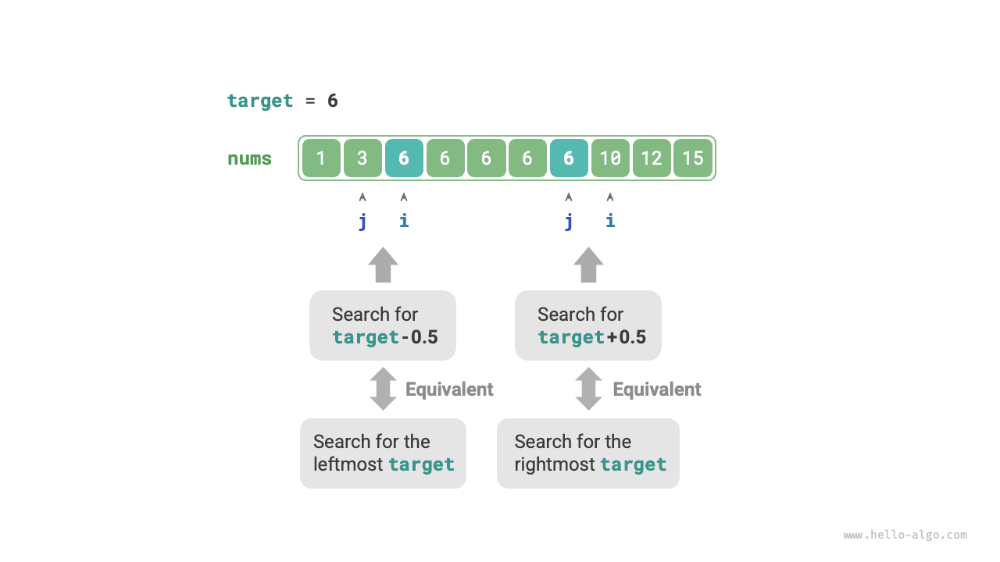

# Biên giới của Binary Search

## Tìm biên trái

!!! question

    Cho một mảng đã sắp xếp `nums` có độ dài $n$ và có thể chứa các phần tử trùng lặp, hãy trả về chỉ số của lần xuất hiện ngoài cùng bên trái của `target`. Nếu mảng không chứa `target`, hãy trả về $-1$.

Hãy nhớ lại phương pháp tìm vị trí chèn bằng binary search. Sau khi quá trình tìm kiếm hoàn tất, $i$ trỏ đến `target` ngoài cùng bên trái, **vì vậy tìm vị trí chèn về cơ bản chính là tìm chỉ số của `target` ngoài cùng bên trái**.

Hãy xem xét việc triển khai tìm biên trái bằng hàm tìm vị trí chèn. Lưu ý rằng mảng có thể không chứa `target`, dẫn đến hai trường hợp sau:

- Chỉ số vị trí chèn $i$ nằm ngoài phạm vi.
- Phần tử `nums[i]` không bằng `target`.

Khi xảy ra một trong hai trường hợp này, chỉ cần trả về $-1$. Mã được trình bày dưới đây:

```src
[file]{binary_search_edge}-[class]{}-[func]{binary_search_left_edge}
```

## Tìm biên phải

Vậy làm thế nào để tìm `target` ngoài cùng bên phải? Cách trực tiếp nhất là chỉnh sửa mã và thay thế thao tác thu hẹp con trỏ trong trường hợp `nums[m] == target`. Phần mã được lược bỏ ở đây; bạn đọc có thể tự triển khai.

Dưới đây, chúng ta sẽ giới thiệu thêm hai phương pháp thông minh hơn.

### Tái sử dụng tìm biên trái

Trên thực tế, chúng ta có thể sử dụng hàm tìm `target` ngoài cùng bên trái để tìm `target` ngoài cùng bên phải. Phương pháp cụ thể là: **chuyển việc tìm `target` ngoài cùng bên phải thành việc tìm `target + 1` ngoài cùng bên trái**.

Như minh họa trong hình bên dưới, sau khi quá trình tìm kiếm hoàn tất, con trỏ $i$ trỏ đến `target + 1` ngoài cùng bên trái (nếu tồn tại), còn $j$ trỏ đến `target` ngoài cùng bên phải, **vì vậy chúng ta có thể trả về $j$**.


Lưu ý rằng vị trí chèn được trả về là $i$, vì vậy chúng ta cần trừ $1$ để thu được $j$:

```src
[file]{binary_search_edge}-[class]{}-[func]{binary_search_right_edge}
```

### Chuyển đổi thành tìm kiếm phần tử

Chúng ta biết rằng khi mảng không chứa `target`, $i$ và $j$ cuối cùng sẽ lần lượt trỏ đến phần tử đầu tiên lớn hơn `target` và phần tử ngoài cùng bên phải nhỏ hơn `target`.

Do đó, như minh họa trong hình bên dưới, chúng ta có thể tạo một phần tử không tồn tại trong mảng để tìm các biên trái và phải.

- Tìm `target` ngoài cùng bên trái: Có thể chuyển thành việc tìm `target - 0.5` và trả về con trỏ $i$.
- Tìm `target` ngoài cùng bên phải: Có thể chuyển thành việc tìm `target + 0.5` và trả về con trỏ $j$.



Phần mã được lược bỏ ở đây, nhưng cần lưu ý hai điểm sau:

- Vì mảng đã cho không chứa các giá trị thập phân, chúng ta không cần lo lắng về cách xử lý trường hợp bằng nhau.
- Vì phương pháp này đưa vào các số thập phân, biến `target` trong hàm cần được đổi sang kiểu số thực (Python không yêu cầu thay đổi này).