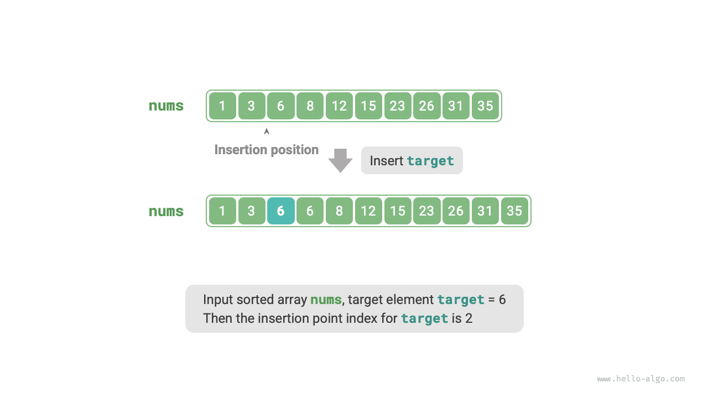
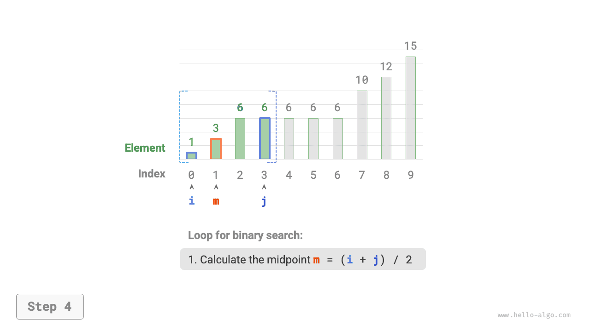
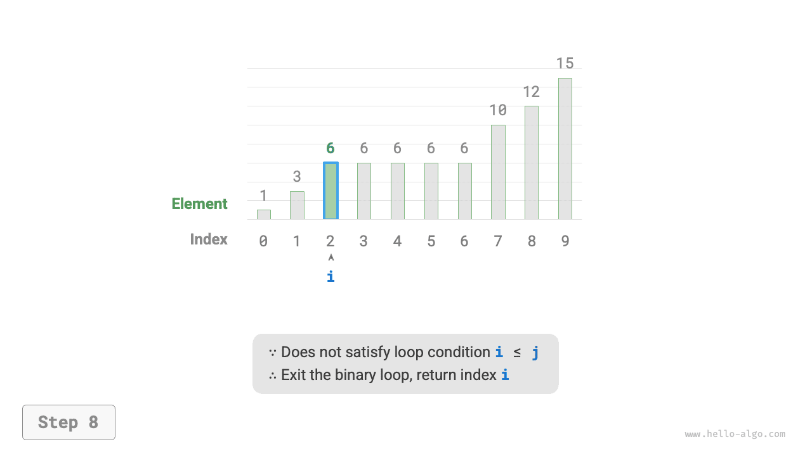

# Vị trí chèn trong tìm kiếm nhị phân

Tìm kiếm nhị phân không chỉ được dùng để tìm các phần tử đích mà còn có thể giải quyết nhiều bài toán biến thể, chẳng hạn như tìm vị trí chèn của một phần tử đích.

## Trường hợp không có phần tử trùng lặp

!!! question

    Cho một mảng đã sắp xếp `nums` có độ dài $n$ và một phần tử `target`, trong đó mảng không chứa phần tử trùng lặp, hãy chèn `target` vào `nums` mà vẫn duy trì thứ tự sắp xếp. Nếu `target` đã tồn tại trong mảng, hãy chèn nó vào bên trái phần tử đó. Trả về chỉ số của `target` sau khi chèn. Ví dụ được minh họa bên dưới.



Nếu muốn sử dụng lại mã tìm kiếm nhị phân ở phần trước, chúng ta cần trả lời hai câu hỏi sau.

**Câu hỏi 1**: Khi mảng chứa `target`, chỉ số vị trí chèn có giống với chỉ số của phần tử đó không?

Bài toán yêu cầu chèn `target` vào bên trái các phần tử bằng nó, nghĩa là `target` mới được chèn sẽ thay thế vị trí của `target` ban đầu. Nói cách khác, **khi mảng chứa `target`, chỉ số vị trí chèn chính là chỉ số của `target` đó**.

**Câu hỏi 2**: Khi mảng không chứa `target`, chỉ số vị trí chèn là gì?

Để phân tích sâu hơn, hãy xem xét quá trình tìm kiếm nhị phân: khi `nums[m] < target`, $i$ di chuyển, nghĩa là con trỏ $i$ đang tiến đến các phần tử lớn hơn hoặc bằng `target`. Tương tự, con trỏ $j$ luôn tiến đến các phần tử nhỏ hơn hoặc bằng `target`.

Do đó, khi tìm kiếm nhị phân kết thúc, $i$ phải trỏ đến phần tử đầu tiên lớn hơn `target`, còn $j$ phải trỏ đến phần tử ngoài cùng bên phải nhỏ hơn `target`. **Suy ra rằng khi mảng không chứa `target`, chỉ số chèn là $i$**. Mã được trình bày bên dưới:

```src
[file]{binary_search_insertion}-[class]{}-[func]{binary_search_insertion_simple}
```

## Trường hợp có phần tử trùng lặp

!!! question

    Dựa trên bài toán trước, giả sử mảng có thể chứa các phần tử trùng lặp, còn mọi điều kiện khác giữ nguyên.

Giả sử trong mảng có nhiều phần tử `target`. Tìm kiếm nhị phân thông thường chỉ có thể trả về chỉ số của một `target`, **và không thể xác định có bao nhiêu phần tử `target` nằm bên trái và bên phải phần tử đó**.

Bài toán yêu cầu chèn phần tử đích vào vị trí ngoài cùng bên trái, **vì vậy chúng ta cần tìm chỉ số của `target` ngoài cùng bên trái trong mảng**. Một cách tiếp cận ban đầu đơn giản là thực hiện theo các bước được minh họa trong hình bên dưới:

1. Thực hiện tìm kiếm nhị phân để lấy chỉ số của một `target` bất kỳ, ký hiệu là $k$.
2. Bắt đầu từ chỉ số $k$, duyệt tuyến tính sang trái và trả về khi tìm thấy `target` ngoài cùng bên trái.


Mặc dù phương pháp này hoạt động, nó có sử dụng tìm kiếm tuyến tính, dẫn đến độ phức tạp thời gian là $O(n)$. Khi mảng chứa nhiều phần tử `target` trùng lặp, phương pháp này rất kém hiệu quả.

Bây giờ hãy xem xét việc mở rộng mã tìm kiếm nhị phân. Như minh họa trong hình bên dưới, quy trình tổng thể không thay đổi: trong mỗi lần lặp, trước tiên chúng ta tính chỉ số giữa $m$, sau đó so sánh `target` với `nums[m]`, dẫn đến các trường hợp sau:

- Khi `nums[m] < target` hoặc `nums[m] > target`, điều đó có nghĩa là vẫn chưa tìm thấy `target`, vì vậy hãy sử dụng thao tác thu hẹp khoảng tiêu chuẩn của tìm kiếm nhị phân để **di chuyển các con trỏ $i$ và $j$ đến gần `target` hơn**.
- Khi `nums[m] == target`, điều đó có nghĩa là các phần tử nhỏ hơn `target` nằm trong khoảng $[i, m - 1]$, vì vậy hãy sử dụng $j = m - 1$ để thu hẹp khoảng, qua đó **di chuyển con trỏ $j$ đến gần các phần tử nhỏ hơn `target` hơn**.

Sau khi vòng lặp hoàn tất, $i$ trỏ đến `target` ngoài cùng bên trái, còn $j$ trỏ đến phần tử ngoài cùng bên phải nhỏ hơn `target`, **do đó chỉ số $i$ chính là vị trí chèn**.

=== "<1>"
    

=== "<2>"
    

=== "<3>"
    

=== "<4>"
    

=== "<5>"
    

=== "<6>"
    

=== "<7>"
    

=== "<8>"
    

Hãy quan sát đoạn mã sau: các nhánh `nums[m] > target` và `nums[m] == target` thực hiện cùng một thao tác, vì vậy có thể gộp chúng lại.

Tuy vậy, chúng ta vẫn có thể giữ nguyên các nhánh điều kiện riêng biệt, vì logic sẽ rõ ràng và dễ đọc hơn.

```src
[file]{binary_search_insertion}-[class]{}-[func]{binary_search_insertion}
```

!!! tip

    Mã trong phần này luôn sử dụng cách tiếp cận "khoảng đóng". Bạn đọc quan tâm có thể tự triển khai cách tiếp cận "đóng bên trái, mở bên phải".

Nhìn chung, tìm kiếm nhị phân chỉ đơn giản là thiết lập các mục tiêu tìm kiếm riêng cho hai con trỏ $i$ và $j$. Mục tiêu có thể là một phần tử cụ thể (chẳng hạn như `target`) hoặc một khoảng các phần tử (chẳng hạn như các phần tử nhỏ hơn `target`).

Sau mỗi lần lặp của tìm kiếm nhị phân, các con trỏ $i$ và $j$ dần tiến đến những mục tiêu đã đặt trước. Cuối cùng, chúng либо tìm thấy đáp án hoặc dừng lại sau khi vượt qua biên.