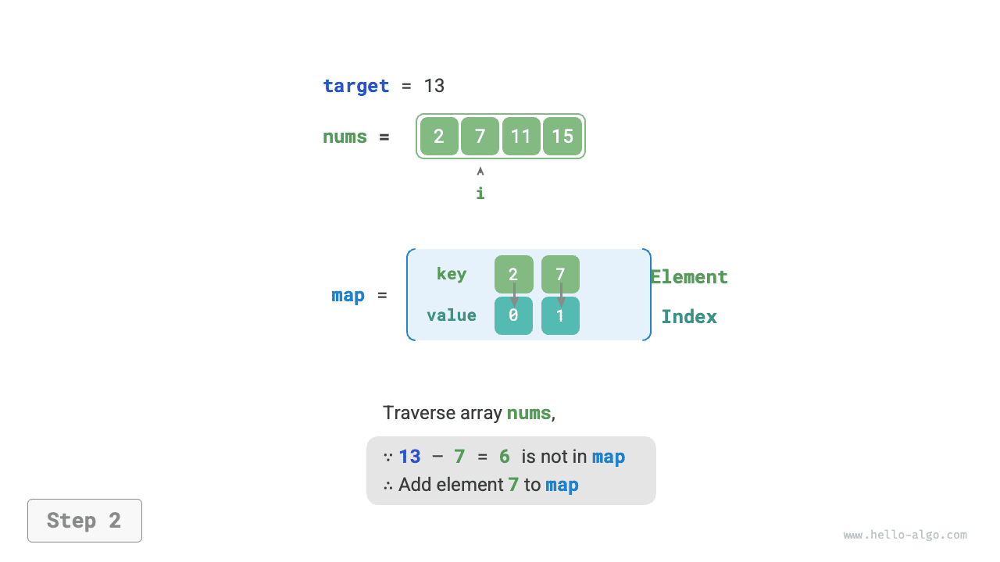

# Chiến lược tối ưu hóa Hash

Trong các bài toán thuật toán, **chúng ta thường giảm độ phức tạp thời gian của thuật toán bằng cách thay thế việc tìm kiếm tuyến tính bằng tìm kiếm dựa trên hash**. Hãy sử dụng một bài toán thuật toán để hiểu sâu hơn về vấn đề này.

!!! question

    Cho một mảng số nguyên `nums` và một giá trị đích `target`, hãy tìm hai phần tử trong mảng có tổng bằng `target` và trả về chỉ số của chúng. Chấp nhận mọi nghiệm.

## Tìm kiếm tuyến tính: Đánh đổi thời gian lấy không gian

Hãy xét cách duyệt trực tiếp tất cả các tổ hợp có thể. Như trong hình dưới đây, chúng ta sử dụng các vòng lặp lồng nhau và kiểm tra trong mỗi lần lặp xem tổng của hai số nguyên có bằng `target` hay không. Nếu có, trả về chỉ số của chúng.


Mã được trình bày dưới đây:

```src
[file]{two_sum}-[class]{}-[func]{two_sum_brute_force}
```

Phương pháp này có độ phức tạp thời gian là $O(n^2)$ và độ phức tạp không gian là $O(1)$, khiến nó tốn nhiều thời gian khi xử lý đầu vào lớn.

## Tìm kiếm dựa trên Hash: Đánh đổi không gian lấy thời gian

Hãy xét việc sử dụng một hash table với các phần tử mảng làm key và chỉ số của chúng làm value. Duyệt qua mảng và thực hiện các bước được minh họa trong hình dưới đây ở mỗi lần lặp:

1. Kiểm tra xem số `target - nums[i]` có nằm trong hash table hay không. Nếu có, trực tiếp trả về chỉ số của hai phần tử này.
2. Thêm cặp key-value `nums[i]` và chỉ số `i` vào hash table.

=== "<1>"
    

=== "<2>"
    

=== "<3>"
    

Phần triển khai được trình bày dưới đây và chỉ cần một vòng lặp:

```src
[file]{two_sum}-[class]{}-[func]{two_sum_hash_table}
```

Phương pháp này giảm độ phức tạp thời gian từ $O(n^2)$ xuống $O(n)$ nhờ tìm kiếm dựa trên hash, qua đó cải thiện đáng kể hiệu suất thời gian chạy.

Vì cần duy trì thêm một hash table, độ phức tạp không gian là $O(n)$. **Tuy nhiên, phương pháp này mang lại sự cân bằng tổng thể tốt hơn giữa thời gian và không gian, khiến nó trở thành lời giải tối ưu cho bài toán này**.