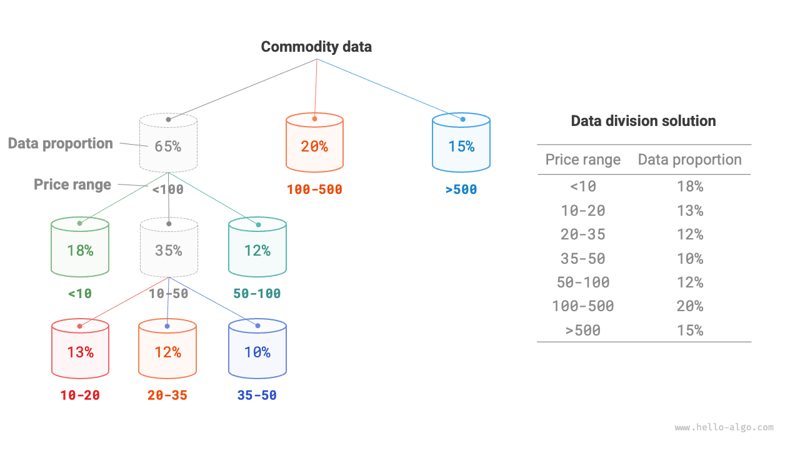
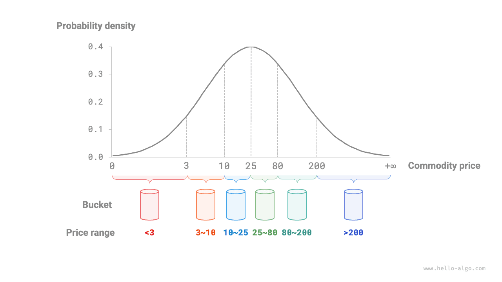

# Sắp xếp theo bucket

Các thuật toán sắp xếp được thảo luận trước đây đều là thuật toán sắp xếp dựa trên so sánh, tức là sắp xếp bằng cách so sánh thứ tự tương đối của các phần tử. Độ phức tạp thời gian trong trường hợp xấu nhất của các thuật toán này có cận dưới là $\Omega(n \log n)$. Tiếp theo, chúng ta sẽ tìm hiểu một số thuật toán sắp xếp không dựa trên so sánh, có độ phức tạp thời gian tuyến tính.

<u>Sắp xếp theo bucket</u> là một ứng dụng điển hình của chiến lược chia để trị. Thuật toán tạo ra một dãy các bucket có thứ tự, mỗi bucket tương ứng với một phạm vi dữ liệu, rồi phân phối dữ liệu đồng đều vào các bucket đó. Sau đó, các phần tử trong từng bucket được sắp xếp riêng. Cuối cùng, tất cả các bucket được gộp lại theo thứ tự.

## Quy trình thuật toán

Xét một mảng có độ dài $n$, trong đó các phần tử là số thực trong phạm vi $[0, 1)$. Quy trình của bucket sort được minh họa trong hình dưới đây.

1. Khởi tạo $k$ bucket và phân phối $n$ phần tử vào $k$ bucket.
2. Sắp xếp riêng từng bucket (ở đây chúng ta sử dụng hàm sắp xếp tích hợp của ngôn ngữ lập trình).
3. Gộp các kết quả theo thứ tự từ bucket nhỏ nhất đến bucket lớn nhất.


Mã nguồn như sau:

```src
[file]{bucket_sort}-[class]{}-[func]{bucket_sort}
```

## Đặc điểm của thuật toán

Bucket sort phù hợp để xử lý các tập dữ liệu rất lớn. Ví dụ, giả sử đầu vào chứa 1 triệu phần tử và bộ nhớ hạn chế khiến hệ thống không thể tải tất cả phần tử cùng lúc. Khi đó, dữ liệu có thể được chia thành 1000 bucket, mỗi bucket được sắp xếp riêng, sau đó các kết quả được gộp lại.

- **Độ phức tạp thời gian là $O(n + k)$**: Giả sử các phần tử được phân phối đồng đều giữa các bucket, mỗi bucket chứa $\frac{n}{k}$ phần tử. Nếu việc sắp xếp một bucket mất $O(\frac{n}{k} \log\frac{n}{k})$ thời gian, thì việc sắp xếp tất cả các bucket mất $O(n \log\frac{n}{k})$ thời gian. **Khi số lượng bucket $k$ tương đối lớn, độ phức tạp thời gian tiến gần đến $O(n)$**. Việc gộp các kết quả yêu cầu duyệt qua tất cả bucket và phần tử, mất $O(n + k)$ thời gian. Trong trường hợp xấu nhất, toàn bộ dữ liệu được đưa vào một bucket duy nhất, và việc sắp xếp bucket đó mất $O(n^2)$ thời gian.
- **Độ phức tạp không gian là $O(n + k)$ và bucket sort không phải là thuật toán in-place**: Thuật toán cần thêm không gian cho $k$ bucket và tổng cộng $n$ phần tử.
- Bucket sort có ổn định hay không phụ thuộc vào việc thuật toán dùng để sắp xếp các phần tử trong bucket có ổn định hay không.

## Cách đạt được phân phối đồng đều

Về lý thuyết, bucket sort có thể đạt độ phức tạp thời gian $O(n)$. **Điểm mấu chốt là phân phối các phần tử đồng đều giữa các bucket**, vì dữ liệu trong thực tế thường không được phân phối đồng đều. Ví dụ, giả sử chúng ta muốn chia đều tất cả sản phẩm trên Taobao thành 10 bucket theo khoảng giá, nhưng phân phối giá không đồng đều: có rất nhiều sản phẩm có giá dưới 100 nhân dân tệ và rất ít sản phẩm có giá trên 1000 nhân dân tệ. Nếu chia đều phạm vi giá thành 10 khoảng, số lượng sản phẩm trong các bucket sẽ chênh lệch rất lớn.

Để đạt được phân phối đồng đều hơn, trước tiên chúng ta có thể chọn một ranh giới tương đối và chia dữ liệu thành 3 bucket. **Sau đó, các bucket chứa nhiều sản phẩm hơn có thể tiếp tục được chia thành 3 bucket cho đến khi số lượng phần tử trong tất cả các bucket xấp xỉ bằng nhau**.

Như trong hình dưới đây, phương pháp này về bản chất xây dựng một cây đệ quy với mục tiêu làm cho các node lá cân bằng nhất có thể. Tất nhiên, dữ liệu không nhất thiết phải được chia thành 3 bucket trong mỗi vòng; có thể linh hoạt lựa chọn chiến lược phân hoạch cụ thể dựa trên đặc điểm của dữ liệu.



Nếu biết trước phân phối xác suất của giá sản phẩm, **chúng ta có thể đặt các ranh giới giá cho từng bucket dựa trên phân phối đó**. Đáng chú ý là không cần đo chính xác phân phối dữ liệu; cũng có thể xấp xỉ bằng một mô hình xác suất được lựa chọn để phù hợp với đặc điểm của dữ liệu.

Như trong hình dưới đây, giả sử giá sản phẩm tuân theo phân phối chuẩn, cho phép chúng ta thiết lập các khoảng giá một cách hợp lý để phân phối đồng đều sản phẩm vào từng bucket.

