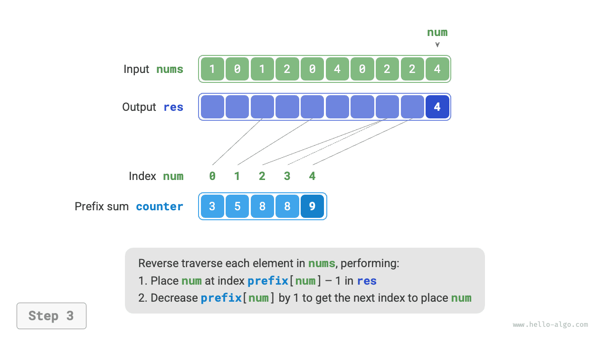

# Counting Sort

<u>Counting sort</u> sắp xếp bằng cách đếm số lần xuất hiện của các phần tử và thường được áp dụng cho các mảng số nguyên.

## Cài đặt đơn giản

Hãy bắt đầu với một ví dụ đơn giản. Cho một mảng `nums` có độ dài $n$, trong đó tất cả các phần tử đều là "số nguyên không âm", quy trình tổng thể của counting sort được minh họa trong hình dưới đây.

1. Duyệt qua mảng để tìm số lớn nhất, ký hiệu là $m$, sau đó tạo một mảng phụ `counter` có độ dài $m + 1$.
2. **Sử dụng `counter` để đếm số lần mỗi số xuất hiện trong `nums`**, trong đó `counter[num]` lưu số lần xuất hiện của `num`. Việc này rất đơn giản: duyệt qua `nums` (ký hiệu số hiện tại là `num`) và tăng `counter[num]` thêm $1$ sau mỗi lần.
3. **Vì các chỉ số của `counter` vốn đã được sắp xếp theo thứ tự, các số về cơ bản đã được sắp xếp**. Tiếp theo, duyệt qua `counter` và ghi các số trở lại `nums` theo thứ tự tăng dần dựa trên số lần xuất hiện của chúng.


Mã được viết như sau:

```src
[file]{counting_sort}-[class]{}-[func]{counting_sort_naive}
```

!!! note "Mối liên hệ giữa counting sort và bucket sort"

    Dưới góc nhìn của bucket sort, mỗi chỉ số của mảng đếm `counter` có thể được xem là một bucket, còn quá trình đếm có thể được xem là việc phân phối các phần tử vào những bucket tương ứng. Về bản chất, counting sort là một trường hợp đặc biệt của bucket sort dành cho dữ liệu số nguyên.

## Cài đặt đầy đủ

Những độc giả tinh ý có thể nhận ra rằng **nếu đầu vào bao gồm các đối tượng thì bước `3.` ở trên không còn hoạt động**. Giả sử đầu vào gồm các đối tượng sản phẩm và chúng ta muốn sắp xếp chúng theo giá (một biến thành viên của lớp); thuật toán trên chỉ có thể tạo ra thứ tự đã sắp xếp của chính các giá trị giá.

Vậy làm thế nào để lấy được thứ tự đã sắp xếp của dữ liệu ban đầu? Trước tiên, chúng ta tính tổng tiền tố của `counter`. Như tên gọi cho thấy, tổng tiền tố tại chỉ số `i`, `prefix[i]`, bằng tổng các phần tử từ chỉ số `0` đến `i`:

$$
\text{prefix}[i] = \sum_{j=0}^i \text{counter[j]}
$$

**Tổng tiền tố có cách diễn giải rõ ràng: `prefix[num] - 1` cho biết chỉ số của lần xuất hiện cuối cùng của phần tử `num` trong mảng kết quả `res`**. Thông tin này rất quan trọng vì nó cho biết vị trí cần đặt mỗi phần tử trong mảng kết quả. Tiếp theo, chúng ta duyệt ngược mảng ban đầu `nums`, và với mỗi phần tử `num`, thực hiện hai bước sau.

1. Đặt `num` tại chỉ số `prefix[num] - 1` của mảng `res`.
2. Giảm tổng tiền tố `prefix[num]` đi $1$ để lấy chỉ số cho lần đặt tiếp theo của `num`.

Sau khi duyệt xong, mảng `res` chứa kết quả đã sắp xếp; cuối cùng, `res` được dùng để ghi đè lên mảng ban đầu `nums`. Quy trình counting sort đầy đủ được minh họa trong hình dưới đây.

=== "<1>"
    

=== "<2>"
    

=== "<3>"
    

=== "<4>"
    

=== "<5>"
    

=== "<6>"
    

=== "<7>"
    

=== "<8>"
    

Cài đặt counting sort được trình bày dưới đây:

```src
[file]{counting_sort}-[class]{}-[func]{counting_sort}
```

## Đặc điểm của thuật toán

- **Độ phức tạp thời gian là $O(n + m)$ và counting sort không thích nghi**: Việc duyệt qua `nums` và `counter` đều có thời gian tuyến tính. Nhìn chung, khi $n \gg m$, độ phức tạp thời gian tiến gần đến $O(n)$.
- **Độ phức tạp không gian là $O(n + m)$, sắp xếp không tại chỗ**: Sử dụng các mảng `res` và `counter` có độ dài lần lượt là $n$ và $m$.
- **Sắp xếp ổn định**: Vì các phần tử được điền vào `res` theo thứ tự "từ phải sang trái", việc duyệt `nums` theo thứ tự ngược có thể tránh làm thay đổi vị trí tương đối của các phần tử bằng nhau, nhờ đó đạt được sắp xếp ổn định. Trên thực tế, duyệt `nums` theo thứ tự xuôi cũng có thể cho kết quả sắp xếp chính xác, nhưng kết quả sẽ không ổn định.

## Hạn chế

Đến đây, bạn có thể nghĩ rằng counting sort khá khéo léo vì đạt được hiệu quả sắp xếp chỉ bằng cách đếm số lần xuất hiện. Tuy nhiên, các điều kiện tiên quyết để sử dụng counting sort khá khắt khe.

**Counting sort chỉ áp dụng được cho các số nguyên không âm**. Để áp dụng nó cho các kiểu dữ liệu khác, bạn phải đảm bảo rằng chúng có thể được chuyển đổi thành các số nguyên không âm mà không làm thay đổi thứ tự tương đối của các phần tử. Ví dụ, với một mảng số nguyên chứa các số âm, trước tiên bạn có thể cộng một hằng số vào mọi số để dịch chúng vào phạm vi không âm, sau đó dịch ngược chúng sau khi sắp xếp.

**Counting sort đặc biệt phù hợp với các trường hợp có nhiều phần tử nhưng phạm vi giá trị nhỏ**. Ví dụ, trong trường hợp trên, $m$ không được quá lớn; nếu không, thuật toán sẽ tiêu tốn quá nhiều không gian. Và khi $n \ll m$, counting sort mất thời gian $O(m)$, có thể chậm hơn các thuật toán sắp xếp có độ phức tạp thời gian $O(n \log n)$.