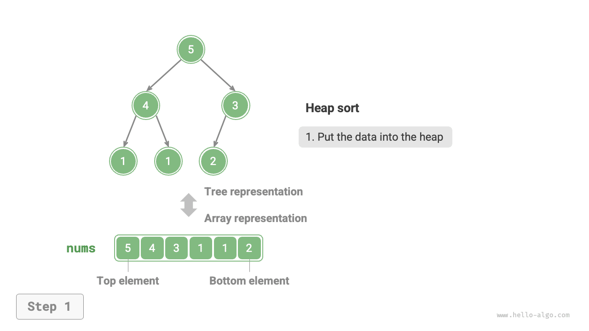
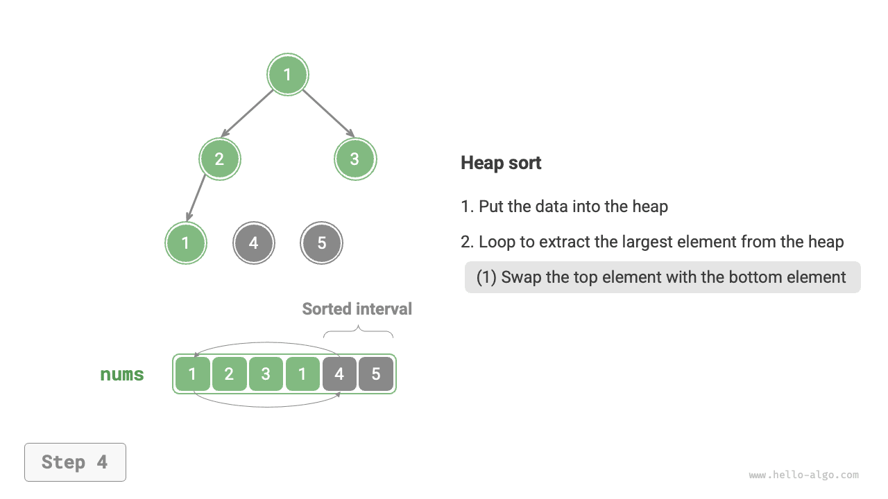
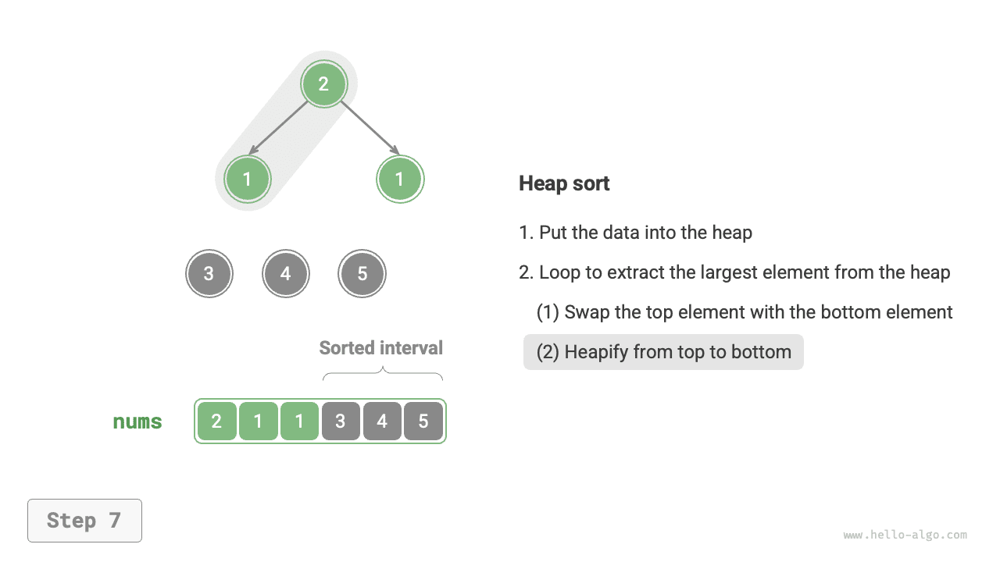
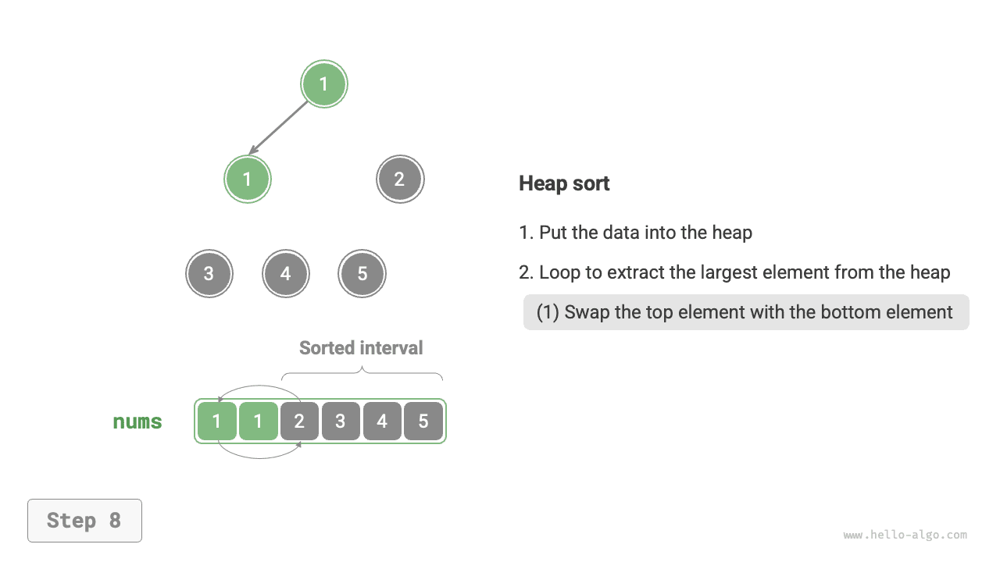

# Heap Sort

!!! tip

    Trước khi đọc phần này, hãy đảm bảo bạn đã hoàn thành chương "Heap".

<u>Heap sort</u> là một thuật toán sắp xếp hiệu quả dựa trên cấu trúc dữ liệu heap. Ta có thể triển khai heap sort bằng cách sử dụng các thao tác xây dựng heap và xóa phần tử đã được giới thiệu trước đó.

1. Nhập mảng và xây dựng min-heap, khi đó phần tử nhỏ nhất nằm ở đỉnh heap.
2. Liên tục thực hiện thao tác xóa phần tử và ghi lại các phần tử đã xóa theo thứ tự để thu được một dãy được sắp xếp theo thứ tự tăng dần.

Mặc dù phương pháp trên khả thi, nhưng nó yêu cầu một mảng bổ sung để lưu các phần tử được lấy ra, gây lãng phí khá nhiều không gian. Trong thực tế, ta thường sử dụng một phương pháp triển khai thanh lịch hơn.

## Quy trình thuật toán

Giả sử độ dài mảng là $n$. Quy trình của heap sort được minh họa trong hình bên dưới.

1. Nhập mảng và xây dựng max-heap. Sau khi hoàn tất, phần tử lớn nhất nằm ở đỉnh heap.
2. Hoán đổi phần tử ở đỉnh heap (phần tử đầu tiên) với phần tử ở đáy heap (phần tử cuối cùng). Sau khi hoán đổi hoàn tất, giảm độ dài heap đi $1$ và tăng số lượng phần tử đã sắp xếp lên $1$.
3. Bắt đầu từ phần tử ở đỉnh heap, thực hiện thao tác heapify từ trên xuống dưới (sift down). Sau khi heapify hoàn tất, tính chất heap được khôi phục.
4. Lặp lại các bước `2.` và `3.` Sau $n - 1$ lượt, mảng được sắp xếp.

!!! tip

    Thực tế, thao tác xóa phần tử cũng bao gồm các bước `2.` và `3.`, cùng với bước xóa phần tử.

=== "<1>"
    

=== "<2>"
    

=== "<3>"
    

=== "<4>"
    

=== "<5>"
    

=== "<6>"
    

=== "<7>"
    

=== "<8>"
    

=== "<9>"
    

=== "<10>"
    

=== "<11>"
    

=== "<12>"
    

Trong đoạn mã bên dưới, ta sử dụng cùng hàm `sift_down()` để thực hiện heapify từ trên xuống dưới như trong chương "Heap". Cần lưu ý rằng vì độ dài heap giảm dần khi phần tử lớn nhất được lấy ra, ta cần thêm tham số độ dài $n$ vào `sift_down()` để chỉ định độ dài hiệu dụng hiện tại của heap. Mã như sau:

```src
[file]{heap_sort}-[class]{}-[func]{heap_sort}
```

## Đặc điểm của thuật toán

- **Độ phức tạp thời gian là $O(n \log n)$; heap sort không thích nghi**: Việc xây dựng heap mất thời gian $O(n)$. Việc lấy phần tử lớn nhất từ heap mất thời gian $O(\log n)$ và được lặp lại tổng cộng $n - 1$ lượt.
- **Độ phức tạp không gian là $O(1)$; heap sort là in-place**: Một vài biến con trỏ sử dụng không gian $O(1)$. Việc hoán đổi phần tử và heapify đều được thực hiện trên mảng ban đầu.
- **Sắp xếp không ổn định**: Khi hoán đổi phần tử ở đỉnh heap với phần tử ở đáy heap, vị trí tương đối của các phần tử bằng nhau có thể thay đổi.