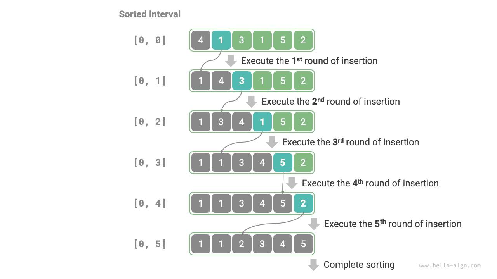

# Sắp xếp chèn

<u>Sắp xếp chèn</u> là một thuật toán sắp xếp đơn giản, hoạt động rất giống với quy trình sắp xếp thủ công một bộ bài.

Cụ thể, chúng ta chọn một phần tử cơ sở từ phần chưa được sắp xếp, lần lượt so sánh phần tử đó với các phần tử trong phần đã được sắp xếp ở bên trái, rồi chèn nó vào đúng vị trí.

Hình bên dưới minh họa cách chèn một phần tử vào mảng. Gọi phần tử cơ sở là `base`. Chúng ta cần dịch tất cả các phần tử nằm giữa chỉ số đích và `base` sang phải một vị trí, sau đó gán `base` vào chỉ số đích.


## Quy trình của thuật toán

Quy trình tổng thể của sắp xếp chèn được minh họa trong hình bên dưới.

1. Ban đầu, phần tử đầu tiên của mảng đã được sắp xếp.
2. Chọn phần tử thứ hai của mảng làm `base`, sau khi chèn phần tử đó vào đúng vị trí, **2 phần tử đầu tiên của mảng đã được sắp xếp**.
3. Chọn phần tử thứ ba làm `base`, sau khi chèn phần tử đó vào đúng vị trí, **3 phần tử đầu tiên của mảng đã được sắp xếp**.
4. Cứ tiếp tục như vậy. Ở lượt cuối, chọn phần tử cuối cùng làm `base`, sau khi chèn phần tử đó vào đúng vị trí, **tất cả các phần tử đều đã được sắp xếp**.



Mã ví dụ như sau:

```src
[file]{insertion_sort}-[class]{}-[func]{insertion_sort}
```

## Đặc điểm của thuật toán

- **Độ phức tạp thời gian $O(n^2)$, sắp xếp thích nghi**: Trong trường hợp xấu nhất, các thao tác chèn lần lượt cần $n - 1$, $n-2$, $\dots$, $2$ và $1$ lần lặp, tổng cộng là $(n - 1) n / 2$, vì vậy độ phức tạp thời gian là $O(n^2)$. Khi dữ liệu đã được sắp xếp, mỗi thao tác chèn sẽ kết thúc sớm. Khi mảng đầu vào đã được sắp xếp hoàn toàn, sắp xếp chèn đạt độ phức tạp thời gian trong trường hợp tốt nhất là $O(n)$.
- **Độ phức tạp không gian $O(1)$, sắp xếp tại chỗ**: Các con trỏ $i$ và $j$ chỉ sử dụng một lượng không gian bổ sung không đổi.
- **Sắp xếp ổn định**: Trong quá trình chèn, chúng ta đặt các phần tử vào bên phải các phần tử bằng chúng, nên thứ tự tương đối của chúng không thay đổi.

## Ưu điểm của sắp xếp chèn

Độ phức tạp thời gian của sắp xếp chèn là $O(n^2)$, trong khi độ phức tạp thời gian của quick sort, thuật toán mà chúng ta sẽ học tiếp theo, là $O(n \log n)$. Mặc dù sắp xếp chèn có độ phức tạp thời gian cao hơn, **nó thường nhanh hơn trên các tập dữ liệu nhỏ**.

Kết luận này tương tự như kết luận về trường hợp áp dụng linear search và binary search. Các thuật toán như quick sort, có độ phức tạp $O(n \log n)$, là các thuật toán sắp xếp chia để trị và thường bao gồm nhiều thao tác nguyên thủy hơn. Khi tập dữ liệu nhỏ, các giá trị $n^2$ và $n \log n$ tương đối gần nhau, vì vậy độ phức tạp tiệm cận không còn mang tính quyết định; thay vào đó, số lượng thao tác nguyên thủy trong mỗi lượt trở thành yếu tố quyết định.

Trên thực tế, các hàm sắp xếp tích hợp sẵn của nhiều ngôn ngữ lập trình (chẳng hạn như Java) sử dụng sắp xếp chèn. Ý tưởng chung là: với các mảng lớn, sử dụng các thuật toán sắp xếp chia để trị như quick sort; với các mảng ngắn, sử dụng trực tiếp sắp xếp chèn.

Mặc dù bubble sort, selection sort và insertion sort đều có độ phức tạp thời gian là $O(n^2)$, trong thực tế, **insertion sort được sử dụng thường xuyên hơn đáng kể so với bubble sort và selection sort**, chủ yếu vì những lý do sau.

- Bubble sort được triển khai bằng cách hoán đổi các phần tử, thao tác này cần một biến tạm thời và bao gồm 3 thao tác nguyên thủy; insertion sort được triển khai bằng cách gán phần tử và chỉ cần 1 thao tác nguyên thủy. Vì vậy, **bubble sort thường có chi phí tính toán cao hơn insertion sort**.
- Selection sort có độ phức tạp thời gian là $O(n^2)$ trong mọi trường hợp. **Nếu được cung cấp một tập dữ liệu đã được sắp xếp một phần, insertion sort thường hiệu quả hơn selection sort**.
- Selection sort không ổn định và không thể áp dụng cho việc sắp xếp nhiều cấp.