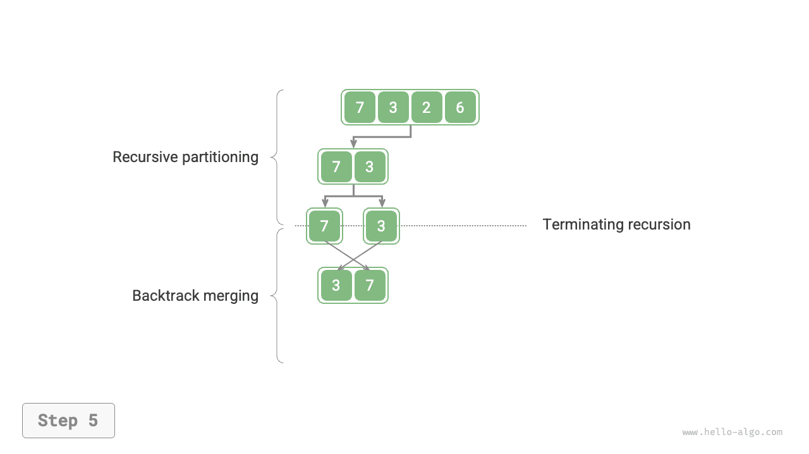
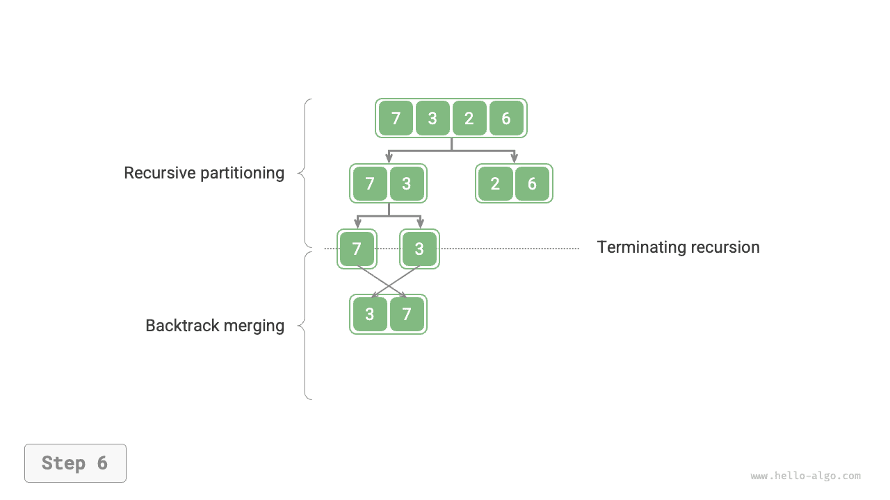

# Merge Sort

<u>Merge sort</u> là một thuật toán sắp xếp dựa trên chiến lược chia để trị, gồm hai giai đoạn "chia" và "trộn" được minh họa trong hình dưới đây.

1. **Giai đoạn chia**: Đệ quy chia mảng tại điểm giữa, chuyển bài toán sắp xếp một mảng dài thành bài toán sắp xếp các mảng ngắn hơn.
2. **Giai đoạn trộn**: Khi một mảng con có độ dài bằng 1, dừng việc chia và bắt đầu trộn, liên tục kết hợp các mảng con ngắn đã được sắp xếp ở bên trái và bên phải thành một mảng dài hơn đã được sắp xếp cho đến khi hoàn tất.


## Quy trình thuật toán

Như minh họa trong hình dưới đây, "giai đoạn chia" đệ quy chia mảng từ điểm giữa thành hai mảng con theo thứ tự từ trên xuống dưới.

1. Tính điểm giữa của mảng `mid`, đệ quy chia mảng con bên trái (khoảng `[left, mid]`) và mảng con bên phải (khoảng `[mid + 1, right]`).
2. Lặp lại đệ quy bước `1.` cho đến khi một mảng con có độ dài bằng 1.

"Giai đoạn trộn" hợp nhất các mảng con bên trái và bên phải thành một mảng đã được sắp xếp theo thứ tự từ dưới lên trên. Lưu ý rằng việc trộn bắt đầu từ các mảng con có độ dài bằng 1, vì vậy mọi mảng con tham gia vào giai đoạn này đều đã được sắp xếp.

=== "<1>"
    

=== "<2>"
    

=== "<3>"
    

=== "<4>"
    

=== "<5>"
    

=== "<6>"
    

=== "<7>"
    

=== "<8>"
    

=== "<9>"
    

=== "<10>"
    

Thứ tự đệ quy của merge sort nhất quán với phép duyệt hậu thứ tự (post-order traversal) của cây nhị phân.

- **Duyệt hậu thứ tự**: Trước tiên đệ quy duyệt cây con bên trái, sau đó đệ quy duyệt cây con bên phải và cuối cùng xử lý nút gốc.
- **Merge sort**: Trước tiên đệ quy xử lý mảng con bên trái, sau đó đệ quy xử lý mảng con bên phải và cuối cùng thực hiện thao tác trộn.

Phần triển khai merge sort được trình bày trong đoạn code dưới đây. Lưu ý rằng khoảng cần trộn trong `nums` là `[left, right]`, trong khi khoảng tương ứng trong `tmp` là `[0, right - left]`.

```src
[file]{merge_sort}-[class]{}-[func]{merge_sort}
```

## Đặc điểm của thuật toán

- **Độ phức tạp thời gian là $O(n \log n)$; merge sort không thích nghi (non-adaptive)**: Giai đoạn chia tạo ra một cây đệ quy có chiều cao $\log n$, và tổng số thao tác được thực hiện trong quá trình trộn ở mỗi mức là $n$, vì vậy độ phức tạp thời gian tổng thể là $O(n \log n)$.
- **Độ phức tạp không gian là $O(n)$; merge sort không phải là thuật toán in-place**: Độ sâu đệ quy là $\log n$, sử dụng không gian $O(\log n)$ cho các stack frame. Thao tác trộn yêu cầu một mảng phụ, sử dụng thêm không gian $O(n)$.
- **Sắp xếp ổn định**: Trong quá trình trộn, thứ tự tương đối của các phần tử bằng nhau không thay đổi.

## Sắp xếp danh sách liên kết

Đối với danh sách liên kết, merge sort có những ưu điểm đáng kể so với các thuật toán sắp xếp khác, **đồng thời có thể giảm độ phức tạp không gian của tác vụ sắp xếp xuống còn $O(1)$**.

- **Giai đoạn chia**: Có thể sử dụng phép lặp thay cho đệ quy để chia danh sách liên kết, qua đó loại bỏ không gian stack frame được sử dụng bởi đệ quy.
- **Giai đoạn trộn**: Trong danh sách liên kết, việc chèn và xóa nút chỉ yêu cầu cập nhật con trỏ, vì vậy giai đoạn trộn (hợp nhất hai danh sách liên kết ngắn đã được sắp xếp thành một danh sách liên kết dài hơn đã được sắp xếp) không yêu cầu tạo thêm một danh sách liên kết.

Các chi tiết triển khai cụ thể khá phức tạp; những độc giả quan tâm có thể tham khảo các tài liệu liên quan để tìm hiểu.