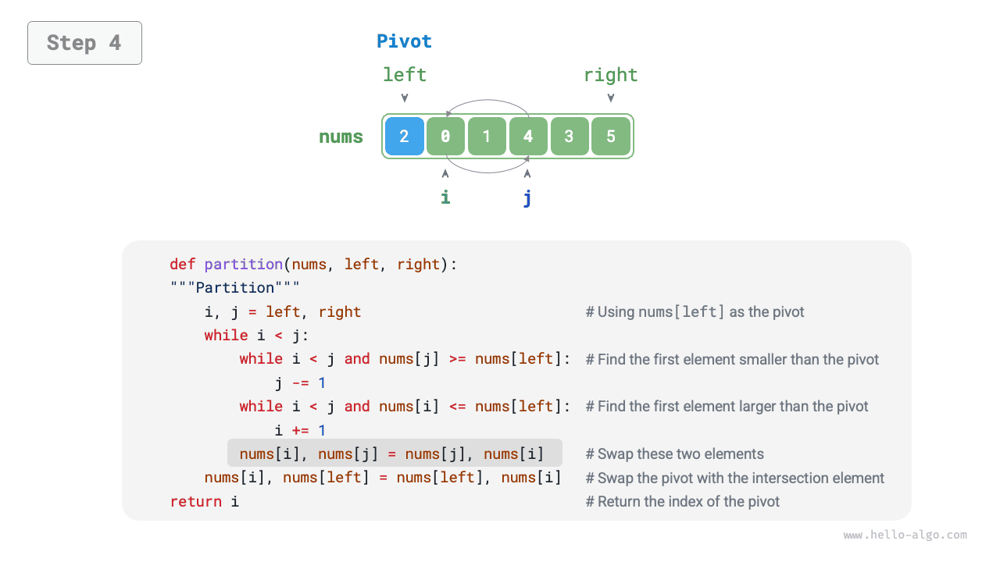
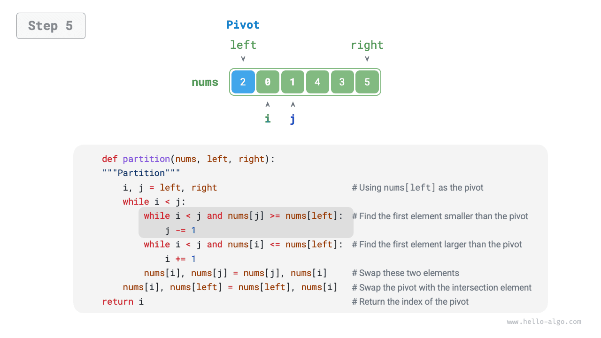
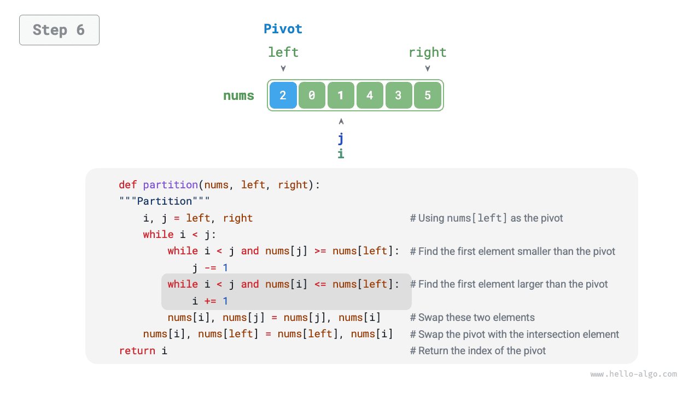
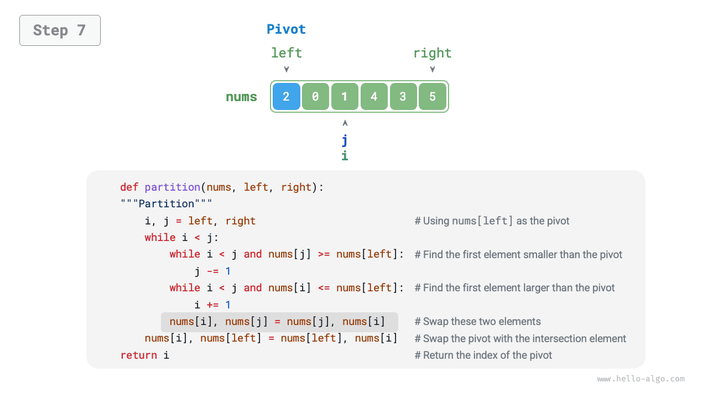
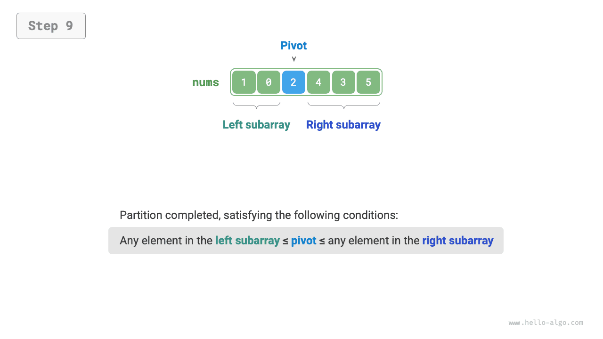

# Quick Sort

<u>Quick sort</u> là một thuật toán sắp xếp hiệu quả và được sử dụng rộng rãi, dựa trên chiến lược chia để trị.

Thao tác cốt lõi của quick sort là “phân hoạch bằng chốt”, với mục tiêu chọn một phần tử làm “pivot”, di chuyển tất cả phần tử nhỏ hơn pivot sang bên trái, và di chuyển tất cả phần tử lớn hơn pivot sang bên phải. Cụ thể, quy trình được minh họa trong hình dưới đây.

1. Chọn phần tử ngoài cùng bên trái làm pivot, đồng thời khởi tạo hai con trỏ `i` và `j` ở hai đầu mảng.
2. Bắt đầu một vòng lặp. Trong mỗi lượt, sử dụng `i` (`j`) để tìm phần tử đầu tiên lớn hơn (nhỏ hơn) pivot, sau đó hoán đổi hai phần tử này.
3. Lặp lại bước `2.` cho đến khi `i` và `j` gặp nhau, rồi hoán đổi pivot vào vị trí biên giữa hai mảng con.

=== "<1>"
    

=== "<2>"
    

=== "<3>"
    

=== "<4>"
    

=== "<5>"
    

=== "<6>"
    

=== "<7>"
    

=== "<8>"
    

=== "<9>"
    

Sau khi phân hoạch bằng chốt, mảng ban đầu được chia thành ba phần: mảng con bên trái, pivot và mảng con bên phải, sao cho “mọi phần tử trong mảng con bên trái $\leq$ pivot $\leq$ mọi phần tử trong mảng con bên phải”. Vì vậy, tiếp theo chúng ta chỉ cần sắp xếp hai mảng con.

!!! note "Chiến lược chia để trị của quick sort"

    Bản chất của phân hoạch bằng chốt là đơn giản hóa bài toán sắp xếp một mảng dài thành các bài toán sắp xếp hai mảng ngắn hơn.

```src
[file]{quick_sort}-[class]{quick_sort}-[func]{partition}
```

## Quy trình thuật toán

Quy trình tổng thể của quick sort được minh họa trong hình dưới đây.

1. Trước tiên, thực hiện một lần “phân hoạch bằng chốt” trên mảng ban đầu để thu được mảng con bên trái và mảng con bên phải chưa được sắp xếp.
2. Sau đó, lần lượt thực hiện đệ quy “phân hoạch bằng chốt” trên mảng con bên trái và mảng con bên phải.
3. Tiếp tục đệ quy cho đến khi độ dài mảng con bằng 1; lúc đó, toàn bộ mảng đã được sắp xếp.


```src
[file]{quick_sort}-[class]{quick_sort}-[func]{quick_sort}
```

## Đặc điểm của thuật toán

- **Độ phức tạp thời gian $O(n \log n)$, sắp xếp không thích nghi**: Trung bình, phân hoạch bằng chốt tạo ra $\log n$ mức đệ quy, và tổng số lần lặp vòng lặp ở mỗi mức là $n$, vì vậy độ phức tạp thời gian tổng thể là $O(n \log n)$. Trong trường hợp xấu nhất, mỗi lượt phân hoạch bằng chốt chia một mảng có độ dài $n$ thành các mảng con có độ dài $0$ và $n - 1$. Khi đó, độ sâu đệ quy đạt đến $n$, với $n$ lần lặp vòng lặp ở mỗi mức, dẫn đến độ phức tạp thời gian tổng thể là $O(n^2)$.
- **Độ phức tạp không gian $O(n)$, sắp xếp tại chỗ**: Khi mảng đầu vào bị đảo ngược hoàn toàn, độ sâu đệ quy trong trường hợp xấu nhất đạt đến $n$, sử dụng $O(n)$ không gian cho các stack frame. Thao tác sắp xếp được thực hiện trực tiếp trên mảng ban đầu mà không cần đến mảng bổ sung.
- **Sắp xếp không ổn định**: Trong bước cuối của phân hoạch bằng chốt, pivot có thể được hoán đổi sang bên phải một phần tử bằng nó.

## Vì sao Quick Sort nhanh

Đúng như tên gọi, quick sort có những ưu thế rõ rệt về hiệu suất. Mặc dù độ phức tạp thời gian trung bình giống với “merge sort” và “heap sort”, quick sort thường nhanh hơn trong thực tế vì các lý do sau.

- **Trường hợp xấu nhất khó xảy ra**: Mặc dù độ phức tạp thời gian trong trường hợp xấu nhất của quick sort là $O(n^2)$ và hiệu suất của nó khó dự đoán hơn merge sort, quick sort chạy trong thời gian $O(n \log n)$ ở phần lớn trường hợp.
- **Hiệu quả cache cao**: Trong quá trình phân hoạch bằng chốt, hệ thống có thể tải toàn bộ mảng con vào cache, vì vậy việc truy cập các phần tử tương đối hiệu quả. Ngược lại, các thuật toán như “heap sort” yêu cầu truy cập các phần tử không liền kề, nên không có được lợi thế này.
- **Hệ số hằng nhỏ**: Trong ba thuật toán trên, quick sort thực hiện tổng cộng ít phép so sánh, phép gán và phép hoán đổi nhất. Điều này tương tự lý do “insertion sort” nhanh hơn “bubble sort”.

## Tối ưu hóa Pivot

**Quick sort có thể kém hiệu quả về thời gian hơn đối với một số dữ liệu đầu vào**. Hãy xét một ví dụ cực đoan, trong đó mảng đầu vào được sắp xếp hoàn toàn theo thứ tự giảm dần. Vì chúng ta chọn phần tử ngoài cùng bên trái làm pivot, sau khi phân hoạch bằng chốt hoàn tất, pivot sẽ được hoán đổi đến tận cùng bên phải của mảng, để lại một mảng con bên trái có độ dài $n - 1$ và một mảng con bên phải có độ dài $0$. Nếu quá trình này tiếp tục theo cách đệ quy, mỗi lượt phân hoạch bằng chốt sẽ tạo ra một mảng con có độ dài $0$, chiến lược chia để trị bị phá vỡ, và quick sort suy biến thành một dạng gần giống “bubble sort”.

Để giảm khả năng điều này xảy ra, **chúng ta có thể tối ưu hóa chiến lược chọn pivot được sử dụng trong phân hoạch bằng chốt**. Ví dụ, chúng ta có thể chọn pivot một cách ngẫu nhiên. Tuy nhiên, nếu không may liên tục chọn phải các pivot không phù hợp, hiệu suất vẫn có thể không đạt yêu cầu.

Cần lưu ý rằng các ngôn ngữ lập trình thường tạo ra “số giả ngẫu nhiên”. Nếu xây dựng một trường hợp kiểm thử cụ thể dựa trên một chuỗi giả ngẫu nhiên, quick sort vẫn có thể bị suy giảm hiệu suất.

Để cải thiện hơn nữa, chúng ta có thể chọn ba phần tử ứng viên từ mảng, thường là phần tử đầu tiên, phần tử cuối cùng và phần tử ở giữa, **sau đó sử dụng trung vị của ba phần tử làm pivot**. Điều này làm tăng đáng kể khả năng pivot “không quá nhỏ cũng không quá lớn”. Chúng ta cũng có thể chọn nhiều phần tử ứng viên hơn để tiếp tục cải thiện độ ổn định của thuật toán. Với phương pháp này, xác suất độ phức tạp thời gian suy giảm xuống $O(n^2)$ được giảm đáng kể.

Mã ví dụ như sau:

```src
[file]{quick_sort}-[class]{quick_sort_median}-[func]{partition}
```

## Tối ưu hóa độ sâu đệ quy

**Quick sort cũng có thể sử dụng nhiều không gian hơn đối với một số dữ liệu đầu vào**. Hãy xét một mảng đầu vào đã được sắp xếp hoàn toàn. Gọi độ dài của mảng con hiện tại trong quá trình đệ quy là $m$. Mỗi lượt phân hoạch bằng chốt tạo ra một mảng con bên trái có độ dài $0$ và một mảng con bên phải có độ dài $m - 1$, nghĩa là mỗi lời gọi đệ quy chỉ làm giảm kích thước bài toán đi một phần tử. Do đó, cây đệ quy có thể đạt chiều cao $n - 1$, cần đến $O(n)$ không gian cho các stack frame.

Để ngăn các stack frame tích lũy, sau mỗi lượt phân hoạch bằng chốt, chúng ta có thể so sánh độ dài của hai mảng con và **chỉ đệ quy trên mảng con ngắn hơn**. Vì mảng con ngắn hơn có độ dài tối đa là $n / 2$, phương pháp này đảm bảo độ sâu đệ quy không vượt quá $\log n$, giảm độ phức tạp không gian trong trường hợp xấu nhất xuống $O(\log n)$. Mã được trình bày bên dưới:

```src
[file]{quick_sort}-[class]{quick_sort_tail_call}-[func]{quick_sort}
```
