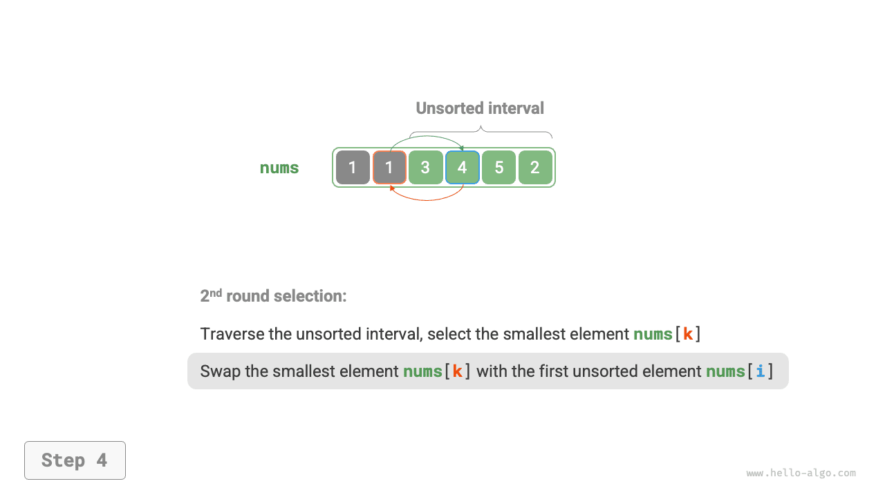
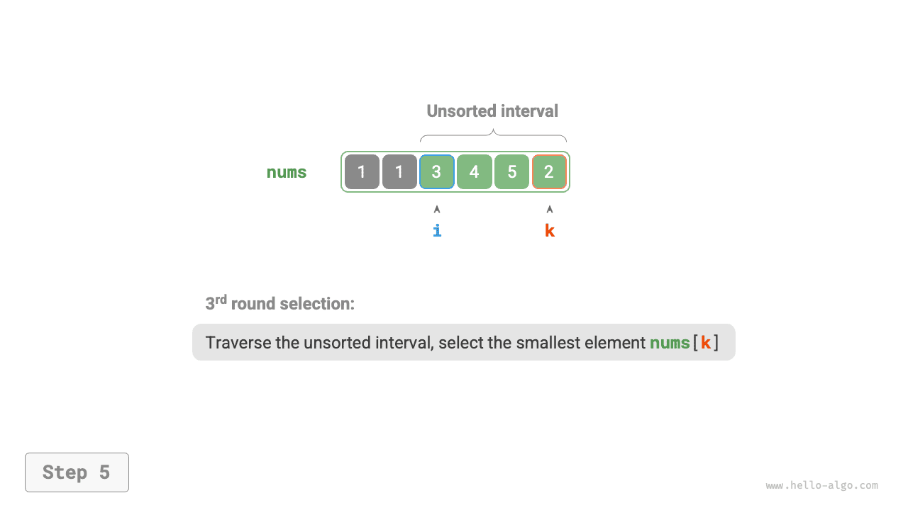
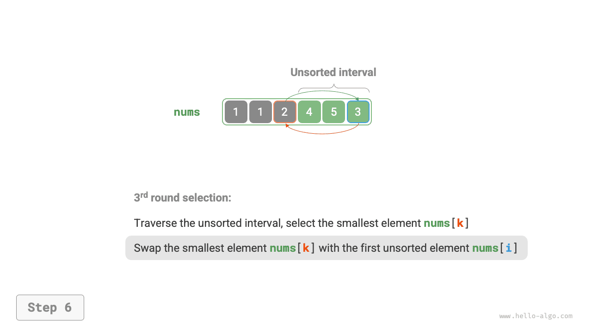
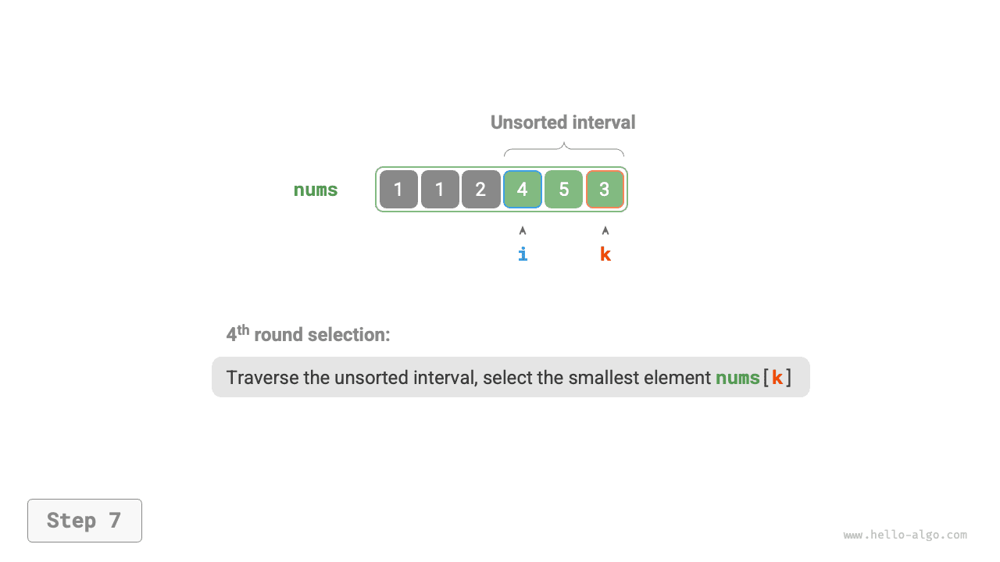
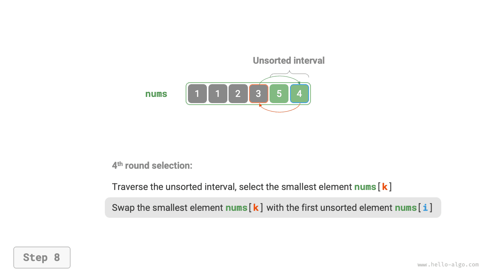

# Sắp xếp chọn

<u>Sắp xếp chọn</u> hoạt động rất đơn giản: trong mỗi vòng, thuật toán chọn phần tử nhỏ nhất trong khoảng chưa được sắp xếp và đặt phần tử đó vào cuối khoảng đã được sắp xếp.

Giả sử mảng có độ dài $n$. Quy trình sắp xếp chọn được minh họa trong hình dưới đây.

1. Ban đầu, tất cả phần tử đều chưa được sắp xếp, tức là khoảng (chỉ số) chưa được sắp xếp là $[0, n-1]$.
2. Chọn phần tử nhỏ nhất trong khoảng $[0, n-1]$ và hoán đổi nó với phần tử tại chỉ số $0$. Sau khi hoàn tất, phần tử đầu tiên của mảng đã được sắp xếp.
3. Chọn phần tử nhỏ nhất trong khoảng $[1, n-1]$ và hoán đổi nó với phần tử tại chỉ số $1$. Sau khi hoàn tất, 2 phần tử đầu tiên của mảng đã được sắp xếp.
4. Và cứ tiếp tục như vậy. Sau $n - 1$ vòng chọn và hoán đổi, $n - 1$ phần tử đầu tiên của mảng đã được sắp xếp.
5. Phần tử duy nhất còn lại chắc chắn là phần tử lớn nhất, vì vậy không cần sắp xếp thêm và mảng đã được sắp xếp.

=== "<1>"
    

=== "<2>"
    

=== "<3>"
    

=== "<4>"
    

=== "<5>"
    

=== "<6>"
    

=== "<7>"
    

=== "<8>"
    

=== "<9>"
    

=== "<10>"
    

=== "<11>"
    

Trong code, chúng ta sử dụng $k$ để theo dõi phần tử nhỏ nhất trong khoảng chưa được sắp xếp:

```src
[file]{selection_sort}-[class]{}-[func]{selection_sort}
```

## Đặc điểm của thuật toán

- **Độ phức tạp thời gian $O(n^2)$, sắp xếp không thích nghi**: Vòng lặp bên ngoài có tổng cộng $n - 1$ vòng. Vòng lặp bên trong chạy $n - 1$ lần ở vòng đầu tiên và $1$ lần ở vòng cuối cùng. Do đó, qua các vòng, nó chạy lần lượt $n - 1$, $n - 2$, $\dots$, $2$ và $1$ lần, với tổng là $\frac{n(n - 1)}{2}$.
- **Độ phức tạp không gian $O(1)$, sắp xếp tại chỗ**: Các con trỏ $i$ và $j$ sử dụng một lượng không gian bổ sung không đổi.
- **Sắp xếp không ổn định**: Như được minh họa trong hình dưới đây, phần tử `nums[i]` có thể bị hoán đổi sang bên phải của một phần tử bằng nó, làm thay đổi thứ tự tương đối giữa chúng.

