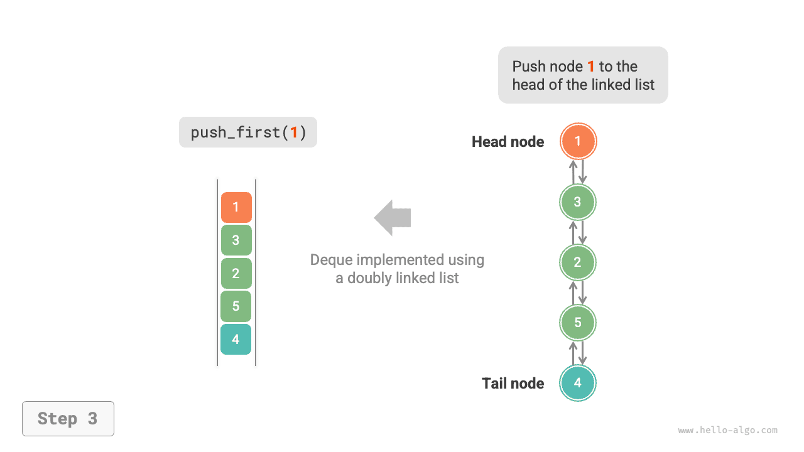
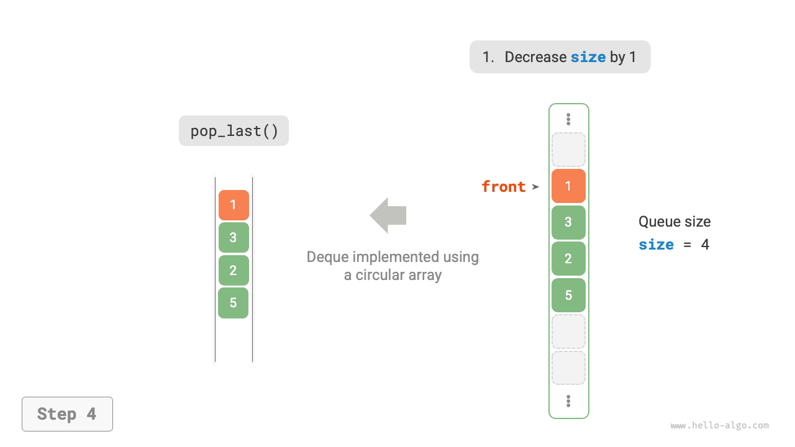

# Deque

Trong một queue, chúng ta chỉ có thể loại bỏ phần tử ở đầu hoặc thêm phần tử ở cuối. Như minh họa trong hình bên dưới, <u>double-ended queue (deque)</u> mang lại nhiều tính linh hoạt hơn, cho phép thêm hoặc loại bỏ phần tử ở cả đầu và cuối.


## Các thao tác deque thường dùng

Các thao tác thường dùng trên deque được trình bày trong bảng bên dưới. Tên phương thức cụ thể phụ thuộc vào ngôn ngữ lập trình được sử dụng.

<p align="center"> Bảng <id> &nbsp; Độ phức tạp của các thao tác deque </p>

| Phương thức         | Mô tả               | Độ phức tạp thời gian |
| -------------- | ------------------------- | --------------- |
| `push_first()` | Thêm phần tử vào đầu      | $O(1)$          |
| `push_last()`  | Thêm phần tử vào cuối       | $O(1)$          |
| `pop_first()`  | Xóa phần tử ở đầu      | $O(1)$          |
| `pop_last()`   | Xóa phần tử ở cuối       | $O(1)$          |
| `peek_first()` | Truy cập phần tử ở đầu      | $O(1)$          |
| `peek_last()`  | Truy cập phần tử ở cuối       | $O(1)$          |

Tương tự, chúng ta có thể trực tiếp sử dụng các class deque được ngôn ngữ lập trình cung cấp:

=== "Python"

    ```python title="deque.py"
    from collections import deque

    # Khởi tạo deque
    deq: deque[int] = deque()

    # Thêm các phần tử
    deq.append(2)      # Thêm vào cuối
    deq.append(5)
    deq.append(4)
    deq.appendleft(3)  # Thêm vào đầu
    deq.appendleft(1)

    # Truy cập các phần tử
    front: int = deq[0]  # Phần tử ở đầu
    rear: int = deq[-1]  # Phần tử ở cuối

    # Xóa các phần tử
    pop_front: int = deq.popleft()  # Xóa phần tử ở đầu
    pop_rear: int = deq.pop()       # Xóa phần tử ở cuối

    # Lấy độ dài deque
    size: int = len(deq)

    # Kiểm tra deque có rỗng không
    is_empty: bool = len(deq) == 0
    ```

=== "C++"

    ```cpp title="deque.cpp"
    /* Khởi tạo deque */
    deque<int> deque;

    /* Thêm các phần tử */
    deque.push_back(2);   // Thêm vào cuối
    deque.push_back(5);
    deque.push_back(4);
    deque.push_front(3);  // Thêm vào đầu
    deque.push_front(1);

    /* Truy cập các phần tử */
    int front = deque.front(); // Phần tử ở đầu
    int back = deque.back();   // Phần tử ở cuối

    /* Xóa các phần tử */
    deque.pop_front();  // Xóa phần tử ở đầu
    deque.pop_back();   // Xóa phần tử ở cuối

    /* Lấy độ dài deque */
    int size = deque.size();

    /* Kiểm tra deque có rỗng không */
    bool empty = deque.empty();
    ```

=== "Java"

    ```java title="deque.java"
    /* Khởi tạo deque */
    Deque<Integer> deque = new LinkedList<>();

    /* Thêm các phần tử */
    deque.offerLast(2);   // Thêm vào cuối
    deque.offerLast(5);
    deque.offerLast(4);
    deque.offerFirst(3);  // Thêm vào đầu
    deque.offerFirst(1);

    /* Truy cập các phần tử */
    int peekFirst = deque.peekFirst();  // Phần tử ở đầu
    int peekLast = deque.peekLast();    // Phần tử ở cuối

    /* Xóa các phần tử */
    int popFirst = deque.pollFirst();  // Xóa phần tử ở đầu
    int popLast = deque.pollLast();    // Xóa phần tử ở cuối

    /* Lấy độ dài deque */
    int size = deque.size();

    /* Kiểm tra deque có rỗng không */
    boolean isEmpty = deque.isEmpty();
    ```

=== "C#"

    ```csharp title="deque.cs"
    /* Khởi tạo deque */
    // Trong C#, sử dụng LinkedList làm deque
    LinkedList<int> deque = new();

    /* Thêm các phần tử */
    deque.AddLast(2);   // Thêm vào cuối
    deque.AddLast(5);
    deque.AddLast(4);
    deque.AddFirst(3);  // Thêm vào đầu
    deque.AddFirst(1);

    /* Truy cập các phần tử */
    int peekFirst = deque.First.Value;  // Phần tử ở đầu
    int peekLast = deque.Last.Value;    // Phần tử ở cuối

    /* Xóa các phần tử */
    deque.RemoveFirst();  // Xóa phần tử ở đầu
    deque.RemoveLast();   // Xóa phần tử ở cuối

    /* Lấy độ dài deque */
    int size = deque.Count;

    /* Kiểm tra deque có rỗng không */
    bool isEmpty = deque.Count == 0;
    ```

=== "Go"

    ```go title="deque_test.go"
    /* Khởi tạo deque */
    // Trong Go, sử dụng list làm deque
    deque := list.New()

    /* Thêm các phần tử */
    deque.PushBack(2)      // Thêm vào cuối
    deque.PushBack(5)
    deque.PushBack(4)
    deque.PushFront(3)     // Thêm vào đầu
    deque.PushFront(1)

    /* Truy cập các phần tử */
    front := deque.Front() // Phần tử ở đầu
    rear := deque.Back()   // Phần tử ở cuối

    /* Xóa các phần tử */
    deque.Remove(front)    // Xóa phần tử ở đầu
    deque.Remove(rear)     // Xóa phần tử ở cuối

    /* Lấy độ dài deque */
    size := deque.Len()

    /* Kiểm tra deque có rỗng không */
    isEmpty := deque.Len() == 0
    ```

=== "Swift"

    ```swift title="deque.swift"
    /* Khởi tạo deque */
    // Swift không có class deque tích hợp sẵn, có thể sử dụng Array làm deque
    var deque: [Int] = []

    /* Thêm các phần tử */
    deque.append(2) // Thêm vào cuối
    deque.append(5)
    deque.append(4)
    deque.insert(3, at: 0) // Thêm vào đầu
    deque.insert(1, at: 0)

    /* Truy cập các phần tử */
    let peekFirst = deque.first! // Phần tử ở đầu
    let peekLast = deque.last! // Phần tử ở cuối

    /* Xóa các phần tử */
    // Khi sử dụng Array để mô phỏng, popFirst có độ phức tạp O(n)
    let popFirst = deque.removeFirst() // Xóa phần tử ở đầu
    let popLast = deque.removeLast() // Xóa phần tử ở cuối

    /* Lấy độ dài deque */
    let size = deque.count

    /* Kiểm tra deque có rỗng không */
    let isEmpty = deque.isEmpty
    ```

=== "JS"

    ```javascript title="deque.js"
    /* Khởi tạo deque */
    // JavaScript không có deque tích hợp sẵn, chỉ có thể sử dụng Array làm deque
    const deque = [];

    /* Thêm các phần tử */
    deque.push(2);
    deque.push(5);
    deque.push(4);
    // Lưu ý rằng vì đây là một mảng, unshift() có độ phức tạp thời gian O(n)
    deque.unshift(3);
    deque.unshift(1);

    /* Truy cập các phần tử */
    const peekFirst = deque[0];
    const peekLast = deque[deque.length - 1];

    /* Xóa các phần tử */
    // Lưu ý rằng vì đây là một mảng, shift() có độ phức tạp thời gian O(n)
    const popFront = deque.shift();
    const popBack = deque.pop();

    /* Lấy độ dài deque */
    const size = deque.length;

    /* Kiểm tra deque có rỗng không */
    const isEmpty = size === 0;
    ```

=== "TS"

    ```typescript title="deque.ts"
    /* Khởi tạo deque */
    // TypeScript không có deque tích hợp sẵn, chỉ có thể sử dụng Array làm deque
    const deque: number[] = [];

    /* Thêm các phần tử */
    deque.push(2);
    deque.push(5);
    deque.push(4);
    // Lưu ý rằng vì đây là một mảng, unshift() có độ phức tạp thời gian O(n)
    deque.unshift(3);
    deque.unshift(1);

    /* Truy cập các phần tử */
    const peekFirst: number = deque[0];
    const peekLast: number = deque[deque.length - 1];

    /* Xóa các phần tử */
    // Lưu ý rằng vì đây là một mảng, shift() có độ phức tạp thời gian O(n)
    const popFront: number = deque.shift() as number;
    const popBack: number = deque.pop() as number;

    /* Lấy độ dài deque */
    const size: number = deque.length;

    /* Kiểm tra deque có rỗng không */
    const isEmpty: boolean = size === 0;
    ```

=== "Dart"

    ```dart title="deque.dart"
    /* Khởi tạo deque */
    // Trong Dart, Queue được định nghĩa là một deque
    Queue<int> deque = Queue<int>();

    /* Thêm các phần tử */
    deque.addLast(2);  // Thêm vào cuối
    deque.addLast(5);
    deque.addLast(4);
    deque.addFirst(3); // Thêm vào đầu
    deque.addFirst(1);

    /* Truy cập các phần tử */
    int peekFirst = deque.first; // Phần tử ở đầu
    int peekLast = deque.last;   // Phần tử ở cuối

    /* Xóa các phần tử */
    int popFirst = deque.removeFirst(); // Xóa phần tử ở đầu
    int popLast = deque.removeLast();   // Xóa phần tử ở cuối

    /* Lấy độ dài deque */
    int size = deque.length;

    /* Kiểm tra deque có rỗng không */
    bool isEmpty = deque.isEmpty;
    ```

=== "Rust"

    ```rust title="deque.rs"
    /* Khởi tạo deque */
    let mut deque: VecDeque<u32> = VecDeque::new();

    /* Thêm các phần tử */
    deque.push_back(2);  // Thêm vào cuối
    deque.push_back(5);
    deque.push_back(4);
    deque.push_front(3); // Thêm vào đầu
    deque.push_front(1);

    /* Truy cập các phần tử */
    if let Some(front) = deque.front() { // Phần tử ở đầu
    }
    if let Some(rear) = deque.back() {   // Phần tử ở cuối
    }

    /* Xóa các phần tử */
    if let Some(pop_front) = deque.pop_front() { // Xóa phần tử ở đầu
    }
    if let Some(pop_rear) = deque.pop_back() {   // Xóa phần tử ở cuối
    }

    /* Lấy độ dài deque */
    let size = deque.len();

    /* Kiểm tra deque có rỗng không */
    let is_empty = deque.is_empty();
    ```

=== "C"

    ```c title="deque.c"
    // C không cung cấp deque tích hợp sẵn
    ```

=== "Kotlin"

    ```kotlin title="deque.kt"
    /* Khởi tạo deque */
    val deque = LinkedList<Int>()

    /* Thêm các phần tử */
    deque.offerLast(2)  // Thêm vào cuối
    deque.offerLast(5)
    deque.offerLast(4)
    deque.offerFirst(3) // Thêm vào đầu
    deque.offerFirst(1)

    /* Truy cập các phần tử */
    val peekFirst = deque.peekFirst() // Phần tử ở đầu
    val peekLast = deque.peekLast()   // Phần tử ở cuối

    /* Xóa các phần tử */
    val popFirst = deque.pollFirst() // Xóa phần tử ở đầu
    val popLast = deque.pollLast()   // Xóa phần tử ở cuối

    /* Lấy độ dài deque */
    val size = deque.size

    /* Kiểm tra deque có rỗng không */
    val isEmpty = deque.isEmpty()
    ```

=== "Ruby"

    ```ruby title="deque.rb"
    # Khởi tạo deque
    # Ruby không có deque tích hợp sẵn, chỉ có thể sử dụng Array làm deque
    deque = []

    # Enqueue các phần tử
    deque << 2
    deque << 5
    deque << 4
    # Lưu ý rằng vì đây là một mảng, Array#unshift có độ phức tạp thời gian O(n)
    deque.unshift(3)
    deque.unshift(1)

    # Truy cập các phần tử
    peek_first = deque.first
    peek_last = deque.last

    # Dequeue các phần tử
    # Lưu ý rằng vì đây là một mảng, Array#shift có độ phức tạp thời gian O(n)
    pop_front = deque.shift
    pop_back = deque.pop

    # Lấy độ dài deque
    size = deque.length

    # Kiểm tra deque có rỗng không
    is_empty = size.zero?
    ```

??? pythontutor "Trực quan hóa mã"

    https://pythontutor.com/render.html#code=from%20collections%20import%20deque%0A%0A%22%22%22Driver%20Code%22%22%22%0Aif%20__name__%20%3D%3D%20%22__main__%22%3A%0A%20%20%20%20%23%20%E5%88%9D%E5%A7%8B%E5%8C%96%E5%8F%8C%E5%90%91%E9%98%9F%E5%88%97%0A%20%20%20%20deq%20%3D%20deque%28%29%0A%0A%20%20%20%20%23%20%E5%85%83%E7%B4%A0%E5%85%A5%E9%98%9F%0A%20%20%20%20deq.append%282%29%20%20%23%20%E6%B7%BB%E5%8A%A0%E8%87%B3%E9%98%9F%E5%B0%BE%0A%20%20%20%20deq.append%285%29%0A%20%20%20%20deq.append%284%29%0A%20%20%20%20deq.appendleft%283%29%20%20%23%20%E6%B7%BB%E5%8A%A0%E8%87%B3%E9%98%9F%E9%A6%96%0A%20%20%20%20deq.appendleft%281%29%0A%20%20%20%20print%28%22%E5%8F%8C%E5%90%91%E9%98%9F%E5%88%97%20deque%20%3D%22,%20deq%29%0A%0A%20%20%20%20%23%20%E8%AE%BF%E9%97%AE%E5%85%83%E7%B4%A0%0A%20%20%20%20front%20%3D%20deq%5B0%5D%20%20%23%20%E9%98%9F%E9%A6%96%E5%85%83%E7%B4%A0%0A%20%20%20%20print%28%22%E9%98%9F%E9%A6%96%E5%85%83%E7%B4%A0%20front%20%3D%22,%20front%29%0A%20%20%20%20rear%20%3D%20deq%5B-1%5D%20%20%23%20%E9%98%9F%E5%B0%BE%E5%85%83%E7%B4%A0%0A%20%20%20%20print%28%22%E9%98%9F%E5%B0%BE%E5%85%83%E7%B4%A0%20rear%20%3D%22,%20rear%29%0A%0A%20%20%20%20%23%20%E5%85%83%E7%B4%A0%E5%87%BA%E9%98%9F%0A%20%20%20%20pop_front%20%3D%20deq.popleft%28%29%20%20%23%20%E9%98%9F%E9%A6%96%E5%85%83%E7%B4%A0%E5%87%BA%E9%98%9F%0A%20%20%20%20print%28%22%E9%98%9F%E9%A6%96%E5%87%BA%E9%98%9F%E5%85%83%E7%B4%A0%20%20pop_front%20%3D%22,%20pop_front%29%0A%20%20%20%20print%28%22%E9%98%9F%E9%A6%96%E5%87%BA%E9%98%9F%E5%90%8E%20deque%20%3D%22,%20deq%29%0A%20%20%20%20pop_rear%20%3D%20deq.pop%28%29%20%20%23%20%E9%98%9F%E5%B0%BE%E5%85%83%E7%B4%A0%E5%87%BA%E9%98%9F%0A%20%20%20%20print%28%22%E9%98%9F%E5%B0%BE%E5%87%BA%E9%98%9F%E5%85%83%E7%B4%A0%20%20pop_rear%20%3D%22,%20pop_rear%29%0A%20%20%20%20print%28%22%E9%98%9F%E5%B0%BE%E5%87%BA%E9%98%9F%E5%90%8E%20deque%20%3D%22,%20deq%29%0A%0A%20%20%20%20%23%20%E8%8E%B7%E5%8F%96%E5%8F%8C%E5%90%91%E9%98%9F%E5%88%97%E7%9A%84%E9%95%BF%E5%BA%A6%0A%20%20%20%20size%20%3D%20len%28deq%29%0A%20%20%20%20print%28%22%E5%8F%8C%E5%90%91%E9%98%9F%E5%88%97%E9%95%BF%E5%BA%A6%20size%20%3D%22,%20size%29%0A%0A%20%20%20%20%23%20%E5%88%A4%E6%96%AD%E5%8F%8C%E5%90%91%E9%98%9F%E5%88%97%E6%98%AF%E5%90%A6%E4%B8%BA%E7%A9%BA%0A%20%20%20%20is_empty%20%3D%20len%28deq%29%20%3D%3D%200%0A%20%20%20%20print%28%22%E5%8F%8C%E5%90%91%E9%98%9F%E5%88%97%E6%98%AF%E5%90%A6%E4%B8%BA%E7%A9%BA%20%3D%22,%20is_empty%29&cumulative=false&curInstr=3&heapPrimitives=nevernest&mode=display&origin=opt-frontend.js&py=311&rawInputLstJSON=%5B%5D&textReferences=false

## Triển khai Deque *

Cách triển khai deque tương tự như queue. Bạn có thể chọn danh sách liên kết hoặc mảng làm cấu trúc dữ liệu nền tảng.

### Triển khai bằng danh sách liên kết đôi

Xem lại phần trước, chúng ta đã sử dụng một danh sách liên kết đơn thông thường để triển khai queue vì nó cho phép xóa nút đầu (tương ứng với dequeue) và thêm các nút mới sau nút cuối (tương ứng với enqueue) một cách thuận tiện.

Đối với deque, cả hai đầu trước và sau đều có thể thực hiện các thao tác enqueue và dequeue. Nói cách khác, deque cũng cần triển khai các thao tác theo hướng ngược lại. Vì lý do này, chúng ta sử dụng "danh sách liên kết đôi" làm cấu trúc dữ liệu nền tảng cho deque.

Như minh họa trong hình bên dưới, chúng ta xem các nút đầu và cuối của danh sách liên kết đôi lần lượt là đầu trước và đầu sau của deque, từ đó triển khai chức năng thêm và xóa nút ở cả hai đầu.

=== "<1>"
    

=== "<2>"
    

=== "<3>"
    

=== "<4>"
    

=== "<5>"
    

Mã triển khai được trình bày bên dưới:

```src
[file]{linkedlist_deque}-[class]{linked_list_deque}-[func]{}
```

### Triển khai bằng mảng

Như minh họa trong hình bên dưới, tương tự như khi triển khai queue dựa trên mảng, chúng ta cũng có thể sử dụng mảng vòng để triển khai deque.

=== "<1>"
    

=== "<2>"
    

=== "<3>"
    

=== "<4>"
    

=== "<5>"
    

Dựa trên cách triển khai queue, chúng ta chỉ cần thêm các phương thức cho "enqueue ở đầu trước" và "dequeue từ đầu sau":

```src
[file]{array_deque}-[class]{array_deque}-[func]{}
```

## Ứng dụng của Deque

Deque kết hợp logic của cả stack và queue. **Do đó, nó có thể triển khai mọi trường hợp sử dụng của cả hai, đồng thời mang lại tính linh hoạt cao hơn**.

Chúng ta biết rằng chức năng "undo" trong phần mềm thường được triển khai bằng stack: hệ thống đẩy mỗi thao tác thay đổi vào stack, sau đó thực hiện undo thông qua thao tác pop. Tuy nhiên, do giới hạn tài nguyên hệ thống, phần mềm thường giới hạn số bước undo (ví dụ: chỉ cho phép lưu 50 bước). Khi độ dài stack vượt quá 50, phần mềm cần thực hiện thao tác xóa ở đáy stack (đầu trước của queue). **Nhưng stack không thể triển khai chức năng này, vì vậy cần dùng deque để thay thế stack**. Lưu ý rằng logic cốt lõi của "undo" vẫn tuân theo nguyên tắc LIFO của stack; chỉ là deque có thể triển khai một số logic bổ sung linh hoạt hơn.