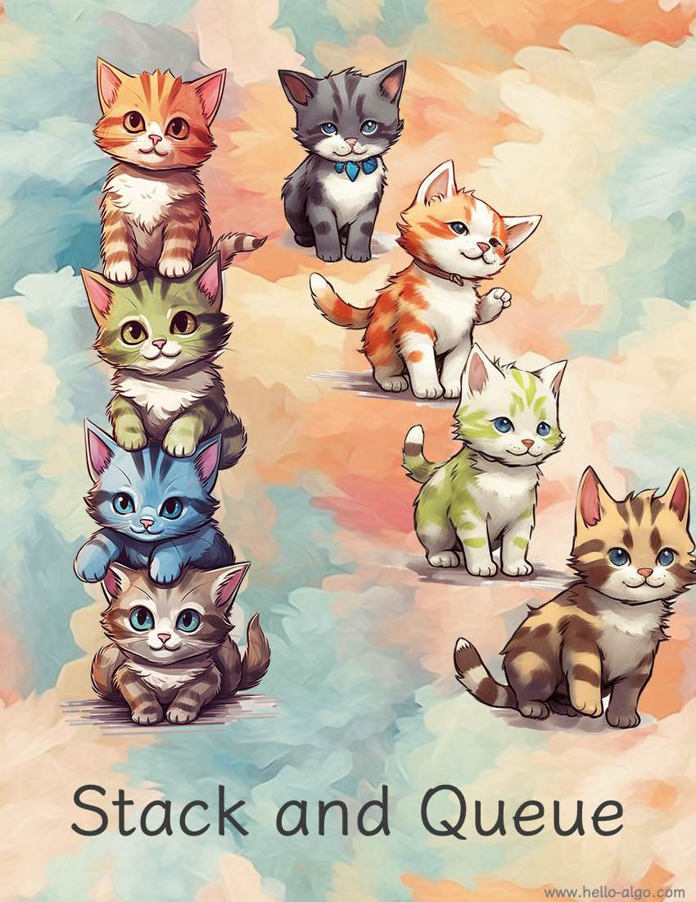

# Ngăn xếp và Hàng đợi

!!! abstract

    Ngăn xếp giống như những chú mèo xếp chồng lên nhau, còn hàng đợi giống như những chú mèo xếp thành hàng.

    Chúng lần lượt thể hiện các mối quan hệ logic LIFO (Last In, First Out) và FIFO (First In, First Out).