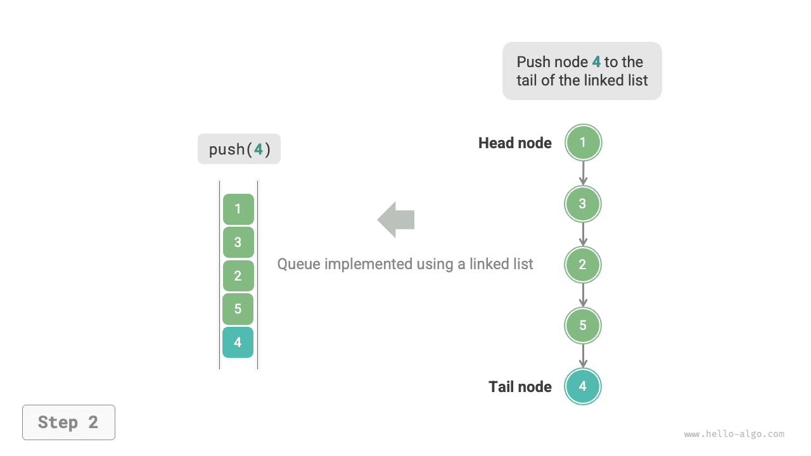

# Hàng đợi

Một <u>hàng đợi</u> là một cấu trúc dữ liệu tuyến tính tuân theo quy tắc Vào trước, Ra trước (First In, First Out - FIFO). Đúng như tên gọi, nó mô phỏng cảnh mọi người xếp hàng: người mới liên tục gia nhập phía sau hàng đợi, còn những người ở phía trước lần lượt rời đi.

Như trong hình bên dưới, chúng ta gọi phần đầu của hàng đợi là "front" và phần cuối là "rear". Thao tác thêm một phần tử vào phía sau được gọi là "enqueue", còn thao tác xóa phần tử ở phía trước được gọi là "dequeue".


## Các thao tác phổ biến trên hàng đợi

Các thao tác phổ biến trên hàng đợi được trình bày trong bảng bên dưới. Lưu ý rằng tên method có thể khác nhau giữa các ngôn ngữ lập trình. Ở đây, chúng ta sử dụng cùng quy ước đặt tên như đối với stack.

<p align="center"> Bảng <id> &nbsp; Độ phức tạp của các thao tác trên hàng đợi </p>

| Method   | Mô tả                                      | Độ phức tạp thời gian |
| -------- | ------------------------------------------ | --------------- |
| `push()` | Enqueue phần tử, thêm phần tử vào phía sau | $O(1)$          |
| `pop()`  | Dequeue phần tử ở phía trước              | $O(1)$          |
| `peek()` | Truy cập phần tử ở phía trước              | $O(1)$          |

Chúng ta có thể trực tiếp sử dụng các class hàng đợi được ngôn ngữ lập trình cung cấp:

=== "Python"

    ```python title="queue.py"
    from collections import deque

    # Khởi tạo hàng đợi
    # Trong Python, thông thường chúng ta sử dụng class deque làm hàng đợi
    # Mặc dù queue.Queue() là một class hàng đợi thuần túy, nó không thân thiện với người dùng lắm nên không được khuyến nghị
    que: deque[int] = deque()

    # Enqueue các phần tử
    que.append(1)
    que.append(3)
    que.append(2)
    que.append(5)
    que.append(4)

    # Truy cập phần tử ở phía trước
    front: int = que[0]

    # Dequeue phần tử
    pop: int = que.popleft()

    # Lấy độ dài hàng đợi
    size: int = len(que)

    # Kiểm tra xem hàng đợi có rỗng không
    is_empty: bool = len(que) == 0
    ```

=== "C++"

    ```cpp title="queue.cpp"
    /* Khởi tạo hàng đợi */
    queue<int> queue;

    /* Enqueue các phần tử */
    queue.push(1);
    queue.push(3);
    queue.push(2);
    queue.push(5);
    queue.push(4);

    /* Truy cập phần tử ở phía trước */
    int front = queue.front();

    /* Dequeue phần tử */
    queue.pop();

    /* Lấy độ dài hàng đợi */
    int size = queue.size();

    /* Kiểm tra xem hàng đợi có rỗng không */
    bool empty = queue.empty();
    ```

=== "Java"

    ```java title="queue.java"
    /* Khởi tạo hàng đợi */
    Queue<Integer> queue = new LinkedList<>();

    /* Enqueue các phần tử */
    queue.offer(1);
    queue.offer(3);
    queue.offer(2);
    queue.offer(5);
    queue.offer(4);

    /* Truy cập phần tử ở phía trước */
    int peek = queue.peek();

    /* Dequeue phần tử */
    int pop = queue.poll();

    /* Lấy độ dài hàng đợi */
    int size = queue.size();

    /* Kiểm tra xem hàng đợi có rỗng không */
    boolean isEmpty = queue.isEmpty();
    ```

=== "C#"

    ```csharp title="queue.cs"
    /* Khởi tạo hàng đợi */
    Queue<int> queue = new();

    /* Enqueue các phần tử */
    queue.Enqueue(1);
    queue.Enqueue(3);
    queue.Enqueue(2);
    queue.Enqueue(5);
    queue.Enqueue(4);

    /* Truy cập phần tử ở phía trước */
    int peek = queue.Peek();

    /* Dequeue phần tử */
    int pop = queue.Dequeue();

    /* Lấy độ dài hàng đợi */
    int size = queue.Count;

    /* Kiểm tra xem hàng đợi có rỗng không */
    bool isEmpty = queue.Count == 0;
    ```

=== "Go"

    ```go title="queue_test.go"
    /* Khởi tạo hàng đợi */
    // Trong Go, sử dụng list làm hàng đợi
    queue := list.New()

    /* Enqueue các phần tử */
    queue.PushBack(1)
    queue.PushBack(3)
    queue.PushBack(2)
    queue.PushBack(5)
    queue.PushBack(4)

    /* Truy cập phần tử ở phía trước */
    peek := queue.Front()

    /* Dequeue phần tử */
    pop := queue.Front()
    queue.Remove(pop)

    /* Lấy độ dài hàng đợi */
    size := queue.Len()

    /* Kiểm tra xem hàng đợi có rỗng không */
    isEmpty := queue.Len() == 0
    ```

=== "Swift"

    ```swift title="queue.swift"
    /* Khởi tạo hàng đợi */
    // Swift không có class hàng đợi tích hợp sẵn, có thể sử dụng Array làm hàng đợi
    var queue: [Int] = []

    /* Enqueue các phần tử */
    queue.append(1)
    queue.append(3)
    queue.append(2)
    queue.append(5)
    queue.append(4)

    /* Truy cập phần tử ở phía trước */
    let peek = queue.first!

    /* Dequeue phần tử */
    // Vì đây là một array, removeFirst có độ phức tạp O(n)
    let pop = queue.removeFirst()

    /* Lấy độ dài hàng đợi */
    let size = queue.count

    /* Kiểm tra xem hàng đợi có rỗng không */
    let isEmpty = queue.isEmpty
    ```

=== "JS"

    ```javascript title="queue.js"
    /* Khởi tạo hàng đợi */
    // JavaScript không có hàng đợi tích hợp sẵn, có thể sử dụng Array làm hàng đợi
    const queue = [];

    /* Enqueue các phần tử */
    queue.push(1);
    queue.push(3);
    queue.push(2);
    queue.push(5);
    queue.push(4);

    /* Truy cập phần tử ở phía trước */
    const peek = queue[0];

    /* Dequeue phần tử */
    // Cấu trúc bên dưới là một array, vì vậy shift() có độ phức tạp thời gian O(n)
    const pop = queue.shift();

    /* Lấy độ dài hàng đợi */
    const size = queue.length;

    /* Kiểm tra xem hàng đợi có rỗng không */
    const empty = queue.length === 0;
    ```

=== "TS"

    ```typescript title="queue.ts"
    /* Khởi tạo hàng đợi */
    // TypeScript không có hàng đợi tích hợp sẵn, có thể sử dụng Array làm hàng đợi
    const queue: number[] = [];

    /* Enqueue các phần tử */
    queue.push(1);
    queue.push(3);
    queue.push(2);
    queue.push(5);
    queue.push(4);

    /* Truy cập phần tử ở phía trước */
    const peek = queue[0];

    /* Dequeue phần tử */
    // Cấu trúc bên dưới là một array, vì vậy shift() có độ phức tạp thời gian O(n)
    const pop = queue.shift();

    /* Lấy độ dài hàng đợi */
    const size = queue.length;

    /* Kiểm tra xem hàng đợi có rỗng không */
    const empty = queue.length === 0;
    ```

=== "Dart"

    ```dart title="queue.dart"
    /* Khởi tạo hàng đợi */
    // Trong Dart, class Queue là một deque và cũng có thể được sử dụng như một hàng đợi
    Queue<int> queue = Queue();

    /* Enqueue các phần tử */
    queue.add(1);
    queue.add(3);
    queue.add(2);
    queue.add(5);
    queue.add(4);

    /* Truy cập phần tử ở phía trước */
    int peek = queue.first;

    /* Dequeue phần tử */
    int pop = queue.removeFirst();

    /* Lấy độ dài hàng đợi */
    int size = queue.length;

    /* Kiểm tra xem hàng đợi có rỗng không */
    bool isEmpty = queue.isEmpty;
    ```

=== "Rust"

    ```rust title="queue.rs"
    /* Khởi tạo deque */
    // Trong Rust, sử dụng deque như một hàng đợi thông thường
    let mut deque: VecDeque<u32> = VecDeque::new();

    /* Enqueue các phần tử */
    deque.push_back(1);
    deque.push_back(3);
    deque.push_back(2);
    deque.push_back(5);
    deque.push_back(4);

    /* Truy cập phần tử ở phía trước */
    if let Some(front) = deque.front() {
    }

    /* Dequeue phần tử */
    if let Some(pop) = deque.pop_front() {
    }

    /* Lấy độ dài hàng đợi */
    let size = deque.len();

    /* Kiểm tra xem hàng đợi có rỗng không */
    let is_empty = deque.is_empty();
    ```

=== "C"

    ```c title="queue.c"
    // C không cung cấp hàng đợi tích hợp sẵn
    ```

=== "Kotlin"

    ```kotlin title="queue.kt"
    /* Khởi tạo hàng đợi */
    val queue = LinkedList<Int>()

    /* Enqueue các phần tử */
    queue.offer(1)
    queue.offer(3)
    queue.offer(2)
    queue.offer(5)
    queue.offer(4)

    /* Truy cập phần tử ở phía trước */
    val peek = queue.peek()

    /* Dequeue phần tử */
    val pop = queue.poll()

    /* Lấy độ dài hàng đợi */
    val size = queue.size

    /* Kiểm tra xem hàng đợi có rỗng không */
    val isEmpty = queue.isEmpty()
    ```

=== "Ruby"

    ```ruby title="queue.rb"
    # Khởi tạo hàng đợi
    # Hàng đợi tích hợp sẵn của Ruby (Thread::Queue) không có các method peek và traversal, có thể sử dụng Array làm hàng đợi
    queue = []

    # Enqueue các phần tử
    queue.push(1)
    queue.push(3)
    queue.push(2)
    queue.push(5)
    queue.push(4)

    # Truy cập phần tử ở phía trước
    peek = queue.first

    # Dequeue phần tử
    # Lưu ý rằng vì đây là một array, Array#shift có độ phức tạp thời gian O(n)
    pop = queue.shift

    # Lấy độ dài hàng đợi
    size = queue.length

    # Kiểm tra xem hàng đợi có rỗng không
    is_empty = queue.empty?
    ```

??? pythontutor "Trực quan hóa mã"

    https://pythontutor.com/render.html#code=from%20collections%20import%20deque%0A%0A%22%22%22Driver%20Code%22%22%22%0Aif%20__name__%20%3D%3D%20%22__main__%22%3A%0A%20%20%20%20%23%20%E5%88%9D%E5%A7%8B%E5%8C%96%E9%98%9F%E5%88%97%0A%20%20%20%20%23%20%E5%9C%A8%20Python%20%E4%B8%AD%EF%BC%8C%E6%88%91%E4%BB%AC%E4%B8%80%E8%88%AC%E5%B0%86%E5%8F%8C%E5%90%91%E9%98%9F%E5%88%97%E7%B1%BB%20deque%20%E7%9C%8B%E4%BD%9C%E9%98%9F%E5%88%97%E4%BD%BF%E7%94%A8%0A%20%20%20%20%23%20%E8%99%BD%E7%84%B6%20queue.Queue%28%29%20%E6%98%AF%E7%BA%AF%E6%AD%A3%E7%9A%84%E9%98%9F%E5%88%97%E7%B1%BB%EF%BC%8C%E4%BD%86%E4%B8%8D%E5%A4%AA%E5%A5%BD%E7%94%A8%0A%20%20%20%20que%20%3D%20deque%28%29%0A%0A%20%20%20%20%23%20%E5%85%83%E7%B4%A0%E5%85%A5%E9%98%9F%0A%20%20%20%20que.append%281%29%0A%20%20%20%20que.append%283%29%0A%20%20%20%20que.append%282%29%0A%20%20%20%20que.append%285%29%0A%20%20%20%20que.append%284%29%0A%20%20%20%20print%28%22%E9%98%9F%E5%88%97%20que%20%3D%22,%20que%29%0A%0A%20%20%20%20%23%20%E8%AE%BF%E9%97%AE%E9%98%9F%E9%A6%96%E5%85%83%E7%B4%A0%0A%20%20%20%20front%20%3D%20que%5B0%5D%0A%20%20%20%20print%28%22%E9%98%9F%E9%A6%96%E5%85%83%E7%B4%A0%20front%20%3D%22,%20front%29%0A%0A%20%20%20%20%23%20%E5%85%83%E7%B4%A0%E5%87%BA%E9%98%9F%0A%20%20%20%20pop%20%3D%20que.popleft%28%29%0A%20%20%20%20print%28%22%E5%87%BA%E9%98%9F%E5%85%83%E7%B4%A0%20pop%20%3D%22,%20pop%29%0A%20%20%20%20print%28%22%E5%87%BA%E9%98%9F%E5%90%8E%20que%20%3D%22,%20que%29%0A%0A%20%20%20%20%23%20%E8%8E%B7%E5%8F%96%E9%98%9F%E5%88%97%E7%9A%84%E9%95%BF%E5%BA%A6%0A%20%20%20%20size%20%3D%20len%28que%29%0A%20%20%20%20print%28%22%E9%98%9F%E5%88%97%E9%95%BF%E5%BA%A6%20size%20%3D%22,%20size%29%0A%0A%20%20%20%20%23%20%E5%88%A4%E6%96%AD%E9%98%9F%E5%88%97%E6%98%AF%E5%90%A6%E4%B8%BA%E7%A9%BA%0A%20%20%20%20is_empty%20%3D%20len%28que%29%20%3D%3D%200%0A%20%20%20%20print%28%22%E9%98%9F%E5%88%97%E6%98%AF%E5%90%A6%E4%B8%BA%E7%A9%BA%20%3D%22,%20is_empty%29&cumulative=false&curInstr=3&heapPrimitives=nevernest&mode=display&origin=opt-frontend.js&py=311&rawInputLstJSON=%5B%5D&textReferences=false

## Triển khai hàng đợi

Để triển khai một hàng đợi, chúng ta cần một cấu trúc dữ liệu cho phép thêm phần tử ở một đầu và xóa phần tử ở đầu còn lại. Cả linked list và array đều đáp ứng yêu cầu này.

### Triển khai bằng linked list

Như trong hình bên dưới, chúng ta có thể xem "head node" và "tail node" của một linked list lần lượt là "front" và "rear" của hàng đợi, với quy tắc các node chỉ có thể được thêm vào phía sau và xóa khỏi phía trước.

=== "<1>"
    

=== "<2>"
    

=== "<3>"
    

Dưới đây là mã triển khai hàng đợi bằng linked list:

```src
[file]{linkedlist_queue}-[class]{linked_list_queue}-[func]{}
```

### Triển khai bằng array

Việc xóa phần tử đầu tiên trong một mảng có độ phức tạp thời gian là $O(n)$, khiến thao tác dequeue trở nên kém hiệu quả. Tuy nhiên, chúng ta có thể sử dụng phương pháp khéo léo sau đây để tránh vấn đề này.

Chúng ta có thể sử dụng một biến `front` để trỏ đến chỉ mục của phần tử đầu hàng đợi và duy trì một biến `size` để ghi lại độ dài hàng đợi. Chúng ta định nghĩa `rear = front + size`, biến này tính vị trí ngay sau phần tử cuối hàng đợi.

Dựa trên thiết kế này, **khoảng hợp lệ chứa các phần tử trong mảng là `[front, rear - 1]`**. Các phương thức triển khai cho những thao tác khác nhau được minh họa trong hình bên dưới:

- Thao tác enqueue: Gán phần tử đầu vào cho chỉ mục `rear` và tăng `size` thêm 1.
- Thao tác dequeue: Chỉ cần tăng `front` thêm 1 và giảm `size` đi 1.

Như bạn có thể thấy, cả thao tác enqueue và dequeue chỉ yêu cầu một thao tác, với độ phức tạp thời gian là $O(1)$.

=== "<1>"
    

=== "<2>"
    

=== "<3>"
    

Bạn có thể nhận thấy một vấn đề: khi liên tục thực hiện enqueue và dequeue, cả `front` và `rear` đều di chuyển về bên phải. **Khi chạm đến cuối mảng, chúng không thể tiếp tục di chuyển**. Để giải quyết vấn đề này, chúng ta có thể xem mảng như một "mảng vòng" với phần đầu và phần cuối được nối với nhau.

Đối với một mảng vòng, chúng ta cần cho `front` hoặc `rear` quay lại đầu mảng khi chúng vượt qua cuối mảng. Mẫu tuần hoàn này có thể được triển khai bằng "phép modulo", như trong đoạn mã bên dưới:

```src
[file]{array_queue}-[class]{array_queue}-[func]{}
```

Hàng đợi được triển khai ở trên vẫn có một hạn chế: độ dài của nó là bất biến. Tuy nhiên, vấn đề này không khó giải quyết. Chúng ta có thể thay mảng bằng một mảng động để đưa vào cơ chế mở rộng. Bạn đọc quan tâm có thể tự thử triển khai cơ chế này.

Các kết luận so sánh giữa hai cách triển khai phù hợp với các kết luận đối với stack và sẽ không được nhắc lại ở đây.

## Ứng dụng điển hình của Queue

- **Đơn hàng Taobao**. Sau khi người mua đặt hàng, các đơn hàng được thêm vào một queue, rồi hệ thống xử lý các đơn hàng trong queue theo thứ tự của chúng. Trong dịp Double Eleven, một lượng lớn đơn hàng được tạo ra trong thời gian ngắn, và concurrency cao trở thành một thách thức quan trọng mà các kỹ sư cần giải quyết.
- **Các tác vụ cần làm khác nhau**. Bất kỳ tình huống nào cần triển khai chức năng "đến trước, phục vụ trước", chẳng hạn như hàng đợi tác vụ của máy in hoặc hàng đợi đơn hàng của nhà hàng, đều có thể sử dụng queue để duy trì hiệu quả thứ tự xử lý.