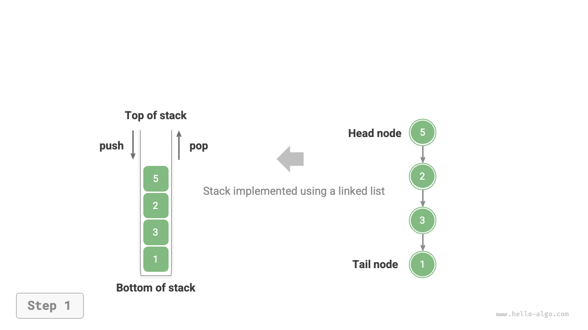
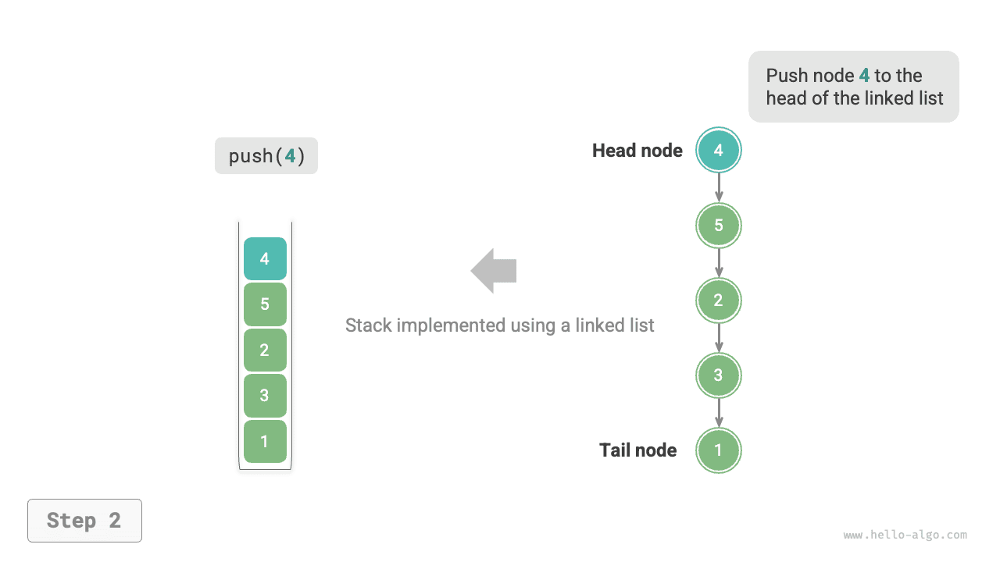

# Ngăn xếp

Một <u>ngăn xếp</u> là một cấu trúc dữ liệu tuyến tính tuân theo nguyên tắc Vào Sau, Ra Trước (Last In, First Out - LIFO).

Chúng ta có thể ví ngăn xếp như một chồng đĩa trên bàn. Nếu quy định rằng mỗi lần chỉ được di chuyển một chiếc đĩa, thì để lấy chiếc đĩa ở dưới cùng, trước tiên chúng ta phải lần lượt lấy từng chiếc đĩa bên trên ra. Nếu thay những chiếc đĩa bằng nhiều loại phần tử khác nhau (chẳng hạn như số nguyên, ký tự, đối tượng, v.v.), chúng ta sẽ có cấu trúc dữ liệu ngăn xếp.

Như minh họa trong hình bên dưới, chúng ta gọi phần trên cùng của các phần tử được xếp chồng là "top" và phần dưới cùng là "bottom". Thao tác thêm một phần tử vào trên cùng được gọi là "push", còn thao tác xóa phần tử trên cùng được gọi là "pop".


## Các thao tác phổ biến trên ngăn xếp

Các thao tác phổ biến trên ngăn xếp được trình bày trong bảng bên dưới. Tên phương thức cụ thể phụ thuộc vào ngôn ngữ lập trình được sử dụng. Ở đây, chúng ta sử dụng quy ước đặt tên phổ biến là `push()`, `pop()` và `peek()`.

<p align="center"> Bảng <id> &nbsp; Độ phức tạp của các thao tác trên ngăn xếp </p>

| Phương thức   | Mô tả                                    | Độ phức tạp thời gian |
| -------- | ---------------------------------------------- | --------------- |
| `push()` | Đẩy phần tử vào ngăn xếp (thêm vào trên cùng)          | $O(1)$          |
| `pop()`  | Lấy phần tử trên cùng ra khỏi ngăn xếp                     | $O(1)$          |
| `peek()` | Truy cập phần tử trên cùng                             | $O(1)$          |

Thông thường, chúng ta có thể sử dụng trực tiếp stack class tích hợp sẵn do ngôn ngữ lập trình cung cấp. Tuy nhiên, một số ngôn ngữ có thể không cung cấp stack class chuyên dụng. Trong những trường hợp đó, chúng ta có thể sử dụng "array" hoặc "linked list" của ngôn ngữ làm ngăn xếp và chỉ cần tránh sử dụng các thao tác không liên quan đến hành vi của ngăn xếp.

=== "Python"

    ```python title="stack.py"
    # Khởi tạo ngăn xếp
    # Python không có stack class tích hợp sẵn, có thể sử dụng list làm ngăn xếp
    stack: list[int] = []

    # Đẩy các phần tử
    stack.append(1)
    stack.append(3)
    stack.append(2)
    stack.append(5)
    stack.append(4)

    # Truy cập phần tử trên cùng
    peek: int = stack[-1]

    # Lấy phần tử ra
    pop: int = stack.pop()

    # Lấy độ dài ngăn xếp
    size: int = len(stack)

    # Kiểm tra xem có rỗng không
    is_empty: bool = len(stack) == 0
    ```

=== "C++"

    ```cpp title="stack.cpp"
    /* Khởi tạo ngăn xếp */
    stack<int> stack;

    /* Đẩy các phần tử */
    stack.push(1);
    stack.push(3);
    stack.push(2);
    stack.push(5);
    stack.push(4);

    /* Truy cập phần tử trên cùng */
    int top = stack.top();

    /* Lấy phần tử ra */
    stack.pop(); // Không có giá trị trả về

    /* Lấy độ dài ngăn xếp */
    int size = stack.size();

    /* Kiểm tra xem có rỗng không */
    bool empty = stack.empty();
    ```

=== "Java"

    ```java title="stack.java"
    /* Khởi tạo ngăn xếp */
    Stack<Integer> stack = new Stack<>();

    /* Đẩy các phần tử */
    stack.push(1);
    stack.push(3);
    stack.push(2);
    stack.push(5);
    stack.push(4);

    /* Truy cập phần tử trên cùng */
    int peek = stack.peek();

    /* Lấy phần tử ra */
    int pop = stack.pop();

    /* Lấy độ dài ngăn xếp */
    int size = stack.size();

    /* Kiểm tra xem có rỗng không */
    boolean isEmpty = stack.isEmpty();
    ```

=== "C#"

    ```csharp title="stack.cs"
    /* Khởi tạo ngăn xếp */
    Stack<int> stack = new();

    /* Đẩy các phần tử */
    stack.Push(1);
    stack.Push(3);
    stack.Push(2);
    stack.Push(5);
    stack.Push(4);

    /* Truy cập phần tử trên cùng */
    int peek = stack.Peek();

    /* Lấy phần tử ra */
    int pop = stack.Pop();

    /* Lấy độ dài ngăn xếp */
    int size = stack.Count;

    /* Kiểm tra xem có rỗng không */
    bool isEmpty = stack.Count == 0;
    ```

=== "Go"

    ```go title="stack_test.go"
    /* Khởi tạo ngăn xếp */
    // Trong Go, nên sử dụng Slice làm ngăn xếp
    var stack []int

    /* Đẩy các phần tử */
    stack = append(stack, 1)
    stack = append(stack, 3)
    stack = append(stack, 2)
    stack = append(stack, 5)
    stack = append(stack, 4)

    /* Truy cập phần tử trên cùng */
    peek := stack[len(stack)-1]

    /* Lấy phần tử ra */
    pop := stack[len(stack)-1]
    stack = stack[:len(stack)-1]

    /* Lấy độ dài ngăn xếp */
    size := len(stack)

    /* Kiểm tra xem có rỗng không */
    isEmpty := len(stack) == 0
    ```

=== "Swift"

    ```swift title="stack.swift"
    /* Khởi tạo ngăn xếp */
    // Swift không có stack class tích hợp sẵn, có thể sử dụng Array làm ngăn xếp
    var stack: [Int] = []

    /* Đẩy các phần tử */
    stack.append(1)
    stack.append(3)
    stack.append(2)
    stack.append(5)
    stack.append(4)

    /* Truy cập phần tử trên cùng */
    let peek = stack.last!

    /* Lấy phần tử ra */
    let pop = stack.removeLast()

    /* Lấy độ dài ngăn xếp */
    let size = stack.count

    /* Kiểm tra xem có rỗng không */
    let isEmpty = stack.isEmpty
    ```

=== "JS"

    ```javascript title="stack.js"
    /* Khởi tạo ngăn xếp */
    // JavaScript không có stack class tích hợp sẵn, có thể sử dụng Array làm ngăn xếp
    const stack = [];

    /* Đẩy các phần tử */
    stack.push(1);
    stack.push(3);
    stack.push(2);
    stack.push(5);
    stack.push(4);

    /* Truy cập phần tử trên cùng */
    const peek = stack[stack.length-1];

    /* Lấy phần tử ra */
    const pop = stack.pop();

    /* Lấy độ dài ngăn xếp */
    const size = stack.length;

    /* Kiểm tra xem có rỗng không */
    const is_empty = stack.length === 0;
    ```

=== "TS"

    ```typescript title="stack.ts"
    /* Khởi tạo ngăn xếp */
    // TypeScript không có stack class tích hợp sẵn, có thể sử dụng Array làm ngăn xếp
    const stack: number[] = [];

    /* Đẩy các phần tử */
    stack.push(1);
    stack.push(3);
    stack.push(2);
    stack.push(5);
    stack.push(4);

    /* Truy cập phần tử trên cùng */
    const peek = stack[stack.length - 1];

    /* Lấy phần tử ra */
    const pop = stack.pop();

    /* Lấy độ dài ngăn xếp */
    const size = stack.length;

    /* Kiểm tra xem có rỗng không */
    const is_empty = stack.length === 0;
    ```

=== "Dart"

    ```dart title="stack.dart"
    /* Khởi tạo ngăn xếp */
    // Dart không có stack class tích hợp sẵn, có thể sử dụng List làm ngăn xếp
    List<int> stack = [];

    /* Đẩy các phần tử */
    stack.add(1);
    stack.add(3);
    stack.add(2);
    stack.add(5);
    stack.add(4);

    /* Truy cập phần tử trên cùng */
    int peek = stack.last;

    /* Lấy phần tử ra */
    int pop = stack.removeLast();

    /* Lấy độ dài ngăn xếp */
    int size = stack.length;

    /* Kiểm tra xem có rỗng không */
    bool isEmpty = stack.isEmpty;
    ```

=== "Rust"

    ```rust title="stack.rs"
    /* Khởi tạo ngăn xếp */
    // Sử dụng Vec làm ngăn xếp
    let mut stack: Vec<i32> = Vec::new();

    /* Đẩy các phần tử */
    stack.push(1);
    stack.push(3);
    stack.push(2);
    stack.push(5);
    stack.push(4);

    /* Truy cập phần tử trên cùng */
    let top = stack.last().unwrap();

    /* Lấy phần tử ra */
    let pop = stack.pop().unwrap();

    /* Lấy độ dài ngăn xếp */
    let size = stack.len();

    /* Kiểm tra xem có rỗng không */
    let is_empty = stack.is_empty();
    ```

=== "C"

    ```c title="stack.c"
    // C không cung cấp stack tích hợp sẵn
    ```

=== "Kotlin"

    ```kotlin title="stack.kt"
    /* Khởi tạo ngăn xếp */
    val stack = Stack<Int>()

    /* Đẩy các phần tử */
    stack.push(1)
    stack.push(3)
    stack.push(2)
    stack.push(5)
    stack.push(4)

    /* Truy cập phần tử trên cùng */
    val peek = stack.peek()

    /* Lấy phần tử ra */
    val pop = stack.pop()

    /* Lấy độ dài ngăn xếp */
    val size = stack.size

    /* Kiểm tra xem có rỗng không */
    val isEmpty = stack.isEmpty()
    ```

=== "Ruby"

    ```ruby title="stack.rb"
    # Khởi tạo ngăn xếp
    # Ruby không có stack class tích hợp sẵn, có thể sử dụng Array làm ngăn xếp
    stack = []

    # Đẩy các phần tử
    stack << 1
    stack << 3
    stack << 2
    stack << 5
    stack << 4

    # Truy cập phần tử trên cùng
    peek = stack.last

    # Lấy phần tử ra
    pop = stack.pop

    # Lấy độ dài ngăn xếp
    size = stack.length

    # Kiểm tra xem có rỗng không
    is_empty = stack.empty?
    ```

??? pythontutor "Trực quan hóa mã"

    https://pythontutor.com/render.html#code=%22%22%22Driver%20Code%22%22%22%0Aif%20__name__%20%3D%3D%20%22__main__%22%3A%0A%20%20%20%20%23%20%E5%88%9D%E5%A7%8B%E5%8C%96%E6%A0%88%0A%20%20%20%20%23%20Python%20%E6%B2%A1%E6%9C%89%E5%86%85%E7%BD%AE%E7%9A%84%E6%A0%88%E7%B1%BB%EF%BC%8C%E5%8F%AF%E4%BB%A5%E6%8A%8A%20list%20%E5%BD%93%E4%BD%9C%E6%A0%88%E6%9D%A5%E4%BD%BF%E7%94%A8%0A%20%20%20%20stack%20%3D%20%5B%5D%0A%0A%20%20%20%20%23%20%E5%85%83%E7%B4%A0%E5%85%A5%E6%A0%88%0A%20%20%20%20stack.append%281%29%0A%20%20%20%20stack.append%283%29%0A%20%20%20%20stack.append%282%29%0A%20%20%20%20stack.append%285%29%0A%20%20%20%20stack.append%284%29%0A%20%20%20%20print%28%22%E6%A0%88%20stack%20%3D%22,%20stack%29%0A%0A%20%20%20%20%23%20%E8%AE%BF%E9%97%AE%E6%A0%88%E9%A1%B6%E5%85%83%E7%B4%A0%0A%20%20%20%20peek%20%3D%20stack%5B-1%5D%0A%20%20%20%20print%28%22%E6%A0%88%E9%A1%B6%E5%85%83%E7%B4%A0%20peek%20%3D%22,%20peek%29%0A%0A%20%20%20%20%23%20%E5%85%83%E7%B4%A0%E5%87%BA%E6%A0%88%0A%20%20%20%20pop%20%3D%20stack.pop%28%29%0A%20%20%20%20print%28%22%E5%87%BA%E6%A0%88%E5%85%83%E7%B4%A0%20pop%20%3D%22,%20pop%29%0A%20%20%20%20print%28%22%E5%87%BA%E6%A0%88%E5%90%8E%20stack%20%3D%22,%20stack%29%0A%0A%20%20%20%20%23%20%E8%8E%B7%E5%8F%96%E6%A0%88%E7%9A%84%E9%95%BF%E5%BA%A6%0A%20%20%20%20size%20%3D%20len%28stack%29%0A%20%20%20%20print%28%22%E6%A0%88%E7%9A%84%E9%95%BF%E5%BA%A6%20size%20%3D%22,%20size%29%0A%0A%20%20%20%20%23%20%E5%88%A4%E6%96%AD%E6%98%AF%E5%90%A6%E4%B8%BA%E7%A9%BA%0A%20%20%20%20is_empty%20%3D%20len%28stack%29%20%3D%3D%200%0A%20%20%20%20print%28%22%E6%A0%88%E6%98%AF%E5%90%A6%E4%B8%BA%E7%A9%BA%20%3D%22,%20is_empty%29&cumulative=false&curInstr=2&heapPrimitives=nevernest&mode=display&origin=opt-frontend.js&py=311&rawInputLstJSON=%5B%5D&textReferences=false

## Cài đặt ngăn xếp

Để hiểu sâu hơn về cách một ngăn xếp hoạt động, hãy thử tự cài đặt một stack class.

Ngăn xếp tuân theo nguyên tắc LIFO, vì vậy chúng ta chỉ có thể thêm hoặc xóa phần tử ở trên cùng. Tuy nhiên, cả array và linked list đều cho phép thêm và xóa phần tử ở bất kỳ vị trí nào. **Do đó, có thể xem ngăn xếp là một array hoặc linked list bị giới hạn**. Nói cách khác, chúng ta có thể "che giấu" một số thao tác không liên quan của array hoặc linked list để logic bên ngoài của chúng phù hợp với các đặc điểm của ngăn xếp.

### Cài đặt bằng linked list

Khi cài đặt ngăn xếp bằng linked list, chúng ta có thể xem node đầu của linked list là phần trên cùng của ngăn xếp và node cuối là đáy.

Như minh họa trong hình bên dưới, đối với thao tác push, chúng ta chỉ cần chèn một phần tử vào đầu linked list. Phương pháp chèn node này được gọi là "head insertion method". Đối với thao tác pop, chúng ta chỉ cần xóa node đầu khỏi linked list.

=== "<1>"
    

=== "<2>"
    

=== "<3>"
    

Dưới đây là mã mẫu để triển khai stack dựa trên linked list:

```src
[file]{linkedlist_stack}-[class]{linked_list_stack}-[func]{}
```

### Triển khai bằng mảng

Khi triển khai stack bằng mảng, chúng ta có thể coi phần cuối của mảng là đỉnh của stack. Như trong hình minh họa bên dưới, các thao tác push và pop tương ứng với việc thêm và xóa phần tử ở cuối mảng, cả hai đều có độ phức tạp thời gian là $O(1)$.

=== "<1>"
    

=== "<2>"
    

=== "<3>"
    

Vì các phần tử được push vào stack có thể liên tục tăng lên, chúng ta có thể sử dụng mảng động, nhờ đó không cần tự xử lý việc mở rộng mảng. Dưới đây là mã mẫu:

```src
[file]{array_stack}-[class]{array_stack}-[func]{}
```

## So sánh hai cách triển khai

**Các thao tác được hỗ trợ**

Cả hai cách triển khai đều hỗ trợ tất cả các thao tác được định nghĩa cho stack. Cách triển khai bằng mảng còn hỗ trợ truy cập ngẫu nhiên, nhưng điều này nằm ngoài định nghĩa của stack và thường không được sử dụng.

**Hiệu quả về thời gian**

Trong cách triển khai dựa trên mảng, cả thao tác push và pop đều diễn ra trên vùng nhớ liên tục được cấp phát trước, có tính cục bộ bộ nhớ đệm tốt nên hiệu quả hơn. Tuy nhiên, nếu thao tác push vượt quá sức chứa của mảng, nó sẽ kích hoạt cơ chế mở rộng, khiến độ phức tạp thời gian của riêng thao tác push đó tăng lên $O(n)$.

Trong cách triển khai dựa trên linked list, việc mở rộng danh sách rất linh hoạt và không xảy ra vấn đề giảm hiệu quả do mở rộng mảng. Tuy nhiên, thao tác push yêu cầu khởi tạo một đối tượng node và thay đổi các con trỏ, nên tương đối kém hiệu quả hơn. Dù vậy, nếu các phần tử được push vào vốn đã là các đối tượng node, có thể bỏ qua bước khởi tạo, từ đó cải thiện hiệu quả.

Tóm lại, khi các phần tử được push và pop là những kiểu dữ liệu cơ bản như `int` hoặc `double`, chúng ta có thể rút ra các kết luận sau:

- Cách triển khai stack bằng mảng có hiệu quả giảm khi kích hoạt mở rộng, nhưng vì mở rộng là thao tác không thường xuyên nên hiệu quả trung bình cao hơn.
- Cách triển khai stack bằng linked list có thể mang lại hiệu suất ổn định hơn.

**Hiệu quả về không gian**

Khi khởi tạo một danh sách, hệ thống sẽ cấp phát một “sức chứa ban đầu” có thể vượt quá nhu cầu thực tế. Ngoài ra, cơ chế mở rộng thường mở rộng theo một tỷ lệ cụ thể (ví dụ: 2x), và sức chứa sau khi mở rộng cũng có thể vượt quá nhu cầu thực tế. Vì vậy, **cách triển khai stack bằng mảng có thể gây lãng phí một phần không gian**.

Tuy nhiên, vì các node của linked list cần lưu trữ thêm các con trỏ, **không gian mà các node của linked list chiếm dụng tương đối lớn**.

Tóm lại, chúng ta không thể đơn giản xác định cách triển khai nào tiết kiệm bộ nhớ hơn mà cần phân tích tình huống cụ thể.

## Các ứng dụng điển hình của stack

- **Quay lại và tiến tới trong trình duyệt, hoàn tác và làm lại trong phần mềm**. Mỗi khi mở một trang web mới, trình duyệt sẽ push trang trước đó vào stack, cho phép chúng ta quay lại trang trước thông qua thao tác back. Về bản chất, thao tác back là thực hiện một thao tác pop. Để hỗ trợ cả back và forward, cần sử dụng hai stack phối hợp với nhau.
- **Quản lý bộ nhớ của chương trình**. Mỗi khi một hàm được gọi, hệ thống sẽ thêm một stack frame vào đỉnh của stack để ghi lại thông tin ngữ cảnh của hàm. Trong quá trình đệ quy, giai đoạn đệ quy đi xuống liên tục thực hiện các thao tác push, còn giai đoạn quay lui đi lên liên tục thực hiện các thao tác pop.