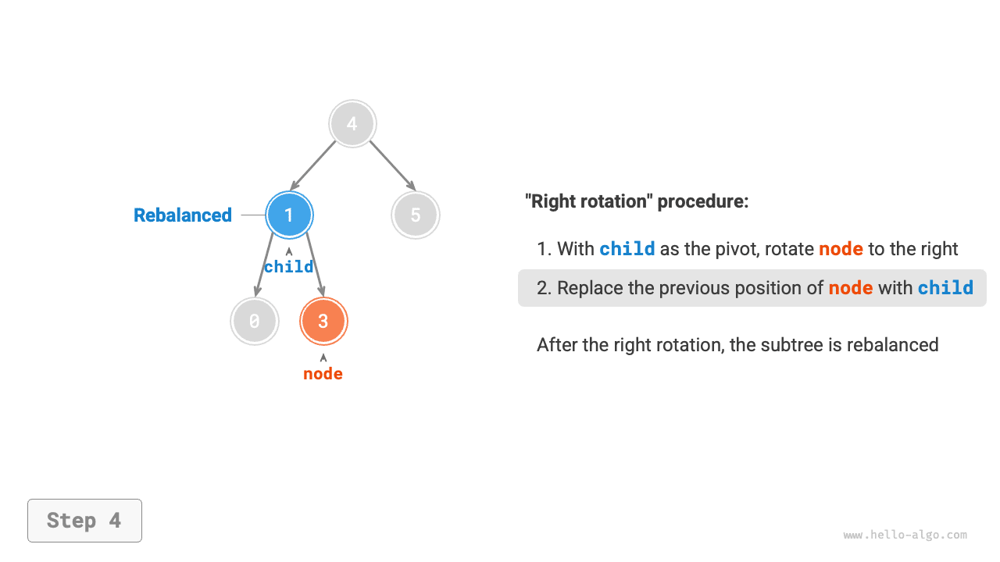
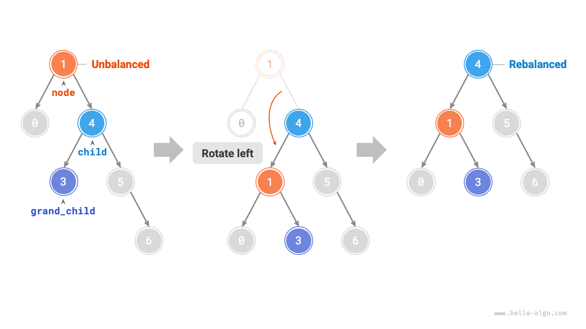

# Cây AVL *

Trong phần "Cây tìm kiếm nhị phân", chúng ta đã đề cập rằng sau nhiều thao tác chèn và xóa, một cây tìm kiếm nhị phân có thể suy biến thành một danh sách liên kết. Trong trường hợp này, độ phức tạp thời gian của mọi thao tác sẽ giảm từ $O(\log n)$ xuống $O(n)$.

Như trong hình dưới đây, sau hai thao tác xóa nút, cây tìm kiếm nhị phân này sẽ suy biến thành một danh sách liên kết.


Ví dụ, trong cây nhị phân hoàn chỉnh được minh họa ở hình dưới đây, sau khi chèn hai nút, cây sẽ nghiêng mạnh sang trái và độ phức tạp thời gian của các thao tác tìm kiếm cũng sẽ suy giảm.


Năm 1962, G. M. Adelson-Velsky và E. M. Landis đã đề xuất <u>cây AVL</u> trong bài báo "An algorithm for the organization of information". Bài báo mô tả một loạt thao tác giúp cây AVL không bị suy biến khi các nút được chèn và xóa, nhờ đó duy trì độ phức tạp thời gian của nhiều thao tác ở mức $O(\log n)$. Nói cách khác, trong các tình huống yêu cầu thực hiện thường xuyên các thao tác chèn, xóa, tra cứu và cập nhật, cây AVL có thể duy trì hiệu suất ổn định và hiệu quả, do đó có giá trị thực tiễn cao.

## Thuật ngữ thường dùng trong cây AVL

Cây AVL vừa là cây tìm kiếm nhị phân vừa là cây nhị phân cân bằng, đồng thời thỏa mãn tất cả các tính chất của hai loại cây nhị phân này, vì vậy nó là một <u>cây tìm kiếm nhị phân cân bằng</u>.

### Chiều cao của nút

Vì các thao tác liên quan đến cây AVL cần lấy chiều cao của nút, chúng ta cần thêm một `height` biến vào lớp nút:

=== "Python"

    ```python title=""
    class TreeNode:
        """Nút cây AVL"""
        def __init__(self, val: int):
            self.val: int = val                 # Giá trị nút
            self.height: int = 0                # Chiều cao nút
            self.left: TreeNode | None = None   # Tham chiếu đến nút con trái
            self.right: TreeNode | None = None  # Tham chiếu đến nút con phải
    ```

=== "C++"

    ```cpp title=""
    /* Nút cây AVL */
    struct TreeNode {
        int val{};          // Giá trị nút
        int height = 0;     // Chiều cao nút
        TreeNode *left{};   // Nút con trái
        TreeNode *right{};  // Nút con phải
        TreeNode() = default;
        explicit TreeNode(int x) : val(x){}
    };
    ```

=== "Java"

    ```java title=""
    /* Nút cây AVL */
    class TreeNode {
        public int val;        // Giá trị nút
        public int height;     // Chiều cao nút
        public TreeNode left;  // Nút con trái
        public TreeNode right; // Nút con phải
        public TreeNode(int x) { val = x; }
    }
    ```

=== "C#"

    ```csharp title=""
    /* Nút cây AVL */
    class TreeNode(int? x) {
        public int? val = x;    // Giá trị nút
        public int height;      // Chiều cao nút
        public TreeNode? left;  // Tham chiếu đến nút con trái
        public TreeNode? right; // Tham chiếu đến nút con phải
    }
    ```

=== "Go"

    ```go title=""
    /* Nút cây AVL */
    type TreeNode struct {
        Val    int       // Giá trị nút
        Height int       // Chiều cao nút
        Left   *TreeNode // Tham chiếu đến nút con trái
        Right  *TreeNode // Tham chiếu đến nút con phải
    }
    ```

=== "Swift"

    ```swift title=""
    /* Nút cây AVL */
    class TreeNode {
        var val: Int // Giá trị nút
        var height: Int // Chiều cao nút
        var left: TreeNode? // Nút con trái
        var right: TreeNode? // Nút con phải

        init(x: Int) {
            val = x
            height = 0
        }
    }
    ```

=== "JS"

    ```javascript title=""
    /* Nút cây AVL */
    class TreeNode {
        val; // Giá trị nút
        height; // Chiều cao nút
        left; // Con trỏ đến nút con trái
        right; // Con trỏ đến nút con phải
        constructor(val, left, right, height) {
            this.val = val === undefined ? 0 : val;
            this.height = height === undefined ? 0 : height;
            this.left = left === undefined ? null : left;
            this.right = right === undefined ? null : right;
        }
    }
    ```

=== "TS"

    ```typescript title=""
    /* Nút cây AVL */
    class TreeNode {
        val: number;            // Giá trị nút
        height: number;         // Chiều cao nút
        left: TreeNode | null;  // Con trỏ đến nút con trái
        right: TreeNode | null; // Con trỏ đến nút con phải
        constructor(val?: number, height?: number, left?: TreeNode | null, right?: TreeNode | null) {
            this.val = val === undefined ? 0 : val;
            this.height = height === undefined ? 0 : height; 
            this.left = left === undefined ? null : left; 
            this.right = right === undefined ? null : right; 
        }
    }
    ```

=== "Dart"

    ```dart title=""
    /* Nút cây AVL */
    class TreeNode {
      int val;         // Giá trị nút
      int height;      // Chiều cao nút
      TreeNode? left;  // Nút con trái
      TreeNode? right; // Nút con phải
      TreeNode(this.val, [this.height = 0, this.left, this.right]);
    }
    ```

=== "Rust"

    ```rust title=""
    use std::rc::Rc;
    use std::cell::RefCell;

    /* Nút cây AVL */
    struct TreeNode {
        val: i32,                               // Giá trị nút
        height: i32,                            // Chiều cao nút
        left: Option<Rc<RefCell<TreeNode>>>,    // Nút con trái
        right: Option<Rc<RefCell<TreeNode>>>,   // Nút con phải
    }

    impl TreeNode {
        /* Hàm khởi tạo */
        fn new(val: i32) -> Rc<RefCell<Self>> {
            Rc::new(RefCell::new(Self {
                val,
                height: 0,
                left: None,
                right: None
            }))
        }
    }
    ```

=== "C"

    ```c title=""
    /* Nút cây AVL */
    typedef struct TreeNode {
        int val;
        int height;
        struct TreeNode *left;
        struct TreeNode *right;
    } TreeNode;

    /* Hàm khởi tạo */
    TreeNode *newTreeNode(int val) {
        TreeNode *node;

        node = (TreeNode *)malloc(sizeof(TreeNode));
        node->val = val;
        node->height = 0;
        node->left = NULL;
        node->right = NULL;
        return node;
    }
    ```

=== "Kotlin"

    ```kotlin title=""
    /* Nút cây AVL */
    class TreeNode(val _val: Int) {  // Giá trị nút
        var height: Int = 0          // Chiều cao nút
        var left: TreeNode? = null   // Nút con trái
        var right: TreeNode? = null  // Nút con phải
    }
    ```

=== "Ruby"

    ```ruby title=""
    ### Lớp nút cây AVL ###
    class TreeNode
      attr_accessor :val    # Giá trị nút
      attr_accessor :height # Chiều cao nút
      attr_accessor :left   # Tham chiếu đến nút con trái
      attr_accessor :right  # Tham chiếu đến nút con phải

      def initialize(val)
        @val = val
        @height = 0
      end
    end
    ```

"Chiều cao của nút" là khoảng cách từ nút đó đến nút lá xa nhất của nó, tức là số cạnh trên đường đi. Cần lưu ý rằng chiều cao của một nút lá là $0$, còn chiều cao của một nút null là $-1$. Chúng ta sẽ tạo hai hàm tiện ích để lấy và cập nhật chiều cao của một nút:

```src
[file]{avl_tree}-[class]{avl_tree}-[func]{update_height}
```

### Hệ số cân bằng của nút

<u>Hệ số cân bằng</u> của một nút được định nghĩa là chiều cao của cây con trái của nút đó trừ đi chiều cao của cây con phải, và hệ số cân bằng của một nút null được định nghĩa là $0$. Chúng ta cũng đóng gói hàm lấy hệ số cân bằng của nút để thuận tiện sử dụng về sau:

```src
[file]{avl_tree}-[class]{avl_tree}-[func]{balance_factor}
```

!!! tip

    Gọi hệ số cân bằng là $f$, khi đó hệ số cân bằng của mọi nút trong cây AVL thỏa mãn $-1 \le f \le 1$.

## Các phép xoay trong cây AVL

Đặc điểm của cây AVL nằm ở thao tác "xoay", có thể khôi phục sự cân bằng cho các nút mất cân bằng mà không ảnh hưởng đến thứ tự duyệt inorder của cây nhị phân. Nói cách khác, **các thao tác xoay vừa có thể duy trì tính chất của một "cây tìm kiếm nhị phân", vừa đưa cây trở lại thành một "cây nhị phân cân bằng"**.

Chúng ta gọi các nút có giá trị tuyệt đối của hệ số cân bằng $> 1$ là "nút mất cân bằng". Tùy theo tình trạng mất cân bằng, các thao tác xoay được chia thành bốn loại: xoay phải, xoay trái, xoay phải rồi xoay trái và xoay trái rồi xoay phải. Dưới đây, chúng ta sẽ mô tả chi tiết các thao tác xoay này.

### Xoay phải

Như trong hình dưới đây, giá trị bên dưới nút là hệ số cân bằng. Từ dưới lên trên, nút mất cân bằng đầu tiên trong cây nhị phân là "nút 3". Chúng ta tập trung vào cây con có nút mất cân bằng này làm gốc, ký hiệu nút đó là `node` và nút con trái của nó là `child`, rồi thực hiện thao tác "xoay phải". Sau khi hoàn tất phép xoay phải, cây con lấy lại được sự cân bằng và vẫn duy trì các tính chất của cây tìm kiếm nhị phân.

=== "<1>"
    

=== "<2>"
    

=== "<3>"
    

=== "<4>"
    

Như trong hình dưới đây, khi node `child` có một node con bên phải (được ký hiệu là `grand_child`), cần thêm một bước vào phép xoay phải: đặt `grand_child` làm node con bên trái của `node`.


“Xoay phải” là một cách gọi mang tính hình tượng; trên thực tế, thao tác này được thực hiện bằng cách sửa đổi các con trỏ node, như trong đoạn mã sau:

```src
[file]{avl_tree}-[class]{avl_tree}-[func]{right_rotate}
```

### Xoay trái

Tương ứng, nếu xét “ảnh gương” của cây nhị phân mất cân bằng ở trên, cần thực hiện thao tác “xoay trái” được minh họa trong hình dưới đây.


Tương tự, như trong hình dưới đây, khi node `child` có một node con bên trái (được ký hiệu là `grand_child`), cần thêm một bước vào phép xoay trái: đặt `grand_child` làm node con bên phải của `node`.



Có thể thấy rằng **các thao tác xoay phải và xoay trái đối xứng gương về mặt logic, đồng thời hai trường hợp mất cân bằng mà chúng giải quyết cũng đối xứng với nhau**. Dựa trên tính đối xứng, chúng ta chỉ cần thay thế tất cả `left` trong mã triển khai phép xoay phải bằng `right`, và tất cả `right` bằng `left`, để thu được mã triển khai phép xoay trái:

```src
[file]{avl_tree}-[class]{avl_tree}-[func]{left_rotate}
```

### Xoay trái rồi xoay phải

Đối với node mất cân bằng 3 trong hình dưới đây, chỉ thực hiện phép xoay trái hoặc xoay phải riêng lẻ đều không thể đưa cây con về trạng thái cân bằng. Trong trường hợp này, trước tiên cần thực hiện “xoay trái” trên `child`, sau đó thực hiện “xoay phải” trên `node`.


### Xoay phải rồi xoay trái

Như trong hình dưới đây, đối với trường hợp đối xứng của cây nhị phân mất cân bằng ở trên, trước tiên cần thực hiện “xoay phải” trên `child`, sau đó thực hiện “xoay trái” trên `node`.


### Lựa chọn phép xoay

Bốn trường hợp mất cân bằng trong hình dưới đây tương ứng một-một với các trường hợp ở trên, lần lượt yêu cầu xoay phải, xoay trái rồi xoay phải, xoay phải rồi xoay trái và xoay trái.


Như trong bảng dưới đây, chúng ta xác định node mất cân bằng thuộc trường hợp nào bằng cách xét dấu của hệ số cân bằng của node mất cân bằng và hệ số cân bằng của node con ở phía cao hơn.

<p align="center"> Bảng <id> &nbsp; Điều kiện lựa chọn giữa bốn trường hợp xoay </p>

| Hệ số cân bằng của node mất cân bằng | Hệ số cân bằng của node con | Phương pháp xoay cần áp dụng |
| -------------------------------------- | --------------------------------- | --------------------------------- |
| $> 1$ (cây nghiêng trái)              | $\geq 0$                          | Xoay phải                    |
| $> 1$ (cây nghiêng trái)              | $<0$                              | Xoay trái rồi xoay phải |
| $< -1$ (cây nghiêng phải)            | $\leq 0$                          | Xoay trái                     |
| $< -1$ (cây nghiêng phải)            | $>0$                              | Xoay phải rồi xoay trái |

Để thuận tiện sử dụng, chúng ta đóng gói các thao tác xoay vào một function. **Với function này, chúng ta có thể thực hiện phép xoay cho nhiều tình huống mất cân bằng khác nhau, khôi phục trạng thái cân bằng cho các node mất cân bằng**. Mã như sau:

```src
[file]{avl_tree}-[class]{avl_tree}-[func]{rotate}
```

## Các thao tác phổ biến trong cây AVL

### Chèn node

Về nguyên tắc, thao tác chèn node trong cây AVL tương tự như trong cây tìm kiếm nhị phân. Điểm khác biệt duy nhất là sau khi chèn một node vào cây AVL, có thể xuất hiện một loạt node mất cân bằng trên đường đi từ node đó đến root. Do đó, **chúng ta cần bắt đầu từ node này và thực hiện các thao tác xoay từ dưới lên trên, khôi phục trạng thái cân bằng cho tất cả các node mất cân bằng**. Mã như sau:

```src
[file]{avl_tree}-[class]{avl_tree}-[func]{insert_helper}
```

### Xóa node

Tương tự, dựa trên phương pháp xóa node của cây tìm kiếm nhị phân, cần thực hiện các thao tác xoay từ dưới lên trên để khôi phục trạng thái cân bằng cho tất cả các node mất cân bằng. Mã như sau:

```src
[file]{avl_tree}-[class]{avl_tree}-[func]{remove_helper}
```

### Tìm kiếm node

Thao tác tìm kiếm node trong cây AVL nhất quán với thao tác tương ứng trong cây tìm kiếm nhị phân, nên sẽ không trình bày chi tiết ở đây.

## Các ứng dụng điển hình của cây AVL

- Tổ chức và lưu trữ dữ liệu quy mô lớn, phù hợp với các tình huống có tần suất tìm kiếm cao và tần suất chèn, xóa thấp.
- Được sử dụng để xây dựng hệ thống chỉ mục trong cơ sở dữ liệu.
- Cây đỏ-đen cũng là một loại cây tìm kiếm nhị phân cân bằng phổ biến. So với cây AVL, cây đỏ-đen có điều kiện cân bằng nới lỏng hơn, cần ít thao tác xoay hơn khi chèn và xóa node, đồng thời có hiệu suất trung bình cao hơn đối với các thao tác thêm và xóa node.