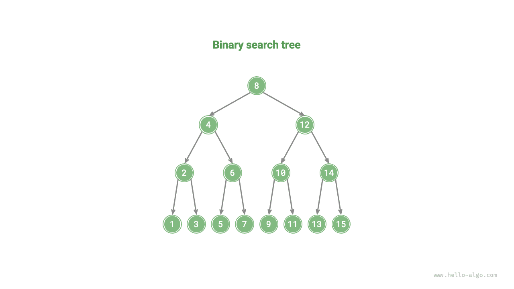
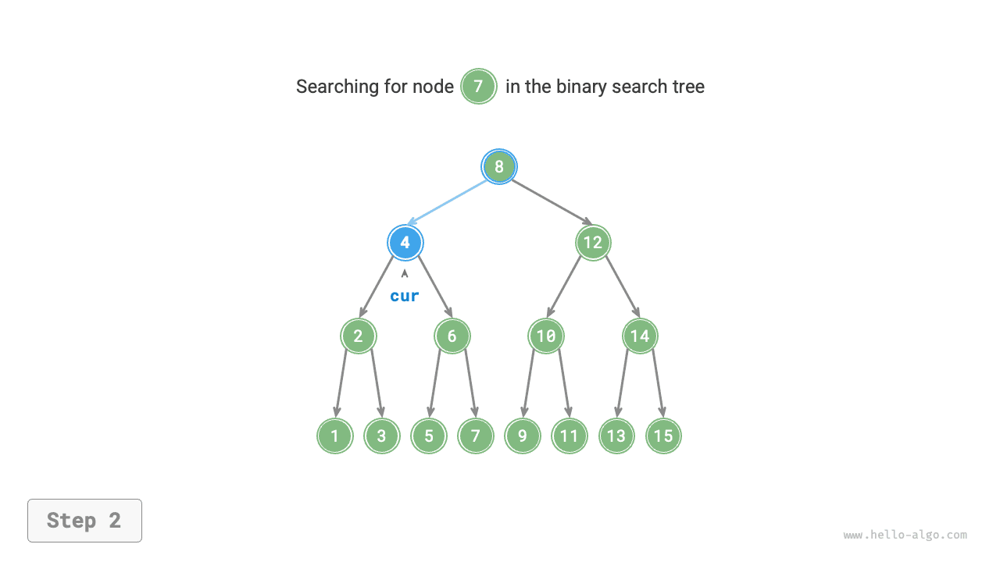
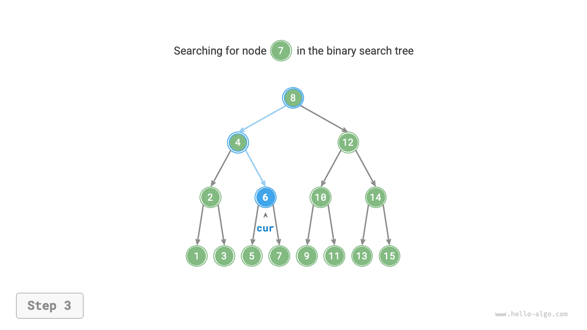
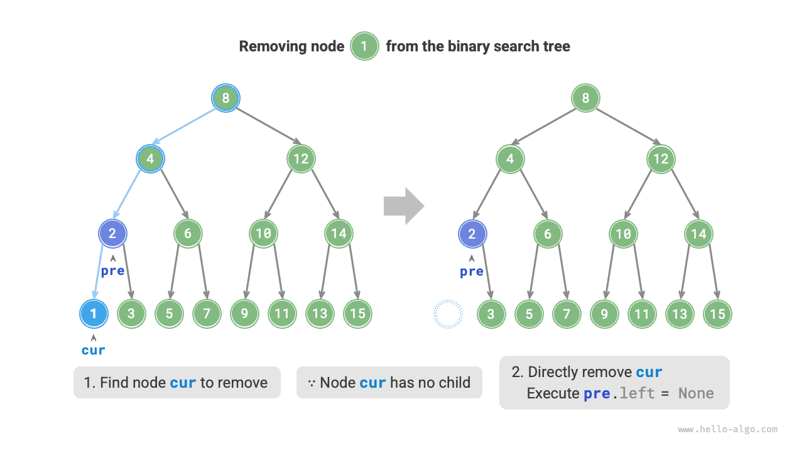
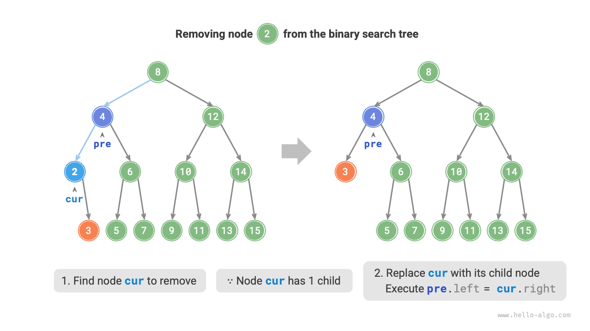
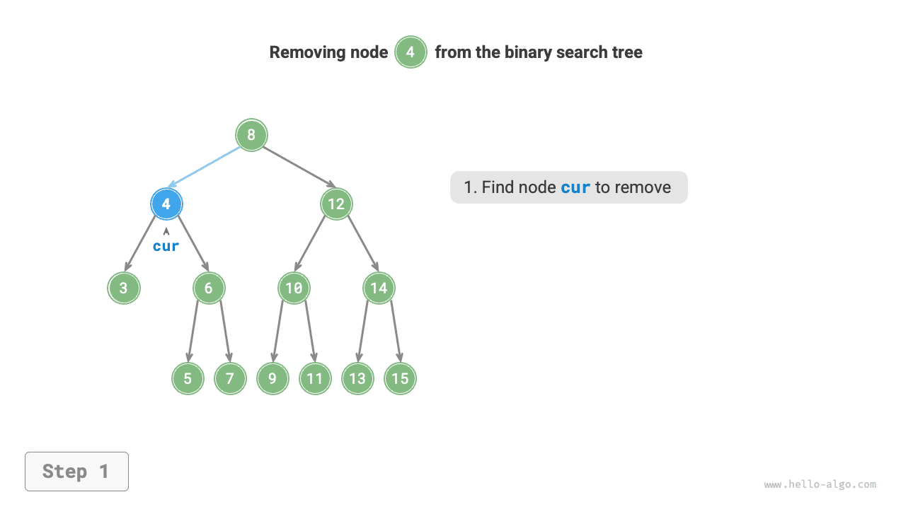
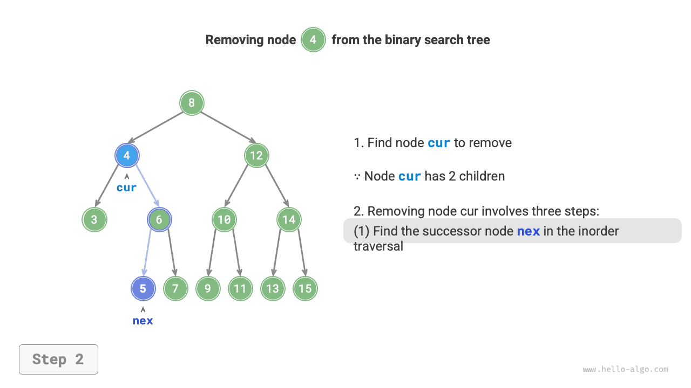
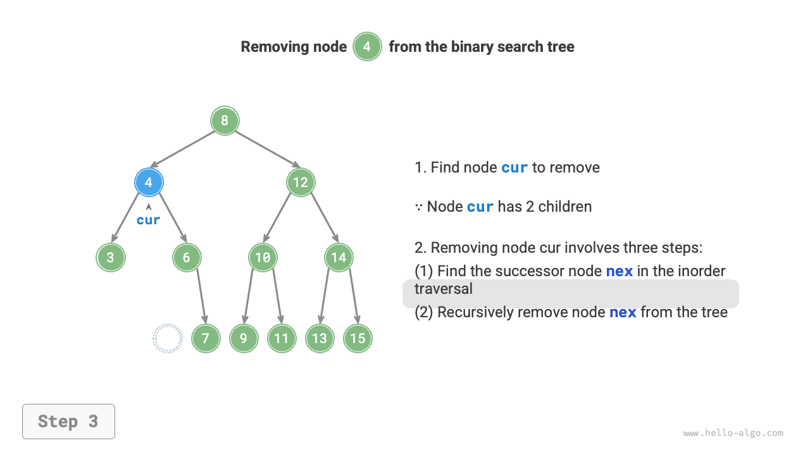
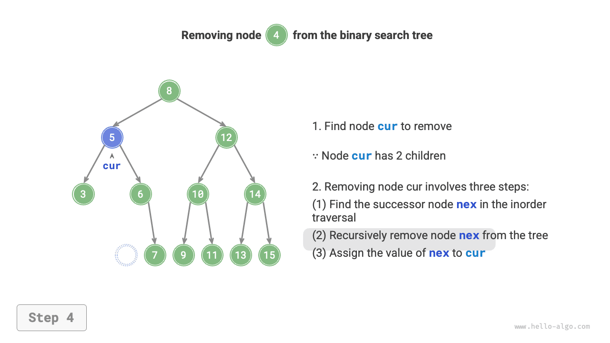

# Cây tìm kiếm nhị phân

Như trong hình bên dưới, một <u>cây tìm kiếm nhị phân</u> thỏa mãn các điều kiện sau.

1. Đối với nút gốc, giá trị của mọi nút trong cây con trái $<$ giá trị của nút gốc $<$ giá trị của mọi nút trong cây con phải.
2. Cây con trái và cây con phải của mọi nút cũng là cây tìm kiếm nhị phân, tức là cũng thỏa mãn điều kiện `1.`.



## Các thao tác trên cây tìm kiếm nhị phân

Chúng ta đóng gói cây tìm kiếm nhị phân thành một class `BinarySearchTree` và khai báo một biến thành viên `root` trỏ đến nút gốc của cây.

### Tìm kiếm một nút

Với giá trị nút cần tìm `num`, chúng ta có thể tìm kiếm dựa trên các tính chất của cây tìm kiếm nhị phân. Như trong hình bên dưới, chúng ta khai báo một nút `cur` và bắt đầu từ nút gốc `root` của cây tìm kiếm nhị phân, lặp lại để so sánh `cur.val` với `num`.

- Nếu `cur.val < num`, điều đó có nghĩa là nút cần tìm nằm trong cây con phải của `cur`, vì vậy thực hiện `cur = cur.right`.
- Nếu `cur.val > num`, điều đó có nghĩa là nút cần tìm nằm trong cây con trái của `cur`, vì vậy thực hiện `cur = cur.left`.
- Nếu `cur.val = num`, điều đó có nghĩa là đã tìm thấy nút cần tìm, thoát khỏi vòng lặp và trả về nút đó.

=== "<1>"
    

=== "<2>"
    

=== "<3>"
    

=== "<4>"
    

Thao tác tìm kiếm trong cây tìm kiếm nhị phân tuân theo cùng nguyên tắc với tìm kiếm nhị phân: mỗi vòng lặp loại bỏ một nửa số trường hợp còn lại. Số lần lặp tối đa bằng chiều cao của cây. Khi cây cân bằng, thao tác tìm kiếm mất thời gian $O(\log n)$. Mã ví dụ như sau:

```src
[file]{binary_search_tree}-[class]{binary_search_tree}-[func]{search}
```

### Chèn một nút

Với một phần tử `num` cần chèn, để duy trì tính chất “cây con trái < nút gốc < cây con phải” của cây tìm kiếm nhị phân, quá trình chèn được thực hiện như trong hình bên dưới.

1. **Tìm vị trí chèn**: Tương tự thao tác tìm kiếm, bắt đầu từ nút gốc và lặp xuống dưới để tìm kiếm dựa trên quan hệ kích thước giữa giá trị của nút hiện tại và `num`, cho đến khi đi qua nút lá (duyệt đến `None`) rồi thoát khỏi vòng lặp.
2. **Chèn nút vào vị trí đó**: Tạo một nút cho `num` và đặt nó vào vị trí `None`.


Trong phần triển khai mã, cần lưu ý hai điểm sau:

- Cây tìm kiếm nhị phân không cho phép các nút trùng lặp; nếu không, cây sẽ không còn thỏa mãn định nghĩa của nó. Vì vậy, nếu nút cần chèn đã tồn tại trong cây, thao tác chèn sẽ được bỏ qua và hàm trả về ngay.
- Để triển khai thao tác chèn nút, chúng ta cần sử dụng nút `pre` để lưu nút của lần lặp trước đó. Nhờ vậy, khi duyệt đến `None`, chúng ta có thể lấy được nút cha của nó và hoàn tất thao tác chèn nút.

```src
[file]{binary_search_tree}-[class]{binary_search_tree}-[func]{insert}
```

Tương tự như tìm kiếm một nút, thao tác chèn một nút mất thời gian $O(\log n)$.

### Xóa một nút

Trước tiên, tìm nút cần xóa trong cây tìm kiếm nhị phân, sau đó xóa nó. Tương tự như khi chèn nút, chúng ta cần đảm bảo rằng sau khi hoàn tất thao tác xóa, tính chất “cây con trái $<$ nút gốc $<$ cây con phải” của cây tìm kiếm nhị phân vẫn được duy trì. Vì vậy, dựa trên số lượng nút con của nút cần xóa, chúng ta xét ba trường hợp: bậc $0$, bậc $1$ và bậc $2$, rồi thực hiện thao tác xóa tương ứng.

Như trong hình bên dưới, khi nút cần xóa có bậc $0$, điều đó có nghĩa là nút đó là nút lá và có thể được xóa trực tiếp.



Như trong hình bên dưới, khi nút cần xóa có bậc $1$, chỉ cần thay thế nút cần xóa bằng nút con của nó.



Khi nút cần xóa có bậc $2$, chúng ta không thể xóa trực tiếp nút đó; thay vào đó, cần dùng một nút khác để thay thế. Để duy trì tính chất “cây con trái $<$ nút gốc $<$ cây con phải” của cây tìm kiếm nhị phân, **nút này có thể là nút nhỏ nhất trong cây con phải hoặc nút lớn nhất trong cây con trái**.

Giả sử chúng ta chọn nút nhỏ nhất trong cây con phải, tức là nút kế nhiệm trong phép duyệt inorder, quá trình xóa được thực hiện như trong hình bên dưới.

1. Tìm nút tiếp theo của nút cần xóa trong “chuỗi duyệt inorder”, ký hiệu là `tmp`.
2. Thay thế giá trị của nút cần xóa bằng giá trị của `tmp`, rồi đệ quy xóa nút `tmp` trong cây.

=== "<1>"
    

=== "<2>"
    

=== "<3>"
    

=== "<4>"
    

Thao tác xóa nút cũng mất thời gian $O(\log n)$, trong đó việc tìm nút cần xóa mất thời gian $O(\log n)$ và việc lấy nút kế nhiệm trong phép duyệt inorder mất thời gian $O(\log n)$. Mã ví dụ như sau:

```src
[file]{binary_search_tree}-[class]{binary_search_tree}-[func]{remove}
```

### Duyệt Inorder Có Thứ Tự

Như trong hình bên dưới, phép duyệt inorder của cây nhị phân tuân theo thứ tự “trái $\rightarrow$ gốc $\rightarrow$ phải”, trong khi cây tìm kiếm nhị phân thỏa mãn quan hệ kích thước “nút con trái $<$ nút gốc $<$ nút con phải”.

Điều này có nghĩa là khi thực hiện phép duyệt inorder trên cây tìm kiếm nhị phân, nút nhỏ tiếp theo luôn được duyệt trước, từ đó tạo nên một tính chất quan trọng: **chuỗi duyệt inorder của cây tìm kiếm nhị phân có thứ tự tăng dần**.

Nhờ tính chất tăng dần của phép duyệt inorder, chúng ta có thể lấy dữ liệu theo thứ tự trong cây tìm kiếm nhị phân chỉ trong thời gian $O(n)$ mà không cần thực hiện thêm thao tác sắp xếp nào, nên rất hiệu quả.


## Hiệu quả của cây tìm kiếm nhị phân

Với một tập dữ liệu, chúng ta cân nhắc việc sử dụng mảng hoặc cây tìm kiếm nhị phân để lưu trữ. Như trong bảng bên dưới, mọi thao tác trên cây tìm kiếm nhị phân đều có độ phức tạp thời gian logarit, mang lại hiệu suất ổn định và hiệu quả. Mảng chỉ hiệu quả hơn cây tìm kiếm nhị phân trong các trường hợp có tần suất thêm phần tử cao và tần suất tìm kiếm, xóa phần tử thấp.

<p align="center"> Bảng <id> &nbsp; So sánh hiệu quả giữa mảng và cây tìm kiếm </p>

|                | Mảng chưa sắp xếp | Cây tìm kiếm nhị phân |
| -------------- | -------------- | ------------------ |
| Tìm kiếm phần tử | $O(n)$         | $O(\log n)$        |
| Chèn phần tử | $O(1)$         | $O(\log n)$        |
| Xóa phần tử | $O(n)$         | $O(\log n)$        |

Trong trường hợp lý tưởng, cây tìm kiếm nhị phân được cân bằng, vì vậy có thể tìm thấy bất kỳ nút nào trong vòng $O(\log n)$ lần lặp.

Tuy nhiên, nếu liên tục chèn và xóa các nút trong cây tìm kiếm nhị phân, cây có thể suy biến thành một danh sách liên kết như trong hình bên dưới, khi đó độ phức tạp thời gian của các thao tác khác nhau cũng suy giảm xuống còn $O(n)$.


## Các ứng dụng phổ biến của cây tìm kiếm nhị phân

- Được sử dụng làm chỉ mục nhiều cấp trong các hệ thống để triển khai các thao tác tìm kiếm, chèn và xóa hiệu quả.
- Được dùng làm cấu trúc dữ liệu nền tảng cho một số thuật toán tìm kiếm.
- Được sử dụng để lưu trữ các luồng dữ liệu nhằm duy trì trạng thái có thứ tự của chúng.