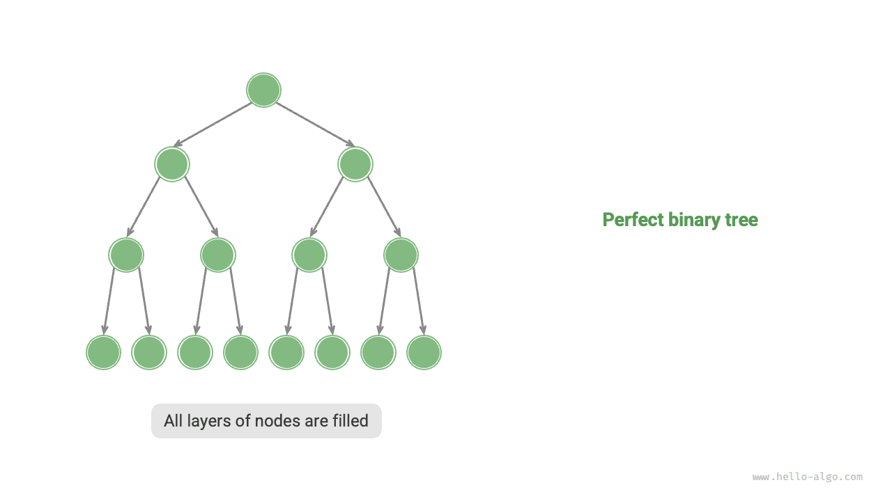

# Cây nhị phân

Một <u>cây nhị phân</u> là một cấu trúc dữ liệu phi tuyến mô hình hóa mối quan hệ phân cấp giữa "tổ tiên" và "hậu duệ", đồng thời thể hiện mô hình chia để trị, trong đó mỗi lần phân chia đều rẽ thành hai nhánh. Tương tự danh sách liên kết, đơn vị cơ bản của cây nhị phân là một node, và mỗi node chứa một giá trị, một tham chiếu đến node con bên trái và một tham chiếu đến node con bên phải.

=== "Python"

    ```python title=""
    class TreeNode:
        """Node cây nhị phân"""
        def __init__(self, val: int):
            self.val: int = val                # Giá trị của node
            self.left: TreeNode | None = None  # Tham chiếu đến node con bên trái
            self.right: TreeNode | None = None # Tham chiếu đến node con bên phải
    ```

=== "C++"

    ```cpp title=""
    /* Node cây nhị phân */
    struct TreeNode {
        int val;          // Giá trị của node
        TreeNode *left;   // Con trỏ đến node con bên trái
        TreeNode *right;  // Con trỏ đến node con bên phải
        TreeNode(int x) : val(x), left(nullptr), right(nullptr) {}
    };
    ```

=== "Java"

    ```java title=""
    /* Node cây nhị phân */
    class TreeNode {
        int val;         // Giá trị của node
        TreeNode left;   // Tham chiếu đến node con bên trái
        TreeNode right;  // Tham chiếu đến node con bên phải
        TreeNode(int x) { val = x; }
    }
    ```

=== "C#"

    ```csharp title=""
    /* Node cây nhị phân */
    class TreeNode(int? x) {
        public int? val = x;    // Giá trị của node
        public TreeNode? left;  // Tham chiếu đến node con bên trái
        public TreeNode? right; // Tham chiếu đến node con bên phải
    }
    ```

=== "Go"

    ```go title=""
    /* Node cây nhị phân */
    type TreeNode struct {
        Val   int
        Left  *TreeNode
        Right *TreeNode
    }
    /* Constructor */
    func NewTreeNode(v int) *TreeNode {
        return &TreeNode{
            Left:  nil, // Con trỏ đến node con bên trái
            Right: nil, // Con trỏ đến node con bên phải
            Val:   v,   // Giá trị của node
        }
    }
    ```

=== "Swift"

    ```swift title=""
    /* Node cây nhị phân */
    class TreeNode {
        var val: Int // Giá trị của node
        var left: TreeNode? // Tham chiếu đến node con bên trái
        var right: TreeNode? // Tham chiếu đến node con bên phải

        init(x: Int) {
            val = x
        }
    }
    ```

=== "JS"

    ```javascript title=""
    /* Node cây nhị phân */
    class TreeNode {
        val; // Giá trị của node
        left; // Con trỏ đến node con bên trái
        right; // Con trỏ đến node con bên phải
        constructor(val, left, right) {
            this.val = val === undefined ? 0 : val;
            this.left = left === undefined ? null : left;
            this.right = right === undefined ? null : right;
        }
    }
    ```

=== "TS"

    ```typescript title=""
    /* Node cây nhị phân */
    class TreeNode {
        val: number;
        left: TreeNode | null;
        right: TreeNode | null;

        constructor(val?: number, left?: TreeNode | null, right?: TreeNode | null) {
            this.val = val === undefined ? 0 : val; // Giá trị của node
            this.left = left === undefined ? null : left; // Tham chiếu đến node con bên trái
            this.right = right === undefined ? null : right; // Tham chiếu đến node con bên phải
        }
    }
    ```

=== "Dart"

    ```dart title=""
    /* Node cây nhị phân */
    class TreeNode {
      int val;         // Giá trị của node
      TreeNode? left;  // Tham chiếu đến node con bên trái
      TreeNode? right; // Tham chiếu đến node con bên phải
      TreeNode(this.val, [this.left, this.right]);
    }
    ```

=== "Rust"

    ```rust title=""
    use std::rc::Rc;
    use std::cell::RefCell;

    /* Node cây nhị phân */
    struct TreeNode {
        val: i32,                               // Giá trị của node
        left: Option<Rc<RefCell<TreeNode>>>,    // Tham chiếu đến node con bên trái
        right: Option<Rc<RefCell<TreeNode>>>,   // Tham chiếu đến node con bên phải
    }

    impl TreeNode {
        /* Constructor */
        fn new(val: i32) -> Rc<RefCell<Self>> {
            Rc::new(RefCell::new(Self {
                val,
                left: None,
                right: None
            }))
        }
    }
    ```

=== "C"

    ```c title=""
    /* Node cây nhị phân */
    typedef struct TreeNode {
        int val;                // Giá trị của node
        int height;             // Chiều cao của node
        struct TreeNode *left;  // Con trỏ đến node con bên trái
        struct TreeNode *right; // Con trỏ đến node con bên phải
    } TreeNode;

    /* Constructor */
    TreeNode *newTreeNode(int val) {
        TreeNode *node;

        node = (TreeNode *)malloc(sizeof(TreeNode));
        node->val = val;
        node->height = 0;
        node->left = NULL;
        node->right = NULL;
        return node;
    }
    ```

=== "Kotlin"

    ```kotlin title=""
    /* Node cây nhị phân */
    class TreeNode(val _val: Int) {  // Giá trị của node
        var left: TreeNode? = null   // Tham chiếu đến node con bên trái
        var right: TreeNode? = null  // Tham chiếu đến node con bên phải
    }
    ```

=== "Ruby"

    ```ruby title=""
    ### Lớp node cây nhị phân ###
    class TreeNode
      attr_accessor :val    # Giá trị của node
      attr_accessor :left   # Tham chiếu đến node con bên trái
      attr_accessor :right  # Tham chiếu đến node con bên phải

      def initialize(val)
        @val = val
      end
    end
    ```

Mỗi node có hai tham chiếu (con trỏ), lần lượt trỏ đến <u>node con bên trái</u> và <u>node con bên phải</u>. Node này được gọi là <u>node cha</u> của hai node con đó. Khi cho một node của cây nhị phân, ta gọi cây được tạo bởi node con bên trái của node này và tất cả các node bên dưới nó là <u>cây con bên trái</u> của node này. Tương tự, ta có thể định nghĩa <u>cây con bên phải</u>.

**Trong một cây nhị phân, mọi node không phải node lá đều có các node con, do đó có các cây con không rỗng.** Như minh họa trong hình dưới đây, nếu xem "Node 2" là một node cha, thì các node con bên trái và bên phải của nó lần lượt là "Node 4" và "Node 5". Cây con bên trái được tạo bởi "Node 4" và tất cả các node bên dưới nó, trong khi cây con bên phải được tạo bởi "Node 5" và tất cả các node bên dưới nó.


## Thuật ngữ thường dùng trong cây nhị phân

Các thuật ngữ thường dùng trong cây nhị phân được minh họa trong hình dưới đây.

- <u>Node gốc</u>: Node ở cấp cao nhất của cây nhị phân, không có node cha.
- <u>Node lá</u>: Node không có node con nào, cả hai con trỏ đều trỏ đến `None`.
- <u>Cạnh</u>: Đoạn thẳng nối hai node, biểu thị một tham chiếu (con trỏ) giữa các node.
- <u>Cấp</u> của một node: Tăng dần từ trên xuống dưới, với node gốc ở cấp 1.
- <u>Bậc</u> của một node: Số node con mà một node có. Trong cây nhị phân, bậc có thể là 0, 1 hoặc 2.
- <u>Chiều cao</u> của cây nhị phân: Số cạnh từ node gốc đến node lá xa nhất.
- <u>Độ sâu</u> của một node: Số cạnh từ node gốc đến node đó.
- <u>Chiều cao</u> của một node: Số cạnh từ node lá xa nhất đến node đó.


!!! tip

    Thông thường, ta định nghĩa "chiều cao" và "độ sâu" là số cạnh đã duyệt qua, nhưng một số giáo trình và đề bài định nghĩa chúng là số node trên đường đi. Trong trường hợp đó, cả hai giá trị đều lớn hơn 1.

## Các thao tác cơ bản trên cây nhị phân

### Khởi tạo cây nhị phân

Tương tự danh sách liên kết, việc khởi tạo cây nhị phân trước tiên bao gồm tạo các node, sau đó thiết lập các tham chiếu (con trỏ) giữa chúng.

=== "Python"

    ```python title="binary_tree.py"
    # Khởi tạo cây nhị phân
    # Khởi tạo các node
    n1 = TreeNode(val=1)
    n2 = TreeNode(val=2)
    n3 = TreeNode(val=3)
    n4 = TreeNode(val=4)
    n5 = TreeNode(val=5)
    # Liên kết các tham chiếu (con trỏ) giữa các node
    n1.left = n2
    n1.right = n3
    n2.left = n4
    n2.right = n5
    ```

=== "C++"

    ```cpp title="binary_tree.cpp"
    /* Khởi tạo cây nhị phân */
    // Khởi tạo các node
    TreeNode* n1 = new TreeNode(1);
    TreeNode* n2 = new TreeNode(2);
    TreeNode* n3 = new TreeNode(3);
    TreeNode* n4 = new TreeNode(4);
    TreeNode* n5 = new TreeNode(5);
    // Liên kết các tham chiếu (con trỏ) giữa các node
    n1->left = n2;
    n1->right = n3;
    n2->left = n4;
    n2->right = n5;
    ```

=== "Java"

    ```java title="binary_tree.java"
    // Khởi tạo các node
    TreeNode n1 = new TreeNode(1);
    TreeNode n2 = new TreeNode(2);
    TreeNode n3 = new TreeNode(3);
    TreeNode n4 = new TreeNode(4);
    TreeNode n5 = new TreeNode(5);
    // Liên kết các tham chiếu (con trỏ) giữa các node
    n1.left = n2;
    n1.right = n3;
    n2.left = n4;
    n2.right = n5;
    ```

=== "C#"

    ```csharp title="binary_tree.cs"
    /* Khởi tạo cây nhị phân */
    // Khởi tạo các node
    TreeNode n1 = new(1);
    TreeNode n2 = new(2);
    TreeNode n3 = new(3);
    TreeNode n4 = new(4);
    TreeNode n5 = new(5);
    // Liên kết các tham chiếu (con trỏ) giữa các node
    n1.left = n2;
    n1.right = n3;
    n2.left = n4;
    n2.right = n5;
    ```

=== "Go"

    ```go title="binary_tree.go"
    /* Khởi tạo cây nhị phân */
    // Khởi tạo các node
    n1 := NewTreeNode(1)
    n2 := NewTreeNode(2)
    n3 := NewTreeNode(3)
    n4 := NewTreeNode(4)
    n5 := NewTreeNode(5)
    // Liên kết các tham chiếu (con trỏ) giữa các node
    n1.Left = n2
    n1.Right = n3
    n2.Left = n4
    n2.Right = n5
    ```

=== "Swift"

    ```swift title="binary_tree.swift"
    // Khởi tạo các node
    let n1 = TreeNode(x: 1)
    let n2 = TreeNode(x: 2)
    let n3 = TreeNode(x: 3)
    let n4 = TreeNode(x: 4)
    let n5 = TreeNode(x: 5)
    // Liên kết các tham chiếu (con trỏ) giữa các node
    n1.left = n2
    n1.right = n3
    n2.left = n4
    n2.right = n5
    ```

=== "JS"

    ```javascript title="binary_tree.js"
    /* Khởi tạo cây nhị phân */
    // Khởi tạo các node
    let n1 = new TreeNode(1),
        n2 = new TreeNode(2),
        n3 = new TreeNode(3),
        n4 = new TreeNode(4),
        n5 = new TreeNode(5);
    // Liên kết các tham chiếu (con trỏ) giữa các node
    n1.left = n2;
    n1.right = n3;
    n2.left = n4;
    n2.right = n5;
    ```

=== "TS"

    ```typescript title="binary_tree.ts"
    /* Khởi tạo cây nhị phân */
    // Khởi tạo các node
    let n1 = new TreeNode(1),
        n2 = new TreeNode(2),
        n3 = new TreeNode(3),
        n4 = new TreeNode(4),
        n5 = new TreeNode(5);
    // Liên kết các tham chiếu (con trỏ) giữa các node
    n1.left = n2;
    n1.right = n3;
    n2.left = n4;
    n2.right = n5;
    ```

=== "Dart"

    ```dart title="binary_tree.dart"
    /* Khởi tạo cây nhị phân */
    // Khởi tạo các node
    TreeNode n1 = new TreeNode(1);
    TreeNode n2 = new TreeNode(2);
    TreeNode n3 = new TreeNode(3);
    TreeNode n4 = new TreeNode(4);
    TreeNode n5 = new TreeNode(5);
    // Liên kết các tham chiếu (con trỏ) giữa các node
    n1.left = n2;
    n1.right = n3;
    n2.left = n4;
    n2.right = n5;
    ```

=== "Rust"

    ```rust title="binary_tree.rs"
    // Khởi tạo các node
    let n1 = TreeNode::new(1);
    let n2 = TreeNode::new(2);
    let n3 = TreeNode::new(3);
    let n4 = TreeNode::new(4);
    let n5 = TreeNode::new(5);
    // Liên kết các tham chiếu (con trỏ) giữa các node
    n1.borrow_mut().left = Some(n2.clone());
    n1.borrow_mut().right = Some(n3);
    n2.borrow_mut().left = Some(n4);
    n2.borrow_mut().right = Some(n5);
    ```

=== "C"

    ```c title="binary_tree.c"
    /* Khởi tạo cây nhị phân */
    // Khởi tạo các node
    TreeNode *n1 = newTreeNode(1);
    TreeNode *n2 = newTreeNode(2);
    TreeNode *n3 = newTreeNode(3);
    TreeNode *n4 = newTreeNode(4);
    TreeNode *n5 = newTreeNode(5);
    // Liên kết các tham chiếu (con trỏ) giữa các node
    n1->left = n2;
    n1->right = n3;
    n2->left = n4;
    n2->right = n5;
    ```

=== "Kotlin"

    ```kotlin title="binary_tree.kt"
    // Khởi tạo các node
    val n1 = TreeNode(1)
    val n2 = TreeNode(2)
    val n3 = TreeNode(3)
    val n4 = TreeNode(4)
    val n5 = TreeNode(5)
    // Liên kết các tham chiếu (con trỏ) giữa các node
    n1.left = n2
    n1.right = n3
    n2.left = n4
    n2.right = n5
    ```

=== "Ruby"

    ```ruby title="binary_tree.rb"
    # Khởi tạo cây nhị phân
    # Khởi tạo các node
    n1 = TreeNode.new(1)
    n2 = TreeNode.new(2)
    n3 = TreeNode.new(3)
    n4 = TreeNode.new(4)
    n5 = TreeNode.new(5)
    # Liên kết các tham chiếu (con trỏ) giữa các node
    n1.left = n2
    n1.right = n3
    n2.left = n4
    n2.right = n5
    ```

??? pythontutor "Trực quan hóa mã"

    https://pythontutor.com/render.html#code=class%20TreeNode%3A%0A%20%20%20%20%22%22%22%E4%BA%8C%E5%8F%89%E6%A0%91%E8%8A%82%E7%82%B9%E7%B1%BB%22%22%22%0A%20%20%20%20def%20__init__%28self,%20val%3A%20int%29%3A%0A%20%20%20%20%20%20%20%20self.val%3A%20int%20%3D%20val%20%20%20%20%20%20%20%20%20%20%20%20%20%20%20%20%23%20%E8%8A%82%E7%82%B9%E5%80%BC%0A%20%20%20%20%20%20%20%20self.left%3A%20TreeNode%20%7C%20None%20%3D%20None%20%20%23%20%E5%B7%A6%E5%AD%90%E8%8A%82%E7%82%B9%E5%BC%95%E7%94%A8%0A%20%20%20%20%20%20%20%20self.right%3A%20TreeNode%20%7C%20None%20%3D%20None%20%23%20%E5%8F%B3%E5%AD%90%E8%8A%82%E7%82%B9%E5%BC%95%E7%94%A8%0A%0A%22%22%22Driver%20Code%22%22%22%0Aif%20__name__%20%3D%3D%20%22__main__%22%3A%0A%20%20%20%20%23%20%E5%88%9D%E5%A7%8B%E5%8C%96%E4%BA%8C%E5%8F%89%E6%A0%91%0A%20%20%20%20%23%20%E5%88%9D%E5%A7%8B%E5%8C%96%E8%8A%82%E7%82%B9%0A%20%20%20%20n1%20%3D%20TreeNode%28val%3D1%29%0A%20%20%20%20n2%20%3D%20TreeNode%28val%3D2%29%0A%20%20%20%20n3%20%3D%20TreeNode%28val%3D3%29%0A%20%20%20%20n4%20%3D%20TreeNode%28val%3D4%29%0A%20%20%20%20n5%20%3D%20TreeNode%28val%3D5%29%0A%20%20%20%20%23%20%E6%9E%84%E5%BB%BA%E8%8A%82%E7%82%B9%E4%B9%8B%E9%97%B4%E7%9A%84%E5%BC%95%E7%94%A8%EF%BC%88%E6%8C%87%E9%92%88%EF%BC%89%0A%20%20%20%20n1.left%20%3D%20n2%0A%20%20%20%20n1.right%20%3D%20n3%0A%20%20%20%20n2.left%20%3D%20n4%0A%20%20%20%20n2.right%20%3D%20n5&cumulative=false&curInstr=3&heapPrimitives=nevernest&mode=display&origin=opt-frontend.js&py=311&rawInputLstJSON=%5B%5D&textReferences=false

### Chèn và xóa node

Tương tự như linked list, có thể chèn và xóa các node trong cây nhị phân bằng cách sửa đổi các con trỏ. Hình bên dưới minh họa một ví dụ.


=== "Python"

    ```python title="binary_tree.py"
    # Chèn và xóa node
    p = TreeNode(0)
    # Chèn node P vào giữa n1 -> n2
    n1.left = p
    p.left = n2
    # Xóa node P
    n1.left = n2
    ```

=== "C++"

    ```cpp title="binary_tree.cpp"
    /* Chèn và xóa node */
    TreeNode* P = new TreeNode(0);
    // Chèn node P vào giữa n1 và n2
    n1->left = P;
    P->left = n2;
    // Xóa node P
    n1->left = n2;
    ```

=== "Java"

    ```java title="binary_tree.java"
    TreeNode P = new TreeNode(0);
    // Chèn node P vào giữa n1 và n2
    n1.left = P;
    P.left = n2;
    // Xóa node P
    n1.left = n2;
    ```

=== "C#"

    ```csharp title="binary_tree.cs"
    /* Chèn và xóa node */
    TreeNode P = new(0);
    // Chèn node P vào giữa n1 và n2
    n1.left = P;
    P.left = n2;
    // Xóa node P
    n1.left = n2;
    ```

=== "Go"

    ```go title="binary_tree.go"
    /* Chèn và xóa node */
    // Chèn node P vào giữa n1 và n2
    p := NewTreeNode(0)
    n1.Left = p
    p.Left = n2
    // Xóa node P
    n1.Left = n2
    ```

=== "Swift"

    ```swift title="binary_tree.swift"
    let P = TreeNode(x: 0)
    // Chèn node P vào giữa n1 và n2
    n1.left = P
    P.left = n2
    // Xóa node P
    n1.left = n2
    ```

=== "JS"

    ```javascript title="binary_tree.js"
    /* Chèn và xóa node */
    let P = new TreeNode(0);
    // Chèn node P vào giữa n1 và n2
    n1.left = P;
    P.left = n2;
    // Xóa node P
    n1.left = n2;
    ```

=== "TS"

    ```typescript title="binary_tree.ts"
    /* Chèn và xóa node */
    const P = new TreeNode(0);
    // Chèn node P vào giữa n1 và n2
    n1.left = P;
    P.left = n2;
    // Xóa node P
    n1.left = n2;
    ```

=== "Dart"

    ```dart title="binary_tree.dart"
    /* Chèn và xóa node */
    TreeNode P = new TreeNode(0);
    // Chèn node P vào giữa n1 và n2
    n1.left = P;
    P.left = n2;
    // Xóa node P
    n1.left = n2;
    ```

=== "Rust"

    ```rust title="binary_tree.rs"
    let p = TreeNode::new(0);
    // Chèn node P vào giữa n1 và n2
    n1.borrow_mut().left = Some(p.clone());
    p.borrow_mut().left = Some(n2.clone());
    // Xóa node P
    n1.borrow_mut().left = Some(n2);
    ```

=== "C"

    ```c title="binary_tree.c"
    /* Chèn và xóa node */
    TreeNode *P = newTreeNode(0);
    // Chèn node P vào giữa n1 và n2
    n1->left = P;
    P->left = n2;
    // Xóa node P
    n1->left = n2;
    ```

=== "Kotlin"

    ```kotlin title="binary_tree.kt"
    val P = TreeNode(0)
    // Chèn node P vào giữa n1 và n2
    n1.left = P
    P.left = n2
    // Xóa node P
    n1.left = n2
    ```

=== "Ruby"

    ```ruby title="binary_tree.rb"
    # Chèn và xóa node
    _p = TreeNode.new(0)
    # Chèn node _p vào giữa n1 và n2
    n1.left = _p
    _p.left = n2
    # Xóa node _p
    n1.left = n2
    ```

??? pythontutor "Trực quan hóa mã"

    https://pythontutor.com/render.html#code=class%20TreeNode%3A%0A%20%20%20%20%22%22%22%E4%BA%8C%E5%8F%89%E6%A0%91%E8%8A%82%E7%82%B9%E7%B1%BB%22%22%22%0A%20%20%20%20def%20__init__%28self,%20val%3A%20int%29%3A%0A%20%20%20%20%20%20%20%20self.val%3A%20int%20%3D%20val%20%20%20%20%20%20%20%20%20%20%20%20%20%20%20%20%23%20%E8%8A%82%E7%82%B9%E5%80%BC%0A%20%20%20%20%20%20%20%20self.left%3A%20TreeNode%20%7C%20None%20%3D%20None%20%20%23%20%E5%B7%A6%E5%AD%90%E8%8A%82%E7%82%B9%E5%BC%95%E7%94%A8%0A%20%20%20%20%20%20%20%20self.right%3A%20TreeNode%20%7C%20None%20%3D%20None%20%23%20%E5%8F%B3%E5%AD%90%E8%8A%82%E7%82%B9%E5%BC%95%E7%94%A8%0A%0A%22%22%22Driver%20Code%22%22%22%0Aif%20__name__%20%3D%3D%20%22__main__%22%3A%0A%20%20%20%20%23%20%E5%88%9D%E5%A7%8B%E5%8C%96%E4%BA%8C%E5%8F%89%E6%A0%91%0A%20%20%20%20%23%20%E5%88%9D%E5%A7%8B%E5%8C%96%E8%8A%82%E7%82%B9%0A%20%20%20%20n1%20%3D%20TreeNode%28val%3D1%29%0A%20%20%20%20n2%20%3D%20TreeNode%28val%3D2%29%0A%20%20%20%20n3%20%3D%20TreeNode%28val%3D3%29%0A%20%20%20%20n4%20%3D%20TreeNode%28val%3D4%29%0A%20%20%20%20n5%20%3D%20TreeNode%28val%3D5%29%0A%20%20%20%20%23%20%E6%9E%84%E5%BB%BA%E8%8A%82%E7%82%B9%E4%B9%8B%E9%97%B4%E7%9A%84%E5%BC%95%E7%94%A8%EF%BC%88%E6%8C%87%E9%92%88%EF%BC%89%0A%20%20%20%20n1.left%20%3D%20n2%0A%20%20%20%20n1.right%20%3D%20n3%0A%20%20%20%20n2.left%20%3D%20n4%0A%20%20%20%20n2.right%20%3D%20n5%0A%0A%20%20%20%20%23%20%E6%8F%92%E5%85%A5%E4%B8%8E%E5%88%A0%E9%99%A4%E8%8A%82%E7%82%B9%0A%20%20%20%20p%20%3D%20TreeNode%280%29%0A%20%20%20%20%23%20%E5%9C%A8%20n1%20-%3E%20n2%20%E4%B8%AD%E9%97%B4%E6%8F%92%E5%85%A5%E8%8A%82%E7%82%B9%20P%0A%20%20%20%20n1.left%20%3D%20p%0A%20%20%20%20p.left%20%3D%20n2%0A%20%20%20%20%23%20%E5%88%A0%E9%99%A4%E8%8A%82%E7%82%B9%20P%0A%20%20%20%20n1.left%20%3D%20n2&cumulative=false&curInstr=37&heapPrimitives=nevernest&mode=display&origin=opt-frontend.js&py=311&rawInputLstJSON=%5B%5D&textReferences=false

!!! tip

    Hãy lưu ý rằng việc chèn một node có thể làm thay đổi cấu trúc logic ban đầu của cây nhị phân, trong khi việc xóa một node thường bao hàm việc xóa node đó cùng với toàn bộ cây con của nó. Vì vậy, trên thực tế, thao tác chèn và xóa trong cây nhị phân thường được triển khai dưới dạng các chuỗi thao tác phối hợp để đạt được kết quả có ý nghĩa.

## Các loại cây nhị phân phổ biến

### Cây nhị phân hoàn hảo

Như hình bên dưới minh họa, một <u>cây nhị phân hoàn hảo</u> có mọi cấp được lấp đầy hoàn toàn. Trong cây nhị phân hoàn hảo, các node lá có bậc bằng $0$, trong khi tất cả các node khác có bậc bằng $2$. Nếu chiều cao của cây là $h$, tổng số node là $2^{h+1} - 1$, tuân theo một dạng hàm mũ tiêu chuẩn tương tự hiện tượng phân chia tế bào phổ biến trong tự nhiên.

!!! tip

    Xin lưu ý rằng trong cộng đồng Trung Quốc, cây nhị phân hoàn hảo thường được gọi là <u>cây nhị phân đầy đủ</u>.



### Cây nhị phân đầy đủ theo cấp

Như hình bên dưới minh họa, một <u>cây nhị phân đầy đủ theo cấp</u> chỉ cho phép cấp cuối cùng được lấp đầy không hoàn toàn, và các node ở cấp cuối phải được lấp đầy liên tục từ trái sang phải. Lưu ý rằng cây nhị phân hoàn hảo cũng là một cây nhị phân đầy đủ theo cấp.


### Cây nhị phân đầy đủ

Như hình bên dưới minh họa, trong một <u>cây nhị phân đầy đủ</u>, tất cả các node ngoại trừ node lá đều có hai node con.


### Cây nhị phân cân bằng

Như hình bên dưới minh họa, trong một <u>cây nhị phân cân bằng</u>, độ chênh lệch tuyệt đối giữa chiều cao của cây con trái và cây con phải của bất kỳ node nào không vượt quá 1.


## Sự suy biến của cây nhị phân

Hình dưới đây đối chiếu cấu trúc lý tưởng và cấu trúc suy biến của cây nhị phân. Khi mọi mức đều được lấp đầy, cây trở thành một “cây nhị phân hoàn hảo”; khi tất cả các nút lệch về một phía, cây nhị phân suy biến thành một “danh sách liên kết”.

- Cây nhị phân hoàn hảo là trường hợp lý tưởng, tận dụng tối đa các ưu điểm của phương pháp chia để trị trong cây nhị phân.
- Danh sách liên kết đại diện cho thái cực ngược lại, trong đó mọi thao tác đều trở thành thao tác tuyến tính với độ phức tạp thời gian suy giảm xuống $O(n)$.


Như được minh họa trong bảng dưới đây, với cấu trúc tốt nhất và tệ nhất, cây nhị phân lần lượt đạt giá trị lớn nhất hoặc nhỏ nhất về số lượng nút lá, tổng số nút và chiều cao.

<p align="center"> Bảng <id> &nbsp; Cấu trúc tốt nhất và tệ nhất của cây nhị phân </p>

|                                                 | Cây nhị phân hoàn hảo | Danh sách liên kết |
| ----------------------------------------------- | --------------------- | ------------------ |
| Số lượng nút ở mức $i$                           | $2^{i-1}$           | $1$         |
| Số lượng nút lá trong cây có chiều cao $h$       | $2^h$               | $1$         |
| Tổng số nút trong cây có chiều cao $h$           | $2^{h+1} - 1$       | $h + 1$     |
| Chiều cao của cây có tổng cộng $n$ nút           | $\log_2 (n+1) - 1$  | $n - 1$     |