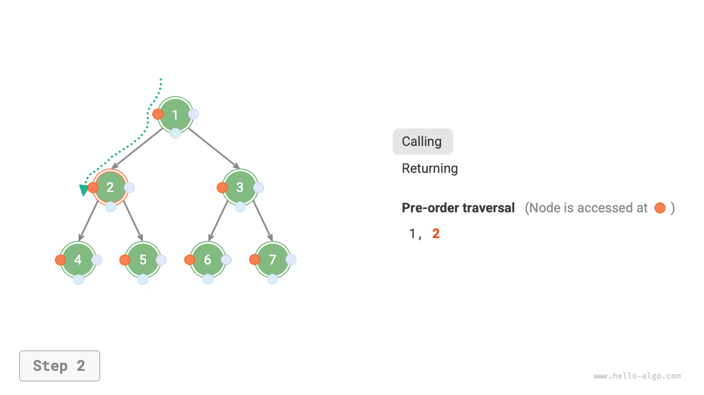
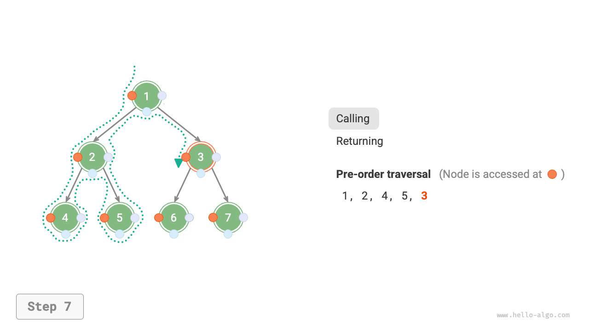
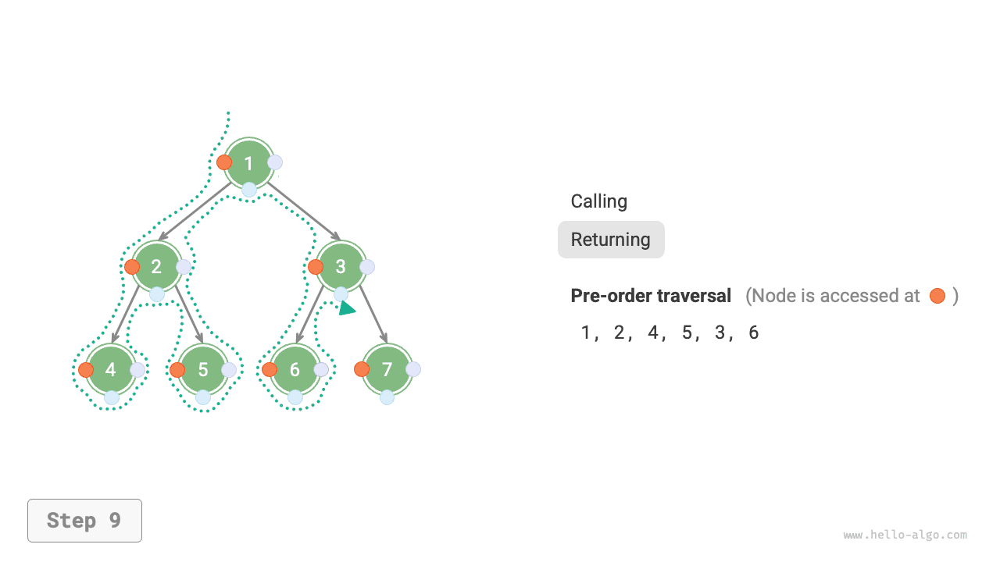

# Duyệt cây nhị phân

Xét về cấu trúc vật lý, cây là một cấu trúc dữ liệu dựa trên danh sách liên kết. Do đó, phương thức duyệt cây bao gồm việc truy cập từng nút thông qua các con trỏ. Tuy nhiên, cây là một cấu trúc dữ liệu phi tuyến, khiến việc duyệt cây phức tạp hơn so với duyệt danh sách liên kết và cần đến sự hỗ trợ của các thuật toán tìm kiếm.

Các phương thức duyệt cây nhị phân phổ biến gồm duyệt theo thứ tự mức, duyệt tiền thứ tự, duyệt trung thứ tự và duyệt hậu thứ tự.

## Duyệt theo thứ tự mức

Như trong hình bên dưới, <u>duyệt theo thứ tự mức</u> duyệt cây nhị phân từ trên xuống dưới, theo từng tầng. Trong mỗi tầng, các nút được thăm từ trái sang phải.

Duyệt theo thứ tự mức về bản chất là <u>duyệt theo chiều rộng</u>, còn được gọi là <u>tìm kiếm theo chiều rộng (BFS)</u>, tiến ra ngoài theo từng tầng.


### Cài đặt bằng mã

Duyệt theo chiều rộng thường được triển khai với sự trợ giúp của một "queue". Queue tuân theo quy tắc "vào trước, ra trước", trong khi duyệt theo chiều rộng tuân theo quy tắc "tiến triển theo từng tầng"; ý tưởng nền tảng của hai khái niệm này là nhất quán. Mã triển khai như sau:

```src
[file]{binary_tree_bfs}-[class]{}-[func]{level_order}
```

### Phân tích độ phức tạp

- **Độ phức tạp thời gian là $O(n)$**: Tất cả các nút được thăm đúng một lần, sử dụng $O(n)$ thời gian, trong đó $n$ là số lượng nút.
- **Độ phức tạp không gian là $O(n)$**: Trong trường hợp xấu nhất, tức là một cây nhị phân đầy đủ, trước khi duyệt đến tầng dưới cùng, queue chứa đồng thời nhiều nhất $(n + 1) / 2$ nút, chiếm $O(n)$ không gian.

## Duyệt tiền thứ tự, trung thứ tự và hậu thứ tự

Tương ứng, duyệt tiền thứ tự, trung thứ tự và hậu thứ tự đều thuộc <u>duyệt theo chiều sâu</u>, còn được gọi là <u>tìm kiếm theo chiều sâu (DFS)</u>, đi sâu nhất có thể trước khi quay lui.

Hình bên dưới cho thấy cách duyệt theo chiều sâu hoạt động trên một cây nhị phân. **Duyệt theo chiều sâu giống như "đi bộ" quanh chu vi của toàn bộ cây nhị phân**, gặp ba vị trí tại mỗi nút, tương ứng với duyệt tiền thứ tự, trung thứ tự và hậu thứ tự.


### Cài đặt bằng mã

Tìm kiếm theo chiều sâu thường được triển khai dựa trên đệ quy:

```src
[file]{binary_tree_dfs}-[class]{}-[func]{post_order}
```

!!! tip

    Tìm kiếm theo chiều sâu cũng có thể được triển khai theo cách lặp, và bạn đọc quan tâm có thể tự tìm hiểu thêm.

Hình bên dưới cho thấy quá trình đệ quy của phép duyệt tiền thứ tự trên một cây nhị phân, có thể được chia thành hai giai đoạn đối lập: "đi xuống" và "quay về".

1. "Đi xuống" nghĩa là thực hiện một lời gọi đệ quy mới, trong đó chương trình thăm nút tiếp theo.
2. "Quay về" nghĩa là lời gọi hàm trả về, cho biết nút hiện tại đã được xử lý hoàn toàn.

=== "<1>"
    

=== "<2>"
    

=== "<3>"
    

=== "<4>"
    

=== "<5>"
    

=== "<6>"
    

=== "<7>"
    

=== "<8>"
    

=== "<9>"
    

=== "<10>"
    

=== "<11>"
    

### Phân tích độ phức tạp

- **Độ phức tạp thời gian là $O(n)$**: Tất cả các nút được thăm đúng một lần, sử dụng $O(n)$ thời gian.
- **Độ phức tạp không gian là $O(n)$**: Trong trường hợp xấu nhất, tức là cây suy biến thành một danh sách liên kết, độ sâu đệ quy đạt đến $n$ và hệ thống sử dụng $O(n)$ không gian cho các stack frame.